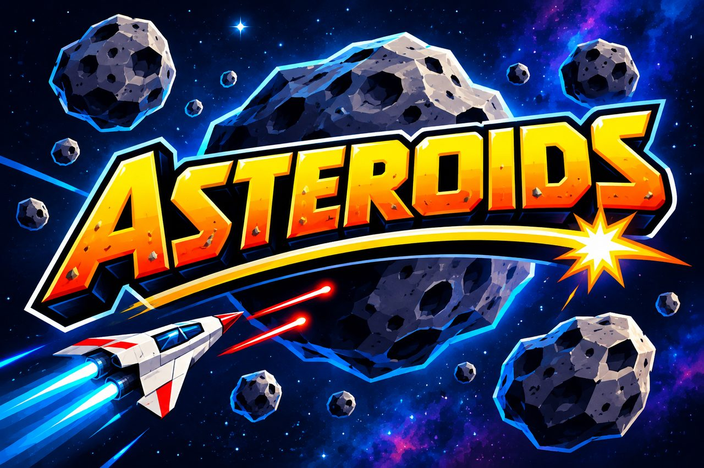

# Tutorial: Next Steps -- Lit 3D Models and a Chase Camera

This is the last tutorial in the Asteroids series. So far everything has been drawn as flat line art. In this step the game gets real depth: **lit 3D rocks** generated in code, the **ship and both UFOs as 3D models** loaded from files, a **choice of two ships** on the title screen, and an optional **chase camera** that follows the ship from behind. You write the code; this document tells you what to write and why.

By the end you'll have:

- A reusable **model loader** that centers and sizes any `.glb` file to fit the game
- **Procedural 3D rocks**: a faceted, lit mesh for every rock, shaped from the outline each rock already had
- A **rocket** for the ship, with a glowing exhaust cone, and **two flying saucers** for the big and small UFOs
- A **ship picker** on the title screen: choose the rocket or a fighter, and the ship you pick is the one you fly
- **Lights**, so the 3D shapes have a bright side and a dark side
- A **chase camera** on **V**: swap the overhead view for one behind the ship, which swings around as you turn
- A **splash screen** that covers the page while the models load, shown for at least three seconds, and a helpful message if the models can't be loaded
- Unit tests for all of it, and the game itself checked end to end

**What you'll learn:** loading `.glb` (glTF) files with `SceneLoader`, parent nodes as adjusters (wrappers that recenter and resize a model), building a mesh from `VertexData`, normals and flat shading, `StandardMaterial` lit by `HemisphericLight` and `DirectionalLight`, why enabling and disabling nodes works better than `isVisible` for models, an async `createScene`, swapping one model for another, a small data table plus a class that chooses from it, and perspective versus orthographic cameras.

## Where you're starting

This folder is a copy of the finished Polish sample, plus eight empty placeholder files for the new code:

```
asteroids_next_steps/
├── index.html
├── tests.html
├── js/
│   ├── wrap.js, collision.js, aim.js, ship.js, bullets.js, rocks.js, hud.js,
│   │   game.js, waves.js, ufo.js, explosions.js, main.js   (from the Polish sample)
│   ├── models.js                                           (placeholder -- Step 1)
│   ├── chase.js                                            (placeholder -- Step 5)
│   ├── ships.js                                            (placeholder -- Step 6)
│   └── splash.js                                           (placeholder -- Step 8)
└── tests/
    ├── wrap / collision / aim / ship / bullets / rocks / hud / game / waves / ufo / explosions .tests.js   (from the Polish sample)
    ├── models.tests.js                                     (placeholder -- Step 1)
    ├── chase.tests.js                                      (placeholder -- Step 5)
    ├── ships.tests.js                                      (placeholder -- Step 6)
    └── splash.tests.js                                     (placeholder -- Step 8)
```

### The models

The four 3D models are already in `samples/asteroids/assets/`, shared by the Asteroids samples:

| File | Used for | Size |
|---|---|---|
| `arunangshubanerjee-rocket-ship-2090.glb` | the Rocket, the first ship | 1.3 MB |
| `spaceship.glb` | the Fighter, the second ship | 3.2 MB |
| `plaggy_cc0-ufo-621.glb` | the large UFO | 0.2 MB |
| `jeremywoodsster-ufo-2582.glb` | the small UFO | 0.1 MB |

The rocket and the two saucers are CC0 models from Pixabay. Their credits are in [the assets README](../assets/README.md), and the sample README carries them too. The files came with large textures, so the textures were resized to keep the whole set small.

### You need a web server for this one

Until now you could double-click `index.html` and the game ran. **Loading a `.glb` file can't work that way**: browsers don't let a page opened from a file fetch other files. You need to open the game over `http://`. Either of these works:

- In the repo's root folder, run `npx serve`, then open `http://localhost:3000/samples/asteroids/asteroids_next_steps/` (the command prints the exact address).
- In VS Code, install the *Live Server* extension, right-click `index.html`, and choose *Open with Live Server*.

(The tests page, `tests.html`, doesn't load any models, so it still works from a file.) The game on GitHub Pages is served over `https://`, so it works there too.

### Starting over

To get back to exactly this starting point at any time, run the reset script from this folder:

```
node reset-tutorial.js
```

It asks for confirmation, then replaces `index.html`, `tests.html`, `js/` and `tests/` with a fresh copy of the Polish sample plus the placeholders. Pass `--yes` to skip the question. Your work in those files is overwritten, so copy anything you want to keep first. `TUTORIAL.md` is never touched. It needs [Node.js](https://nodejs.org/) 16.7 or newer and no other setup.

---

Serve the game and open it now to confirm it still works. Open `tests.html` too and note how many tests pass; you'll watch that number grow. Keep the developer console open (F12) as you work.

> **A note on how this tutorial builds code.** When a step creates a *new class*, the class is shown **complete and closed** straight away, and later steps tell you to add methods *inside* it, above its closing `}`. That way the file is valid JavaScript after every step.

---

## Step 1: Load a model and make it fit

A model arrives at whatever size and position its artist happened to use. The rocket is 0.26 units tall with its origin at the bottom, and one of the saucers is 12 units wide. The game wants every model **centered on the origin and a known size**, so it can treat them like the meshes it used to build in code. Working out how to get there is plain arithmetic, so it goes in a function that is easy to test. Loading the file and applying the result goes in a second function.

Put this in `js/models.js`:

```js
// Loading 3D models (.glb files) and making them fit the game.
//
// A model comes in at whatever size and position its artist happened to use: a
// rocket 0.26 units tall with its origin at the bottom, a saucer 12 units wide.
// The game wants every model centered on the origin and a known size, so it can
// treat them like the meshes it used to build in code. fitToSize() works out how
// to get there (plain numbers, so it is easy to test), and loadModel() loads a
// file and applies it. See ../tests/models.tests.js.

// Given the corners of a model's bounding box, returns how to scale it so its
// largest dimension is `size`, and where to move it so its center lands on the
// origin. `offset` is already in scaled units, ready to use as a position.
function fitToSize(min, max, size) {
  const largest = Math.max(max.x - min.x, max.y - min.y, max.z - min.z);
  const scale = largest > 0 ? size / largest : 1;
  return {
    scale,
    offset: {
      x: -((min.x + max.x) / 2) * scale,
      y: -((min.y + max.y) / 2) * scale,
      z: -((min.z + max.z) / 2) * scale,
    },
  };
}

// Loads the .glb at `url` into `scene` and returns a TransformNode wrapping it,
// centered on the origin with its largest dimension equal to `size`. Move,
// rotate, and scale the returned node freely: scaling it by 2 makes the model
// twice `size`. `rotation` ({ x, y, z } in radians) turns the model once, up front,
// to correct for whichever way its artist built it facing.
//
// glTF materials are written for scenes lit by an environment map. With only
// ordinary lights, a fully metallic surface has nothing to reflect and comes out
// nearly black, so metallic values are capped at `maxMetallic`.
async function loadModel(scene, url, { size = 1, name = "model", maxMetallic = 0.3, rotation = null } = {}) {
  const slash = url.lastIndexOf("/") + 1;
  const result = await BABYLON.SceneLoader.ImportMeshAsync("", url.slice(0, slash), url.slice(slash), scene);

  // The first mesh is the loader's root node; everything else hangs off it.
  const loaded = result.meshes[0];

  for (const material of new Set(result.meshes.map((mesh) => mesh.material))) {
    if (material && typeof material.metallic === "number") {
      material.metallic = Math.min(material.metallic, maxMetallic);
    }
  }

  const bounds = loaded.getHierarchyBoundingVectors(true);
  const fit = fitToSize(bounds.min, bounds.max, size);

  loaded.scaling.scaleInPlace(fit.scale);
  loaded.position.x = fit.offset.x;
  loaded.position.y = fit.offset.y;
  loaded.position.z = fit.offset.z;

  const wrapper = new BABYLON.TransformNode(name, scene);
  loaded.parent = wrapper;
  if (rotation) {
    wrapper.rotation.x = rotation.x;
    wrapper.rotation.y = rotation.y;
    wrapper.rotation.z = rotation.z;
  }
  return wrapper;
}

// Plain <script> include (no bundler in this project), so export via both
// CommonJS (for the QUnit/Node test runner) and the global scope (for
// index.html) depending on which environment loads this file.
if (typeof module !== "undefined" && module.exports) {
  module.exports = { fitToSize, loadModel };
} else {
  window.fitToSize = fitToSize;
  window.loadModel = loadModel;
}
```

Things to notice:

- **`fitToSize` is pure math.** It takes the two opposite corners of a model's bounding box and returns a `scale` (so the largest dimension becomes `size`) and an `offset` (so the center lands on the origin). The offset is already multiplied by the scale, so it works as a position *after* scaling.
- **A model is a tree of nodes.** `ImportMeshAsync` returns every mesh in the file; the first, `meshes[0]`, is a root node the loader adds that everything else hangs from. Scaling and moving that root moves the whole model.
- **The loader's root is mirrored.** glTF uses a right-handed coordinate system and Babylon.js a left-handed one, so the root has a `scaling` of `(1, 1, -1)`. That's why the code uses `scaleInPlace(scale)`, which multiplies by the factor and keeps the minus sign, instead of replacing the scaling.
- **The wrapper node.** The returned `TransformNode` is an empty node the model hangs from. The game moves, rotates and scales *the wrapper*; the recentering and resizing are baked into the model underneath it. So `wrapper.scaling = 2` means "twice the size you asked for", and `wrapper.rotation.z` spins the model about its own center.
- **Capping `metallic`.** glTF materials expect an environment to reflect, and a fully metallic surface reflecting nothing renders nearly black. The rocket and the big saucer arrive with `metallic = 1`, so the loader turns that down to 0.3.
- **`rotation` turns the model once, up front.** Every artist builds a model facing a different way. The game wants ships nose-up, so `loadModel` can turn the wrapper by whatever it takes ({ x, y, z } in radians) before anyone else touches it. It defaults to no turn at all. You'll use it for the second ship in Step 6.
- **It's `async`** because loading a file takes time. `await` pauses the function until the file arrives, and a failed load throws, so the caller can show an error.

Test it. The first part tests the math directly. Put it in `tests/models.tests.js`:

```js
QUnit.module("fitToSize", () => {
  const near = (assert, actual, expected, message) =>
    assert.true(Math.abs(actual - expected) < 1e-9, message || `expected ${actual} to be close to ${expected}`);

  QUnit.test("scales so the largest dimension becomes the requested size", (assert) => {
    // A box 2 wide, 6 tall, 4 deep: the 6 is the largest.
    const fit = fitToSize({ x: 0, y: 0, z: 0 }, { x: 2, y: 6, z: 4 }, 3);

    near(assert, fit.scale, 0.5);
  });

  QUnit.test("it scales up a model that is too small, too", (assert) => {
    const fit = fitToSize({ x: 0, y: 0, z: 0 }, { x: 0.1, y: 0.26, z: 0.1 }, 1.3);

    near(assert, fit.scale, 1.3 / 0.26);
  });

  QUnit.test("moves the center of the box to the origin", (assert) => {
    // The box runs 2..4 in x, 0..10 in y, -6..-2 in z: the center is (3, 5, -4).
    const fit = fitToSize({ x: 2, y: 0, z: -6 }, { x: 4, y: 10, z: -2 }, 10); // scale 1

    near(assert, fit.offset.x, -3);
    near(assert, fit.offset.y, -5);
    near(assert, fit.offset.z, 4);
  });

  QUnit.test("the offset is in scaled units, so it works after the model is scaled", (assert) => {
    // Center (0, 5, 0), scale 0.5: after scaling, the center is at (0, 2.5, 0).
    const fit = fitToSize({ x: -1, y: 0, z: -1 }, { x: 1, y: 10, z: 1 }, 5);

    near(assert, fit.scale, 0.5);
    near(assert, fit.offset.y, -2.5);
  });

  QUnit.test("a model that is already centered is only scaled", (assert) => {
    const fit = fitToSize({ x: -1, y: -1, z: -1 }, { x: 1, y: 1, z: 1 }, 4);

    near(assert, fit.scale, 2);
    near(assert, fit.offset.x, 0);
    near(assert, fit.offset.y, 0);
    near(assert, fit.offset.z, 0);
  });

  QUnit.test("an empty box can't be scaled, so it is left alone", (assert) => {
    const fit = fitToSize({ x: 1, y: 1, z: 1 }, { x: 1, y: 1, z: 1 }, 5);

    assert.strictEqual(fit.scale, 1);
  });
});
```

Then add the second part, below it in the same file. It stubs out `BABYLON` so the loader never touches a real file, and checks what the function asked for and what it did with the answer:

```js
QUnit.module("loadModel", (hooks) => {
  const globalScope = typeof window !== "undefined" ? window : global;

  class FakeVector3 {
    constructor(x = 0, y = 0, z = 0) {
      Object.assign(this, { x, y, z });
    }
    scaleInPlace(k) {
      this.x *= k;
      this.y *= k;
      this.z *= k;
    }
  }

  class FakeTransformNode {
    rotation = { x: 0, y: 0, z: 0 };

    constructor(name, scene) {
      Object.assign(this, { name, scene });
    }
  }

  let imported; // what the fake loader was asked for
  let root; // the fake root mesh the loader hands back
  let materials;

  hooks.beforeEach(() => {
    imported = null;
    materials = [{ name: "shiny", metallic: 1 }, { name: "matte", metallic: 0.1 }, { name: "flat" }];
    root = {
      scaling: new FakeVector3(1, 1, -1), // the real loader mirrors its root, for glTF's handedness
      position: new FakeVector3(),
      parent: null,
      material: null,
      getHierarchyBoundingVectors: () => ({ min: { x: 0, y: 0, z: 0 }, max: { x: 2, y: 4, z: 2 } }),
    };
    globalScope.BABYLON = {
      TransformNode: FakeTransformNode,
      SceneLoader: {
        ImportMeshAsync: async (names, rootUrl, filename, scene) => {
          imported = { names, rootUrl, filename, scene };
          return { meshes: [root, ...materials.map((material) => ({ material }))] };
        },
      },
    };
  });

  hooks.afterEach(() => {
    delete globalScope.BABYLON;
  });

  QUnit.test("splits the url into a folder and a file name for the loader", async (assert) => {
    await loadModel({}, "../assets/ship.glb");

    assert.strictEqual(imported.rootUrl, "../assets/");
    assert.strictEqual(imported.filename, "ship.glb");
  });

  QUnit.test("a url with no folder works too", async (assert) => {
    await loadModel({}, "ship.glb");

    assert.strictEqual(imported.rootUrl, "");
    assert.strictEqual(imported.filename, "ship.glb");
  });

  QUnit.test("loads into the scene it is given", async (assert) => {
    const scene = { id: "the scene" };

    await loadModel(scene, "a.glb");

    assert.strictEqual(imported.scene, scene);
  });

  QUnit.test("returns a node that wraps the loaded model", async (assert) => {
    const wrapper = await loadModel({}, "a.glb", { name: "rocket" });

    assert.ok(wrapper instanceof FakeTransformNode);
    assert.strictEqual(wrapper.name, "rocket");
    assert.strictEqual(root.parent, wrapper, "the loaded root is parented to the wrapper");
  });

  QUnit.test("scales the loaded root to the requested size, keeping its mirroring", async (assert) => {
    await loadModel({}, "a.glb", { size: 8 }); // the box is 2 x 4 x 2, so the scale is 2

    assert.strictEqual(root.scaling.x, 2);
    assert.strictEqual(root.scaling.y, 2);
    assert.strictEqual(root.scaling.z, -2, "still flipped in z");
  });

  QUnit.test("moves the loaded root so the model is centered on the wrapper", async (assert) => {
    await loadModel({}, "a.glb", { size: 8 }); // center (1, 2, 1) times scale 2

    assert.strictEqual(root.position.x, -2);
    assert.strictEqual(root.position.y, -4);
    assert.strictEqual(root.position.z, -2);
  });

  QUnit.test("caps how metallic materials are, and leaves matte ones alone", async (assert) => {
    await loadModel({}, "a.glb", { maxMetallic: 0.3 });

    assert.strictEqual(materials[0].metallic, 0.3, "was fully metallic");
    assert.strictEqual(materials[1].metallic, 0.1, "was already under the cap");
    assert.strictEqual(materials[2].metallic, undefined, "has no metallic value at all");
  });

  QUnit.test("a failed load is passed on to the caller", async (assert) => {
    globalScope.BABYLON.SceneLoader.ImportMeshAsync = async () => {
      throw new Error("404 not found");
    };

    try {
      await loadModel({}, "missing.glb");
      assert.true(false, "should have thrown");
    } catch (error) {
      assert.strictEqual(error.message, "404 not found");
    }
  });

  QUnit.test("turns the wrapper by the rotation it is given", async (assert) => {
    const wrapper = await loadModel({}, "a.glb", { rotation: { x: 0.1, y: 0.2, z: 0.3 } });

    assert.strictEqual(wrapper.rotation.x, 0.1);
    assert.strictEqual(wrapper.rotation.y, 0.2);
    assert.strictEqual(wrapper.rotation.z, 0.3);
  });

  QUnit.test("without a rotation, the wrapper isn't turned", async (assert) => {
    const wrapper = await loadModel({}, "a.glb");

    assert.deepEqual(wrapper.rotation, { x: 0, y: 0, z: 0 });
  });
});
```

The tests are `async` functions so they can `await` the loader. QUnit waits for them to finish.

Register both files. In `tests.html`, add the script and its tests next to the others:

```html
  <script src="js/models.js"></script>
```
```html
  <script src="tests/models.tests.js"></script>
```

(You'll add `models.js` to `index.html` in Step 7, together with everything else.)

Reload `tests.html`: **16 more** tests, all green.

---

## Step 2: Lit 3D rocks

The rocks are the one thing that gets no model: you'll build them in code. Each rock already has a `shape`, an array with one number per corner of its 2D outline, saying how far that corner is pulled in. You'll reuse that array to lumpy-up a 3D sphere, so each rock keeps its own personality and you don't add any new random numbers.

Open `js/rocks.js`.

### 2a. Reshaping a point

Add this just above `class RockField {`:

```js
// Rocks are a little flatter front to back than they are across.
const ROCK_DEPTH = 0.8;

// Turns a point on a perfect sphere into a point on a lumpy rock. The rock's
// outline (its `shape`, one entry per corner) was already worked out when it
// spawned; this reuses it in 3D. Looking at the point from the front, it sits
// over one of the outline's corners (found from its angle around the z axis),
// and is pulled in toward the center by that corner's factor.
//
// Points over the same corner move together, so the surface stays in one piece,
// with a sharp crease wherever one corner meets the next.
function rockPoint(x, y, z, shape) {
  const turn = (Math.atan2(y, x) + Math.PI) / (2 * Math.PI); // 0 to 1 around the circle
  const factor = shape[Math.min(Math.floor(turn * shape.length), shape.length - 1)];
  return { x: x * factor, y: y * factor, z: z * factor * ROCK_DEPTH };
}
```

Things to notice:

- **A point on a perfect sphere becomes a point on the rock.** `rockPoint` looks at a point from the front, finds which corner of the outline it sits over (from its angle around the z axis, `atan2`), and multiplies the point by that corner's factor. The front-to-back `z` is also squashed to 80%, so rocks are a bit flatter than they are wide.
- **Same corner, same pull.** Points over the same corner all move by the same factor, so the surface stays in one piece. Between two corners with different factors you get a sharp crease, which is exactly what a rough rock looks like.
- **`Math.min(..., shape.length - 1)`** guards the one point where the angle is exactly `π` and `turn` is exactly 1, which would otherwise index one past the end of the array.
- It never pulls a point *outward* (the factors are at most 1), so the rock always stays inside the circle used for collisions.

### 2b. A shared material

In the constructor, add a line at the end, after `this._random = random;`:

```js
    // Every rock shares one material, like the bullets do.
    this._material = scene ? this._createMaterial(scene, color) : null;
```

### 2c. Draw the rock as a mesh

Find the section at the bottom of the class that draws a rock: the methods `_attach`, `_syncMesh` and `_disposeRock` (and the extra blank lines before the class's closing `}`). **Replace all three** with these four methods, still inside the class, above its closing `}`:

```js
  // One material for every rock: a dull stone color that barely shines.
  _createMaterial(scene, color) {
    const material = new BABYLON.StandardMaterial("rockMaterial", scene);
    material.diffuseColor = BABYLON.Color3.FromHexString(color);
    material.specularColor = new BABYLON.Color3(0.1, 0.1, 0.1);
    return material;
  }

  // Builds the rock as a lit 3D mesh: a faceted sphere whose points are pulled
  // in to match the rock's outline (see rockPoint). Building the vertex data
  // first and applying it to a new mesh lets us reshape the sphere before
  // anything is drawn.
  _attach(rock) {
    const vertexData = BABYLON.VertexData.CreateIcoSphere({ radius: rock.radius, subdivisions: 2, flat: true });

    const positions = vertexData.positions;
    for (let i = 0; i < positions.length; i += 3) {
      const p = rockPoint(positions[i], positions[i + 1], positions[i + 2], rock.shape);
      positions[i] = p.x;
      positions[i + 1] = p.y;
      positions[i + 2] = p.z;
    }

    // Lighting works from each face's normal, which pointed away from the old
    // sphere. Work them out again for the new shape.
    BABYLON.VertexData.ComputeNormals(positions, vertexData.indices, vertexData.normals);

    rock.mesh = new BABYLON.Mesh("rock", this.scene);
    vertexData.applyToMesh(rock.mesh);
    rock.mesh.material = this._material;
    this._syncMesh(rock);
  }

  _syncMesh(rock) {
    if (!rock.mesh) return;
    rock.mesh.position.x = rock.x;
    rock.mesh.position.y = rock.y;
    rock.mesh.rotation.z = rock.angle; // spinning in the plane of the screen
    rock.mesh.rotation.x = rock.angle * 0.5; // and tumbling a little, so the light plays across it
  }

  _disposeRock(rock) {
    if (!rock.mesh) return;
    // The second argument is false so the shared material survives.
    rock.mesh.dispose(false, false);
    rock.mesh = null;
  }
```

Things to notice:

- **`VertexData` first, mesh second.** `VertexData.CreateIcoSphere` produces the raw numbers for a faceted sphere (`positions`, `indices`, `normals`) without making a mesh. You reshape those numbers, and only then build the mesh and `applyToMesh` them, so nothing is ever drawn in the wrong shape.
- **`flat: true`** makes each triangle its own face with its own corners, so shading is faceted, like cut stone, instead of smooth like a ball.
- **Normals.** Lighting is calculated from each surface's *normal*, the direction it faces. The sphere's normals pointed away from the middle of the old sphere, which is wrong for the new shape, so `ComputeNormals` works them out again from the new positions. Skip this step and the rocks light up as if they were still round.
- **`specularColor` of dark grey** gives the stone a dull finish with almost no shine.
- **Two rotations.** `rotation.z` spins the rock in the plane of the screen, as before. `rotation.x` tumbles it at half that rate, so the light plays across its facets and it reads as a solid object rather than a spinning cutout. A rock's position and spin remain the 2D numbers they always were; only the drawing changed.
- **`dispose(false, false)`.** The second argument tells Babylon *not* to dispose the material, which the other rocks are still using (the same rule as the bullets).

### 2d. Dispose the material too

Replace the `dispose()` method (the short one that just calls `this.clear()`) with:

```js
  // Removes every rock and the shared material.
  dispose() {
    this.clear();
    if (this._material) {
      this._material.dispose();
      this._material = null;
    }
  }
```

### 2e. Make `rockPoint` available to tests

In the footer, directly below `RockField.SIZES = ROCK_SIZES;`, add:

```js
RockField.rockPoint = rockPoint;
```

### 2f. Tests

Two things to do in `tests/rocks.tests.js`.

First, the old drawing tests describe line-art, and the code no longer does that. Find `QUnit.module("RockField rendering", ...)` (it has five tests that mention `CreateLines`) and **delete the whole module**.

Then put these in its place, before `QUnit.module("RockField findCollision", ...)`. The first module tests the reshaping math; the second tests the drawing with a stubbed `BABYLON`:

```js
QUnit.module("rockPoint", () => {
  const near = (assert, actual, expected, message) =>
    assert.true(Math.abs(actual - expected) < 1e-9, message || `expected ${actual} to be close to ${expected}`);

  QUnit.test("a corner factor of 1 leaves a point where it was, apart from the flattening", (assert) => {
    const p = RockField.rockPoint(1, 0, 0.5, [1, 1, 1, 1]);

    near(assert, p.x, 1);
    near(assert, p.y, 0);
    near(assert, p.z, 0.5 * 0.8, "rocks are 80% as deep as they are wide");
  });

  QUnit.test("a smaller factor pulls the point in toward the middle", (assert) => {
    const p = RockField.rockPoint(1, 0, 0, [0.5, 0.5]);

    near(assert, p.x, 0.5);
    near(assert, p.y, 0);
  });

  QUnit.test("points are pulled by the corner they sit over, so the sides can differ", (assert) => {
    // Two corners. A point on the left (angle -PI..0 as seen from the center,
    // turn < 0.5) uses the first; one on the right uses the second.
    const shape = [1, 0.5];
    const below = RockField.rockPoint(0, -1, 0, shape); // straight down: turn 0.25, first corner
    const above = RockField.rockPoint(0, 1, 0, shape); // straight up: turn 0.75, second corner

    near(assert, below.y, -1);
    near(assert, above.y, 0.5);
  });

  QUnit.test("a point keeps its direction around the z axis", (assert) => {
    const p = RockField.rockPoint(3, 4, 0, [0.6, 0.6, 0.6]);

    near(assert, p.y / p.x, 4 / 3);
  });

  QUnit.test("a point exactly at the seam (angle PI) still finds a corner", (assert) => {
    const p = RockField.rockPoint(-1, 0, 0, [0.9, 0.7]);

    assert.true(Number.isFinite(p.x) && p.x < 0, "not NaN, and still on the left");
    near(assert, p.x, -0.7, "it used the last corner");
  });

  QUnit.test("the point on the z axis has no angle, but still gets a finite result", (assert) => {
    const p = RockField.rockPoint(0, 0, 1, [0.8, 0.8, 0.8]);

    assert.true(Number.isFinite(p.x) && Number.isFinite(p.y) && Number.isFinite(p.z));
  });
});

QUnit.module("RockField rendering", (hooks) => {
  const globalScope = typeof window !== "undefined" ? window : global;
  const BOUNDS = { halfWidth: 10, halfHeight: 5 };

  class FakeColor3 {
    constructor(r, g, b) {
      Object.assign(this, { r, g, b });
    }
    static FromHexString(hex) {
      return { hex };
    }
  }

  class FakeMaterial {
    disposed = false;

    constructor(name, scene) {
      Object.assign(this, { name, scene });
    }
    dispose() {
      this.disposed = true;
    }
  }

  class FakeMesh {
    position = { x: 0, y: 0, z: 0 };
    rotation = { x: 0, y: 0, z: 0 };
    material = null;
    appliedData = null;
    disposeArgs = null;

    constructor(name, scene) {
      Object.assign(this, { name, scene });
    }
    dispose(...args) {
      this.disposeArgs = args;
    }
  }

  let sphereOptions; // what the last sphere was asked for
  let normalsCalls; // every ComputeNormals call

  // Three points on a unit-ish sphere: enough to see the shaping happen.
  const makeVertexData = () => ({
    positions: [1, 0, 0, 0, 1, 0, 0, 0, 1],
    indices: [0, 1, 2],
    normals: [0, 0, 0, 0, 0, 0, 0, 0, 0],
    applyToMesh(mesh) {
      mesh.appliedData = this;
    },
  });

  hooks.beforeEach(() => {
    sphereOptions = null;
    normalsCalls = [];
    globalScope.BABYLON = {
      Mesh: FakeMesh,
      StandardMaterial: FakeMaterial,
      Color3: FakeColor3,
      VertexData: {
        CreateIcoSphere: (options) => {
          sphereOptions = options;
          return makeVertexData();
        },
        ComputeNormals: (positions, indices, normals) => {
          normalsCalls.push({ positions: [...positions], indices, normals });
        },
      },
    };
  });

  hooks.afterEach(() => {
    delete globalScope.BABYLON;
  });

  QUnit.test("each rock gets a mesh built from a faceted sphere the size of its collision circle", (assert) => {
    const field = new RockField({ scene: {} });

    const rock = field.spawn("large", 1, 2);

    assert.ok(rock.mesh instanceof FakeMesh);
    assert.strictEqual(sphereOptions.radius, RockField.SIZES.large.radius);
    assert.true(sphereOptions.flat, "flat-shaded facets");
    assert.ok(rock.mesh.appliedData, "the vertex data was applied to the mesh");
    assert.strictEqual(rock.mesh.position.x, 1);
    assert.strictEqual(rock.mesh.position.y, 2);
  });

  QUnit.test("the sphere's points are reshaped to match the rock's outline", (assert) => {
    const field = new RockField({ scene: {} });

    const rock = field.spawn("large", 0, 0);

    const expected = [];
    for (const [x, y, z] of [[1, 0, 0], [0, 1, 0], [0, 0, 1]]) {
      const p = RockField.rockPoint(x, y, z, rock.shape);
      expected.push(p.x, p.y, p.z);
    }
    assert.deepEqual(rock.mesh.appliedData.positions, expected);
  });

  QUnit.test("normals are worked out again from the reshaped points", (assert) => {
    const field = new RockField({ scene: {} });

    const rock = field.spawn("large", 0, 0);

    assert.strictEqual(normalsCalls.length, 1);
    assert.deepEqual(normalsCalls[0].positions, rock.mesh.appliedData.positions, "uses the new positions");
    assert.strictEqual(normalsCalls[0].normals, rock.mesh.appliedData.normals);
  });

  QUnit.test("all rocks share one material, tinted with the rock color", (assert) => {
    const field = new RockField({ scene: {}, color: "#ff0000" });

    const a = field.spawn("large", 0, 0);
    const b = field.spawn("small", 1, 1);

    assert.ok(field._material instanceof FakeMaterial);
    assert.deepEqual(field._material.diffuseColor, { hex: "#ff0000" });
    assert.strictEqual(a.mesh.material, field._material);
    assert.strictEqual(b.mesh.material, field._material);
  });

  QUnit.test("no meshes or material are created when scene is omitted", (assert) => {
    const field = new RockField();

    assert.strictEqual(field.spawn("large", 0, 0).mesh, null);
    assert.strictEqual(field._material, null);
  });

  QUnit.test("update() keeps each mesh synced to position, spin, and tumble", (assert) => {
    const field = new RockField({ scene: {} });
    const rock = field.spawn("large", 0, 0, { vx: 2, vy: 0 });
    rock.spin = 1;

    field.update(0.5, BOUNDS);

    assert.strictEqual(rock.mesh.position.x, 1);
    assert.strictEqual(rock.mesh.rotation.z, 0.5);
    assert.strictEqual(rock.mesh.rotation.x, 0.25, "tumbles at half the spin");
  });

  QUnit.test("destroy() disposes the rock's mesh but not the shared material, and meshes the new pieces", (assert) => {
    const field = new RockField({ scene: {} });
    const rock = field.spawn("large", 0, 0);
    const mesh = rock.mesh;

    const { children } = field.destroy(rock);

    assert.deepEqual(mesh.disposeArgs, [false, false]);
    assert.false(field._material.disposed, "still needed by the pieces");
    assert.true(children.every((c) => c.mesh instanceof FakeMesh), "the pieces are drawn too");
  });

  QUnit.test("clear() disposes every mesh", (assert) => {
    const field = new RockField({ scene: {} });
    const meshes = [field.spawn("large", 0, 0).mesh, field.spawn("small", 1, 1).mesh];

    field.clear();

    assert.true(meshes.every((m) => m.disposeArgs !== null));
  });

  QUnit.test("dispose() also disposes the shared material", (assert) => {
    const field = new RockField({ scene: {} });
    field.spawn("large", 0, 0);
    const material = field._material;

    field.dispose();

    assert.true(material.disposed);
    assert.strictEqual(field._material, null);
  });
});
```

Reload `tests.html`: five tests were replaced by nine, and there are six new `rockPoint` ones, so you should be **10 more** than before.

---

## Step 3: A rocket for the ship

The ship's body changes from three lines to a 3D model. Everything else about the ship (steering, thrust, wrapping, blinking, hyperspace) stays exactly as it is, because those were never about how it's drawn.

Open `js/ship.js`.

### 3a. Hide and show with `setEnabled`

The ship hides itself when it blinks, and when it's destroyed, by setting `isVisible` on its meshes. A loaded model isn't one mesh: it's a **node** with meshes underneath, and `isVisible` only affects the one mesh you set it on, not its children. `setEnabled(false)` is different: disabling a node disables everything beneath it.

In `attachTo` (the line-art version), find:

```js
    this.flame.isVisible = false;
```

and change it to:

```js
    this.flame.setEnabled(false);
```

At the bottom of the class, in `_syncMesh`, find:

```js
    this.mesh.isVisible = drawn;
    this.flame.isVisible = drawn && this.thrusting;
```

and change those two lines to:

```js
    this.mesh.setEnabled(drawn);
    this.flame.setEnabled(drawn && this.thrusting);
```

### 3b. A second way to give the ship a body

Add this method inside the class, just above the `// Removes and disposes the hull and its flame child, if attached.` comment (above `dispose()`):

```js
  // Gives the ship a loaded 3D model for a hull instead of the line art.
  // `model` is a node centered on the origin with its nose pointing up (see
  // loadModel in models.js), and `length` is how long it is from nose to tail,
  // in world units. A glowing cone under the tail is the exhaust flame.
  attachModel(scene, model, { length = this.radius * 2.4, flameColor = "#ffb347" } = {}) {
    this.scene = scene;
    this.mesh = new BABYLON.TransformNode("ship", scene);
    this.useModel(model); // the model follows the ship's position and rotation

    const flameLength = length * 0.6;
    this.flame = BABYLON.MeshBuilder.CreateCylinder(
      "shipFlame",
      { diameterTop: length * 0.28, diameterBottom: 0, height: flameLength, tessellation: 12 },
      scene
    );
    const material = new BABYLON.StandardMaterial("shipFlameMaterial", scene);
    material.emissiveColor = BABYLON.Color3.FromHexString(flameColor);
    material.disableLighting = true; // glows at full brightness, whatever the lights are doing
    this.flame.material = material;
    this.flame.parent = this.mesh;
    // Just under the tail, overlapping it a little so there's no gap.
    this.flame.position.y = -(length / 2 + flameLength / 2) + length * 0.08;
    this.flame.setEnabled(false);

    this._syncMesh();
    return this;
  }
```

Things to notice:

- **The root is an empty `TransformNode`**, not a mesh. The ship moves and rotates that, and the model and the flame ride along as its children. `_syncMesh` already sets `position`, `rotation.z` and `setEnabled` on `this.mesh`, so it works on the new root with no further changes.
- **The model must be nose-up.** At angle 0 the ship points along +Y, and the rocket model happens to point that way already, so no rotation is needed.
- **The exhaust is a cone**: a cylinder with a top diameter and a bottom diameter of 0 is a cone with its point at the bottom. It's positioned just below the tail, overlapping it a little so there's no gap.
- **`emissiveColor` with `disableLighting`** makes the flame glow at full brightness whatever the lights are doing, the same trick as the bullets.
- **Both ways stay available.** `attachTo` still builds the line-art ship (the tests use it), and `attachModel` builds the 3D one.
- **`attachModel` hands the hull to `useModel`**, which you'll write next. Splitting it out means the ship's body can be swapped for another model later (that's how the ship picker works), while the root and the flame stay put.

### 3c. Swapping the body

Add this method right below `attachModel`, still above the `// Removes and disposes the hull` comment:

```js
  // Swaps the ship's body for a different loaded model, keeping the same root
  // and exhaust flame. The old model is hidden and set free, not destroyed, so it
  // can be swapped back in later. Every model is expected to be the same length,
  // so the flame still sits under the tail.
  useModel(model) {
    if (this.model) {
      this.model.parent = null;
      this.model.setEnabled(false);
    }
    this.model = model;
    model.setEnabled(true);
    model.parent = this.mesh;
  }
```

`useModel` keeps track of the current model in `this.model`, so give the ship that field. In the constructor, find:

```js
    this.mesh = null;
    this.flame = null;
```

and add a line under it (the `dispose` method has the same two lines near its end; add it there too, as `this.model = null;`):

```js
    this.model = null; // the loaded 3D model currently used as the hull, if any
```

Things to notice:

- **The old model is hidden and set free, not destroyed.** The picker will want it back when the player chooses it again, and loading a file twice would be wasteful. `setEnabled(false)` hides it, and `parent = null` lets go of it.
- **Every model must be the same length.** `loadModel` already sizes each one to `length`, so the flame, which is placed from that length, still sits under the tail whichever hull is on.

### 3d. Tests

The existing ship tests use a stand-in mesh with an `isVisible` flag, and the code now uses `setEnabled`. Reload `tests.html` and seven ship tests fail. That's correct: they describe the old behavior.

In `tests/ship.tests.js` there are **two** stand-in classes called `FakeMesh`. In each, find the line:

```js
    isVisible = true;
```

and replace it with:

```js
    enabled = true;
    setEnabled(value) {
      this.enabled = value;
    }
```

Then use your editor's find-and-replace across the file to change every `.isVisible` into `.enabled` (for example `ship.flame.isVisible` becomes `ship.flame.enabled`). There are 8 of them. Reload: green again.

Now add tests for the new model-based ship to the **end** of the file:

```js
QUnit.module("Ship with a model", (hooks) => {
  const globalScope = typeof window !== "undefined" ? window : global;
  const BOUNDS = { halfWidth: 10, halfHeight: 5 };

  class FakeNode {
    position = { x: 0, y: 0, z: 0 };
    rotation = { x: 0, y: 0, z: 0 };
    parent = null;
    material = null;
    enabled = true;
    disposed = false;

    constructor(name, scene) {
      Object.assign(this, { name, scene });
    }
    setEnabled(value) {
      this.enabled = value;
    }
    dispose() {
      this.disposed = true;
    }
  }

  class FakeMaterial {
    constructor(name, scene) {
      Object.assign(this, { name, scene });
    }
  }

  let coneOptions; // what the flame cone was asked for

  hooks.beforeEach(() => {
    coneOptions = null;
    globalScope.BABYLON = {
      TransformNode: FakeNode,
      MeshBuilder: {
        CreateCylinder: (name, options, scene) => {
          coneOptions = options;
          return new FakeNode(name, scene);
        },
      },
      StandardMaterial: FakeMaterial,
      Color3: { FromHexString: (hex) => hex },
    };
  });

  hooks.afterEach(() => {
    delete globalScope.BABYLON;
  });

  const modelShip = (options) => {
    const ship = new Ship({ radius: 0.5 });
    const model = new FakeNode("model");
    ship.attachModel({}, model, options);
    return { ship, model };
  };

  QUnit.test("the ship's root node carries the model", (assert) => {
    const { ship, model } = modelShip();

    assert.ok(ship.mesh instanceof FakeNode);
    assert.strictEqual(model.parent, ship.mesh);
  });

  QUnit.test("the exhaust is a cone that comes to a point at the bottom", (assert) => {
    modelShip({ length: 2 });

    assert.strictEqual(coneOptions.diameterBottom, 0, "the point");
    assert.true(coneOptions.diameterTop > 0, "the wide end is against the tail");
    assert.strictEqual(coneOptions.height, 1.2, "0.6 of the ship's length");
    assert.strictEqual(coneOptions.diameterTop, 0.56, "0.28 of the ship's length");
  });

  QUnit.test("the cone sits below the tail and follows the ship", (assert) => {
    const { ship } = modelShip({ length: 2 });

    assert.strictEqual(ship.flame.parent, ship.mesh);
    assert.true(ship.flame.position.y < -1, "below the tail, which is at y = -1");
    assert.true(ship.flame.position.y > -2, "but still close to it");
  });

  QUnit.test("the flame glows at full brightness and is switched off to begin with", (assert) => {
    const { ship } = modelShip({ flameColor: "#00ff00" });

    assert.strictEqual(ship.flame.material.emissiveColor, "#00ff00");
    assert.true(ship.flame.material.disableLighting);
    assert.false(ship.flame.enabled);
  });

  QUnit.test("by default the model is 2.4 times the ship's radius long", (assert) => {
    modelShip(); // radius 0.5, so a length of 1.2

    assert.true(Math.abs(coneOptions.height - 1.2 * 0.6) < 1e-9);
  });

  QUnit.test("the ship's position and heading are applied to the root node", (assert) => {
    const { ship } = modelShip();
    ship.vx = 2;
    ship.rotate(1, 0.1);

    ship.update(1, BOUNDS);

    assert.strictEqual(ship.mesh.position.x, 2);
    assert.strictEqual(ship.mesh.rotation.z, ship.angle);
  });

  QUnit.test("the flame is on only for frames the ship thrusts", (assert) => {
    const { ship } = modelShip();

    ship.thrust(0.1);
    ship.update(0.1, BOUNDS);
    assert.true(ship.flame.enabled);

    ship.update(0.1, BOUNDS);
    assert.false(ship.flame.enabled);
  });

  QUnit.test("hiding the ship switches off the whole root, which hides the model with it", (assert) => {
    const { ship } = modelShip();

    ship.setVisible(false);

    assert.false(ship.mesh.enabled);
    assert.false(ship.flame.enabled);
  });

  QUnit.test("a protected ship blinks, model and all", (assert) => {
    const { ship } = modelShip();

    ship.makeInvulnerable(1.0);
    assert.true(ship.mesh.enabled);

    ship.update(0.05, BOUNDS); // 0.95s left
    assert.false(ship.mesh.enabled);
  });

  QUnit.test("dispose() disposes the root node", (assert) => {
    const { ship } = modelShip();
    const root = ship.mesh;

    ship.dispose();

    assert.true(root.disposed);
    assert.strictEqual(ship.mesh, null);
  });

  QUnit.test("attachModel() remembers which model it was given", (assert) => {
    const { ship, model } = modelShip();

    assert.strictEqual(ship.model, model);
  });

  QUnit.test("useModel() hangs a different model from the same root and shows it", (assert) => {
    const { ship, model } = modelShip();
    const other = new FakeNode("other");
    other.setEnabled(false);

    ship.useModel(other);

    assert.strictEqual(other.parent, ship.mesh);
    assert.true(other.enabled);
    assert.strictEqual(ship.model, other);
  });

  QUnit.test("useModel() hides the old model and lets go of it", (assert) => {
    const { ship, model } = modelShip();

    ship.useModel(new FakeNode("other"));

    assert.strictEqual(model.parent, null);
    assert.false(model.enabled);
    assert.false(model.disposed, "it can be swapped back in later");
  });

  QUnit.test("swapping back and forth works, and the flame stays put", (assert) => {
    const { ship, model } = modelShip();
    const other = new FakeNode("other");
    const flame = ship.flame;

    ship.useModel(other);
    ship.useModel(model);

    assert.strictEqual(model.parent, ship.mesh);
    assert.true(model.enabled);
    assert.strictEqual(other.parent, null);
    assert.strictEqual(ship.flame, flame);
    assert.strictEqual(flame.parent, ship.mesh);
  });

  QUnit.test("a swapped-in model follows the ship, because it hangs from the same root", (assert) => {
    const { ship } = modelShip();
    ship.useModel(new FakeNode("other"));
    ship.vx = 2;

    ship.update(1, BOUNDS);

    assert.strictEqual(ship.mesh.position.x, 2);
  });
});
```

Reload `tests.html`: **15 more** tests, all green.

---

## Step 4: Two flying saucers

A UFO is created when it appears and destroyed when it leaves, and its drawing was built the same way. With models that would mean cloning a model every time. Instead the two saucer models are loaded once and **shared**: they start hidden, are shown while a UFO of that size is flying, and are hidden again afterwards.

Open `js/ufo.js`.

### 4a. A tilt

Add this just above `class Ufo {`:

```js
// A model is tilted a little toward the camera, so we see the top of the dome
// and not just a flat edge-on profile.
const UFO_TILT = 0.4;
```

### 4b. The models option

In the constructor's options, add a line after `color = "#ff6b6b",`:

```js
    models = null, // { large, small }: loaded 3D models to show instead of the line-art saucer
```

and store it, along with the current lean, directly below `this.scene = scene;`:

```js
    this.models = models;
    this.tilt = UFO_TILT; // radians the saucer leans toward the camera; see setTilt()
```

### 4c. Hide them to begin with

At the end of the constructor, below `this.mesh = null;`, add:

```js

    // The models are loaded once and shared, so they start hidden and are shown
    // while a UFO of that size is flying.
    if (models) {
      for (const model of Object.values(models)) model.setEnabled(false);
    }
```

### 4d. Show a model instead of building one

In `_attach()`, add this at the very top of the method, above `const r = this.radius;`:

```js
    if (this.models) {
      this.mesh = this.models[this.size];
      this.mesh.scaling.setAll(this.radius * 2); // the models are one unit wide
      this.mesh.rotation.x = -this.tilt; // a negative turn about x leans the top toward the camera (which is at negative z)
      this.mesh.setEnabled(true);
      this._syncMesh();
      return;
    }

```

### 4e. Hide a model instead of destroying it

Replace `_disposeMesh()` with:

```js
  _disposeMesh() {
    if (!this.mesh) return;
    if (this.models) {
      this.mesh.setEnabled(false); // shared, so hidden rather than destroyed
    } else {
      this.mesh.dispose();
    }
    this.mesh = null;
  }
```

Things to notice:

- **`this.mesh` still exists.** `_syncMesh` already moves `this.mesh`, and now it moves the wrapper node of whichever model is showing. Nothing else in the class had to change.
- **The models are one unit wide**, because Step 7 loads them with `size: 1`. Setting the wrapper's `scaling` to the UFO's diameter makes the model exactly as wide as its collision circle.
- **Which way to tilt took a measurement.** The camera sits at negative z, so tilting the dome *toward* the camera means a negative turn about the x axis. A positive turn leans it away, and the saucer looks upside-down-ish. When a sign is easy to get wrong, check it with numbers.
- `Object.values(models)` loops over whatever sizes were passed, so adding a third size later needs no change here.

### 4f. Changing the lean

The overhead camera looks down on the arena, so a lean shows off the dome. A camera behind the ship (Step 5) sees the saucers from a different angle, where the same lean looks odd, so the lean has to be changeable. Add this method inside the class, just above the `// Where to shoot, as` comment (above `_aimAt`):

```js
  // How far the saucers lean toward the camera, in radians. The overhead view
  // looks best with a lean, so the dome shows; a view from behind the ship may
  // want them level. Applies to the saucer flying now, if there is one, and to
  // every one after it.
  setTilt(tilt) {
    this.tilt = tilt;
    if (this.models && this.mesh) this.mesh.rotation.x = -tilt;
  }
```

and, in the footer, directly below `Ufo.SIZES = UFO_SIZES;`, make the default available to callers:

```js
Ufo.TILT = UFO_TILT;
```

Things to notice:

- **`tilt` is remembered, not just applied.** `_attach()` reads `this.tilt` every time a saucer appears, so a saucer that spawns *after* the view was switched starts out right. `setTilt` also updates the saucer that's flying *right now*, so switching views mid-flight takes effect immediately.
- **A positive value leans toward the camera.** The sign flip (`-tilt`) lives in one place each, so callers don't need to remember that Babylon.js wants a negative turn.
- `Ufo.TILT` is the overhead-view default, so the code that switches views can put it back without repeating the number.

### 4g. Tests

Add this to the **end** of `tests/ufo.tests.js`:

```js
QUnit.module("Ufo with models", (hooks) => {
  const globalScope = typeof window !== "undefined" ? window : global;
  const BOUNDS = { halfWidth: 10, halfHeight: 5 };
  const SIZES = Ufo.SIZES;

  class FakeModel {
    position = { x: 0, y: 0, z: 0 };
    rotation = { x: 0, y: 0, z: 0 };
    scaling = {
      x: 1,
      y: 1,
      z: 1,
      setAll(value) {
        this.x = this.y = this.z = value;
      },
    };
    enabled = true;
    disposed = false;

    setEnabled(value) {
      this.enabled = value;
    }
    dispose() {
      this.disposed = true;
    }
  }

  let lineArtCalls;

  const makeUfo = (options = {}) => {
    const models = { large: new FakeModel(), small: new FakeModel() };
    const ufo = new Ufo({ scene: {}, models, random: scripted([0.1, 0.5, 0.5, 0.5]), ...options });
    return { ufo, models };
  };

  hooks.beforeEach(() => {
    lineArtCalls = 0;
    globalScope.BABYLON = {
      MeshBuilder: {
        CreateLineSystem: () => {
          lineArtCalls++;
          return new FakeModel();
        },
      },
    };
  });

  hooks.afterEach(() => {
    delete globalScope.BABYLON;
  });

  QUnit.test("both models start hidden", (assert) => {
    const { models } = makeUfo();

    assert.false(models.large.enabled);
    assert.false(models.small.enabled);
  });

  QUnit.test("spawning shows the model for that size, and only that one", (assert) => {
    const { ufo, models } = makeUfo();

    ufo.spawn("large", BOUNDS);

    assert.true(models.large.enabled);
    assert.false(models.small.enabled);
    assert.strictEqual(ufo.mesh, models.large);
  });

  QUnit.test("the small UFO shows the small model", (assert) => {
    const { ufo, models } = makeUfo();

    ufo.spawn("small", BOUNDS);

    assert.true(models.small.enabled);
    assert.false(models.large.enabled);
  });

  QUnit.test("the model is scaled to the UFO's diameter and tilted toward the camera", (assert) => {
    const { ufo, models } = makeUfo();

    ufo.spawn("large", BOUNDS);

    assert.strictEqual(models.large.scaling.x, SIZES.large.radius * 2);
    assert.strictEqual(models.large.scaling.y, SIZES.large.radius * 2);
    assert.strictEqual(models.large.scaling.z, SIZES.large.radius * 2);
    assert.strictEqual(models.large.rotation.x, -0.4, "a negative turn about x leans the dome toward the camera");
  });

  QUnit.test("the model follows the UFO as it flies", (assert) => {
    const { ufo, models } = makeUfo();
    ufo.spawn("large", BOUNDS);
    ufo.weaveTimer = 100;

    ufo.update(1, BOUNDS);

    assert.strictEqual(models.large.position.x, ufo.x);
    assert.strictEqual(models.large.position.y, ufo.y);
  });

  QUnit.test("destroying the UFO hides its model without destroying it", (assert) => {
    const { ufo, models } = makeUfo();
    ufo.spawn("large", BOUNDS);

    ufo.destroy();

    assert.false(models.large.enabled);
    assert.false(models.large.disposed, "it will be needed again");
    assert.strictEqual(ufo.mesh, null);
  });

  QUnit.test("a UFO that flies off the far side hides its model too", (assert) => {
    const { ufo, models } = makeUfo();
    ufo.spawn("large", BOUNDS);
    ufo.weaveTimer = 100;
    ufo.x = BOUNDS.halfWidth + SIZES.large.radius;

    ufo.update(0.1, BOUNDS);

    assert.false(models.large.enabled);
    assert.false(models.large.disposed);
  });

  QUnit.test("the same model is used again for the next UFO of that size", (assert) => {
    const { ufo, models } = makeUfo();
    ufo.spawn("large", BOUNDS);
    ufo.destroy();

    ufo.spawn("large", BOUNDS);

    assert.true(models.large.enabled);
    assert.strictEqual(ufo.mesh, models.large);
  });

  QUnit.test("with models, the line-art saucer isn't built", (assert) => {
    const { ufo } = makeUfo();

    ufo.spawn("large", BOUNDS);
    ufo.spawn("small", BOUNDS);

    assert.strictEqual(lineArtCalls, 0);
  });

  QUnit.test("the saucers lean by default", (assert) => {
    const { ufo, models } = makeUfo();
    assert.strictEqual(ufo.tilt, Ufo.TILT);

    ufo.spawn("large", BOUNDS);

    assert.strictEqual(models.large.rotation.x, -Ufo.TILT);
  });

  QUnit.test("setTilt() changes the lean of the saucer that is flying now", (assert) => {
    const { ufo, models } = makeUfo();
    ufo.spawn("large", BOUNDS);

    ufo.setTilt(0);

    assert.strictEqual(models.large.rotation.x, -0, "level");
    ufo.setTilt(0.25);
    assert.strictEqual(models.large.rotation.x, -0.25);
  });

  QUnit.test("a saucer that appears afterwards uses the lean that was set", (assert) => {
    const { ufo, models } = makeUfo();
    ufo.setTilt(0); // nothing is flying yet

    ufo.spawn("small", BOUNDS);

    assert.strictEqual(models.small.rotation.x, -0);
  });

  QUnit.test("the lean can be put back", (assert) => {
    const { ufo, models } = makeUfo();
    ufo.spawn("large", BOUNDS);
    ufo.setTilt(0);

    ufo.setTilt(Ufo.TILT);

    assert.strictEqual(models.large.rotation.x, -Ufo.TILT);
  });

  QUnit.test("setTilt() is harmless with no saucer flying, or with no models at all", (assert) => {
    const { ufo } = makeUfo();
    ufo.setTilt(0.1); // no saucer flying: the value is just remembered

    const plain = new Ufo(); // no models, no scene
    plain.setTilt(0.3);

    assert.strictEqual(ufo.tilt, 0.1);
    assert.strictEqual(plain.tilt, 0.3);
  });
});
```

Reload `tests.html`: **14 more** tests, all green.

---

## Step 5: A chase camera

Until now the camera has looked straight down at the whole arena. A **chase camera** sits behind the ship and a little above it, looks ahead, and turns as the ship turns. It's a different kind of camera too: *perspective*, where things in the distance shrink, instead of *orthographic*, where distance makes no difference.

As with the aiming math, the interesting part is plain numbers, so it goes in its own file. Put a skeleton in `js/chase.js` first: two small functions, then the whole `ChaseCamera` class, **complete and closed**, with just a constructor, plus the export footer.

### 5a. The skeleton

```js
// A chase camera: instead of looking straight down at the whole arena, it sits
// behind the ship and a little above it, looking ahead, and turns as the ship
// turns. The arena is a flat plane at z = 0, so "above" means toward the viewer
// (negative z).
//
// This file is only the math -- where the camera should be, and how it eases
// toward that spot -- so it can be tested without a camera or a screen.
// main.js applies the result to the real Babylon.js camera. See
// ../tests/chase.tests.js.

// Where a camera following `ship` should sit and look. The ship points along
// (-sin(angle), cos(angle)), so the camera goes `distance` behind it and
// `height` above the plane, and looks at a point `lookAhead` in front of it.
function chaseView(ship, { distance, height, lookAhead }) {
  const forwardX = -Math.sin(ship.angle);
  const forwardY = Math.cos(ship.angle);
  return {
    position: { x: ship.x - forwardX * distance, y: ship.y - forwardY * distance, z: -height },
    target: { x: ship.x + forwardX * lookAhead, y: ship.y + forwardY * lookAhead, z: 0 },
  };
}

// Moves `current` toward `target` by a fraction that depends on how much time
// passed, so the camera eases in rather than snapping. Because the fraction is
// worked out as 1 - e^(-rate * dt), two half-steps land in exactly the same
// place as one whole step: the easing looks the same at any frame rate.
function approach(current, target, dt, rate = 5) {
  return current + (target - current) * (1 - Math.exp(-rate * dt));
}

class ChaseCamera {
  constructor({ distance = 7, height = 3.5, lookAhead = 5, rate = 5 } = {}) {
    this.distance = distance;
    this.height = height;
    this.lookAhead = lookAhead;
    this.rate = rate;
    this.position = { x: 0, y: -distance, z: -height };
    this.target = { x: 0, y: lookAhead, z: 0 };
  }
}

// Plain <script> include (no bundler in this project), so export via both
// CommonJS (for the QUnit/Node test runner) and the global scope (for
// index.html) depending on which environment loads this file.
if (typeof module !== "undefined" && module.exports) {
  module.exports = { ChaseCamera, chaseView, approach };
} else {
  window.ChaseCamera = ChaseCamera;
  window.chaseView = chaseView;
  window.approach = approach;
}
```

Things to notice:

- **`chaseView`** works out where the camera should be. The ship points along `(-sin(angle), cos(angle))` (you've used that since the first tutorial), so the camera goes `distance` behind it. The arena is a flat plane at `z = 0` and the viewer is at negative z, so `z: -height` puts the camera *above* the plane.
- **`approach` eases without depending on frame rate.** A fraction like `0.1` per frame would ease faster on a 144 Hz monitor than a 60 Hz one. `1 - e^(-rate × dt)` depends on elapsed *time*, and it has the neat property that two half-steps land exactly where one whole step does.
- The class keeps its own `position` and `target` so it can ease toward the ideal view over several frames.

The next two methods go **inside the class**, below the constructor and above its closing `}`, in this order.

### 5b. Jumping to the ideal view

```js
  // Jumps straight to the ideal spot for `ship`, with no easing. Use it when
  // the view is switched on, and when the ship wraps to the other side of the
  // screen (easing there would swing the camera across the whole arena).
  snapTo(ship) {
    const view = chaseView(ship, this);
    this.position = view.position;
    this.target = view.target;
  }
```

### 5c. Easing toward it

```js
  // Eases the camera toward the ideal spot for `ship` over `dt` seconds.
  update(ship, dt) {
    const view = chaseView(ship, this);
    for (const axis of ["x", "y", "z"]) {
      this.position[axis] = approach(this.position[axis], view.position[axis], dt, this.rate);
      this.target[axis] = approach(this.target[axis], view.target[axis], dt, this.rate);
    }
  }
```

**Why `snapTo` as well as `update`?** Easing is wrong whenever the ship *teleports*. When it wraps from the right edge to the left, the camera would glide across the whole arena to catch up. The same goes for a respawn or a hyperspace jump. In those cases `main.js` calls `snapTo` and the camera jumps with the ship.

### 5d. Tests

Put this in `tests/chase.tests.js`:

```js
const closeEnough = (assert, actual, expected, message) =>
  assert.true(Math.abs(actual - expected) < 1e-9, message || `expected ${actual} to be close to ${expected}`);

QUnit.module("chaseView", () => {
  const OPTIONS = { distance: 6, height: 3, lookAhead: 4 };

  QUnit.test("a ship pointing up: the camera is below it on the screen, and above the plane", (assert) => {
    const view = chaseView({ x: 0, y: 0, angle: 0 }, OPTIONS);

    closeEnough(assert, view.position.x, 0);
    closeEnough(assert, view.position.y, -6, "6 behind");
    closeEnough(assert, view.position.z, -3, "3 above the plane, toward the viewer");
  });

  QUnit.test("the camera looks at a point ahead of the ship, on the plane", (assert) => {
    const view = chaseView({ x: 0, y: 0, angle: 0 }, OPTIONS);

    closeEnough(assert, view.target.x, 0);
    closeEnough(assert, view.target.y, 4, "4 ahead");
    closeEnough(assert, view.target.z, 0);
  });

  QUnit.test("it follows the ship's position", (assert) => {
    const view = chaseView({ x: 5, y: -2, angle: 0 }, OPTIONS);

    closeEnough(assert, view.position.x, 5);
    closeEnough(assert, view.position.y, -8);
    closeEnough(assert, view.target.x, 5);
    closeEnough(assert, view.target.y, 2);
  });

  QUnit.test("it swings around behind the ship as the ship turns", (assert) => {
    // Turned a quarter turn counter-clockwise, the ship points left (-x), so
    // "behind" is to the right (+x).
    const view = chaseView({ x: 0, y: 0, angle: Math.PI / 2 }, OPTIONS);

    closeEnough(assert, view.position.x, 6);
    closeEnough(assert, view.position.y, 0);
    closeEnough(assert, view.target.x, -4);
    closeEnough(assert, view.target.y, 0);
  });

  QUnit.test("the camera is always the same distance from the ship along the ground", (assert) => {
    for (const angle of [0, 0.7, 2, 3.5, -1.2]) {
      const view = chaseView({ x: 3, y: 4, angle }, OPTIONS);
      closeEnough(assert, Math.hypot(view.position.x - 3, view.position.y - 4), 6);
    }
  });

  QUnit.test("the camera, the ship, and the target all lie on one line from above", (assert) => {
    const ship = { x: 1, y: 2, angle: 1.1 };
    const view = chaseView(ship, OPTIONS);
    const behind = [ship.x - view.position.x, ship.y - view.position.y];
    const ahead = [view.target.x - ship.x, view.target.y - ship.y];

    // Parallel vectors have a zero cross product.
    closeEnough(assert, behind[0] * ahead[1] - behind[1] * ahead[0], 0);
  });
});

QUnit.module("approach", () => {
  QUnit.test("no time passing means no movement", (assert) => {
    closeEnough(assert, approach(2, 10, 0), 2);
  });

  QUnit.test("it moves toward the target without overshooting it", (assert) => {
    const next = approach(0, 10, 0.1, 5);

    assert.true(next > 0 && next < 10);
  });

  QUnit.test("a long time lands (almost) exactly on the target", (assert) => {
    assert.true(Math.abs(approach(0, 10, 100, 5) - 10) < 1e-9);
  });

  QUnit.test("it works the same in either direction", (assert) => {
    closeEnough(assert, approach(10, 0, 0.1, 5), 10 - approach(0, 10, 0.1, 5));
  });

  QUnit.test("two half-steps equal one whole step, so it looks the same at any frame rate", (assert) => {
    const whole = approach(0, 10, 0.2, 5);
    const twoHalves = approach(approach(0, 10, 0.1, 5), 10, 0.1, 5);

    closeEnough(assert, twoHalves, whole);
  });

  QUnit.test("a higher rate gets there faster", (assert) => {
    assert.true(approach(0, 10, 0.1, 10) > approach(0, 10, 0.1, 2));
  });
});

QUnit.module("ChaseCamera", () => {
  const SHIP = { x: 0, y: 0, angle: 0 };

  QUnit.test("starts behind and above a ship at the origin", (assert) => {
    const camera = new ChaseCamera({ distance: 7, height: 3.5, lookAhead: 5 });

    assert.deepEqual(camera.position, { x: 0, y: -7, z: -3.5 });
    assert.deepEqual(camera.target, { x: 0, y: 5, z: 0 });
  });

  QUnit.test("snapTo() jumps straight to the ideal view", (assert) => {
    const camera = new ChaseCamera({ distance: 6, height: 3, lookAhead: 4 });

    camera.snapTo({ x: 10, y: 5, angle: 0 });

    assert.deepEqual(camera.position, { x: 10, y: -1, z: -3 });
    assert.deepEqual(camera.target, { x: 10, y: 9, z: 0 });
  });

  QUnit.test("update() eases part of the way toward the ideal view", (assert) => {
    const camera = new ChaseCamera({ distance: 6, height: 3, lookAhead: 4, rate: 5 });
    camera.snapTo(SHIP);

    camera.update({ x: 10, y: 0, angle: 0 }, 0.1);

    assert.true(camera.position.x > 0 && camera.position.x < 10, "on its way, not there yet");
    assert.true(camera.target.x > 0 && camera.target.x < 10);
  });

  QUnit.test("update() keeps going until it catches up", (assert) => {
    const camera = new ChaseCamera({ distance: 6, height: 3, lookAhead: 4, rate: 5 });
    camera.snapTo(SHIP);

    for (let i = 0; i < 200; i++) camera.update({ x: 10, y: 0, angle: 0 }, 1 / 60);

    assert.true(Math.abs(camera.position.x - 10) < 1e-3);
    assert.true(Math.abs(camera.target.y - 4) < 1e-3);
  });

  QUnit.test("update() for a ship that hasn't moved changes nothing", (assert) => {
    const camera = new ChaseCamera({ distance: 6, height: 3, lookAhead: 4 });
    camera.snapTo(SHIP);
    const before = JSON.stringify({ p: camera.position, t: camera.target });

    camera.update(SHIP, 0.5);

    assert.strictEqual(JSON.stringify({ p: camera.position, t: camera.target }), before);
  });

  QUnit.test("snapTo() after a wrap doesn't leave the camera easing across the arena", (assert) => {
    const camera = new ChaseCamera({ distance: 6, height: 3, lookAhead: 4 });
    camera.snapTo({ x: 12, y: 0, angle: 0 });

    // The ship wraps from the right edge to the left.
    camera.snapTo({ x: -12, y: 0, angle: 0 });

    assert.strictEqual(camera.position.x, -12);
  });
});
```

Add the script and its tests to `tests.html`:

```html
  <script src="js/chase.js"></script>
```
```html
  <script src="tests/chase.tests.js"></script>
```

Reload `tests.html`: **18 more** tests, all green.

---

## Step 6: Choose your ship

There's a second ship in the assets folder, a **Fighter**, and the title screen is the natural place to choose between it and the rocket: the chosen ship floats above the title, turning slowly, and the left and right arrow keys swap it for the other one.

Three small pieces do the work: a **table** describing each ship, a **picker** that tracks which one is selected, and a **label** that shows its name. Then `main.js` joins them up.

### 6a. The ships and the picker

Put this in `js/ships.js`. The class is complete and closed, and so is the table above it:

```js
// The ships the player can choose from on the title screen. Each entry is a
// model file plus the turn needed to make that model sit the way the game wants
// it: nose pointing up the screen (+y), with its top toward the camera. Every
// artist builds models facing a different way, so each one gets its own
// correction, found by looking at it. The game looks straight down the z axis,
// and a ship at angle 0 points along +y.
//
// ShipPicker is only the choosing: which entry is selected, and stepping to the
// next or previous one. It knows nothing about models or the screen. See
// ../tests/ships.tests.js.
const SHIPS = [
  { id: "rocket", name: "Rocket", file: "arunangshubanerjee-rocket-ship-2090.glb", rotation: { x: 0, y: 0, z: 0 } },
  { id: "fighter", name: "Fighter", file: "spaceship.glb", rotation: { x: 0, y: -Math.PI / 2, z: Math.PI / 2 } },
];

class ShipPicker {
  constructor(ships = SHIPS, index = 0) {
    this.ships = ships;
    this.index = index;
  }

  // The entry that is selected right now.
  get current() {
    return this.ships[this.index];
  }

  // Moves to the next ship (direction 1) or the previous one (direction -1),
  // wrapping around at either end, and returns the new selection.
  step(direction) {
    const count = this.ships.length;
    this.index = (((this.index + direction) % count) + count) % count;
    return this.current;
  }
}

// Plain <script> include (no bundler in this project), so export via both
// CommonJS (for the QUnit/Node test runner) and the global scope (for
// index.html) depending on which environment loads this file.
if (typeof module !== "undefined" && module.exports) {
  module.exports = { SHIPS, ShipPicker };
} else {
  window.SHIPS = SHIPS;
  window.ShipPicker = ShipPicker;
}
```

Things to notice:

- **A table, not code.** Each ship is a row: a name to show, a file to load, and a `rotation`. Adding a third ship later means adding a row and a file.
- **Why each ship has its own `rotation`.** The game looks straight down the z axis and a ship at angle 0 points along +y. The rocket was built that way, so it needs no turn. The fighter was built lying flat with its nose along +x, so the table stands it on its tail and turns it to face the camera: `y: -Math.PI / 2`, then `z: Math.PI / 2`. For a new model, the quickest way to find the numbers is to load it, look at it, and try multiples of `Math.PI / 2` until it sits right.
- **`ShipPicker` only chooses.** It knows nothing about models or the screen, which makes it easy to test. Its `step` wraps around at both ends. In JavaScript `%` can return a negative number (`-1 % 3` is `-1`), so `(((index + direction) % count) + count) % count` shifts the answer into range first.

Put the tests in `tests/ships.tests.js`:

```js
QUnit.module("SHIPS", () => {
  QUnit.test("there is more than one ship to choose from", (assert) => {
    assert.true(SHIPS.length >= 2);
  });

  QUnit.test("every ship has an id, a name, a model file, and a correction rotation", (assert) => {
    for (const ship of SHIPS) {
      assert.true(typeof ship.id === "string" && ship.id.length > 0, `${ship.name}: id`);
      assert.true(typeof ship.name === "string" && ship.name.length > 0, `${ship.id}: name`);
      assert.true(/\.glb$/.test(ship.file), `${ship.id}: a .glb file`);
      for (const axis of ["x", "y", "z"]) {
        assert.true(Number.isFinite(ship.rotation[axis]), `${ship.id}: rotation.${axis} is a number`);
      }
    }
  });

  QUnit.test("ids and files are all different", (assert) => {
    assert.strictEqual(new Set(SHIPS.map((s) => s.id)).size, SHIPS.length, "ids");
    assert.strictEqual(new Set(SHIPS.map((s) => s.file)).size, SHIPS.length, "files");
  });
});

QUnit.module("ShipPicker", () => {
  const THREE = [{ id: "a" }, { id: "b" }, { id: "c" }];

  QUnit.test("starts on the first ship", (assert) => {
    const picker = new ShipPicker(THREE);

    assert.strictEqual(picker.index, 0);
    assert.strictEqual(picker.current.id, "a");
  });

  QUnit.test("can start somewhere else", (assert) => {
    assert.strictEqual(new ShipPicker(THREE, 2).current.id, "c");
  });

  QUnit.test("step(1) moves to the next ship and returns it", (assert) => {
    const picker = new ShipPicker(THREE);

    assert.strictEqual(picker.step(1).id, "b");
    assert.strictEqual(picker.current.id, "b");
  });

  QUnit.test("stepping forward past the last ship wraps to the first", (assert) => {
    const picker = new ShipPicker(THREE, 2);

    picker.step(1);

    assert.strictEqual(picker.current.id, "a");
  });

  QUnit.test("stepping back from the first ship wraps to the last", (assert) => {
    const picker = new ShipPicker(THREE);

    picker.step(-1);

    assert.strictEqual(picker.current.id, "c");
  });

  QUnit.test("stepping all the way around lands back where it started", (assert) => {
    const picker = new ShipPicker(THREE, 1);

    for (let i = 0; i < THREE.length; i++) picker.step(1);

    assert.strictEqual(picker.index, 1);
  });

  QUnit.test("with only one ship, stepping stays on it", (assert) => {
    const picker = new ShipPicker([{ id: "only" }]);

    picker.step(1);
    picker.step(-1);

    assert.strictEqual(picker.current.id, "only");
  });

  QUnit.test("by default it chooses from the real SHIPS table", (assert) => {
    assert.strictEqual(new ShipPicker().current, SHIPS[0]);
  });
});
```

Add the script and its tests to `tests.html`:

```html
  <script src="js/ships.js"></script>
```
```html
  <script src="tests/ships.tests.js"></script>
```

Reload `tests.html`: **11 more** tests, all green.

### 6b. A label for the choice

Open `js/hud.js`. The title screen needs one more label, below the title, that shows the chosen ship's name and how to change it. It follows the pattern of the others.

In the constructor, add a field under `this.pausedLabel = null;`:

```js
    this.shipLabel = null;
```

In `attachTo`, after the paused label is added to the `ui` and before `this._syncLabel();`, add:

```js
    // The title screen's ship picker, below the title.
    this.shipLabel = new BABYLON.GUI.TextBlock();
    this.shipLabel.color = "white";
    this.shipLabel.fontSize = 30;
    this.shipLabel.top = "150px"; // below the title, which is centered
    this.shipLabel.outlineWidth = 4;
    this.shipLabel.outlineColor = "#050508";
    this.shipLabel.isVisible = false;
    this.shipLabel.isHitTestVisible = false;
    this.ui.addControl(this.shipLabel);
```

In `dispose`, add `this.shipLabel,` to the end of the list of labels (after `this.pausedLabel,`), and add `this.shipLabel = null;` after the last `this.pausedLabel = null;` line.

Add these two methods inside the class, just above `showPaused`:

```js
  // Shows the title screen's ship picker: the chosen ship's name between
  // arrows, and how to change it.
  showShipChoice(name) {
    if (!this.shipLabel) return;
    this.shipLabel.text = `<  ${name}  >\nChoose your ship with the arrow keys`;
    this.shipLabel.isVisible = true;
  }

  hideShipChoice() {
    if (this.shipLabel) this.shipLabel.isVisible = false;
  }
```

Things to notice:

- **The text is set when it's shown**, because it changes: `<  Fighter  >` is rebuilt each time the player steps to a different ship.
- **`top = "150px"`** moves the label down from the screen's center, under the title. GUI controls start centered.

Tests. The Hud now creates one more control, so the existing control-count test needs updating. In `tests/hud.tests.js`, find the line that checks `ui.controls.length` is `7` and change it to:

```js
    assert.strictEqual(ui.controls.length, 8, "score, lives, wave, game over, announcement, title, paused, and ship choice");
```

Then add these tests to the end of the **`Hud rendering`** module, above its closing `});`:

```js
  QUnit.test("the ship choice starts hidden, then shows the name it is given", (assert) => {
    const hud = new Hud({ ui: new FakeUi() });
    assert.false(hud.shipLabel.isVisible, "hidden to begin with");

    hud.showShipChoice("Fighter");
    assert.true(hud.shipLabel.isVisible);
    assert.true(hud.shipLabel.text.includes("Fighter"));

    hud.hideShipChoice();
    assert.false(hud.shipLabel.isVisible);
  });

  QUnit.test("the ship choice tells the player how to change it", (assert) => {
    const hud = new Hud({ ui: new FakeUi() });

    hud.showShipChoice("Rocket");

    assert.true(hud.shipLabel.text.includes("arrow"));
  });

  QUnit.test("the ship choice doesn't intercept pointer events", (assert) => {
    const hud = new Hud({ ui: new FakeUi() });

    assert.false(hud.shipLabel.isHitTestVisible);
  });

  QUnit.test("choosing a ship without a ui does nothing", (assert) => {
    const hud = new Hud();

    hud.showShipChoice("Rocket");
    hud.hideShipChoice();

    assert.strictEqual(hud.shipLabel, null);
  });
```

Reload `tests.html`: **4 more** tests, all green.

---

## Step 7: Wire it together

Everything is built. Now the page and `main.js` have to use it, and the biggest change is that `main.js` has to wait for the models.

### 7a. `index.html`

Add the glTF loader to the `<head>`, between the two Babylon scripts. It's a separate download from the core library, and without it `ImportMeshAsync` can't read `.glb` files:

```html
  <script src="https://cdn.babylonjs.com/babylon.js"></script>
  <script src="https://cdn.babylonjs.com/loaders/babylonjs.loaders.min.js"></script>
  <script src="https://cdn.babylonjs.com/gui/babylon.gui.min.js"></script>
```

In the `<body>`, add a loading message directly after the `<canvas>` line. It's visible until the models arrive, and `main.js` removes it (or replaces its text with an error):

```html
  <div id="loading" style="position: fixed; inset: 0; display: flex; align-items: center; justify-content: center; padding: 24px; box-sizing: border-box; text-align: center; color: #fff; font: 18px/1.4 system-ui, sans-serif; pointer-events: none;">Loading models&hellip;</div>
```

Replace the scripts at the bottom (everything after `screenshot.js`) with this list. Replace them, don't add underneath:

```html
  <script src="../../../js/screenshot.js"></script>
  <script src="js/wrap.js"></script>
  <script src="js/collision.js"></script>
  <script src="js/aim.js"></script>
  <script src="js/models.js"></script>
  <script src="js/ships.js"></script>
  <script src="js/chase.js"></script>
  <script src="js/ship.js"></script>
  <script src="js/bullets.js"></script>
  <script src="js/rocks.js"></script>
  <script src="js/hud.js"></script>
  <script src="js/game.js"></script>
  <script src="js/waves.js"></script>
  <script src="js/ufo.js"></script>
  <script src="js/explosions.js"></script>
  <script src="js/main.js"></script>
```

Finally, the hint bar. It is the `<div class="hint">` line just above the `<canvas>` line, and it is the player's only on-screen reminder of the controls. **Replace that line** (don't delete it, and don't put the loading message in its place) with this one, which adds the new V key:

```html
  <div class="hint">&larr;/&rarr; (A/D) to turn &middot; &uarr; (W) to thrust &middot; Space to fire &middot; H for hyperspace &middot; V for chase camera &middot; P to pause &middot; R to restart &middot; C for a screenshot &middot; <a href="tests.html">Run tests</a></div>
```

### 7b. `js/main.js`

Make these changes.

**1. Constants.** Add these under `SHIP_DRAG`:

```js
const SHIP_MODEL_LENGTH = SHIP_RADIUS * 2.4; // every ship's length, nose to tail, in world units
const SHIP_PREVIEW_Y = 2.8; // where the ship floats on the title screen
const SHIP_PREVIEW_SCALE = 2.4; // and how much bigger it is there
const ASSETS = "../assets/"; // the .glb models, shared by the Asteroids samples
const UFO_CHASE_TILT = 0; // seen from behind the ship, the saucers are left level
```

**2. `createScene` becomes `async`.** Change `const createScene = () => {` to:

```js
const createScene = async () => {
```

**3. Lights.** Directly after `scene.activeCamera = camera;`, add:

```js
  // Lit 3D needs light. A soft one from above fills in the shadows, and a
  // stronger one shining into the screen from the upper left lights the faces
  // that look toward the camera, so the rocks and ship have a bright side and a
  // dark side.
  const ambient = new BABYLON.HemisphericLight("ambient", new BABYLON.Vector3(0, 1, -0.5), scene);
  ambient.intensity = 0.55;
  const sun = new BABYLON.DirectionalLight("sun", new BABYLON.Vector3(-0.5, -0.6, 1), scene);
  sun.intensity = 0.9;
```

(`HemisphericLight`'s vector is the direction the light comes *from*; `DirectionalLight`'s is the direction it *travels*. Rays traveling toward +z hit the faces turned toward the camera at negative z.)

**4. A frame for the arena.** In the overhead view the screen edge *is* the arena edge. From behind the ship you can't see where the edge is, so draw it. Directly after `let halfWidth, halfHeight;`, add:

```js
  let chasing = false; // true while the chase camera is on
  let frame = null; // a rectangle marking the edge of the arena, shown in the chase view

  // In the overhead view the screen edge IS the arena edge. From behind the
  // ship you can't see that, so draw it.
  const buildFrame = () => {
    if (frame) frame.dispose();
    frame = BABYLON.MeshBuilder.CreateLines(
      "arenaFrame",
      {
        points: [
          new BABYLON.Vector3(-halfWidth, -halfHeight, 0),
          new BABYLON.Vector3(halfWidth, -halfHeight, 0),
          new BABYLON.Vector3(halfWidth, halfHeight, 0),
          new BABYLON.Vector3(-halfWidth, halfHeight, 0),
          new BABYLON.Vector3(-halfWidth, -halfHeight, 0),
        ],
      },
      scene
    );
    frame.color = BABYLON.Color3.FromHexString("#3a4a66");
    frame.setEnabled(chasing);
  };
```

and make `updateViewport` call it, by adding `buildFrame();` after the line `camera.orthoBottom = -halfHeight;`:

```js
    camera.orthoBottom = -halfHeight;
    buildFrame();
  };
```

**5. Load the models.** Directly after the `updateViewport();` call that follows that function, add:

```js
  // Every ship the player can choose, and both saucers, are 3D models. Load
  // them all, side by side, before the game starts. Each ship comes in at the
  // same length, turned by the correction its table entry gives.
  const [ufoLargeModel, ufoSmallModel, ...shipModels] = await Promise.all([
    loadModel(scene, `${ASSETS}plaggy_cc0-ufo-621.glb`, { size: 1, name: "ufoLarge" }),
    loadModel(scene, `${ASSETS}jeremywoodsster-ufo-2582.glb`, { size: 1, name: "ufoSmall" }),
    ...SHIPS.map((choice) =>
      loadModel(scene, `${ASSETS}${choice.file}`, { size: SHIP_MODEL_LENGTH, name: choice.id, rotation: choice.rotation })
    ),
  ]);
```

`Promise.all` starts every load at once and waits for the slowest, rather than loading one after another. Everything below it only runs once they've all arrived. `SHIPS.map` turns the table into one load per ship, and the `...shipModels` at the front of the result collects whatever is left after the two saucers: one model per ship, in table order.

**6. Use the models.** Replace the line that creates the ship:

```js
  const ship = new Ship({ scene, radius: SHIP_RADIUS, drag: SHIP_DRAG });
```

with:

```js
  const picker = new ShipPicker(SHIPS);
  const ship = new Ship({ radius: SHIP_RADIUS, drag: SHIP_DRAG });
  ship.attachModel(scene, shipModels[picker.index], { length: SHIP_MODEL_LENGTH });
  // Only the chosen ship shows; the others wait their turn.
  shipModels.forEach((model, i) => model.setEnabled(i === picker.index));
```

(No `scene` in the constructor, so it doesn't build the line-art version first.) And replace the line that creates the UFO:

```js
  const ufo = new Ufo({ scene, bulletSpeed: UFO_BULLET_SPEED });
```

with:

```js
  const ufo = new Ufo({
    scene,
    bulletSpeed: UFO_BULLET_SPEED,
    models: { large: ufoLargeModel, small: ufoSmallModel }, // the detailed saucer is the big one
  });
```

**7. The chase camera.** Directly after the line `const explosions = new Explosions({ scene });`, add:

```js

  // The chase camera's numbers, and the two functions that put them to work.
  const chase = new ChaseCamera();

  const applyChase = () => {
    camera.position.copyFromFloats(chase.position.x, chase.position.y, chase.position.z);
    camera.setTarget(new BABYLON.Vector3(chase.target.x, chase.target.y, chase.target.z));
  };

  const setChase = (on) => {
    chasing = on;
    frame.setEnabled(on);
    ufo.setTilt(on ? UFO_CHASE_TILT : Ufo.TILT);
    if (on) {
      camera.mode = BABYLON.Camera.PERSPECTIVE_CAMERA;
      camera.upVector = new BABYLON.Vector3(0, 0, -1); // "up" is toward the viewer, away from the plane
      camera.fov = 0.9;
      chase.snapTo(ship);
      applyChase();
    } else {
      camera.mode = BABYLON.Camera.ORTHOGRAPHIC_CAMERA;
      camera.upVector = new BABYLON.Vector3(0, 1, 0);
      camera.position = new BABYLON.Vector3(0, 0, -10);
      camera.setTarget(BABYLON.Vector3.Zero());
      updateViewport(); // puts the orthographic bounds back
    }
  };
```

Things to notice:

- **`upVector`.** A camera needs to know which way is "up" so it can tell the picture from its mirror image or a sideways one. In the overhead view up is +y. In the chase view the camera is *above the plane*, and above means toward the viewer, which is -z. Leave it at +y and the view comes out on its side.
- **Switching back has to undo everything**: the mode, the up vector, the position, and the orthographic bounds (`updateViewport` rewrites those).
- **The saucers change their lean with the view.** Leaning looked right from above and wrong from behind, so `UFO_CHASE_TILT` is `0` (level). It's a constant so you can try other values; `Math.PI / 2` lays them flat, like plates on a table, as the chase camera sees the arena.

**8. Teleports snap the camera.** Wherever the ship is moved without moving smoothly, add a `chase.snapTo(ship);` line:

- in `loseShip`, directly after `ship.respawn(RESPAWN_PROTECTION);`
- in `restartGame`, directly after `ship.reset();`
- in `hyperspace`, directly after the `const survived = ship.hyperspace(...)` line

**9. The V key.** In the `keydown` handler, add this just above the `KeyH` branch:

```js
    if (event.code === "KeyV") {
      setChase(!chasing);
      return;
    }
```

**10. Follow the ship.** In the frame loop, find `ship.update(dt, bounds);` and replace it with:

```js
      const moved = ship.update(dt, bounds);
      // Wrapping to the other side of the screen would send an easing camera
      // swooping across the arena, so it jumps there instead.
      if (moved.wrappedX || moved.wrappedY) chase.snapTo(ship);
```

Then, right after the `if (!game.over) { ... }` block that contains it (after its closing `}`), add:

```js

    // In the chase view the camera follows the ship every frame.
    if (chasing) {
      chase.update(ship, dt);
      applyChase();
    }
```

**11. Choose a ship on the title screen.** Four small changes.

First, replace `startGame` with this version, and add `chooseShip` right below it:

```js
  const startGame = () => {
    game.start();
    hud.hideTitle();
    hud.hideShipChoice();
    ship.mesh.scaling.setAll(1); // back from the title screen's big preview
    restartGame();
  };

  // On the title screen: swap to the next or previous ship.
  const chooseShip = (direction) => {
    picker.step(direction);
    ship.useModel(shipModels[picker.index]);
    hud.showShipChoice(picker.current.name);
  };
```

Second, find the code that sets up the title screen at the end of `createScene`:

```js
  ship.setVisible(false);
  rocks.populate(5, { halfWidth, halfHeight });
  hud.showTitle();
```

and replace it with this. The ship is no longer hidden: it floats above the title, enlarged:

```js
  // The game opens on the title screen: the chosen ship turns slowly above the
  // title, a few rocks drift behind it, and the arrow keys pick a different ship.
  ship.y = SHIP_PREVIEW_Y;
  ship.mesh.scaling.setAll(SHIP_PREVIEW_SCALE);
  rocks.populate(5, { halfWidth, halfHeight });
  hud.showTitle();
  hud.showShipChoice(picker.current.name);
```

Third, in the `keydown` handler, find the title-screen branch:

```js
    if (!game.started) {
      if (event.code === "Enter") startGame();
      return;
    }
```

and replace it with:

```js
    // On the title screen, Enter starts the game, the left and right keys pick a
    // ship, and nothing else does anything.
    if (!game.started) {
      if (event.code === "Enter") startGame();
      else if (LEFT_KEYS.has(event.code)) chooseShip(-1);
      else if (RIGHT_KEYS.has(event.code)) chooseShip(1);
      return;
    }
```

Finally, in the frame loop, find the title-screen branch:

```js
    if (!game.started) {
      rocks.update(dt, bounds);
      return;
    }
```

and replace it with:

```js
    // On the title screen the rocks drift and the ship turns slowly to show
    // itself off; everything else waits for the player.
    if (!game.started) {
      rocks.update(dt, bounds);
      ship.rotate(1, dt * 0.6);
      ship.update(dt, bounds);
      return;
    }
```

Things to notice:

- **The ship is the preview.** There's no separate "preview ship": the real one sits at the top of the screen, scaled up, and `rotate` and `update` turn it, exactly as they would in play. Starting the game puts its size back.
- **`ship.useModel` swaps the hull**, so the flame, the position and the angle all carry over.
- **Only one model is ever visible.** `useModel` hides the old one before showing the new one.

**12. Start the game once the models are in.** At the very bottom of the file, replace this:

```js
const { scene, updateViewport } = createScene();
initAudio();

engine.runRenderLoop(() => {
  scene.render();
});

window.addEventListener("resize", () => {
  engine.resize();
  updateViewport();
});
```

with:

```js
const loading = document.getElementById("loading");

createScene()
  .then(({ scene, updateViewport }) => {
    loading.remove();
    initAudio();

    engine.runRenderLoop(() => {
      scene.render();
    });

    window.addEventListener("resize", () => {
      engine.resize();
      updateViewport();
    });
  })
  .catch((error) => {
    console.error(error);
    loading.textContent =
      "Something went wrong starting the game. If the 3D models didn't load: a page opened straight from a file " +
      "can't load them, so run a local web server (for example `npx serve` in the repo folder) and open the page " +
      "through that. The console has the details.";
  });
```

Things to notice:

- **`createScene` returns a promise now.** An `async` function always does, so the old `const { scene, updateViewport } = createScene();` would have received a promise, not the scene. `.then` runs the rest once everything is ready.
- **The render loop only starts after the models arrive,** so the player never sees a half-built game. The loading message holds the place.
- **The `.catch` is for people, not for you.** A page opened from a file fails to load the models in a way that's invisible unless you open the console. Putting the reason on the screen turns a blank page into a fix.

---

## Step 8: A splash screen

The page is only a "Loading models…" message while the ships and saucers download, and with four models that can take a moment. Asteroids has a splash picture, so show that instead, and keep it up for **at least three seconds** even if the models load faster: a splash that flashes by too quickly looks like a glitch.

The picture is already in `samples/asteroids/`: `asteroids_splash.png` at full size, and `asteroids_splash_small.jpg`, a 1280-pixel-wide copy of about 200 KB instead of 2 MB. A splash that takes a long time to download defeats its own purpose.

### 8a. Working out how much longer

The timing is plain arithmetic, so it goes in its own file. Put this in `js/splash.js`:

```js
// The splash screen covers the page while the game loads. If the models load
// quickly, taking the splash away at once would just make it flash by, so it
// stays up for a minimum time. This works out how much longer that is. Times
// are in milliseconds, and `now` and `shownAt` come from performance.now().
// See ../tests/splash.tests.js.
function remainingSplashTime(shownAt, now, minimum) {
  return Math.max(0, minimum - (now - shownAt));
}

// Plain <script> include (no bundler in this project), so export via both
// CommonJS (for the QUnit/Node test runner) and the global scope (for
// index.html) depending on which environment loads this file.
if (typeof module !== "undefined" && module.exports) {
  module.exports = { remainingSplashTime };
} else {
  window.remainingSplashTime = remainingSplashTime;
}
```

and its tests in `tests/splash.tests.js`:

```js
QUnit.module("remainingSplashTime", () => {
  QUnit.test("a splash that has only just appeared has the whole minimum left", (assert) => {
    assert.strictEqual(remainingSplashTime(1000, 1000, 3000), 3000);
  });

  QUnit.test("counts down as time passes", (assert) => {
    assert.strictEqual(remainingSplashTime(1000, 2200, 3000), 1800);
  });

  QUnit.test("is zero once exactly the minimum has passed", (assert) => {
    assert.strictEqual(remainingSplashTime(1000, 4000, 3000), 0);
  });

  QUnit.test("never goes below zero, however long loading took", (assert) => {
    assert.strictEqual(remainingSplashTime(1000, 90000, 3000), 0);
  });

  QUnit.test("a minimum of zero never waits", (assert) => {
    assert.strictEqual(remainingSplashTime(0, 0, 0), 0);
  });
});
```

Add the script and its tests to `tests.html`:

```html
  <script src="js/splash.js"></script>
```
```html
  <script src="tests/splash.tests.js"></script>
```

Reload `tests.html`: **5 more** tests, all green.

### 8b. The splash itself

In `index.html`, add some styles to the `<style>` block, below the `.hint a` rule:

```html
    /* The splash covers the page while the game loads, then fades away. Its dark
       blue matches the edges of the picture, which is shown whole. */
    #splash {
      position: fixed;
      inset: 0;
      z-index: 30;
      display: flex;
      align-items: center;
      justify-content: center;
      background: #050818;
      transition: opacity 0.6s ease;
    }
    #splash.hidden {
      opacity: 0;
      pointer-events: none;
    }
    #splash img {
      max-width: 100vw;
      max-height: 100vh;
    }
    #splash p {
      position: absolute;
      left: 0;
      right: 0;
      bottom: 5vh;
      margin: 0;
      padding: 0 24px;
      text-align: center;
      color: #fff;
      font: 18px/1.4 system-ui, sans-serif;
      text-shadow: 0 2px 6px #000;
    }
```

Replace the loading message (the `<div id="loading">` line) with the splash, and add the new script after `explosions.js`:

```html
  <div id="splash">
    
    <p id="splash-status">Loading models&hellip;</p>
  </div>
```

```html
  <script src="js/explosions.js"></script>
  <script src="js/splash.js"></script>
```

Things to notice:

- **A full-screen overlay** (`position: fixed; inset: 0`) with a high `z-index` covers the whole page until it's gone.
- **Its dark blue background** matches the edges of the picture, so if the window is a different shape from the picture there is no hard edge. The picture is shown whole (`max-width` and `max-height`), never cropped.
- **The `hidden` class fades it out:** `opacity` goes to 0 over 0.6 seconds (that's the `transition`), and `pointer-events: none` lets clicks through while it fades.
- **The status line sits at the bottom of the picture,** with a text shadow so it stays readable over it. It's the same text the loading message had, and it's also where an error message goes.

### 8c. `js/main.js`

Add a constant under `UFO_CHASE_TILT`:

```js
const SPLASH_MIN_MS = 3000; // the splash stays at least this long, even if the models load sooner
```

and replace the whole bootstrap at the bottom (everything from `const loading =` to the end of the file) with:

```js
const splash = document.getElementById("splash");
const splashStatus = document.getElementById("splash-status");
const shownAt = performance.now();
const delay = (ms) => new Promise((resolve) => setTimeout(resolve, ms));

createScene()
  .then(async ({ scene, updateViewport }) => {
    initAudio();

    engine.runRenderLoop(() => {
      scene.render();
    });

    window.addEventListener("resize", () => {
      engine.resize();
      updateViewport();
    });

    // The game is ready, drawing behind the splash. Keep the splash up for its
    // minimum time, then fade it out and take it away.
    await delay(remainingSplashTime(shownAt, performance.now(), SPLASH_MIN_MS));
    splash.classList.add("hidden");
    setTimeout(() => splash.remove(), 700); // after the fade has finished
  })
  .catch((error) => {
    console.error(error);
    splashStatus.textContent =
      "Something went wrong starting the game. If the 3D models didn't load: a page opened straight from a file " +
      "can't load them, so run a local web server (for example `npx serve` in the repo folder) and open the page " +
      "through that. The console has the details.";
  });
```

Things to notice:

- **`shownAt` is taken as soon as the script runs,** roughly when the splash appeared.
- **The game draws behind the splash** as soon as it's built, with the title screen and its drifting rocks. When it's ready, `remainingSplashTime` says how much of the three seconds is left, `await delay(...)` waits that long (zero if it's already been three seconds), and only then does the splash fade.
- **The splash is removed after the fade,** 700 ms after the `hidden` class goes on, a little longer than the 0.6-second transition, so it fades completely before it vanishes.
- **On a failure the splash stays** and its status line is replaced by the explanation, instead of fading away and leaving a broken page.

One more change. The title screen is already running behind the splash, so a quick player could press Enter and start the game where nobody can see it. In `startGame`, add a first line:

```js
    if (document.getElementById("splash")) return; // the splash is still up: the game can't start behind it
```

so it does nothing while the splash is on the page. (The splash is removed once it has faded, so afterwards `getElementById` finds nothing and the game starts as usual.)

---

## Step 9: Try it

Serve the game (see "You need a web server" above) and open it.

- [ ] The **controls hint** is in the top right, and mentions V
- [ ] The **Asteroids splash** appears at once and stays for at least three seconds, then fades to the title screen, with 3D, lit, faceted rocks drifting behind it
- [ ] Pressing **Enter** while the splash is still up does nothing; once it has gone, Enter starts the game
- [ ] Above the title, the **rocket turns slowly**, with `<  Rocket  >` below. **←/→** (or **A/D**) swaps it for the **fighter** and back, and both are nose-up as they turn
- [ ] The rocks have a bright side and a dark side, tumble as they spin, and each has its own lumpy shape
- [ ] After **Enter**, the ship is the **one you chose**, back to normal size and nose first. The chosen ship stays your ship after you lose a life, or press R. Turning it turns the rocket; thrust adds a glowing orange cone out of its tail
- [ ] The ship blinks after losing a life, and the whole rocket and its flame blink together
- [ ] The big UFO is a detailed grey **saucer**; the small one is a smaller, **colored** saucer with lights. Both lean toward you so you can see the top of the dome (until you press V: in the chase view they sit level)
- [ ] Explosions, bullets, HUD, sounds, waves and hyperspace all work as before
- [ ] **V** switches to the chase view: the camera swings behind the ship, the arena's edge shows as a thin blue rectangle, and turning the ship swings the view around
- [ ] Flying off an edge in the chase view doesn't make the camera swoop across the arena
- [ ] **V** again returns to the overhead view exactly as it was
- [ ] Opening the page straight from a file (not through a server) keeps the splash up and shows the explanatory message on it instead of a blank screen

**If something's wrong**

- **A blank dark screen:** open the console (F12). A red error about a `.glb` means the models weren't found. Check you're using a server and that the folder `samples/asteroids/assets/` has the four files.
- **`loadModel is not defined` or `ChaseCamera is not defined`:** a script tag from 7a is missing from **`index.html`**.
- **`remainingSplashTime is not defined`:** the `splash.js` script tag is missing from **`index.html`**.
- **The splash never goes away:** open the console (F12). A red error means the game didn't finish loading; the splash stays on purpose, with the explanation on it.
- **`SceneLoader.ImportMeshAsync` fails or there's no loader:** the loader script in 7a is missing.
- **The rocket looks black or very dark:** the model is reflecting nothing. Try raising `maxMetallic` in `loadModel` (it's `0.3`), or lower it toward `0`.
- **`SHIPS is not defined` or `ShipPicker is not defined`:** the `ships.js` script tag is missing from **`index.html`** (or, in the tests, from `tests.html`).
- **A model is sideways, upside-down, or the wrong size:** change `SHIP_MODEL_LENGTH`, or the `UFO_TILT` constant, or the ship's `rotation` in the `SHIPS` table.
- **The arrow keys do nothing on the title screen:** the `LEFT_KEYS.has(...)` and `RIGHT_KEYS.has(...)` lines are missing from the title branch of the `keydown` handler.
- **The chase view is on its side:** the `upVector` line in `setChase` is missing or wrong.
- **Shapes look flat, with no shading:** the lights are missing, or `ComputeNormals` wasn't called.

**Experiments** (change one, reload, then change it back):

- Lower `ambient.intensity` to `0.15`: dramatic shadows, and the unlit sides nearly vanish
- `new ChaseCamera({ distance: 12, height: 8 })` for a camera much higher and farther back
- `rate: 1` in the `ChaseCamera` options for a lazy, swinging camera
- In `rockPoint`, change `ROCK_DEPTH` to `1.2` for rocks that are deeper than they are wide
- Swap which saucer is which by exchanging the two `.glb` file names in the `Promise.all`
- Change `SPLASH_MIN_MS` to `0`, or to `8000`
- Change `SHIP_PREVIEW_SCALE` to `1.5` for a smaller showpiece, or `dt * 3` in the title branch of the frame loop for a ship that spins like a top
- Swap the order of the two rows in `SHIPS` to change which ship the game starts with

---

## Step 10: Tests, all together

Your `tests.html` scripts should now look like this:

```html
  <script src="https://code.jquery.com/qunit/qunit-2.22.0.js"></script>
  <script src="js/wrap.js"></script>
  <script src="js/collision.js"></script>
  <script src="js/aim.js"></script>
  <script src="js/models.js"></script>
  <script src="js/ships.js"></script>
  <script src="js/chase.js"></script>
  <script src="js/splash.js"></script>
  <script src="js/ship.js"></script>
  <script src="js/bullets.js"></script>
  <script src="js/rocks.js"></script>
  <script src="js/hud.js"></script>
  <script src="js/game.js"></script>
  <script src="js/waves.js"></script>
  <script src="js/ufo.js"></script>
  <script src="js/explosions.js"></script>
  <script src="tests/wrap.tests.js"></script>
  <script src="tests/collision.tests.js"></script>
  <script src="tests/aim.tests.js"></script>
  <script src="tests/models.tests.js"></script>
  <script src="tests/ships.tests.js"></script>
  <script src="tests/chase.tests.js"></script>
  <script src="tests/splash.tests.js"></script>
  <script src="tests/ship.tests.js"></script>
  <script src="tests/bullets.tests.js"></script>
  <script src="tests/rocks.tests.js"></script>
  <script src="tests/hud.tests.js"></script>
  <script src="tests/game.tests.js"></script>
  <script src="tests/waves.tests.js"></script>
  <script src="tests/ufo.tests.js"></script>
  <script src="tests/explosions.tests.js"></script>
```

Open it. You should see **326 passing tests** in total (327 if you added the diagonal muzzle test in the Bullets tutorial): the 233 you started with, plus 16 for the model loader, 10 net for the rocks (5 replaced by 9, and 6 new), 15 for the ship, 14 for the UFO models, 18 for the chase camera, 11 for the ship table and picker, 4 for the HUD's ship choice, and 5 for the splash timing.

> **What these tests don't cover.** They check the logic and the calls the code makes, using stand-ins for Babylon.js. They can't tell you a rocket *looks* right. That check is Step 9, with your own eyes. It's a good example of why a test suite and a play-through are different things.

> **Try breaking something.** In `rockPoint`, delete the `Math.min(..., shape.length - 1)` guard, reload `tests.html`, and see which test notices. Then put it back.

---

## Step 11: Publish the sample

**Gallery.** In the root `index.html`, find the Asteroids series and give "Asteroids Next Steps" a `slug` and `tutorial: true`:

```js
          { slug: "asteroids_next_steps", tutorial: true, title: "Asteroids Next Steps", description: "Lit 3D rocks, a rocket and flying-saucer models, and a chase camera." },
```

**Root README.** Add a line to the Asteroids list in the top-level `README.md`.

**Series roadmap.** In `samples/asteroids/README.md`, link row 8 of the table to `asteroids_next_steps/README.md` and its tutorial.

**Previous README.** In `samples/asteroids/asteroids_polish/README.md`, change the "Next up" line to link to Asteroids Next Steps.

**Sample README.** Add `samples/asteroids/asteroids_next_steps/README.md`, using the Polish README as a template. **It must include the model credits**, a section like this, which carries the attribution each model's page asks for:

```md
## Credits

The rocket and the two saucers are CC0 models from Pixabay:

- 3D model by [arunangshubanerjee](https://pixabay.com/users/arunangshubanerjee-29054022/?utm_source=link-attribution&utm_medium=referral&utm_campaign=object3d&utm_content=2090) from [Pixabay](https://pixabay.com//?utm_source=link-attribution&utm_medium=referral&utm_campaign=object3d&utm_content=2090) (the ship)
- 3D model by [Plaggy_CC0](https://pixabay.com/users/plaggy_cc0-51322723/?utm_source=link-attribution&utm_medium=referral&utm_campaign=object3d&utm_content=621) from [Pixabay](https://pixabay.com//?utm_source=link-attribution&utm_medium=referral&utm_campaign=object3d&utm_content=621) (the large UFO)
- 3D model by [jeremywoodsster](https://pixabay.com/users/jeremywoodsster-25048718/?utm_source=link-attribution&utm_medium=referral&utm_campaign=object3d&utm_content=2582) from [Pixabay](https://pixabay.com//?utm_source=link-attribution&utm_medium=referral&utm_campaign=object3d&utm_content=2582) (the small UFO)

The Fighter (`spaceship.glb`) was created with [Meshy](https://www.meshy.ai).

The textures in the rocket, the fighter and the large UFO were resized to keep the files small; see [the assets README](../assets/README.md).
```

When you're ready, ask me and I'll draft the whole README from your finished code.

---

## Recap: what you built

| Concept | Where |
|---|---|
| Fitting any model to the game with a pure function | `fitToSize` |
| Loading a `.glb` and wrapping it in an adjuster node | `loadModel` |
| Reshaping a sphere from existing data | `rockPoint` |
| A mesh built from `VertexData`, with recomputed normals | `RockField._attach` |
| Lit 3D with two lights | `HemisphericLight` + `DirectionalLight` |
| Enabling a whole node instead of one mesh | `setEnabled` |
| A model as a child of the ship's root node | `Ship.attachModel` |
| Sharing loaded models: show, hide, rescale | `Ufo` with `models` |
| Swapping one model for another on the same root | `Ship.useModel` |
| A data table plus a small class that chooses from it | `SHIPS`, `ShipPicker` |
| Correcting a model's facing once, when it loads | the `rotation` option of `loadModel` |
| A perspective camera that follows the ship | `ChaseCamera`, `setChase` |
| Easing that doesn't depend on frame rate | `approach` |
| Waiting for assets before starting | `async createScene`, `Promise.all` |
| A splash with a minimum display time | `remainingSplashTime`, `SPLASH_MIN_MS` |
| Failing helpfully | the `.catch` and the splash's status line |

## Challenges

1. **Bank into turns.** Roll the rocket slightly toward the direction it's turning, like an aircraft. (Hint: set a `rotation.y` on the model node inside the ship's root, easing it toward a target with `approach`.)
2. **Shadows.** Let the rocks and saucers cast shadows with a `ShadowGenerator` on the `DirectionalLight`. (Hint: you'll need something for the shadows to fall on.)
3. **Use the other saucer for both UFOs.** The detailed one is bigger on disk but only 0.2 MB now. What does it look like small?
4. **Real environment lighting.** Load an environment texture with `scene.createDefaultEnvironment()` and remove the `maxMetallic` cap. (Hint: that downloads a texture from Babylon's CDN, so think about what happens offline.)
5. **A third ship.** Find another model, add it to `assets`, and add a row to `SHIPS`. (Hint: load it in the viewer first to find the `rotation` that makes it nose-up.)
6. **Remember the choice.** Store the chosen ship in `localStorage` so the game opens on the ship you flew last. (Hint: pass the saved index as the second argument to `ShipPicker`.)
7. **A starfield.** Scatter a few hundred tiny emissive points behind the arena. (Hint: a single `PointsCloudSystem` or a thin-instanced sphere.)

---

That completes the Asteroids series: a flying ship, bullets, splitting rocks, lives, waves, a UFO that shoots back, a title screen with sound and effects, and now real 3D. Along the way you've used Babylon.js cameras, meshes, materials, lights, the GUI layer, particles, audio, and model loading, with tests for the logic at every step.
