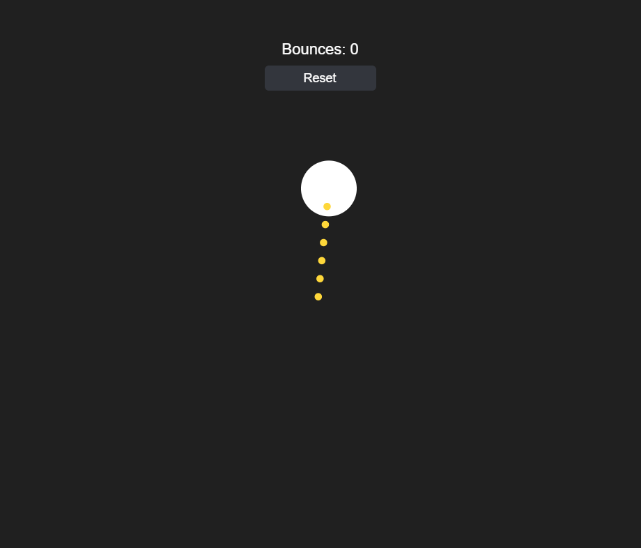

# Bouncing Ball HUD



Builds on [Bouncing Ball Slingshot](../bouncing_ball_slingshot/README.md): a `BABYLON.GUI.TextBlock` pinned to the top of the screen now tracks how many times the ball has bounced off a wall, and a `BABYLON.GUI.Button` below it resets everything back to the start — the ball snaps back to the center at zero velocity (canceling any in-progress drag and clearing the launch indicator) and the bounce count returns to zero.

The new `Hud` class follows the same ui-optional, testable split as `Ball`/`SparkSystem`/`SlingshotIndicator`: `BABYLON` is only touched in `attachTo()`, so `recordBounce()`'s counting logic is tested directly, and the label/button wiring is tested by stubbing `BABYLON.GUI.StackPanel` / `TextBlock` / `Button.CreateSimpleButton`. `Ball` gains a matching `reset(x, y)` method (defaults to the origin), tested alongside its other physics. See [hud.tests.js](tests/hud.tests.js) and [ball.tests.js](tests/ball.tests.js).

## Key code

**Pinning controls to the screen.** Unlike the ball and sparks, which sit in a center-origin space, the HUD uses Babylon GUI's alignment properties to anchor a `StackPanel` to the top-center of the canvas. The panel lays out its children vertically on its own, so there's no manual positioning for the label or button.

```js
this.panel = new BABYLON.GUI.StackPanel();
this.panel.isVertical = true;
this.panel.spacing = 8;
this.panel.width = "160px";
this.panel.adaptHeightToChildren = true;
this.panel.horizontalAlignment = BABYLON.GUI.Control.HORIZONTAL_ALIGNMENT_CENTER;
this.panel.verticalAlignment = BABYLON.GUI.Control.VERTICAL_ALIGNMENT_TOP;
this.panel.top = "56px"; // clears the page's HTML back-button/hint bar
this.ui.addControl(this.panel);
```

**A text label.** `outlineWidth`/`outlineColor` keep the text readable over any background, including the bright sparks.

```js
this.countLabel = new BABYLON.GUI.TextBlock();
this.countLabel.height = "30px";
this.countLabel.color = "white";
this.countLabel.fontSize = 22;
this.countLabel.outlineWidth = 4;
this.countLabel.outlineColor = "#202020";
this.panel.addControl(this.countLabel);

// updated whenever the count changes
this.countLabel.text = `Bounces: ${this.bounces}`;
```

**A clickable button.** `Button.CreateSimpleButton` builds a button with a text child. Clicks arrive through `onPointerUpObservable`, which the `Hud` forwards to an `onReset` callback so it never needs to know what resetting means.

```js
this.resetButton = BABYLON.GUI.Button.CreateSimpleButton("resetButton", "Reset");
this.resetButton.height = "36px";
this.resetButton.color = "white";
this.resetButton.background = "#33363d";
this.resetButton.thickness = 0;
this.resetButton.cornerRadius = 6;
this.resetButton.onPointerUpObservable.add(() => this.onReset());
this.panel.addControl(this.resetButton);
```

**Wiring it up.** `main.js` supplies the reset behavior and calls `recordBounce()` from the same bounce loop that triggers the sparks and sound.

```js
const hud = new Hud({
  ui,
  onReset: () => {
    indicator.hide();
    ball.reset(0, 0);
    hud.resetBounceCount();
  },
});
```

## Babylon.js features demonstrated

- Everything from Bouncing Ball Slingshot
- `BABYLON.GUI.TextBlock` inside a `BABYLON.GUI.StackPanel` for simple auto-laid-out HUD text
- `BABYLON.GUI.Button.CreateSimpleButton` and its `onPointerUpObservable` for a clickable in-scene control
- Screen-space GUI layout (`horizontalAlignment` / `verticalAlignment` pinned to a corner) alongside the center-origin coordinate space `Ball`/`SparkSystem` already use

## Controls

- **Click/tap the ball and drag, then release** — pull back and launch it, slingshot-style. Works again mid-flight to relaunch.
- **Reset button** (top of screen) — snaps the ball back to the center at rest
- **Space** — save a PNG screenshot of the current frame

## Running the tests

Open [tests.html](tests.html) in a browser (or click "Run tests" from the running sample) to execute the QUnit suite against `js/ball.js`, `js/sparks.js`, and `js/hud.js`.

## Notes

Browsers block audio until a user gesture. Babylon shows its own small unmute prompt automatically the first time — click it once to hear the bounce sound.
