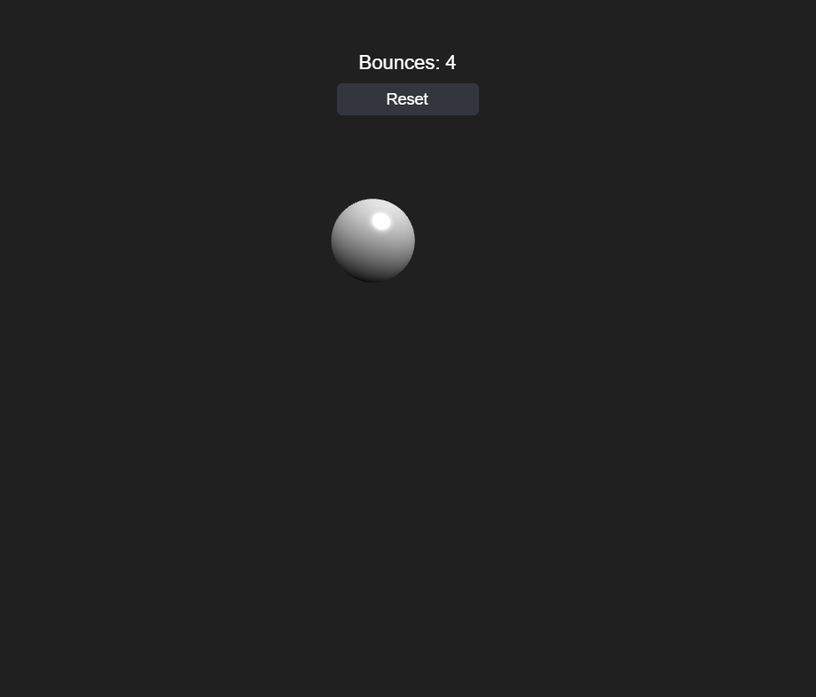

# Bouncing Ball Orthographic



Builds on [Bouncing Ball HUD](../bouncing_ball_hud/README.md): the ball is now a real lit `BABYLON.MeshBuilder.CreateSphere` mesh with a `StandardMaterial`, instead of a flat `BABYLON.GUI.Ellipse`, viewed through an orthographic camera instead of the unused default `FreeCamera` earlier samples never actually pointed anywhere. An orthographic camera has no perspective distortion, so the ball still reads as flat "2D" gameplay — but it now has real shading from a `HemisphericLight`, which a flat GUI circle never could.

The bridge this sample is really about: `Ball`'s physics (`update`, `beginDrag`, `dragTo`, `release`, `reset`) never cared what unit `x`/`y` were in, so swapping screen pixels for world units — and swapping the GUI-control sync for a mesh-position sync — required zero changes to that logic, only to `attachTo()`/`dispose()`/the sync step (renamed `_syncMesh()`). `SparkSystem` and `Hud` don't change at all: they're still `BABYLON.GUI` screen-space overlays, exactly as before, since mixing a 3D world with a 2D GUI overlay is the normal way Babylon apps work. The only new code in `main.js` is a small world-unit ↔ screen-pixel conversion so the GUI overlay (sparks, the slingshot indicator) lines up with what the orthographic camera is actually showing.

One gotcha worth calling out: Babylon's world Y axis points up, but every other part of this sample (physics, dragging, spark spawn points) still works in the same y-grows-downward space the GUI-based samples used. `Ball._syncMesh()` is the single place that flips the sign (`mesh.position.y = -this.y`) — everything else stays in the same coordinate space it always was.

## Key code

**An orthographic camera.** Set `mode` to `ORTHOGRAPHIC_CAMERA` and the camera ignores distance: objects are the same size wherever they sit on the Z axis. The camera looks straight down Z, and `orthoLeft/Right/Top/Bottom` define the visible rectangle in world units.

```js
const camera = new BABYLON.FreeCamera("camera", new BABYLON.Vector3(0, 0, -10), scene);
camera.mode = BABYLON.Camera.ORTHOGRAPHIC_CAMERA;
camera.setTarget(BABYLON.Vector3.Zero());
scene.activeCamera = camera;

const light = new BABYLON.HemisphericLight("light", new BABYLON.Vector3(0.3, 1, -0.4), scene);
light.intensity = 0.9;
```

**Keeping the view in step with the window.** The camera's height is fixed in world units, and its width follows the window's aspect ratio, so the physics bounds and the visible area always agree. The same function also computes how many screen pixels one world unit covers, which the GUI overlay needs below.

```js
const updateViewport = () => {
  const aspect = engine.getRenderWidth() / engine.getRenderHeight();
  halfHeight = WORLD_HALF_HEIGHT;
  halfWidth = halfHeight * aspect;
  camera.orthoLeft = -halfWidth;
  camera.orthoRight = halfWidth;
  camera.orthoTop = halfHeight;
  camera.orthoBottom = -halfHeight;
  worldToScreenScale = engine.getRenderWidth() / (2 * halfWidth);
};
updateViewport(); // once up front, and again from the window's "resize" handler
```

**The ball becomes a mesh.** `attachTo()` is the only place that changed: a sphere with a `StandardMaterial` replaces the `Ellipse`, and the sync step writes to the mesh's transform instead of the control's `left`/`top`. This is also where the Y flip happens, since Babylon's world Y points up but the physics still counts down.

```js
attachTo(scene, color = "#ffffff") {
  this.scene = scene;
  this.mesh = BABYLON.MeshBuilder.CreateSphere("ball", { diameter: this.radius * 2, segments: 32 }, scene);
  const material = new BABYLON.StandardMaterial("ballMaterial", scene);
  material.diffuseColor = BABYLON.Color3.FromHexString(color);
  this.mesh.material = material;
  this._syncMesh();
  return this;
}

_syncMesh() {
  if (!this.mesh) return;
  this.mesh.position.x = this.x;
  this.mesh.position.y = -this.y; // the one place the sign flips
  this.mesh.rotation.z = -this.rotation;
}
```

**Mixing 3D with the 2D GUI overlay.** Pointer input arrives in canvas pixels and has to become world units; the sparks and slingshot indicator still live in the GUI layer, so world positions go back to pixels on the way out.

```js
// pixels -> world units, for pointer input
const toWorld = (pointerX, pointerY) => ({
  x: (pointerX - engine.getRenderWidth() / 2) / worldToScreenScale,
  y: (pointerY - engine.getRenderHeight() / 2) / worldToScreenScale,
});

// world units -> pixels, for the GUI overlay
sparkSystem.spawn(bounce.x * worldToScreenScale, bounce.y * worldToScreenScale, bounce.normalX, bounce.normalY);
```

## Babylon.js features demonstrated

- Everything from Bouncing Ball HUD
- A real mesh (`BABYLON.MeshBuilder.CreateSphere`) with a `BABYLON.StandardMaterial`, instead of a flat GUI control
- An orthographic camera (`camera.mode = BABYLON.Camera.ORTHOGRAPHIC_CAMERA`, `orthoLeft`/`orthoRight`/`orthoTop`/`orthoBottom`) mapping a fixed vertical world-unit extent onto the viewport, recomputed on resize so it always matches the window's aspect ratio
- A `BABYLON.HemisphericLight`, giving the ball actual directional shading
- Converting between world-space units and screen-space pixels, so a 3D mesh and a 2D `BABYLON.GUI` overlay can share one scene and agree on where things are

## Controls

- **Click/tap the ball and drag, then release** — pull back and launch it, slingshot-style. Works again mid-flight to relaunch.
- **Reset button** (top of screen) — snaps the ball back to the center at rest and zeroes the bounce count
- **Space** — save a PNG screenshot of the current frame

## Running the tests

Open [tests.html](tests.html) in a browser (or click "Run tests" from the running sample) to execute the QUnit suite against `js/ball.js`, `js/sparks.js`, and `js/hud.js`.

## Notes

Browsers block audio until a user gesture. Babylon shows its own small unmute prompt automatically the first time — click it once to hear the bounce sound.
