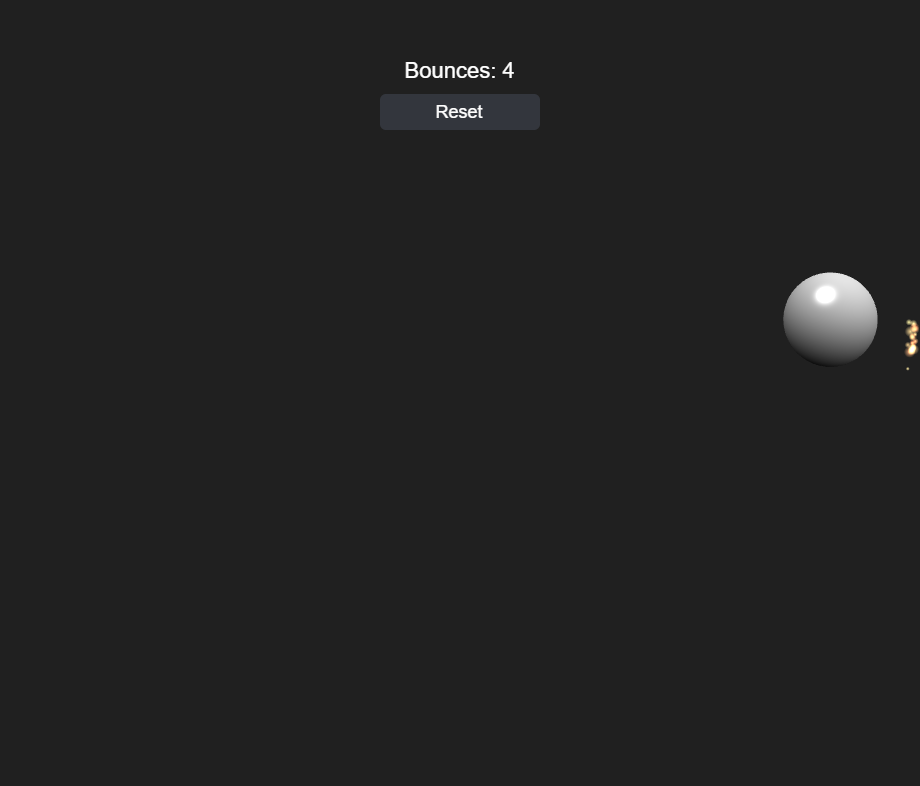

# Bouncing Ball Particles & Friction



Builds on [Bouncing Ball Orthographic](../bouncing_ball_orthographic/README.md): the ball now loses energy on every wall bounce instead of reflecting perfectly forever, and the bounce sparks are real `BABYLON.ParticleSystem` bursts instead of hand-animated `BABYLON.GUI` rectangles.

**Restitution and rest.** `Ball` takes a `restitution` option (default `0.82`) and scales the reflected velocity by it on every wall hit (`this.vx = -this.vx * this.restitution`), so each bounce is a little weaker than the last. Once the post-bounce speed drops below `restThreshold` (default `0.05`), the ball snaps fully to `0` velocity instead of bouncing on forever at an imperceptible speed — a launch eventually settles at rest near the middle of the box. `ball.tests.js` pins `restitution: 1` in the existing reflection tests (so they keep testing pure reflection in isolation) and adds a dedicated `"Ball restitution / rest threshold"` module for the energy-loss/rest-snap behavior.

**Real particles.** `SparkSystem` no longer hand-simulates gravity/drag/lifetime for a pool of GUI rectangles. Instead, every bounce spawns one `BABYLON.ParticleSystem` burst — a real mesh-space particle emitter, not a screen-space GUI overlay — configured with a `manualEmitCount` (14–21, same randomized range as before) and a high `emitRate` so the whole burst empties in about a frame, `direction1`/`direction2` fanning ±72° around the bounce normal, additive blending, and a procedurally generated `BABYLON.DynamicTexture` soft-glow sprite (no external asset, same reasoning as the synthesized bounce sound) shared across every burst. Babylon's own particle engine now handles per-particle motion, gravity, and fade-out; `SparkSystem` just tracks each burst's own `ttl` (its `manualEmitCount` ramp-up time plus `maxLifeTime` plus a small buffer) and disposes it once that elapses. That's deliberately not driven by Babylon's `isAlive()`/`getActiveCount()` flags: right after `start()`, those still read as "empty" for a frame or two while the engine's internal particle update catches up, so a naive poll disposes the burst before it ever draws a single particle. Because particles live in world space alongside the ball, `main.js` no longer converts bounce points through `worldToScreenScale` before handing them to `spawn()` — only the still-GUI-based slingshot indicator needs that conversion.

## Key code

**Energy loss on each bounce.** Scaling the reflected velocity by `restitution` (1 = perfectly elastic, 0 = dead stop) makes every bounce weaker than the last. Once the speed after a bounce falls below `restThreshold`, the ball snaps to rest instead of creeping forever.

```js
if (this.x + this.radius > halfWidth) {
  this.x = halfWidth - this.radius;
  this.vx = -this.vx * this.restitution;
  events.push(this._bounceEvent(this.x + this.radius, this.y, -1, 0));
}
// ...other walls...

if (events.length > 0 && Math.hypot(this.vx, this.vy) < this.restThreshold) {
  this.vx = 0;
  this.vy = 0;
}
```

**A particle system per burst.** Each bounce creates a one-shot `BABYLON.ParticleSystem` at the impact point. `direction1` and `direction2` are the two edges of a ±72° fan around the wall's normal, and Babylon picks a random direction between them for every particle. `manualEmitCount` emits a fixed number of particles, and the high `emitRate` empties that count in about a frame.

```js
const system = new BABYLON.ParticleSystem("sparks", 40, this.scene);
system.particleTexture = this._texture;
system.blendMode = BABYLON.ParticleSystem.BLENDMODE_ADD;
system.emitter = new BABYLON.Vector3(x, y, 0);
system.direction1 = new BABYLON.Vector3(Math.cos(a1), Math.sin(a1), 0);
system.direction2 = new BABYLON.Vector3(Math.cos(a2), Math.sin(a2), 0);
system.minEmitPower = this.minEmitPower;
system.maxEmitPower = this.maxEmitPower;
system.gravity = new BABYLON.Vector3(0, -this.gravity, 0);
system.minLifeTime = this.minLifeTime;
system.maxLifeTime = this.maxLifeTime;
system.color1 = this._toColor4(startColor);
system.color2 = this._toColor4(endColor);
system.colorDead = this._toColor4(endColor, 0); // fades to transparent
system.emitRate = count * 20;
system.manualEmitCount = count;
system.start();
```

**A texture with no image file.** The glow sprite is drawn into a `DynamicTexture` with a canvas radial gradient, the same self-contained approach as the synthesized bounce sound. One texture is shared by every burst.

```js
const texture = new BABYLON.DynamicTexture("sparkTexture", 32, scene, false);
const ctx = texture.getContext();
const gradient = ctx.createRadialGradient(16, 16, 0, 16, 16, 16);
gradient.addColorStop(0, "rgba(255,255,255,1)");
gradient.addColorStop(1, "rgba(255,255,255,0)");
ctx.fillStyle = gradient;
ctx.fillRect(0, 0, 32, 32);
texture.update(false);
texture.hasAlpha = true;
```

**Disposing finished bursts.** `SparkSystem` tracks a time-to-live per burst rather than polling `isAlive()`. Right after `start()`, Babylon still reports a burst as empty for a frame or two, so polling can dispose it before it draws anything. Passing `false` to `dispose()` keeps the shared texture alive.

```js
const ttl = count / system.emitRate + this.maxLifeTime + 0.15;
this.systems.push({ system, ttl });

// each frame:
entry.ttl -= dt;
if (entry.ttl <= 0) {
  entry.system.dispose(false);
  this.systems.splice(i, 1);
}
```

**Sparks are in world space now.** Because particles live in the 3D world next to the ball, bounce points go straight to `spawn()` with no `worldToScreenScale` conversion.

```js
sparkSystem.spawn(bounce.x, -bounce.y, bounce.normalX, -bounce.normalY);
```

## Babylon.js features demonstrated

- Everything from Bouncing Ball Orthographic
- `BABYLON.ParticleSystem` one-shot bursts (`manualEmitCount` + a high `emitRate`) for the bounce sparks, with additive blending and a procedurally generated `BABYLON.DynamicTexture` sprite
- Velocity-based restitution on wall bounces, so the ball's kinetic energy — and its bounce sound/spark intensity, both driven by `bounce.speed` — decays bounce over bounce until it settles at rest

## Controls

- **Click/tap the ball and drag, then release** — pull back and launch it, slingshot-style. Works again mid-flight to relaunch.
- **Reset button** (top of screen) — snaps the ball back to the center at rest and zeroes the bounce count
- **Space** — save a PNG screenshot of the current frame

## Running the tests

Open [tests.html](tests.html) in a browser (or click "Run tests" from the running sample) to execute the QUnit suite against `js/ball.js`, `js/sparks.js`, and `js/hud.js`.

## Notes

Browsers block audio until a user gesture. Babylon shows its own small unmute prompt automatically the first time — click it once to hear the bounce sound.
