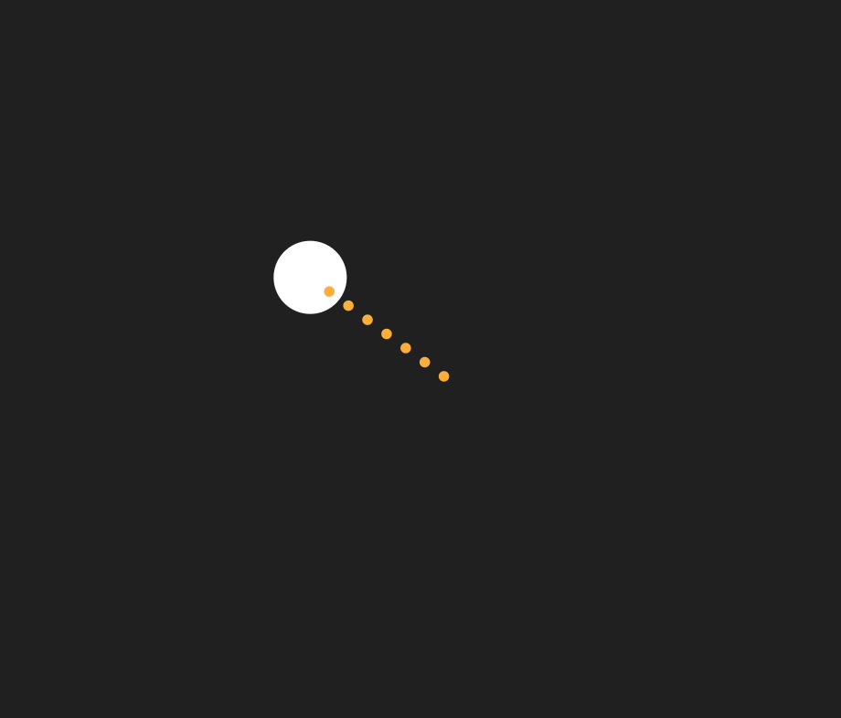

# Bouncing Ball Slingshot



Builds on [Bouncing Ball with Unit Tests](../bouncing_ball_tests/README.md): instead of always being in motion, the ball starts at rest and waits to be launched. Click or tap the ball and drag to pull it back like a slingshot — a trail of dots grows longer and shifts from green to yellow to red as the pull nears its maximum, previewing both the launch direction and speed. Release to fire the ball off opposite the pull. The ball can be grabbed again mid-flight at any time, freezing it in place to reset its trajectory.

`Ball` gains three new drag methods (`beginDrag`, `dragTo`, `release`) alongside its existing physics, all pure math with no `BABYLON` dependency, so they're covered the same way as the rest of the class in [ball.tests.js](tests/ball.tests.js). The new `SlingshotIndicator` class follows the same ui-optional split as `Ball`/`SparkSystem`: it only touches `BABYLON` when constructed with a `ui`, pooling a fixed set of dot controls up front and toggling their visibility instead of creating/disposing controls on every pointer move.

## Key code

**Pointer events.** `scene.onPointerObservable` delivers down/move/up events for the canvas. `scene.pointerX/Y` are canvas pixels with a top-left origin, while the GUI (and so `Ball`) uses a center-origin space, so a small helper converts between them. A press only grabs the ball if it lands within the ball's radius plus a little padding.

```js
const toLocal = (pointerX, pointerY) => ({
  x: pointerX - engine.getRenderWidth() / 2,
  y: pointerY - engine.getRenderHeight() / 2,
});

scene.onPointerObservable.add((pointerInfo) => {
  const { x, y } = toLocal(scene.pointerX, scene.pointerY);

  if (pointerInfo.type === BABYLON.PointerEventTypes.POINTERDOWN) {
    if (Math.hypot(x - ball.x, y - ball.y) <= ball.radius + GRAB_PADDING) {
      ball.beginDrag();
    }
    return;
  }
  if (pointerInfo.type === BABYLON.PointerEventTypes.POINTERMOVE) {
    if (!ball.dragging) return;
    const strength = ball.dragTo(x, y, getMaxDragDistance(engine));
    // ...update the indicator...
    return;
  }
  if (pointerInfo.type === BABYLON.PointerEventTypes.POINTERUP) {
    endDrag();
  }
});
```

Babylon's observable only sees events that target the canvas, so a release outside it would leave the drag stuck open. A plain DOM listener catches that case:

```js
window.addEventListener("pointerup", endDrag);
```

**The drag math.** `beginDrag()` freezes the ball and remembers its position as an *anchor*. `dragTo()` follows the pointer but clamps the pull distance, and returns a 0-1 strength. `release()` snaps the ball back to the anchor and fires it in the opposite direction, at a speed proportional to the pull.

```js
dragTo(px, py, maxDragDistance) {
  const dx = px - this.anchorX;
  const dy = py - this.anchorY;
  const distance = Math.hypot(dx, dy);
  const clamped = Math.min(distance, maxDragDistance);
  const scale = distance > 0 ? clamped / distance : 0;

  this.x = this.anchorX + dx * scale;
  this.y = this.anchorY + dy * scale;
  this._syncControl();

  return maxDragDistance > 0 ? clamped / maxDragDistance : 0;
}

release(maxDragDistance, maxSpeed) {
  // ...snap back to the anchor, then:
  const strength = Math.min(distance / maxDragDistance, 1);
  this.vx = (-dx / distance) * strength * maxSpeed; // opposite the pull
  this.vy = (-dy / distance) * strength * maxSpeed;
}
```

**A pooled indicator.** `show()` can fire dozens of times per drag, so `SlingshotIndicator` creates its ten dot controls once and only toggles `isVisible`, repositions, and recolors them, instead of creating and disposing GUI controls on every pointer move.

```js
_createDots() {
  for (let i = 0; i < this.maxDots; i++) {
    const dot = new BABYLON.GUI.Ellipse();
    dot.thickness = 0;
    dot.isVisible = false;
    this.ui.addControl(dot);
    dots.push(dot);
  }
}

show(originX, originY, dirX, dirY, strength) {
  const visibleCount = Math.max(1, Math.round(strength * this.maxDots));
  for (let i = 0; i < this.dots.length; i++) {
    const dot = this.dots[i];
    if (i >= visibleCount) { dot.isVisible = false; continue; }
    dot.isVisible = true;
    dot.left = originX + dirX * (i + 1) * this.dotSpacing; // walk outward from the ball
    dot.top = originY + dirY * (i + 1) * this.dotSpacing;
    dot.background = this._colorFor(strength); // green -> yellow -> red
  }
}
```

## Babylon.js features demonstrated

- Everything from Bouncing Ball with Unit Tests
- Pointer input via `scene.onPointerObservable` (`POINTERDOWN` / `POINTERMOVE` / `POINTERUP`), converted from canvas pixel space into the GUI's center-origin coordinate space
- A pooled set of `BABYLON.GUI.Ellipse` controls, reused every frame rather than created/disposed, to cheaply animate a growing, color-interpolated indicator

## Controls

- **Click/tap the ball and drag, then release** — pull back and launch it, slingshot-style. Works again mid-flight to relaunch.
- **Space** — save a PNG screenshot of the current frame

## Running the tests

Open [tests.html](tests.html) in a browser (or click "Run tests" from the running sample) to execute the QUnit suite against `js/ball.js` and `js/sparks.js`.

## Notes

Browsers block audio until a user gesture. Babylon shows its own small unmute prompt automatically the first time — click it once to hear the bounce sound.
