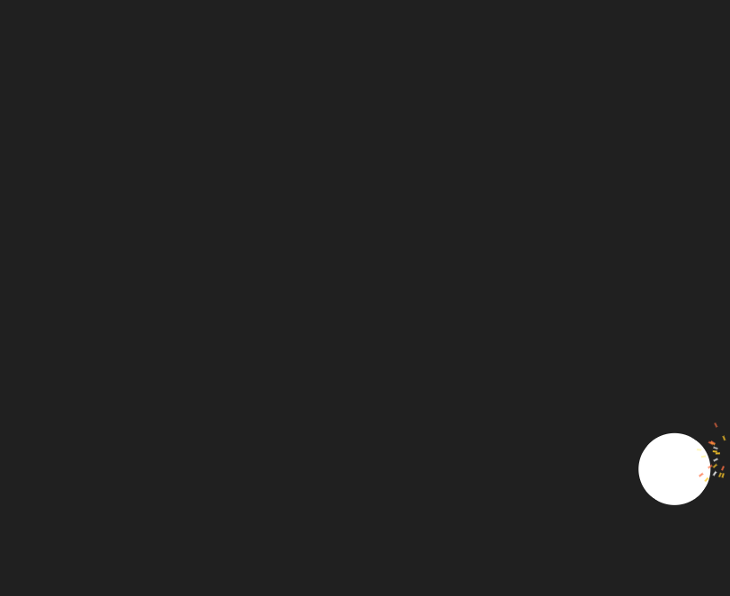

# Bouncing Ball with Sparks



Builds on [Bouncing Circle](../bouncing_circle/README.md): the ball now throws off a shower of sparks and spins like a rolling wheel every time it hits a wall.

## Key code

**Each spark is a tiny GUI rectangle.** Every wall hit spawns 14-21 of them, fanned out in a ±72° cone around the wall's normal. A spark is just a `BABYLON.GUI.Rectangle` plus its own position, velocity, and remaining life, tracked in a plain array. Rotating the rectangle to match its direction of travel makes it read as a streak.

```js
const spawnSparks = (px, py, normalX, normalY) => {
  const count = 14 + Math.floor(Math.random() * 8);
  const baseAngle = Math.atan2(normalY, normalX);
  for (let i = 0; i < count; i++) {
    const angle = baseAngle + (Math.random() - 0.5) * Math.PI * 0.8;
    const speed = 140 + Math.random() * 260;
    const life = 0.25 + Math.random() * 0.35;

    const control = new BABYLON.GUI.Rectangle();
    control.width = "5px";
    control.height = "2px";
    control.thickness = 0;
    control.background = SPARK_COLORS[Math.floor(Math.random() * SPARK_COLORS.length)];
    control.rotation = angle;
    ui.addControl(control);

    sparks.push({ control, x: px, y: py, vx: Math.cos(angle) * speed, vy: Math.sin(angle) * speed, life, maxLife: life });
  }
};
```

**Hand-rolled particle physics.** There's no particle system yet, so each frame the sample applies gravity and drag, ages the spark, fades it with `alpha`, and removes its control when it dies. Iterating backwards makes `splice()` safe mid-loop.

```js
for (let i = sparks.length - 1; i >= 0; i--) {
  const s = sparks[i];
  s.vy += GRAVITY * dt; // pulls sparks downward
  s.vx *= DRAG;         // damps horizontal speed
  s.x += s.vx * dt;
  s.y += s.vy * dt;
  s.life -= dt;

  if (s.life <= 0) {
    ui.removeControl(s.control);
    s.control.dispose();
    sparks.splice(i, 1);
    continue;
  }

  s.control.left = s.x;
  s.control.top = s.y;
  s.control.alpha = s.life / s.maxLife; // fade out
  s.control.rotation = Math.atan2(s.vy, s.vx);
}
```

**Rolling like a wheel.** A GUI control's `rotation` is in radians. Angular speed for rolling without slipping is `velocity / radius`, so the spin follows horizontal speed.

```js
rotation += (vx / radius) * dt;
circle.rotation = rotation;
```

## Babylon.js features demonstrated

- Everything from Bouncing Circle
- A lightweight particle effect built from GUI controls (`BABYLON.GUI.Rectangle`), animated by hand with gravity and drag
- Rotating a GUI control (`circle.rotation`) driven by velocity

## Controls

- **Space** — save a PNG screenshot of the current frame
