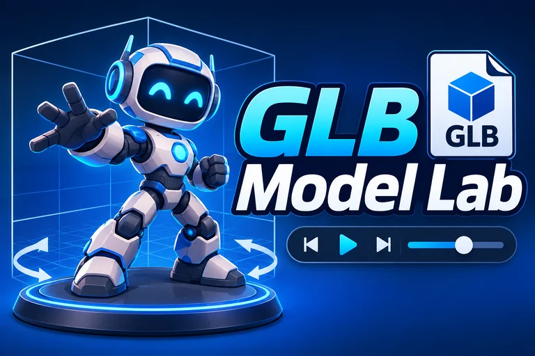

# Tutorial: Model Lab, Skeleton -- Find the Bones



The [Look tutorial](../model_lab_look/TUTORIAL.md) opened a model and counted what was inside it, and one of the things it counted was a **skeleton** with 24 bones. This tutorial opens that skeleton up. You will draw it over the model (a stick figure that is *inside* the body), list its bones as a tree with each bone under its parent, and click a joint on the model or a name in the list to find out everything the lab knows about it.

This is the tutorial that makes everything after it possible. A sword in a hand is a sword *attached to a bone*; armour that bends with the body is armour *bound to the same bones*; and an animation from another character works only if the bones have *the same names*. All three start with being able to see the bones and say which is which. You write the code; this document tells you what to write, and why.

By the end you'll have a page where you can:

- **See the skeleton** drawn over the model: a ball at each joint and a line from each joint to its parent, always visible through the body, and following the bones if they move
- **Read the bones as a tree**: the hips at the top, the spine below them, and the arms, legs and head hanging off it, each coloured by the part of the body that it is in
- **Click a joint** (on the model or in the list) and see its name, its parent, its children, the way down from the root to it, and where it is in the world
- Unit tests for all of it: **115 passing tests**, 53 of them new, and some of them run against the real skeletons, including one that proves that **all three characters have exactly the same bones**

**What you'll learn:** how a skeleton is a tree, how to turn a flat list of bones into a tree you can ask questions of, how to find where a bone really is in the world (and the trap with units that this hides), how to draw something *through* a model, how to tell which joint a click meant, and how to read a naming convention.

**Before you start:** do the [Look tutorial](../model_lab_look/TUTORIAL.md) first (or have its finished sample): this one builds on it.

## Words you'll meet

| Word | What it means |
|------|---------------|
| **Bone** (or **joint**) | One piece of a skeleton: a point in space (the joint) that has a position, a direction and a size, and that other things can follow. Moving the bone moves whatever follows it. A bone is *not* a thing you can see: it has no triangles. |
| **Skeleton** | All of a model's bones, joined together. |
| **Parent** and **child** | Bones are joined in pairs: the upper arm is the *parent* of the forearm, and the forearm is the *child* of the upper arm. When a parent moves, **its children go with it**: bend the shoulder and the whole arm, hand and all, comes along. That is the whole idea of a skeleton. |
| **Root** | The bone that has no parent: the top of the tree. In a character it is usually the **hips**, so moving it moves the whole body. |
| **Tree** | A shape where everything hangs from one root, and each thing has one parent and any number of children. A family tree is the same shape. |
| **Depth** | How many steps a bone is from the root. The root is 0; its children are 1; theirs are 2. |
| **Rest pose** (or **bind pose**) | The pose that the model was built in, before any animation moves it. For a person it is usually the **T-pose** (arms straight out) or the **A-pose** (arms a little down), as the fire bender stands in the picture. |
| **Transform** | A position, a turn and a size, all together. Every bone has one. |
| **Local** and **world** | A bone's *local* position is measured from its parent ("the hand is 25 centimetres past the elbow"); its *world* position is measured from the middle of the scene ("the hand is 0.45 m to the side and a metre up"). Both are true. To draw or click a bone you need the world one. |
| **Transform node** | An invisible object in the scene that has a transform and can have children. When a glTF file is loaded, each bone gets one, and the bone follows it. |
| **Naming convention** | An agreement about what to call things. **Mixamo** (a website that gives rigged characters and animations) calls its bones `mixamorig:Hips`, `mixamorig:Spine`, `mixamorig:LeftArm`... Two skeletons that use the same names can share animations; this tutorial shows how to check. |
| **Left** and **right** | A character's left is *its own* left, so when it faces you its left hand is on the right side of your screen. |
| **Rendering group** | A number that says *when* something is drawn. Group 0 is drawn first; a higher group is drawn later, and can be told to ignore what is already there, so it appears on top. |

## Where you're starting

This folder is a copy of the finished Look sample, plus placeholders for the new files:

```
model_lab_skeleton/
├── index.html, tests.html   (already list the new files)
├── css/
│   ├── bones.css           (placeholder -- Step 5)
│   └── theme.css, lab.css  (from the Look sample)
├── js/
│   ├── bones.js            (placeholder -- Step 1)
│   ├── joints.js           (placeholder -- Step 2)
│   ├── skeletonview.js     (placeholder -- Step 3)
│   ├── bonetree.js         (placeholder -- Step 4)
│   ├── viewer.js, main.js  (changes -- Step 5)
│   └── everything else, from the Look sample
└── tests/
    ├── bones.tests.js, joints.tests.js, skeletonview.tests.js, bonetree.tests.js   (placeholders -- Steps 1 to 4)
    └── everything else, from the Look sample
```

Open `tests.html` before you change anything, through the web server (`npx serve` in the repo root). You should see **62 passing tests**.

## Step 1: A skeleton as a tree (`bones.js`)

Babylon.js keeps a skeleton as a **flat list** of bones, each of which can tell you its parent. A flat list is hard to ask questions of: *who are the Spine2's children? what is the way from the hips to the right hand?* So the first job is to turn it into a **tree of plain data**.

`boneTree` does it in three passes: one **node** for each bone (its index in the list, its name, its parent's index); then each node is told who its children are (by going through everybody's parent and adding the child to it); then each node's **depth** is found by walking up to the root and counting the steps.

The rest are small questions answered from the tree:

- `walkOrder`: the bones in the order for a list that shows each bone under its parent
- `bonePath`: the names from the root down to a bone
- `descendants`: everything that moves when a bone moves
- `findBone`: the index of a bone by name (whole or short)
- `regionOf`: which part of the body a bone is in, from a **table** (`BODY_REGIONS`: head, torso, left and right arm, left and right leg). A bone whose name fits none is "other". The real skeletons have one: a bone called `headfront` that is not a Mixamo name and was added by whoever made the model. Later tutorials will say "the head slot" with this table.
- `namingStyle`: whether the skeleton uses Mixamo's names

Create `js/bones.js`:

```js
// The bones of a model, as a tree. A skeleton in Babylon.js is a flat list of bones, each of which knows its parent; this file turns that list
// into data that is easy to ask questions of: who is whose parent, who are a bone's children, how far down the tree a bone is, and which part of the
// body it belongs to. Nothing here touches the scene, so it can be tested down to its corners. See ../tests/bones.tests.js.

// A bone's name without the program's prefix. Mixamo writes every bone as "mixamorig:Hips", "mixamorig:Spine"... and people read "Hips".
function shortName(name) {
  const colon = name.indexOf(":");
  return colon < 0 ? name : name.slice(colon + 1);
}

// The tree of a skeleton: { nodes, roots }. `nodes` has one entry for each bone, in the skeleton's own order, and each says its index,
// its name (whole and short), the index of its parent (null for a root), the indices of its children, and its depth (a root is 0, its children 1...).
function boneTree(skeleton) {
  const indexOf = new Map(skeleton.bones.map((bone, index) => [bone, index]));
  const nodes = skeleton.bones.map((bone, index) => ({
    index,
    name: bone.name,
    short: shortName(bone.name),
    parent: bone.getParent() ? indexOf.get(bone.getParent()) ?? null : null,
    children: [],
    depth: 0,
  }));
  for (const node of nodes) {
    if (node.parent !== null) nodes[node.parent].children.push(node.index);
  }
  for (const node of nodes) {
    let up = node.parent;
    while (up !== null) {
      node.depth++;
      up = nodes[up].parent;
    }
  }
  return { nodes, roots: nodes.filter((node) => node.parent === null).map((node) => node.index) };
}

// The bones in the order of a walk down the tree: a bone, then everything below its first child, then its second child, and so on.
// This is the order to list them in, so that each bone is under its parent.
function walkOrder(tree) {
  const order = [];
  const visit = (index) => {
    order.push(index);
    tree.nodes[index].children.forEach(visit);
  };
  tree.roots.forEach(visit);
  return order;
}

// The short names from the root down to a bone: ["Hips", "Spine", ...].
function bonePath(tree, index) {
  const path = [];
  for (let at = index; at !== null; at = tree.nodes[at].parent) path.unshift(tree.nodes[at].short);
  return path;
}

// Every bone below a bone (its children, theirs...), as indices. These are the bones that move when the bone moves.
function descendants(tree, index) {
  return walkOrder({ nodes: tree.nodes, roots: [index] }).slice(1);
}

// The index of the bone with a name, whole ("mixamorig:Head") or short ("Head"), or -1.
function findBone(tree, name) {
  return tree.nodes.findIndex((node) => node.name === name || node.short === name);
}

// The parts of the body, as a table: the panel colours and groups by it, and later tutorials will say "the head slot" by it. Each region has a
// pattern that a bone's short name is matched against. A bone that fits none (a bone that someone added) is in "other".
const BODY_REGIONS = [
  { id: "head", label: "Head", match: /^(Neck|Head|HeadTop_End)$/ },
  { id: "torso", label: "Torso", match: /^(Hips|Spine\d*)$/ },
  { id: "leftArm", label: "Left arm", match: /^Left(Shoulder|Arm|ForeArm|Hand)/ },
  { id: "rightArm", label: "Right arm", match: /^Right(Shoulder|Arm|ForeArm|Hand)/ },
  { id: "leftLeg", label: "Left leg", match: /^Left(UpLeg|Leg|Foot|ToeBase)/ },
  { id: "rightLeg", label: "Right leg", match: /^Right(UpLeg|Leg|Foot|ToeBase)/ },
];

// The id of the region that a bone is in, from its name (whole or short).
function regionOf(name) {
  const short = shortName(name);
  const region = BODY_REGIONS.find((candidate) => candidate.match.test(short));
  return region ? region.id : "other";
}

// The label for a region id.
function regionLabel(id) {
  const region = BODY_REGIONS.find((candidate) => candidate.id === id);
  return region ? region.label : "Other";
}

// Which naming style a skeleton uses. Mixamo skeletons put "mixamorig:" in front of every bone. Two models can only share animations if
// their bones have the same names, so knowing the style is the first thing to look at.
function namingStyle(tree) {
  if (tree.nodes.length === 0) return "unknown";
  const prefixed = tree.nodes.filter((node) => node.name.startsWith("mixamorig:")).length;
  return prefixed / tree.nodes.length >= 0.8 ? "mixamo" : "unknown";
}

// Plain <script> include (no bundler in this project), so export via both
// CommonJS (for the QUnit/Node test runner) and the global scope (for
// index.html) depending on which environment loads this file.
if (typeof module !== "undefined" && module.exports) {
  module.exports = { shortName, boneTree, walkOrder, bonePath, descendants, findBone, BODY_REGIONS, regionOf, regionLabel, namingStyle };
} else {
  Object.assign(window, { shortName, boneTree, walkOrder, bonePath, descendants, findBone, BODY_REGIONS, regionOf, regionLabel, namingStyle });
}
```

Now `tests/bones.tests.js`. It begins with `fakeSkeleton`, a skeleton made of plain objects with only the two things that `boneTree` asks of a bone (a name and a parent): that way the tree can be tested on a skeleton of four bones that fits in your head. The last group loads the **three real characters** and checks the facts that the next tutorials depend on, the last being that **their bones are exactly the same, in the same order**.

```js
// A skeleton made of plain objects that answer the two questions boneTree asks of a bone: its name and its parent.
function fakeSkeleton(list) {
  const bones = list.map(([name]) => ({ name }));
  list.forEach(([, parentIndex], index) => {
    bones[index].getParent = () => (parentIndex === null ? null : bones[parentIndex]);
  });
  return { bones };
}

QUnit.module("shortName", () => {
  QUnit.test("takes away the program's prefix", (assert) => {
    assert.strictEqual(shortName("mixamorig:Hips"), "Hips");
  });

  QUnit.test("leaves a name with no prefix as it is", (assert) => {
    assert.strictEqual(shortName("headfront"), "headfront");
  });
});

QUnit.module("boneTree, of a small skeleton", () => {
  const skeleton = fakeSkeleton([["root", null], ["a", 0], ["b", 0], ["c", 1]]);
  const tree = boneTree(skeleton);

  QUnit.test("knows each bone's parent and children", (assert) => {
    assert.strictEqual(tree.nodes[0].parent, null);
    assert.strictEqual(tree.nodes[3].parent, 1);
    assert.deepEqual(tree.nodes[0].children, [1, 2]);
    assert.deepEqual(tree.nodes[2].children, []);
  });

  QUnit.test("knows how far down each bone is", (assert) => {
    assert.deepEqual(tree.nodes.map((node) => node.depth), [0, 1, 1, 2]);
  });

  QUnit.test("finds the roots", (assert) => {
    assert.deepEqual(tree.roots, [0]);
  });

  QUnit.test("a walk visits a bone, then everything under its first child, then the next", (assert) => {
    assert.deepEqual(walkOrder(tree), [0, 1, 3, 2]);
  });

  QUnit.test("a path runs from the root down to the bone", (assert) => {
    assert.deepEqual(bonePath(tree, 3), ["root", "a", "c"]);
    assert.deepEqual(bonePath(tree, 0), ["root"]);
  });

  QUnit.test("the descendants of a bone are everything under it, and not itself", (assert) => {
    assert.deepEqual(descendants(tree, 0), [1, 3, 2]);
    assert.deepEqual(descendants(tree, 1), [3]);
    assert.deepEqual(descendants(tree, 3), []);
  });

  QUnit.test("a skeleton can have more than one root", (assert) => {
    const two = boneTree(fakeSkeleton([["x", null], ["y", null], ["z", 1]]));
    assert.deepEqual(two.roots, [0, 1]);
  });
});

QUnit.module("regionOf", () => {
  QUnit.test("puts the bones in the parts of the body", (assert) => {
    assert.strictEqual(regionOf("mixamorig:Head"), "head");
    assert.strictEqual(regionOf("mixamorig:Spine1"), "torso");
    assert.strictEqual(regionOf("mixamorig:Hips"), "torso");
    assert.strictEqual(regionOf("mixamorig:LeftForeArm"), "leftArm");
    assert.strictEqual(regionOf("mixamorig:RightHand"), "rightArm");
    assert.strictEqual(regionOf("mixamorig:LeftToeBase"), "leftLeg");
    assert.strictEqual(regionOf("mixamorig:RightUpLeg"), "rightLeg");
  });

  QUnit.test("fingers belong to their hand", (assert) => {
    assert.strictEqual(regionOf("mixamorig:LeftHandThumb1"), "leftArm");
  });

  QUnit.test("a bone that someone added is in other", (assert) => {
    assert.strictEqual(regionOf("headfront"), "other");
  });

  QUnit.test("every region has a label and no two share an id", (assert) => {
    const ids = BODY_REGIONS.map((region) => region.id);
    assert.strictEqual(new Set(ids).size, ids.length);
    for (const id of [...ids, "other"]) assert.ok(regionLabel(id).length > 0, id);
  });
});

QUnit.module("namingStyle", () => {
  QUnit.test("a skeleton whose bones begin with mixamorig: is a Mixamo skeleton", (assert) => {
    assert.strictEqual(namingStyle(boneTree(fakeSkeleton([["mixamorig:Hips", null], ["mixamorig:Spine", 0]]))), "mixamo");
  });

  QUnit.test("anything else is unknown, and an empty skeleton too", (assert) => {
    assert.strictEqual(namingStyle(boneTree(fakeSkeleton([["Bone", null], ["Bone.001", 0]]))), "unknown");
    assert.strictEqual(namingStyle(boneTree(fakeSkeleton([]))), "unknown");
  });
});

QUnit.module("the real skeletons", (hooks) => {
  let engine, scene, trees;
  hooks.before(async () => {
    engine = new BABYLON.NullEngine();
    scene = new BABYLON.Scene(engine);
    trees = {};
    for (const name of ["fire", "air", "heavy"]) {
      const { container } = await loadModelFile(scene, `../assets/characters/${name}.glb`);
      trees[name] = boneTree(container.skeletons[0]);
    }
  });
  hooks.after(() => {
    scene.dispose();
    engine.dispose();
  });

  QUnit.test("have twenty-four bones and one root, the hips", (assert) => {
    const tree = trees.fire;
    assert.strictEqual(tree.nodes.length, 24);
    assert.deepEqual(tree.roots.map((index) => tree.nodes[index].short), ["Hips"]);
  });

  QUnit.test("have the bones named in the Mixamo way", (assert) => {
    assert.strictEqual(namingStyle(trees.fire), "mixamo");
    for (const short of ["Hips", "Spine2", "Neck", "Head", "LeftHand", "RightHand", "LeftFoot", "RightFoot"]) assert.ok(findBone(trees.fire, short) >= 0, short);
  });

  QUnit.test("find a bone by its whole name or its short one", (assert) => {
    assert.strictEqual(findBone(trees.fire, "mixamorig:Head"), findBone(trees.fire, "Head"));
    assert.strictEqual(findBone(trees.fire, "Tail"), -1);
  });

  QUnit.test("run from the hips to the right hand by way of the spine and the arm", (assert) => {
    const hand = findBone(trees.fire, "RightHand");
    assert.deepEqual(bonePath(trees.fire, hand), ["Hips", "Spine", "Spine1", "Spine2", "RightShoulder", "RightArm", "RightForeArm", "RightHand"]);
  });

  QUnit.test("the neck and both shoulders hang from the top of the spine", (assert) => {
    const tree = trees.fire;
    const shorts = tree.nodes[findBone(tree, "Spine2")].children.map((index) => tree.nodes[index].short);
    assert.deepEqual(shorts.sort(), ["LeftShoulder", "Neck", "RightShoulder"]);
  });

  QUnit.test("a parent always comes before its children", (assert) => {
    for (const node of trees.fire.nodes) if (node.parent !== null) assert.ok(node.parent < node.index, node.short);
  });

  QUnit.test("every bone has a part of the body, except the one that was added", (assert) => {
    const others = trees.fire.nodes.filter((node) => regionOf(node.name) === "other").map((node) => node.name);
    assert.deepEqual(others, ["headfront"]);
  });

  QUnit.test("all three characters have exactly the same bones in the same order", (assert) => {
    const names = (tree) => tree.nodes.map((node) => node.name);
    assert.deepEqual(names(trees.air), names(trees.fire));
    assert.deepEqual(names(trees.heavy), names(trees.fire));
  });
});
```

Open `tests.html`: **85 passing tests**, 23 of them new.

## Step 2: Where the bones are (`joints.js`)

A bone has no triangles, so there is nothing to see until we draw something at its **world position**. A model loaded from a glTF file gives each bone a **transform node**, and a node can say where it is in the world with every parent's position, turn and scale added up: `getAbsolutePosition()`.

This is where a trap is, and the tests have one to catch it. **The fire bender's bones are measured in centimetres**, but its root is scaled by 0.01 to turn the model into metres. So a bone's *local* position says `100` for a metre, while its *world* position says `1`. Moving a bone by 1 in its own numbers moves it by one *centimetre* in the world. When a later tutorial attaches a sword to a bone and puts it a little to one side, this is what it will have to be careful about.

Four small functions:

- `jointPositions`: the world position of every bone
- `boneSegments`: the lines of the stick figure, one from each bone to its parent
- `jointRadius`: how big to draw a joint (a fraction of the model's size, so that a mouse and a castle both get joints that can be seen)
- `screenPoints` and `nearestJoint`: turn the world positions into places on the screen, and find which one a click was nearest to. This is how a click on the model chooses a bone: **there is nothing to click on** (the joint is an invisible thing inside a body), so we ask, for each joint, where it is on the screen, and take the closest one within a few pixels.

Create `js/joints.js`:

```js
// Where the bones are. A bone is not a thing that can be seen: it is a position and a direction, and to draw it (or to say which one a click meant)
// we need to know where each bone is *in the world*, with the model's own scale and turns counted. This file finds those places, joins them into
// the lines of a stick figure, and works out which joint is nearest to a point on the screen. See ../tests/joints.tests.js.

// The world position of every bone's joint, in the skeleton's order. A model loaded from a glTF file gives each bone a *transform node* (an
// invisible object in the scene that the bone follows), and the node knows its place in the world.
function jointPositions(skeleton) {
  return skeleton.bones.map((bone) => {
    const node = bone.getTransformNode();
    if (node) {
      node.computeWorldMatrix(true);
      return node.getAbsolutePosition().clone();
    }
    return bone.getAbsolutePosition().clone();
  });
}

// The lines of the stick figure: one from each bone to its parent, as [from, to] pairs of positions. A root has no parent, so it has no line.
function boneSegments(tree, positions) {
  return tree.nodes.filter((node) => node.parent !== null).map((node) => [positions[node.parent], positions[node.index]]);
}

// How big to draw a joint: a small part of the model's size, so that a mouse and a castle both get joints that can be seen but do not hide the model.
function jointRadius(modelSize) {
  return Math.max(modelSize * 0.012, 0.001);
}

// The place on the screen (in pixels) of each position, for a camera. This is the camera's own job turned into a function: it takes a point
// in the world through the view and the projection (the camera's two transforms) to the picture.
function screenPoints(positions, scene, camera) {
  const engine = scene.getEngine();
  const viewport = camera.viewport.toGlobal(engine.getRenderWidth(), engine.getRenderHeight());
  return positions.map((position) => {
    const point = BABYLON.Vector3.Project(position, BABYLON.Matrix.Identity(), scene.getTransformMatrix(), viewport);
    return { x: point.x, y: point.y };
  });
}

// The joint nearest to a point on the screen, as an index, or -1 when none is within `maxDistance` pixels. `points` are screen points.
function nearestJoint(points, x, y, maxDistance) {
  let best = -1;
  let bestDistance = maxDistance;
  points.forEach((point, index) => {
    const distance = Math.hypot(point.x - x, point.y - y);
    if (distance <= bestDistance) {
      best = index;
      bestDistance = distance;
    }
  });
  return best;
}

// Plain <script> include (no bundler in this project), so export via both
// CommonJS (for the QUnit/Node test runner) and the global scope (for
// index.html) depending on which environment loads this file.
if (typeof module !== "undefined" && module.exports) {
  module.exports = { jointPositions, boneSegments, jointRadius, screenPoints, nearestJoint };
} else {
  Object.assign(window, { jointPositions, boneSegments, jointRadius, screenPoints, nearestJoint });
}
```

Then `tests/joints.tests.js`. The last group loads the real fire bender and checks that its joints are where a person's would be (the head over the hips over the feet, about as tall as a person, the hands on opposite sides) and that `screenPoints` puts a point that the camera looks at in the middle of the picture:

```js
QUnit.module("boneSegments", () => {
  const v = (x, y, z) => new BABYLON.Vector3(x, y, z);

  QUnit.test("has a line from each bone to its parent, and none for a root", (assert) => {
    const tree = boneTree(fakeSkeleton([["root", null], ["a", 0], ["b", 1]]));
    const positions = [v(0, 0, 0), v(0, 1, 0), v(0, 2, 0)];
    const segments = boneSegments(tree, positions);
    assert.strictEqual(segments.length, 2);
    assert.deepEqual(segments[0], [positions[0], positions[1]]);
    assert.deepEqual(segments[1], [positions[1], positions[2]]);
  });
});

QUnit.module("jointRadius", () => {
  QUnit.test("grows with the model, and is never nothing", (assert) => {
    assert.ok(jointRadius(10) > jointRadius(1));
    assert.ok(jointRadius(0) > 0);
  });
});

QUnit.module("nearestJoint", () => {
  const points = [{ x: 10, y: 10 }, { x: 100, y: 100 }, { x: 105, y: 100 }];

  QUnit.test("is the joint closest to the point", (assert) => {
    assert.strictEqual(nearestJoint(points, 12, 9, 20), 0);
    assert.strictEqual(nearestJoint(points, 104, 100, 20), 2);
  });

  QUnit.test("is -1 when nothing is near enough", (assert) => {
    assert.strictEqual(nearestJoint(points, 300, 300, 20), -1);
    assert.strictEqual(nearestJoint([], 0, 0, 20), -1);
  });

  QUnit.test("a joint exactly on the edge of the distance counts", (assert) => {
    assert.strictEqual(nearestJoint([{ x: 0, y: 0 }], 3, 4, 5), 0);
  });
});

QUnit.module("jointPositions and screenPoints, of the real fire bender", (hooks) => {
  let engine, scene, camera, tree, positions;
  hooks.before(async () => {
    engine = new BABYLON.NullEngine();
    scene = new BABYLON.Scene(engine);
    const { container } = await loadModelFile(scene, "../assets/characters/fire.glb");
    showModel(container);
    tree = boneTree(container.skeletons[0]);
    positions = jointPositions(container.skeletons[0]);
    camera = new BABYLON.ArcRotateCamera("camera", Math.PI / 2, Math.PI / 2, 5, new BABYLON.Vector3(0, 1, 0), scene);
    scene.render();
  });
  hooks.after(() => {
    scene.dispose();
    engine.dispose();
  });

  const at = (name) => positions[findBone(tree, name)];

  QUnit.test("has a position for every bone", (assert) => {
    assert.strictEqual(positions.length, 24);
  });

  QUnit.test("the head is above the hips, and the hips above the feet", (assert) => {
    assert.ok(at("Head").y > at("Hips").y);
    assert.ok(at("Hips").y > at("LeftFoot").y);
  });

  QUnit.test("the person is the size of a person, in metres", (assert) => {
    const height = at("HeadTop_End").y - at("LeftToeBase").y;
    assert.ok(height > 1.4 && height < 2.2, `${height}`);
  });

  QUnit.test("the left and right hands are on opposite sides", (assert) => {
    assert.ok(at("LeftHand").x * at("RightHand").x < 0);
  });

  QUnit.test("screenPoints puts the point that the camera looks at in the middle of the picture", (assert) => {
    const [point] = screenPoints([new BABYLON.Vector3(0, 1, 0)], scene, camera);
    assert.ok(Math.abs(point.x - engine.getRenderWidth() / 2) < 1);
    assert.ok(Math.abs(point.y - engine.getRenderHeight() / 2) < 1);
  });

  QUnit.test("screenPoints puts what is higher up the screen higher on the picture (a smaller y)", (assert) => {
    const [low, high] = screenPoints([new BABYLON.Vector3(0, 0.5, 0), new BABYLON.Vector3(0, 1.5, 0)], scene, camera);
    assert.ok(high.y < low.y);
  });
});
```

Open `tests.html`: **96 passing tests**, 11 of them new.

## Step 3: Drawing the skeleton (`skeletonview.js`)

A ball at each joint, a line from each to its parent. Two things to know:

**It has to be drawn on top of the model.** Bones are *inside* the body, so the body's triangles are in front of them, and a normal drawing would hide them. The fix is a **rendering group**: the skeleton is put in group 1, which is drawn after the model, and the scene is told to **clear the depth** before group 1 (the record of what is in front of what), so that nothing from group 0 is in front of it any more.

**It follows the bones.** `update` runs every frame, finds where the bones are *now*, and moves the balls and the lines to match. This is what will make the skeleton move with an animation in the next tutorial, with nothing more to write. The lines are made once as an *updatable* line system and then updated in place, instead of being thrown away and made again sixty times a second.

The chosen joint is gold, and its parent and its children are green, so that you can see how the chosen bone is connected: all three colours are in one small table.

Create `js/skeletonview.js`:

```js
// The skeleton drawn over the model: a small ball at each joint and a line from each joint to its parent. They are drawn *on top* of the model (in
// a later rendering group, which clears the depth first), because bones are inside the body and would otherwise be hidden by it.
// The picture follows the bones every frame, so it moves with an animation. See ../tests/skeletonview.tests.js.

// The three looks of a joint: an ordinary one, the chosen one, and the ones next to it (its parent and its children).
const JOINT_LOOKS = {
  normal: new BABYLON.Color3(0.35, 0.8, 1),
  selected: new BABYLON.Color3(1, 0.8, 0.2),
  related: new BABYLON.Color3(0.65, 1, 0.55),
};

// The rendering group that the skeleton is drawn in. Group 0 is the model and the floor.
const SKELETON_GROUP = 1;

class SkeletonView {
  constructor(scene) {
    this.scene = scene;
    this.balls = [];
    this.lines = null;
    this.skeleton = null;
    this.tree = null;
    this.selected = -1;
    this.materials = {};
    for (const [look, color] of Object.entries(JOINT_LOOKS)) {
      const material = new BABYLON.StandardMaterial(`boneMaterial-${look}`, scene);
      material.emissiveColor = color;
      material.disableLighting = true;
      this.materials[look] = material;
    }
    scene.setRenderingAutoClearDepthStencil(SKELETON_GROUP, true, true, true);
  }

  // Draws the skeleton of a model. `size` is how big the model is (see inspect.js), which sets how big the joints are.
  show(skeleton, tree, size) {
    this.clear();
    this.skeleton = skeleton;
    this.tree = tree;
    this.selected = -1;
    const positions = jointPositions(skeleton);
    this.balls = tree.nodes.map((node) => {
      const ball = BABYLON.MeshBuilder.CreateSphere(`bone-${node.short}`, { diameter: jointRadius(size) * 2, segments: 8 }, this.scene);
      ball.renderingGroupId = SKELETON_GROUP;
      ball.isPickable = false;
      return ball;
    });
    const segments = boneSegments(tree, positions);
    this.lines = BABYLON.MeshBuilder.CreateLineSystem("bone-lines", { lines: segments, updatable: true }, this.scene);
    this.lines.color = JOINT_LOOKS.normal;
    this.lines.renderingGroupId = SKELETON_GROUP;
    this.lines.isPickable = false;
    this.recolor();
    this.update(true);
  }

  // Chooses a joint (or -1 for none).
  select(index) {
    this.selected = index;
    this.recolor();
  }

  // What a joint looks like, by whether it is the chosen one, next to it, or neither.
  lookOf(index) {
    if (index === this.selected) return "selected";
    const chosen = this.selected >= 0 ? this.tree.nodes[this.selected] : null;
    if (chosen && (chosen.parent === index || chosen.children.includes(index))) return "related";
    return "normal";
  }

  recolor() {
    this.balls.forEach((ball, index) => {
      ball.material = this.materials[this.lookOf(index)];
    });
  }

  // Moves the balls and lines to where the bones are now. Called every frame, so that the picture follows an animation. `visible` is whether to
  // draw it at all.
  update(visible) {
    if (!this.skeleton) return;
    this.balls.forEach((ball) => ball.setEnabled(visible));
    this.lines.setEnabled(visible);
    if (!visible) return;
    const positions = jointPositions(this.skeleton);
    this.balls.forEach((ball, index) => ball.position.copyFrom(positions[index]));
    BABYLON.MeshBuilder.CreateLineSystem("bone-lines", { lines: boneSegments(this.tree, positions), instance: this.lines });
  }

  // The positions of the joints now, for the panel.
  positions() {
    return this.skeleton ? jointPositions(this.skeleton) : [];
  }

  // Takes the drawing away (the next model has its own skeleton).
  clear() {
    this.balls.forEach((ball) => ball.dispose());
    this.balls = [];
    if (this.lines) this.lines.dispose();
    this.lines = null;
    this.skeleton = null;
    this.tree = null;
    this.selected = -1;
  }
}

// Plain <script> include (no bundler in this project), so export via both
// CommonJS (for the QUnit/Node test runner) and the global scope (for
// index.html) depending on which environment loads this file.
if (typeof module !== "undefined" && module.exports) {
  module.exports = { JOINT_LOOKS, SKELETON_GROUP, SkeletonView };
} else {
  Object.assign(window, { JOINT_LOOKS, SKELETON_GROUP, SkeletonView });
}
```

Then `tests/skeletonview.tests.js`. One of the tests moves a bone by a hundred of its own units and checks that the ball moves by a metre: the trap from Step 2, caught.

```js
QUnit.module("SkeletonView", (hooks) => {
  let engine, scene, container, tree, view;
  hooks.beforeEach(async () => {
    engine = new BABYLON.NullEngine();
    scene = new BABYLON.Scene(engine);
    new BABYLON.ArcRotateCamera("camera", 0, 1, 5, BABYLON.Vector3.Zero(), scene);
    ({ container } = await loadModelFile(scene, "../assets/characters/fire.glb"));
    showModel(container);
    tree = boneTree(container.skeletons[0]);
    view = new SkeletonView(scene);
    view.show(container.skeletons[0], tree, 1.8);
  });
  hooks.afterEach(() => {
    scene.dispose();
    engine.dispose();
  });

  QUnit.test("draws a ball for each joint and one set of lines", (assert) => {
    assert.strictEqual(view.balls.length, 24);
    assert.strictEqual(scene.meshes.filter((mesh) => mesh.name.startsWith("bone-") && mesh.name !== "bone-lines").length, 24);
    assert.ok(scene.getMeshByName("bone-lines"));
  });

  QUnit.test("draws them in a later group than the model, so that they show through it", (assert) => {
    for (const ball of view.balls) assert.strictEqual(ball.renderingGroupId, SKELETON_GROUP);
    assert.ok(SKELETON_GROUP > 0);
  });

  QUnit.test("the balls are at the joints", (assert) => {
    const positions = view.positions();
    view.balls.forEach((ball, index) => assert.ok(ball.position.subtract(positions[index]).length() < 1e-6, tree.nodes[index].short));
  });

  QUnit.test("the picture follows a bone that has moved", (assert) => {
    const hips = findBone(tree, "Hips");
    const before = view.balls[hips].position.y;
    // The bones are in centimetres inside a model that is scaled to metres, so a hundred of them is a metre.
    container.skeletons[0].bones[hips].getTransformNode().position.y += 100;
    view.update(true);
    assert.ok(Math.abs(view.balls[hips].position.y - before - 1) < 1e-3);
  });

  QUnit.test("update(false) hides it, and update(true) shows it again", (assert) => {
    view.update(false);
    assert.notOk(view.balls[0].isEnabled());
    assert.notOk(view.lines.isEnabled());
    view.update(true);
    assert.ok(view.balls[0].isEnabled());
  });

  QUnit.test("the chosen joint looks chosen, and its parent and children look related", (assert) => {
    const spine = findBone(tree, "Spine1");
    view.select(spine);
    assert.strictEqual(view.lookOf(spine), "selected");
    assert.strictEqual(view.lookOf(findBone(tree, "Spine")), "related");
    assert.strictEqual(view.lookOf(findBone(tree, "Spine2")), "related");
    assert.strictEqual(view.lookOf(findBone(tree, "Head")), "normal");
    assert.strictEqual(view.balls[spine].material, view.materials.selected);
  });

  QUnit.test("choosing -1 chooses nothing", (assert) => {
    view.select(findBone(tree, "Head"));
    view.select(-1);
    for (let index = 0; index < 24; index++) assert.strictEqual(view.lookOf(index), "normal");
  });

  QUnit.test("showing another skeleton takes the first one's drawing away", (assert) => {
    view.show(container.skeletons[0], tree, 1.8);
    assert.strictEqual(scene.meshes.filter((mesh) => mesh.name === "bone-Hips").length, 1);
  });

  QUnit.test("clear takes everything away", (assert) => {
    view.clear();
    assert.strictEqual(scene.meshes.filter((mesh) => mesh.name.startsWith("bone-")).length, 0);
    view.update(true);
    assert.deepEqual(view.positions(), []);
  });
});
```

Open `tests.html`: **105 passing tests**, 9 of them new.

## Step 4: The list of bones (`bonetree.js`)

The tree in the panel is made from the tree in Step 1: a list inside a list, with a button for each bone, so that each bone is shown *inside* its parent's list, indented, with a thin line down the side. Each button has a coloured edge for the part of the body that it is in (the colours are in the CSS, by region).

Under the tree is a section for the chosen bone. `describeBone` makes what is shown, as **data** (so it can be tested without a page), and `BoneTree.select` puts it on the page.

Like the panel in the Look tutorial, it puts every name on the page with `textContent` and never as HTML: bone names come from a file that someone else made. The test names a bone `` and checks that it shows as those letters.

Create `js/bonetree.js`:

```js
// The list of bones in the panel: the tree, with each bone under its parent, and a click on one chooses it. Under the tree is what is known of the
// chosen bone. Like the rest of the panel, it puts text on the page with textContent only, because bone names come from someone else's file.
// See ../tests/bonetree.tests.js.

// What is known of a bone, as data: its names, its region, its parent and children, its way down from the root, and where it is in the world.
function describeBone(tree, positions, index) {
  const node = tree.nodes[index];
  const position = positions[index] || { x: 0, y: 0, z: 0 };
  return {
    name: node.name,
    short: node.short,
    region: regionLabel(regionOf(node.name)),
    parent: node.parent === null ? null : tree.nodes[node.parent].short,
    children: node.children.map((child) => tree.nodes[child].short),
    path: bonePath(tree, index),
    depth: node.depth,
    position: { x: position.x, y: position.y, z: position.z },
  };
}

// The tree and the details of the chosen bone, in a container. `onSelect(index)` is told when someone clicks a bone.
class BoneTree {
  constructor(container, onSelect) {
    this.container = container;
    this.onSelect = onSelect;
    this.tree = null;
    this.buttons = [];
    this.details = el("div", null, "bone-info");
  }

  // Shows the tree of a skeleton.
  show(tree) {
    this.tree = tree;
    this.buttons = [];
    this.details.replaceChildren(el("p", "Click a bone in the list, or a joint on the model.", "message"));
    const make = (index) => {
      const node = tree.nodes[index];
      const item = el("li");
      const button = el("button", node.short, `bone region-${regionOf(node.name)}`);
      button.type = "button";
      button.addEventListener("click", () => this.onSelect(index));
      this.buttons[index] = button;
      item.append(button);
      if (node.children.length > 0) {
        const list = el("ul");
        node.children.forEach((child) => list.append(make(child)));
        item.append(list);
      }
      return item;
    };
    const root = el("ul", null, "bone-tree");
    tree.roots.forEach((index) => root.append(make(index)));
    const body = el("div");
    body.append(root);
    this.container.replaceChildren(makeSection("Bones", tree.nodes.length, body, true), makeSection("Chosen bone", null, this.details, true));
  }

  // Marks a bone as the chosen one and says what is known of it. `positions` are the joints' places now.
  select(index, positions) {
    this.buttons.forEach((button, at) => button.classList.toggle("selected", at === index));
    if (index < 0 || !this.tree) return;
    const bone = describeBone(this.tree, positions, index);
    const where = `${bone.position.x.toFixed(2)}, ${bone.position.y.toFixed(2)}, ${bone.position.z.toFixed(2)}`;
    this.details.replaceChildren(
      makeFact("Name", bone.name),
      makeFact("Part of the body", bone.region),
      makeFact("Parent", bone.parent || "none (the root)"),
      makeFact("Children", bone.children.length === 0 ? "none (an end)" : bone.children.join(", ")),
      makeFact("Steps from the root", String(bone.depth)),
      makeFact("World position", where),
      el("p", bone.path.join(" > "), "message")
    );
    this.buttons[index].scrollIntoView({ block: "nearest" });
  }

  // Empties the panel (no model, or a model with no skeleton).
  clear(text) {
    this.tree = null;
    this.buttons = [];
    this.container.replaceChildren(el("p", text, "message"));
  }
}

// Plain <script> include (no bundler in this project), so export via both
// CommonJS (for the QUnit/Node test runner) and the global scope (for
// index.html) depending on which environment loads this file.
if (typeof module !== "undefined" && module.exports) {
  module.exports = { describeBone, BoneTree };
} else {
  Object.assign(window, { describeBone, BoneTree });
}
```

Then `tests/bonetree.tests.js`:

```js
QUnit.module("describeBone", () => {
  const tree = boneTree(fakeSkeleton([["mixamorig:Hips", null], ["mixamorig:Spine", 0], ["mixamorig:LeftArm", 1], ["mixamorig:RightArm", 1]]));
  const positions = [{ x: 0, y: 1, z: 0 }, { x: 0, y: 1.2, z: 0 }, { x: 0.3, y: 1.4, z: 0 }, { x: -0.3, y: 1.4, z: 0 }];

  QUnit.test("says a bone's names, its part of the body and its place", (assert) => {
    const bone = describeBone(tree, positions, 2);
    assert.strictEqual(bone.name, "mixamorig:LeftArm");
    assert.strictEqual(bone.short, "LeftArm");
    assert.strictEqual(bone.region, "Left arm");
    assert.deepEqual(bone.position, { x: 0.3, y: 1.4, z: 0 });
  });

  QUnit.test("says its parent and its children by their short names", (assert) => {
    assert.strictEqual(describeBone(tree, positions, 1).parent, "Hips");
    assert.deepEqual(describeBone(tree, positions, 1).children, ["LeftArm", "RightArm"]);
    assert.strictEqual(describeBone(tree, positions, 0).parent, null);
  });

  QUnit.test("says the way down from the root", (assert) => {
    const bone = describeBone(tree, positions, 3);
    assert.deepEqual(bone.path, ["Hips", "Spine", "RightArm"]);
    assert.strictEqual(bone.depth, 2);
  });
});

QUnit.module("BoneTree", (hooks) => {
  let container, picked, panel, tree;
  const positions = [{ x: 0, y: 1, z: 0 }, { x: 0, y: 1.2, z: 0 }, { x: 0.3, y: 1.4, z: 0 }];
  hooks.beforeEach(() => {
    container = document.createElement("div");
    picked = [];
    panel = new BoneTree(container, (index) => picked.push(index));
    tree = boneTree(fakeSkeleton([["mixamorig:Hips", null], ["mixamorig:Spine", 0], ["", 1]]));
    panel.show(tree);
  });

  QUnit.test("has a button for each bone, with the short name", (assert) => {
    const buttons = container.querySelectorAll("button.bone");
    assert.strictEqual(buttons.length, 3);
    assert.strictEqual(buttons[0].textContent, "Hips");
  });

  QUnit.test("puts each bone inside the list of its parent", (assert) => {
    const buttons = container.querySelectorAll("button.bone");
    assert.ok(buttons[0].closest("li").querySelector("ul").contains(buttons[1]));
    assert.notOk(buttons[1].closest("ul").contains(buttons[0]));
  });

  QUnit.test("a click on a bone says which", (assert) => {
    container.querySelectorAll("button.bone")[2].click();
    assert.deepEqual(picked, [2]);
  });

  QUnit.test("choosing a bone marks it, and only it, and says what it is", (assert) => {
    panel.select(1, positions);
    const marked = [...container.querySelectorAll("button.bone.selected")];
    assert.strictEqual(marked.length, 1);
    assert.strictEqual(marked[0].textContent, "Spine");
    const text = container.textContent;
    assert.ok(text.includes("mixamorig:Spine"));
    assert.ok(text.includes("0.00, 1.20, 0.00"));
    assert.ok(text.includes("Hips > Spine"));
  });

  QUnit.test("a bone's name is shown as text and never as HTML", (assert) => {
    panel.select(2, positions);
    assert.strictEqual(container.querySelector("img"), null);
    assert.ok(container.textContent.includes(" {
    panel.select(1, positions);
    panel.select(-1, positions);
    assert.strictEqual(container.querySelectorAll("button.bone.selected").length, 0);
  });

  QUnit.test("clear says why there is nothing to list", (assert) => {
    panel.clear("No skeleton here.");
    assert.strictEqual(container.querySelectorAll("button").length, 0);
    assert.strictEqual(container.textContent, "No skeleton here.");
  });
});
```

Open `tests.html`: **115 passing tests**, 10 of them new. That is all of them.

## Step 5: The page

Everything is ready. Three small things have to change and one file has to be written.

**A switch for the skeleton.** In `js/viewer.js`, the view options are a table, and the panel makes a switch for each row. Add a row for the skeleton. Find the `spin` option (line 31):

```js
  { id: "spin", label: "Turntable (spin slowly)", on: false },
```

and add one after it:

```js
  { id: "bones", label: "Skeleton (show the bones)", on: true },
```

**Leave the joints out of the wireframe.** The wireframe switch turns every material in the scene into lines, and the joints would become lines too. A little further down (line 91, in `apply`), find the line that skips the grid and the box:

```js
      if (mesh === grid || mesh === box || (axes && mesh.name.startsWith("axis"))) continue;
```

and make it also skip every mesh whose name begins with `bone` (that is what `SkeletonView` calls its meshes):

```js
      if (mesh === grid || mesh === box || (axes && mesh.name.startsWith("axis")) || mesh.name.startsWith("bone")) continue;
```

**The styles.** Create `css/bones.css`:

```css
/* The list of bones: a tree, indented under each parent, with a small coloured edge for the part of the body that a bone is in. */
#bones {
  display: grid;
  gap: 8px;
}
ul.bone-tree,
ul.bone-tree ul {
  margin: 0;
  padding-left: 14px;
  list-style: none;
  border-left: 1px solid var(--panel-edge);
}
ul.bone-tree {
  padding-left: 0;
  border-left: 0;
  max-height: 220px;
  overflow-y: auto;
}
button.bone {
  display: block;
  width: 100%;
  margin: 1px 0;
  padding: 2px 8px;
  text-align: left;
  background: transparent;
  color: var(--ink);
  border: 0;
  border-left: 4px solid var(--panel-edge);
  border-radius: 3px;
  font: 13px / 1.3 var(--mono);
  cursor: pointer;
}
button.bone:hover {
  background: var(--bg);
}
button.bone.selected {
  background: var(--bg);
  color: #ffd35a;
  font-weight: 700;
}
button.bone.region-head { border-left-color: #c58cff; }
button.bone.region-torso { border-left-color: #8aa0c8; }
button.bone.region-leftArm { border-left-color: #5ab0ff; }
button.bone.region-rightArm { border-left-color: #ff8a7a; }
button.bone.region-leftLeg { border-left-color: #4fd6b0; }
button.bone.region-rightLeg { border-left-color: #f0b34a; }
button.bone.region-other { border-left-color: #fff; }
.bone-info p.message {
  margin-top: 6px;
  font-family: var(--mono);
  font-size: 12px;
}
```

**The page.** Replace the whole of `js/main.js`. What is new: the bone panel and the skeleton view are made; `chooseBone` is the one place where a bone is chosen (from the list or from a click on the model); `openModel` builds the tree and draws the skeleton for each model that is opened (and says so when there is none); a click on the stage, if the pointer has hardly moved (a drag turns the camera instead), chooses the nearest joint within `PICK_DISTANCE` pixels; and each frame the skeleton's picture follows the bones.

```js
// The Model Lab page: a stage with a model on it, a panel that says what is in the model, and (new in this tutorial) its skeleton drawn over it, with a
// list of its bones. A model comes from the list of samples, from a file that the person picks, or from a file that they drop on the page.
const canvas = document.getElementById("renderCanvas");
const engine = new BABYLON.Engine(canvas, true, { preserveDrawingBuffer: true });

// The models that come with the lab. One table: the list on the page is made from it.
const SAMPLES = [
  { label: "Fire bender", file: "../assets/characters/fire.glb" },
  { label: "Air bender", file: "../assets/characters/air.glb" },
  { label: "Heavy enemy", file: "../assets/characters/heavy.glb" },
];

// How far (in pixels) a click can be from a joint and still choose it, and how far the pointer can move between pressing and letting go
// for it still to be a click and not a drag that turns the camera.
const PICK_DISTANCE = 24;
const CLICK_SLOP = 5;

const scene = new BABYLON.Scene(engine);
const viewer = createViewer(scene, canvas);
const inspector = new Inspector(document.getElementById("inspector"));
const skeletonView = new SkeletonView(scene);
const bonePanel = new BoneTree(document.getElementById("bones"), (index) => chooseBone(index));
const picker = document.getElementById("sample");
const options = document.getElementById("options");

let current = null;

// Chooses a bone: it lights up on the model and in the list, and the panel says what it is.
function chooseBone(index) {
  skeletonView.select(index);
  bonePanel.select(index, skeletonView.positions());
}

// Replaces the model on the stage with a new one, and says what is in it.
async function openModel(source) {
  inspector.message("Loading...");
  try {
    const { container, info } = await loadModelFile(scene, source);
    if (current) removeModel(current);
    current = showModel(container);
    const model = describeModel(container, info);
    viewer.frame(model.bounds);
    viewer.refresh();
    inspector.show(model);
    if (container.skeletons.length > 0) {
      const tree = boneTree(container.skeletons[0]);
      skeletonView.show(container.skeletons[0], tree, Math.max(model.size.x, model.size.y, model.size.z));
      bonePanel.show(tree);
    } else {
      skeletonView.clear();
      bonePanel.clear("This model has no skeleton: nothing in it can bend.");
    }
  } catch (error) {
    console.error(error);
    inspector.message(error.message, true);
  }
}

// The list of samples, and the file picker.
SAMPLES.forEach((sample, index) => picker.append(new Option(sample.label, String(index))));
picker.addEventListener("change", () => openModel(SAMPLES[Number(picker.value)].file));
document.getElementById("file").addEventListener("change", (event) => {
  const file = event.target.files[0];
  if (file) openModel(file);
  event.target.value = "";
});

// Dropping a file anywhere on the page opens it.
window.addEventListener("dragover", (event) => event.preventDefault());
window.addEventListener("drop", (event) => {
  event.preventDefault();
  const file = event.dataTransfer.files[0];
  if (file) openModel(file);
});

// A click on the stage (a press and a letting go that are in nearly the same place) chooses the joint nearest to it, if any is close.
let pressed = null;
canvas.addEventListener("pointerdown", (event) => {
  pressed = { x: event.clientX, y: event.clientY };
});
canvas.addEventListener("pointerup", (event) => {
  if (!pressed || !skeletonView.skeleton || !viewer.state.bones) return;
  const moved = Math.hypot(event.clientX - pressed.x, event.clientY - pressed.y);
  pressed = null;
  if (moved > CLICK_SLOP) return;
  // The picture may be drawn at a different size from how it is shown (the screen's pixel density), so the click is scaled to the picture.
  const rect = canvas.getBoundingClientRect();
  const x = ((event.clientX - rect.left) * engine.getRenderWidth()) / rect.width;
  const y = ((event.clientY - rect.top) * engine.getRenderHeight()) / rect.height;
  const points = screenPoints(skeletonView.positions(), scene, viewer.camera);
  const scale = engine.getRenderWidth() / rect.width;
  const index = nearestJoint(points, x, y, PICK_DISTANCE * scale);
  if (index >= 0) chooseBone(index);
});

// A switch for each view option.
for (const option of VIEW_OPTIONS) {
  const label = el("label", null, "option");
  const box = document.createElement("input");
  box.type = "checkbox";
  box.checked = option.on;
  box.addEventListener("change", () => viewer.set(option.id, box.checked));
  label.append(box, el("span", option.label));
  options.append(label);
}

// Each frame, the skeleton's picture follows the bones.
scene.onBeforeRenderObservable.add(() => skeletonView.update(viewer.state.bones));

engine.runRenderLoop(() => scene.render());
window.addEventListener("resize", () => engine.resize());
openModel(SAMPLES[0].file);
```

Open `index.html` through the web server. You should see the fire bender with a blue skeleton drawn over it. Try these:

1. **Click a joint** on the model: it turns gold, its neighbours turn green, and the *Chosen bone* section says what it is. Click the hand: it says *Right arm* even though it is on the left of the screen. The character's right is its own.
2. **Click a name in the list.** The same joint lights up on the model.
3. **Read the tree.** The hips are the root; the spine goes up in three steps; the neck and **both shoulders** hang from the top of the spine (so the shoulders are not children of the neck); the legs hang from the hips. Find `headfront`: it has a white edge, because it is the one bone that is not in a part of the body. It is not a Mixamo name: someone added it.
4. **Switch the skeleton off and on.** And turn on the wireframe: the joints stay solid.
5. **Open the air bender, and the heavy enemy.** The tree is the same, bone for bone. They are different in height and in animations, but they have **the same skeleton**. That is the whole reason one sword can fit all three and one set of animations can be borrowed by any of them.
6. **Open a model of your own** and read its tree. Are its bones named `mixamorig:`? If not, you have found the first thing that will have to be bridged to share animations with the lab's characters.

## Troubleshooting

| Problem | Likely cause |
|---------|--------------|
| `Identifier 'boneTree' has already been declared` | `main.js` has a variable named `boneTree`. That is the name of the function in `bones.js`: call the panel `bonePanel` |
| The skeleton is not visible, or is hidden by the body | Check that the balls and the lines have `renderingGroupId = SKELETON_GROUP`, and that `setRenderingAutoClearDepthStencil` is called in the constructor |
| The joints are lines in wireframe | The `bone` check in `viewer.js` (Step 5) is missing |
| The joints are tiny, or huge | `show` is given the model's size, in metres: check `main.js` passes `Math.max(model.size.x, model.size.y, model.size.z)` |
| Clicking a joint does nothing | Check the browser console. `screenPoints` needs the scene to have been rendered at least once, so the camera has a transform |
| Clicking and dragging chooses a bone | The drag check in `pointerup` (`CLICK_SLOP`) is missing |
| A test says `fakeSkeleton is not defined` | It is defined at the top of `bones.tests.js`, which `tests.html` loads before the tests that use it |

## What you've built

A skeleton that can be seen and read: drawn through the body, following the bones, listed as a tree, and chosen by a click on either. Everything it knows is data built from the skeleton once, and the tests prove the fact that the rest of the series stands on: the three characters have the same bones.

## Next

**Animations**: playing a clip, scrubbing through it, changing its speed and fading from one to another, with the skeleton you have just drawn moving, and a look inside a clip at what it actually records (a track of positions and turns for each bone).
