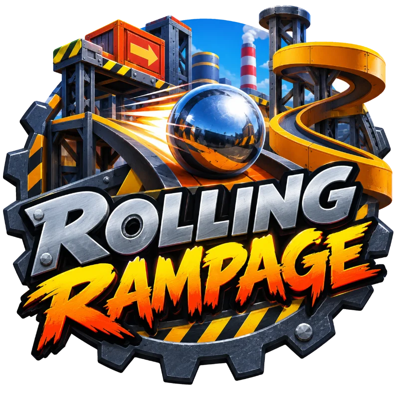

# Rolling Rampage Screens



Step 8 of the Rolling Rampage series. Builds on [Rolling Rampage Enemies](../rolling_rampage_enemies/README.md). What's new is that it is a **game** you start, stop and finish. There is a **title screen** with the logo and a place for your name, a **pause**, a **score** (a game is the three levels, and each is worth a bonus and a hundred points for every second left), a **result screen** that says how the game ended, and a **leaderboard** of the best scores on your device. Every checkpoint, bump, fall, goal and tick of the clock has a **sound**, made in code. And the player's marble is now a **shiny chrome pinball**, like the one in the logo.

This sample is also a [step-by-step tutorial](TUTORIAL.md) you can work through yourself, starting from the Enemies sample. Run `node reset-tutorial.js` to return this folder to the tutorial's starting point.

The page can usually be opened from a file, but a web server is safer: run `npx serve` in the repo root and open the sample through `http://localhost`, or use the live demo.

**Chrome is a sharp highlight and a glowing edge.** The marble is a dark, glassy blue-grey with a very small, hard, white highlight (`specularPower` 160) and a pale glow round its edge that fades to nothing facing the camera (`emissiveFresnelParameters`). That is all it takes for a ball to look polished, and it needs no picture and no new file.

**A game is a state machine.** `Game` is `title`, `playing`, `paused` or `over`, and every method says which states it may come from, so you can't pause the title or end a game that isn't being played. `frozen` is the one question the game loop asks: while it is true, no time passes and the physics isn't stepped.

**Pausing has to stop the forces too.** The physics is frozen, but a push is a *force*, stored until the next step. A player or an enemy that kept pushing during a pause would pile up forces that were all released the moment the game resumed, and the marble would shoot off. So the marble's steering, the enemies and the slime all check `!game.frozen`.

**A score is a pure function.** `levelScore(remaining)` is 500 for finishing and 100 for every whole second left, so a bump (three seconds) or a fall costs points without a rule about it. `Tally` adds a game up, and keeps each level.

**Saving, safely.** The name, the sound setting and the leaderboard are kept in `localStorage`, which can be missing, refuse to save, or hold something damaged or edited by hand. Every use is guarded (`readJson` and `writeJson` give plain answers, never an error), nothing read is trusted (`cleanName`, a filter on every leaderboard row), and the game carries on without it. A name is only ever shown as text, never as HTML.

**Sound from nothing.** Each sound is a row in a table: tones (a wave, a pitch that glides, a start, a length, a volume) and noise (random samples through a low-pass filter). The Web Audio context is made on the first click or key, because the browser keeps sound locked until the player has done something. The audio context is passed in, so the tests use a fake one that records everything made on it.

**Screens are HTML over the canvas.** A title, a pause and a result are mostly text, buttons and a text box, which the page does well, so they are plain `div`s shown one at a time. `Screens` finds them, shows the right one, and fills them in (names as `textContent`, buttons that `blur()` so the space bar doesn't press them again). Each has a CSS file of its own, and each file has a `@media (max-height: 520px)` block so a phone on its side fits: the logo shrinks, and the leaderboard is two columns of five.

**Typing a name mustn't steer.** The steering keys include WASD, and the controls stop the browser acting on a steering key, which would also stop the letter being typed. `typesText` makes the keyboard ignore keys pressed in a text box.

## Key code

**A material that looks like chrome.**

```js
material.diffuseColor = new BABYLON.Color3(0.42, 0.47, 0.58);
material.specularColor = new BABYLON.Color3(1, 1, 1);
material.specularPower = 160;
material.emissiveFresnelParameters = new BABYLON.FresnelParameters({
  bias: 0.05,
  power: 2.5,
  leftColor: BABYLON.Color3.Black(),
  rightColor: new BABYLON.Color3(0.7, 0.8, 0.95),
});
```

**One place a state changes.**

```js
_change(from, state) {
  if (!from.includes(this.state)) return false;
  this.state = state;
  return true;
}
```

**Time stands still.**

```js
scene.physicsEnabled = !game.frozen;
const dt = game.frozen ? 0 : Math.min(engine.getDeltaTime() / 1000, 0.05);
```

**A guarded read.**

```js
function readJson(storage, key) {
  try {
    const text = storage && storage.getItem(key);
    return text ? JSON.parse(text) : null;
  } catch (error) {
    return null;
  }
}
```

**A sound is data.**

```js
checkpoint: [
  { wave: "triangle", from: 784, to: 784, start: 0, length: 0.1, volume: 0.24 },
  { wave: "triangle", from: 1047, to: 1047, start: 0.1, length: 0.25, volume: 0.24 },
],
```

## Babylon.js features demonstrated

- Everything from Rolling Rampage Enemies
- A polished look on a `StandardMaterial` (`specularPower`, `FresnelParameters` on `emissiveFresnelParameters`)
- `scene.physicsEnabled` to freeze the physics
- (The screens, the storage and the sound are the browser's: HTML, `localStorage` and the Web Audio API.)

## Controls

- **Enter**, or **Play**: start a game (also from the result)
- **P** or **Esc**, or the **II** button: pause and resume. A page in the background is paused too
- **M**, or the **Sound** button: sound on and off, remembered
- **T**: back to the title, from the pause or the result
- **Arrow keys or WASD**, **touch and drag**, or **tilt**: roll the marble
- **R**: put the marble back at the last checkpoint (or, on the result, play again)
- **N**: the next level, while playing
- **C**: save a PNG screenshot of the current frame

## Running the tests

Open [tests.html](tests.html) in a browser (or click "Run tests" from the running sample) to run the QUnit suite. It loads Babylon.js and Havok from the internet, so it needs a connection. The new tests cover the marble's shiny look, every rule of the game state, the score and the tally, the profile and the leaderboard against a fake storage and one that throws, every sound against a fake audio context, the screens against a fake page, and the controls ignoring keys pressed while typing.

## Credits

The logo was made for this project, and the fonts are Russo One, Barlow Condensed and Saira Stencil One, from Google Fonts, under the SIL Open Font License, as listed in [the assets README](../assets/README.md). The screens, the profile, the leaderboard and the sounds follow the pattern of the Parkour Runner series.

## Next up

[**Rolling Rampage Polish**](../rolling_rampage_polish/README.md) adds the finishing touches: sparks, a firework, a trail and a camera shake, and a `?dev` panel of sliders to tune the game while you play.
