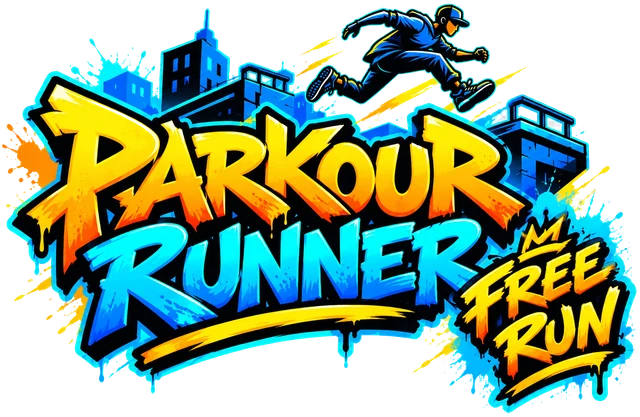

# Parkour Runner Free Run

(The folders of this series are called `rooftop_parkour`: that was the working name.)

A free-roaming parkour game in a city district, in real 3D: run through the streets, climb the buildings by grabbing their ledges, and cross the rooftops, with a third-person camera and a developer mode throughout so that every move can be watched and tuned. The city is a real 3D kit at real scale, and the runner has a whole library of animations. It follows the [Parkour Runner](../parkour_runner/README.md) series, which ran down an endless street; this one is a world you explore.

Like the other series in this repo, each sample is also a step-by-step tutorial: every folder has a `TUTORIAL.md` you can follow from empty files, a `reset-tutorial.js` to go back to the start, and tests you can run in a browser.

The city, the runners and their animations are CC0 models by Quaternius; see the [assets README](assets/README.md).

## The plan

| # | Sample | What it teaches |
|---|--------|-----------------|
| 1 | [Rooftop Parkour World](rooftop_parkour_world/README.md) ([tutorial](rooftop_parkour_world/TUTORIAL.md)) | A loading screen with a real progress bar, a district as data and checks on it, loading once and instancing, the sun and sky for any time of day with cascaded shadows, a third-person camera with the pointer lock that stays out of walls, blended animation clips, walking with walls, and a developer panel |
| 2 | [Rooftop Parkour Run](rooftop_parkour_run/README.md) ([tutorial](rooftop_parkour_run/TUTORIAL.md)) | A kinematic character controller: gravity, steps, falling and landing, standing on a roof, collisions with the buildings as boxes, and a landing animation |
| 3 | [Rooftop Parkour Jump](rooftop_parkour_jump/README.md) ([tutorial](rooftop_parkour_jump/TUTORIAL.md)) | Jumping that feels fair (a tap is a hop, coyote time, a jump buffer), a roll after a long fall, the arithmetic of a jump, and a test that a gap can or can't be jumped |
| 4 | [Rooftop Parkour Ledges](rooftop_parkour_ledges/README.md) ([tutorial](rooftop_parkour_ledges/TUTORIAL.md)) | Finding the ledges of the world from its boxes, deciding whether a hand can catch one, hanging, shimmying along it and climbing up, with the keys read against the wall |
| 5 | [Rooftop Parkour Moves](rooftop_parkour_moves/README.md) ([tutorial](rooftop_parkour_moves/TUTORIAL.md)) | Vaulting a low wall (a line through a box), mantling as catching a ledge with other numbers, a wall kick, a little help for a grab that is nearly right, and a training yard to try them in |
| 6 | [Rooftop Parkour Rooftops](rooftop_parkour_rooftops/README.md) ([tutorial](rooftop_parkour_rooftops/TUTORIAL.md)) | Walls measured from the models, fire escapes from the street to every roof, sills and rooftop things, designed gaps between roofs, and a bot that plays the game to prove each climb and jump can be made |
| 7 | [Rooftop Parkour Goals](rooftop_parkour_goals/README.md) ([tutorial](rooftop_parkour_goals/TUTORIAL.md)) | Tokens to collect, a flow score that rewards chained moves, a time trial with checkpoints, par and medals, and a bot that proves every goal can be reached and what a shortcut saves |
| 8 | Screens | A title with a choice of runner, a pause, best times kept in the browser, sounds and effects |
| 9 | Touch | A phone version: a thumb stick, buttons and a drag-to-look camera |
| 10 | Generator | A city made from a seed, that follows the same rules for what can be jumped |

The plan may shift as each step teaches something unexpected.

## Developer mode

Every sample has a **`?dev`** mode: add it to the address and a panel appears with sliders, switches, read-outs and buttons for the things worth watching and changing while you play (the time of day, the camera, the runner's numbers, the walls). Each sample adds to it, so the game can be tested the way a player won't.

## Credits

Everything in this series that you can see or hear (apart from the code) was made by other people and shared for free, and they deserve the credit. Please have a look at their work, and if you like it, support them.

- **[Quaternius](https://quaternius.com)** ([Patreon](https://www.patreon.com/quaternius)) made the models and the animations, all CC0 (public domain):
  - the **Downtown City MegaKit**: the buildings, the streets, the sidewalks, the fire escapes and the props that make up the district
  - the **Universal Animation Library** (Pro) and the **Universal Animation Library 2** (Standard): the male and female mannequins, and every animation clip they play. Quaternius also has an [animation viewer](https://quaternius.com/animviewer.html) to look through them
- **[Google Fonts](https://fonts.google.com)**: [Sedgwick Ave Display](https://fonts.google.com/specimen/Sedgwick+Ave+Display) and [Bangers](https://fonts.google.com/specimen/Bangers), under the SIL Open Font License

The [assets README](assets/README.md) says exactly which files were used, and what was changed to make them small enough for the web.
