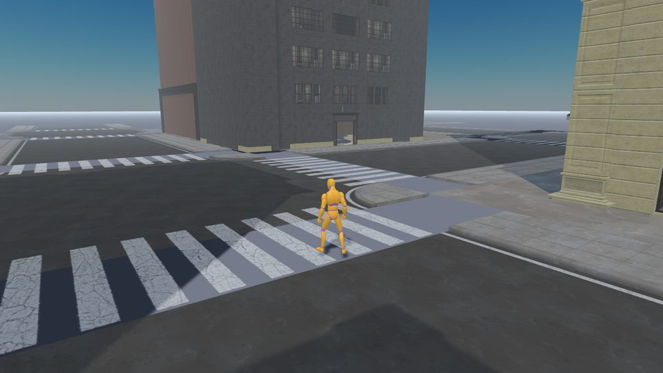

# Rooftop Parkour World



Step 1 of the Rooftop Parkour series. A free-roaming game in a city district: run through the streets, climb the buildings by their ledges, and run across the rooftops. This first step is the **world**: a district of streets and tall buildings made from a real 3D kit, a sun you can move across the sky, a runner you walk about with the keyboard, a third-person camera you steer with the mouse, a loading screen with a real progress bar, and a developer panel to look at it all.

This sample is also a [step-by-step tutorial](TUTORIAL.md) you can work through yourself. Run `node reset-tutorial.js` to return this folder to the tutorial's starting point (empty placeholders).

The models can't be loaded from a page opened from a file, so run a web server: `npx serve` in the repo root and open the sample through `http://localhost`, or use the live demo. Add **`?dev`** to the address for the developer panel.

**A loading screen that tells the truth.** The district is about thirty megabytes, so the loading screen has a bar and a percentage. `LoadProgress` gives every file a weight (its size), adds up what has arrived, and never goes backwards; `easeToward` makes the bar glide when a big building lands all at once; and the screen stays up for a minimum time, so it never just flashes by.

**A world as data.** The plan (`plan.js`) says where each tile of road and each building goes, in metres, as a grid of blocks. Buildings are placed by the street they face, and a checker (`planProblems`) says whether the plan is sound: every building inside its block, none overlapping, every alley at least as wide as it should be. The same numbers will make the walls and the jumps of the later parts.

**Load once, place many.** Each piece is loaded once, kept hidden as a template, and every copy is an *instance* that shares its geometry and its materials. Ninety tiles of road and eight buildings cost nine files.

**The sun is a function of the hour.** `sunAt` is where it is, and `skyLook` is what its light looks like (warm and weak low down, white and strong high up). The `Sky` puts them on the lights, the sky material and the fog, and the developer panel's hour slider moves the sun across the sky, with cascaded shadows that swing round with it.

**A camera that stays out of walls.** The mouse turns the camera (the browser's *pointer lock*), and `clearFraction` is a ray against the buildings' boxes that brings the camera in when a wall is behind the runner.

**Two runners, blended clips.** The male and female mannequins share a skeleton and 46 clips. `clipForSpeed` picks idle, walk, jog or sprint by speed, at a rate that keeps the feet on the ground, and `ClipPlayer` blends from one clip to the next.

**A developer mode from the start.** With `?dev`, a panel of sliders, switches, read-outs and buttons: the hour, the sun, the fog, the shadows, the camera, the runner's speed, a switch to draw the walls, and the position, speed, clip and frame rate. Adding a row is adding a line.

## Key code

**How much has loaded.**

```js
get fraction() {
  let total = 0;
  let loaded = 0;
  for (const item of this.items.values()) {
    total += item.weight;
    loaded += item.weight * item.done;
  }
  return total === 0 ? 1 : loaded / total;
}
```

**Where the sun is.**

```js
function sunAt(hour) {
  const day = (hour - HOURS.sunrise) / (HOURS.sunset - HOURS.sunrise);
  const elevation = Math.sin(Math.PI * day) * NOON_ELEVATION;
  const azimuth = Math.PI * day;
  const toSun = { x: Math.cos(azimuth) * Math.cos(elevation), y: Math.sin(elevation), z: -Math.sin(azimuth) * Math.cos(elevation) };
  return { elevation, azimuth, toSun, light: { x: -toSun.x, y: -toSun.y, z: -toSun.z } };
}
```

**Where the camera is.**

```js
function orbitPosition(target, yaw, pitch, distance) {
  const flat = Math.cos(pitch) * distance;
  return {
    x: target.x - Math.sin(yaw) * flat,
    y: target.y + Math.sin(pitch) * distance,
    z: target.z - Math.cos(yaw) * flat,
  };
}
```

**A row of the developer panel.**

```js
control("hour", () => sky.hour, (value) => sky.setHour(value), HOURS.min, HOURS.max, 0.05),
```

## Babylon.js features demonstrated

- `SceneLoader.ImportMeshAsync` with an `onProgress`, and instancing (`instantiateHierarchy`)
- `SkyMaterial` (a sky from the position of the sun), `DirectionalLight` and `HemisphericLight`, `Scene` fog
- `CascadedShadowGenerator`: shadows in steps of distance
- `FreeCamera` with `setTarget`, and the browser's pointer lock
- Skeletal animation groups, with weights for blending (`setWeightForAllAnimatables`)
- `MeshBuilder.CreateGround` and `CreateBox`, `StandardMaterial` wireframes, `freezeWorldMatrix`
- Testing with a stand-in for the loader and a `NullEngine`

## Controls

- **WASD** or the arrow keys: run, relative to the camera. **Shift**: sprint
- **Click** the picture: take the mouse, and look around by moving it. **Esc**: let it go
- **R**: go back to the start. **C**: a screenshot
- With **`?dev`** on the address: the key under **Esc** hides and shows the developer panel, and its title bar folds it up

## Running the tests

Open [tests.html](tests.html) in a browser (or click "Run tests" from the running sample) to run the QUnit suite. It loads Babylon.js from the internet, so it needs a connection. The tests cover the loading progress and the splash, the plan (and the ways it can be wrong), the library of pieces against a stand-in loader, the sun and the sky, the camera and the pointer lock, the choice and blending of clips, the scout and its walls, and the developer panel.

## Credits

The models and animations are CC0 (public domain), made by [Quaternius](https://quaternius.com) ([Patreon](https://www.patreon.com/quaternius)): the Downtown City MegaKit for the district, and the Universal Animation Libraries for the mannequins and their clips. The fonts are [Sedgwick Ave Display](https://fonts.google.com/specimen/Sedgwick+Ave+Display) and [Bangers](https://fonts.google.com/specimen/Bangers), from Google Fonts, under the SIL Open Font License. Please have a look at their work. The [series README](../README.md#credits) and the [assets README](../assets/README.md) have the details.

## Next up

[**Rooftop Parkour Run**](../rooftop_parkour_run/README.md) gives the runner a body: gravity, steps, walls, standing on a roof, falling off it and landing, as a character controller you write yourself, with the buildings as boxes.
