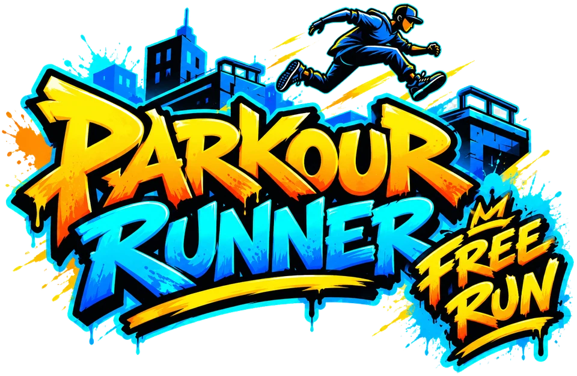

# Tutorial: Rooftop Parkour World -- A District to Run Through

This is the first tutorial of a new series, **Rooftop Parkour**: a free-roaming game in a city district, in which you run through the streets, climb the buildings by grabbing their ledges, and run and jump across the rooftops. In this first step there is no climbing yet, and no jumping. There is a **world**: a district of streets and tall buildings made from a real 3D kit, a **sun** that you can move across the sky, a **runner** who walks about the streets in a **third-person camera** that you steer with the mouse, a **loading screen** with a real progress bar (the district is about thirty megabytes, so it takes a moment), and a **developer panel** to look at all of it. You write the code; this document tells you what to write and why.

By the end you'll have:

- A **loading screen** with a bar and a percentage that follow the real downloads, as plain code that is tested
- A **plan of the district** as data (streets, blocks, buildings) and checks that the plan is sound: nothing overlaps, and the alleys between buildings are as wide as they should be
- **Loading each 3D piece once**, and placing copies of it (instances), so a district of ninety street tiles and eight buildings costs only a few files
- A **sky and a sun for any time of day**: where the sun is, what colour its light is, how long the shadows are, and the haze on the horizon
- A **third-person camera** turned by the mouse (using the browser's pointer lock) that is kept from going into walls
- **Two runners**, male and female, whose animation changes with their speed, blending from one clip to the next
- A **scout**: a runner who walks the ground with the keys, and can't walk through the buildings
- A **developer panel** (add `?dev` to the address) with sliders, switches, read-outs and buttons, which you will use in every part of the series
- Unit tests for all of it, using stand-ins for Babylon.js and the page

**What you'll learn:** how to show real loading progress, how to keep a world as data and check it with code, loading models once and making instances, the sun as a function of the time of day, cascaded shadows, a third-person camera and the pointer lock, a camera that doesn't go through walls (a ray against boxes), blending animation clips, moving a character with the keys and stopping it at walls, a developer mode that grows with the game, and testing code that needs Babylon.js and the page by giving it fakes.

## Where you're starting

This folder holds an empty placeholder for every file you will write, and the pictures, models and fonts you need are already in the series' shared `assets` folder, one level up:

```
rooftop_parkour/
├── assets/                    (the models, the fonts, and a README that says what is in them)
│   ├── character/runner.glb, runner_f.glb
│   ├── city/                  (buildings, street tiles, props, and textures/)
│   └── fonts/
└── rooftop_parkour_world/
    ├── index.html, tests.html   (placeholders -- Steps 1 and 9)
    ├── css/
    │   ├── theme.css, page.css, splash.css   (placeholders -- Step 1)
    │   ├── devpanel.css        (placeholder -- Step 8)
    │   └── look.css            (placeholder -- Step 9)
    ├── js/
    │   ├── progress.js, splash.js   (placeholders -- Step 1)
    │   ├── plan.js             (placeholder -- Step 2)
    │   ├── models.js           (placeholder -- Step 3)
    │   ├── sky.js              (placeholder -- Step 4)
    │   ├── camera.js           (placeholder -- Step 5)
    │   ├── character.js        (placeholder -- Step 6)
    │   ├── scout.js            (placeholder -- Step 7)
    │   ├── debug.js, devpanel.js   (placeholders -- Step 8)
    │   └── main.js             (placeholder -- Step 9)
    └── tests/
        └── a test file for each of those, except main.js   (placeholders)
```

### The assets

Everything is in metres, the unit of the models: the runner is 1.8 tall, a floor of a building is about 3, and a street is 18 across (with its sidewalks). The buildings are **17 to 41 tall**, and about 12 to 25 wide. Each has a **front**, with the windows and the door, and plain sides and back, because they are meant to stand in rows. `assets/README.md` has the details, and says where the models came from (all CC0, by Quaternius).

### Serving the page

The models can't be loaded from a page opened straight from a file, so this sample needs a web server. Run `npx serve` in the repo's root folder and open `http://localhost:3000/samples/rooftop_parkour/rooftop_parkour_world/` (the command prints the exact address), or use the *Live Server* extension in VS Code. Add `?dev` to the address for the developer panel.

### Starting over

To get back to exactly this starting point at any time, run the reset script from this folder:

```
node reset-tutorial.js
```

It asks for confirmation, then replaces `index.html`, `tests.html`, `css/`, `js/` and `tests/` with empty placeholders. Pass `--yes` to skip the question. Your work in those files is overwritten, so copy anything you want to keep first. `TUTORIAL.md` and `README.md` are never touched. It needs [Node.js](https://nodejs.org/) 16.7 or newer and no other setup.

---

> **A note on how this tutorial builds code.** When a step creates a *new class*, the class is shown **complete and closed** straight away. Files that other files depend on end with a short block that exports their names. That way every file is valid JavaScript after every step. Where a step adds a long function, paste it **whole**. Where it **replaces** something, **delete the old one**: a file with two functions of the same name runs the last. `main.js` is built last, in pieces, each added **above** a comment that says where.

> **A note on scripts.** The scripts of this tutorial can go in the list in any order, as long as they are **above `main.js`**. `index.html` is written in Step 1 with the whole list already in it, so you won't need to come back to it. `tests.html` is built up one step at a time.

---

## Step 1: A page, and a loading screen

The district is about thirty megabytes of models and textures. On a good connection that is a few seconds, and on a slow one it is much longer, and a page that shows nothing for that long looks broken. So the first thing you build is the **loading screen**, with a bar and a percentage, driven by how much has really arrived.

### 1a. The style

The look of the game is named once, in `css/theme.css`: a few colours and two fonts, and every other file uses the names. Open the placeholder and replace its contents with:

```css
/* The look of Rooftop Parkour: asphalt grey, a safety orange, a warm white, and graffiti lettering. The colours and the fonts are named
   once here, and everything else uses the names. */
@font-face {
  font-family: "Sedgwick Ave Display";
  src: url("../../assets/fonts/SedgwickAveDisplay-Regular.ttf") format("truetype");
  font-display: swap;
}
@font-face {
  font-family: "Bangers";
  src: url("../../assets/fonts/Bangers-Regular.ttf") format("truetype");
  font-display: swap;
}
:root {
  --title-font: "Sedgwick Ave Display", "Bangers", system-ui, sans-serif; /* graffiti handwriting, for the title and the headings */
  --small-font: "Bangers", system-ui, sans-serif; /* a comic face, for the small words that must be read */

  --asphalt: #1d2027; /* dark, behind everything */
  --concrete: #4a4f5a;
  --paper: #f4efe6;
  --orange: #ff7a1a; /* the accent: spray paint, warnings, the thing to look at */
  --sky: #7fb4ee;
  --good: #7ee081;
}
```

Then `css/page.css`, for the page itself:

```css
/* The page itself. .hint has pointer-events: none so the canvas stays interactive; opt the "Run tests" link back in so it can be clicked. */
.hint a {
  pointer-events: auto;
  color: var(--sky);
}
.hint {
  font-family: var(--small-font);
  letter-spacing: 0.05em;
}

/* The back button and the hint stay above the loading screen's fade and anything else. */
.back-button,
.hint {
  z-index: 26;
}

/* Touch and the mouse. The page must not scroll, zoom or select text when something is dragged over it. */
html,
body {
  overscroll-behavior: none;
  -webkit-tap-highlight-color: transparent;
  -webkit-user-select: none;
  user-select: none;
}
```

And `css/splash.css`, for the loading screen:

```css
/* The loading screen covers the page while the district loads, with a bar and a percentage that follow the real progress, then fades away. */
#splash {
  position: fixed;
  inset: 0;
  z-index: 30;
  display: flex;
  flex-direction: column;
  align-items: center;
  justify-content: center;
  gap: 18px;
  background: radial-gradient(circle at 50% 40%, #2b303b, var(--asphalt) 75%);
  color: var(--paper);
  transition: opacity 0.6s ease;
}
#splash.hidden {
  opacity: 0;
  pointer-events: none;
}
#splash h1 {
  margin: 0;
  line-height: 0;
}
#splash h1 img {
  display: block;
  width: auto;
  height: auto;
  max-width: min(80vw, 520px);
  max-height: 46vh;
  filter: drop-shadow(0 6px 18px rgba(0, 0, 0, 0.6));
}
#splash-bar {
  width: min(70vw, 460px);
  height: 16px;
  border: 3px solid var(--paper);
  border-radius: 10px;
  background: rgba(0, 0, 0, 0.45);
  overflow: hidden;
}
#splash-fill {
  width: 0;
  height: 100%;
  background: repeating-linear-gradient(-45deg, var(--orange) 0 12px, #ffb066 12px 24px);
}
#splash-status {
  margin: 0;
  min-height: 1.4em;
  padding: 0 24px;
  text-align: center;
  font: 20px / 1.4 var(--small-font);
  letter-spacing: 0.06em;
}
#splash.failed #splash-bar {
  display: none;
}
#splash.failed #splash-status {
  max-width: 34em;
  color: #ffb4a0;
  font: 16px / 1.5 system-ui, sans-serif;
  letter-spacing: 0;
}
```

Things to notice:

- **The fonts are the graffiti and comic faces of the Parkour Runner series**, from the series' shared `assets/fonts`. The path in `url(...)` is relative to the **CSS file**, which is why it goes up two folders.
- **Each part of the page has its own small style file**: the page, the splash, and (later) the mouse prompt and the developer panel. A new part of the page is a new file and a new `<link>`.
- **The bar is a box with a fill in it** (`#splash-fill`), and the code sets the fill's width. The stripes are a `repeating-linear-gradient`, so the bar itself is no picture. The one picture on the loading screen is the game's logo, `assets/images/parkour_runner_freerun_splash.webp` (about 180 kilobytes, with a see-through background), in an `<h1>` that has the game's name as its `alt` text, so a page where the picture fails still has a title.
- **`#splash.failed`** hides the bar and shows the words as a message, for when something goes wrong.

### 1b. The page

`index.html` has the loading screen, the mouse prompt, the canvas, and the list of scripts. Open the placeholder and replace its contents with:

```html
<!DOCTYPE html>
<html lang="en">

<head>
  <meta charset="utf-8">
  <meta name="viewport" content="width=device-width, initial-scale=1, maximum-scale=1, user-scalable=no">
  <title>Rooftop Parkour World - Babylon.js</title>
  <link rel="stylesheet" href="../../../css/sample.css">
  <link rel="stylesheet" href="css/theme.css">
  <link rel="stylesheet" href="css/page.css">
  <link rel="stylesheet" href="css/splash.css">
  <link rel="stylesheet" href="css/look.css">
  <link rel="stylesheet" href="css/devpanel.css">
  <script src="https://cdn.babylonjs.com/babylon.js"></script>
  <script src="https://cdn.babylonjs.com/loaders/babylonjs.loaders.min.js"></script>
  <script src="https://cdn.babylonjs.com/materialsLibrary/babylonjs.materials.min.js"></script>
  <script>
    // Rooftop Parkour will use Space to jump, so move the shared screenshot shortcut to C for this series.
    window.SCREENSHOT_KEY = "KeyC";
  </script>
</head>

<body>
  <a class="back-button" href="../../../index.html#rooftop_parkour">&larr; Samples</a>
  <div class="hint">WASD run &middot; Shift sprint &middot; mouse look (click first, Esc lets go) &middot; R restart &middot; C screenshot &middot; <a href="tests.html">Run tests</a></div>
  <div id="splash">
    <h1></h1>
    <div id="splash-bar" role="progressbar" aria-label="Loading" aria-valuemin="0" aria-valuemax="100" aria-valuenow="0"><div id="splash-fill"></div></div>
    <p id="splash-status">Loading the district&hellip;</p>
  </div>
  <p id="look-prompt">Click to look around</p>
  <div id="crosshair"></div>
  <canvas id="renderCanvas"></canvas>
  <script src="../../../js/screenshot.js"></script>
  <script src="js/progress.js"></script>
  <script src="js/splash.js"></script>
  <script src="js/plan.js"></script>
  <script src="js/models.js"></script>
  <script src="js/sky.js"></script>
  <script src="js/camera.js"></script>
  <script src="js/character.js"></script>
  <script src="js/scout.js"></script>
  <script src="js/debug.js"></script>
  <script src="js/devpanel.js"></script>
  <script src="js/main.js"></script>
</body>

</html>
```

Things to notice:

- **The page loads the Babylon.js materials library** (`babylonjs.materials.min.js`), which has the sky material of Step 4.
- **The screenshot shortcut moves to `C`** (`window.SCREENSHOT_KEY`), because Space will jump later.
- **The loading screen is in the page itself**, as plain HTML, so it is there the instant the page is, before any script has run.
- **The bar is a `role="progressbar"`**, with `aria-valuenow` kept up to date, so a screen reader can say how far along it is.
- **The list of scripts is complete**, with every file of the tutorial. The ones you haven't written are empty placeholders, which a page loads without complaint.

### 1c. How much has loaded

A bar needs one number: how much of everything has loaded, from 0 to 1. The district is many files, of different sizes, so each file is given a **weight** (its size is a good one) and the progress is the weight that has arrived, out of all the weight. That is plain arithmetic with no Babylon.js and no page, so it is easy to test. Open the placeholder `js/progress.js` and replace its contents with:

```js
// How much of the game has loaded, as one number, so the loading screen can show a bar and a percentage. The game loads a lot
// of files (every building, the street, the runner), and they are not all the same size, so each one is given a weight (how
// much of the waiting it is: its size in kilobytes will do), and the progress is the weight that has loaded out of all of it.
// This has no Babylon.js and no page in it, so it is easy to test. See ../tests/progress.tests.js.

class LoadProgress {
  constructor() {
    this.items = new Map(); // name -> { weight, done } where done is from 0 to 1
    this.listeners = [];
  }

  // Says that something has to be loaded, and how much of the wait it is. Adding it again changes its weight.
  add(name, weight) {
    const item = this.items.get(name) || { weight: 1, done: 0 };
    item.weight = weight > 0 ? weight : 1;
    this.items.set(name, item);
    this._changed();
  }

  // Says how much of one thing has loaded, from 0 to 1. A bar that goes backwards is confusing, so it never goes down. Something
  // that was never added is added with a weight of 1.
  update(name, fraction) {
    if (!this.items.has(name)) this.items.set(name, { weight: 1, done: 0 });
    const item = this.items.get(name);
    const clean = Number.isFinite(fraction) ? Math.min(1, Math.max(0, fraction)) : 0;
    item.done = Math.max(item.done, clean);
    this._changed();
  }

  complete(name) {
    this.update(name, 1);
  }

  // How much has loaded, from 0 to 1. With nothing to load, there is nothing to wait for, so it is 1.
  get fraction() {
    let total = 0;
    let loaded = 0;
    for (const item of this.items.values()) {
      total += item.weight;
      loaded += item.weight * item.done;
    }
    return total === 0 ? 1 : loaded / total;
  }

  // A whole number of percent. It says 100 only when everything is done, not when it is nearly there.
  get percent() {
    return this.fraction >= 1 ? 100 : Math.min(99, Math.floor(this.fraction * 100));
  }

  get done() {
    return this.fraction >= 1;
  }

  // The name of something that is still loading (the heaviest one), for the line of words under the bar. Or null if all is done.
  get busy() {
    let heaviest = null;
    for (const [name, item] of this.items) {
      if (item.done < 1 && (!heaviest || item.weight > this.items.get(heaviest).weight)) heaviest = name;
    }
    return heaviest;
  }

  // Calls `listener` every time something changes.
  onChange(listener) {
    this.listeners.push(listener);
  }

  _changed() {
    for (const listener of this.listeners) listener(this);
  }
}

// Moves a number toward where it is going, a share of the way each second, so a bar glides instead of jumping when a big file
// finishes. It never overshoots, and it never goes backwards. `rate` is how quickly: 6 closes most of the gap in half a second.
function easeToward(shown, target, dt, rate = 6) {
  if (target <= shown) return shown;
  return shown + (target - shown) * (1 - Math.exp(-rate * dt));
}

// A fraction as the words on the loading screen: 0.426 is "42%".
function formatPercent(fraction) {
  if (fraction >= 1) return "100%";
  return `${Math.min(99, Math.max(0, Math.floor(fraction * 100)))}%`;
}

// Plain <script> include (no bundler in this project), so export via both
// CommonJS (for the QUnit/Node test runner) and the global scope (for
// index.html) depending on which environment loads this file.
if (typeof module !== "undefined" && module.exports) {
  module.exports = { LoadProgress, easeToward, formatPercent };
} else {
  Object.assign(window, { LoadProgress, easeToward, formatPercent });
}
```

Things to notice:

- **`add(name, weight)` says that something is coming**, and how much of the wait it is. Everything is added **at the start**, so the total is known and the bar never goes backwards because more turned up.
- **`update(name, fraction)` says how far one thing has got.** It never lets a thing go down (`Math.max`), because a bar that goes backwards is confusing.
- **Nothing to load means everything is loaded**: `fraction` is 1 with no items. (So the bar must be given its items before it is looked at.)
- **`percent` says 100 only when everything is done.** A bar that says 100% and then waits is worse than one that says 99%.
- **`busy` is the heaviest thing still loading**, for the words under the bar: *Building Large 1*.
- **`easeToward(shown, target, dt)` is how the bar glides.** A big building arrives all at once and would make the bar jump, so what is *shown* moves toward the real number a share of the way each second. It never overshoots and never goes backwards.

### The splash

The loading screen is an object that knows the page's elements, so the rest of the game can say *the bar is at 42%* and not have to know about HTML. Open the placeholder `js/splash.js` and replace its contents with:

```js
// The loading screen. It covers the page while the district loads, with a bar and a percentage that follow the real progress, so
// that a person waiting for thirty megabytes can see that something is happening. If everything loads quickly, taking the splash
// away at once would just make it flash by, so it stays up for a minimum time: remainingSplashTime works out how much longer.
// Times are in milliseconds, and `now` and `shownAt` come from performance.now(). The Splash is built from the page's own
// elements, and given the `document` to look in, so the tests can give it a stand-in. See ../tests/splash.tests.js.
function remainingSplashTime(shownAt, now, minimum) {
  return Math.max(0, minimum - (now - shownAt));
}

class Splash {
  constructor(doc = document) {
    const get = (id) => doc.getElementById(id);
    this.root = get("splash");
    this.bar = get("splash-bar");
    this.fill = get("splash-fill");
    this.status = get("splash-status");
    this.shown = 0; // the fraction the bar is showing now
    this.finished = false; // set when the splash has gone, so whatever keeps it up to date can stop
    this.setProgress(0);
  }

  // Shows how much has loaded, from 0 to 1: the bar fills, and the percentage is written under it.
  setProgress(fraction) {
    this.shown = Math.min(1, Math.max(0, fraction));
    this.fill.style.width = `${(this.shown * 100).toFixed(1)}%`;
    this.bar.setAttribute("aria-valuenow", String(Math.floor(this.shown * 100)));
  }

  // The words under the bar: what is loading, and how far it has got.
  setStatus(text) {
    this.status.textContent = text;
  }

  // Something went wrong: say so, in the place where the loading was.
  fail(message) {
    this.root.classList.add("failed");
    this.status.textContent = message;
  }

  // Fades the splash out. It is taken away from the page a moment later, when the fade has finished.
  hide() {
    this.root.classList.add("hidden");
  }

  remove() {
    this.root.remove();
  }
}

// Plain <script> include (no bundler in this project), so export via both
// CommonJS (for the QUnit/Node test runner) and the global scope (for
// index.html) depending on which environment loads this file.
if (typeof module !== "undefined" && module.exports) {
  module.exports = { remainingSplashTime, Splash };
} else {
  Object.assign(window, { remainingSplashTime, Splash });
}
```

Things to notice:

- **`Splash` is given the `document`** to look in, so the tests can give it a stand-in.
- **`remainingSplashTime`** is from the earlier series: if everything loads quickly, taking the splash away at once would just make it flash by, so it stays up for a minimum time.
- **`fail` puts the error where the loading was.** A page that fails to load its models, and just stays on a bar, is the worst of all worlds.

### Tests

Create `tests.html`. Open the placeholder and replace its contents with:

```html
<!DOCTYPE html>
<html lang="en">

<head>
  <meta charset="utf-8">
  <title>Rooftop Parkour World tests - Babylon.js Samples</title>
  <link rel="stylesheet" href="https://code.jquery.com/qunit/qunit-2.22.0.css" integrity="sha384-Gvip0iPXLBuTKlP0Fan1cxz2R4K8z+c4rnqVxXfz96ojkUDMp2HvFsByVGtBT30o" crossorigin="anonymous">
</head>

<body>
  <div id="qunit"></div>
  <div id="qunit-fixture"></div>
  <script src="https://code.jquery.com/qunit/qunit-2.22.0.js" integrity="sha384-DV6SS+E/t7VjqLYyoFfHRcjHiDgluMrKnNvW5ZwZMqDsQWUQs58s8aj5pXXkY2Gx" crossorigin="anonymous"></script>
  <script src="https://cdn.babylonjs.com/babylon.js"></script>
  <script src="js/progress.js"></script>
  <script src="js/splash.js"></script>
  <script src="js/plan.js"></script>
  <script src="js/models.js"></script>
  <script src="js/sky.js"></script>
  <script src="js/camera.js"></script>
  <script src="js/character.js"></script>
  <script src="js/scout.js"></script>
  <script src="js/debug.js"></script>
  <script src="js/devpanel.js"></script>
  <script src="tests/progress.tests.js"></script>
  <script src="tests/splash.tests.js"></script>
  <script src="tests/plan.tests.js"></script>
  <script src="tests/models.tests.js"></script>
  <script src="tests/sky.tests.js"></script>
  <script src="tests/camera.tests.js"></script>
  <script src="tests/character.tests.js"></script>
  <script src="tests/scout.tests.js"></script>
  <script src="tests/debug.tests.js"></script>
  <script src="tests/devpanel.tests.js"></script>
</body>

</html>
```

That is the **complete** page: every script and every test file of the tutorial is in it. The ones you haven't written yet are placeholders that hold only a comment, which a page loads without complaint, so `tests.html` is finished, and the steps below only fill in test files. (Until the first tests are written, QUnit says *No tests were run*.)

Open the placeholder `tests/progress.tests.js` and replace its contents with:

```js
QUnit.module("LoadProgress", () => {
  QUnit.test("with nothing to load, everything is loaded", (assert) => {
    const progress = new LoadProgress();
    assert.strictEqual(progress.fraction, 1);
    assert.true(progress.done);
  });

  QUnit.test("nothing has loaded until something says so, and then it is the share of the weight", (assert) => {
    const progress = new LoadProgress();
    progress.add("big", 3);
    progress.add("small", 1);
    assert.strictEqual(progress.fraction, 0);
    assert.false(progress.done);

    progress.complete("small");
    assert.strictEqual(progress.fraction, 0.25);

    progress.update("big", 0.5);
    assert.strictEqual(progress.fraction, (1 + 1.5) / 4);
  });

  QUnit.test("it never goes backwards", (assert) => {
    const progress = new LoadProgress();
    progress.add("a", 1);
    progress.update("a", 0.8);
    progress.update("a", 0.3);
    assert.strictEqual(progress.fraction, 0.8);
  });

  QUnit.test("a number that is not a share is held to 0 to 1, and a number that isn't one is 0", (assert) => {
    const progress = new LoadProgress();
    progress.add("a", 1);
    progress.update("a", 7);
    assert.strictEqual(progress.fraction, 1);
    const other = new LoadProgress();
    other.add("a", 1);
    other.update("a", NaN);
    other.update("a", undefined);
    assert.strictEqual(other.fraction, 0);
  });

  QUnit.test("something that was never added is added, with a weight of 1", (assert) => {
    const progress = new LoadProgress();
    progress.add("a", 1);
    progress.update("b", 1);
    assert.strictEqual(progress.fraction, 0.5);
  });

  QUnit.test("adding something again changes its weight and keeps how far it had got", (assert) => {
    const progress = new LoadProgress();
    progress.add("a", 1);
    progress.add("b", 1);
    progress.complete("a");
    progress.add("a", 3);
    assert.strictEqual(progress.fraction, 3 / 4);
  });

  QUnit.test("a weight that isn't a number above 0 counts as 1", (assert) => {
    const progress = new LoadProgress();
    progress.add("a", 0);
    progress.add("b", -4);
    progress.complete("a");
    assert.strictEqual(progress.fraction, 0.5);
  });

  QUnit.test("the percent is a whole number, and is 100 only when everything is done", (assert) => {
    const progress = new LoadProgress();
    progress.add("a", 1000);
    progress.update("a", 0.426);
    assert.strictEqual(progress.percent, 42);
    progress.update("a", 0.9999);
    assert.strictEqual(progress.percent, 99);
    progress.complete("a");
    assert.strictEqual(progress.percent, 100);
  });

  QUnit.test("busy is the heaviest thing still loading, and null when all is done", (assert) => {
    const progress = new LoadProgress();
    progress.add("small", 1);
    progress.add("big", 9);
    progress.add("middle", 5);
    assert.strictEqual(progress.busy, "big");
    progress.complete("big");
    assert.strictEqual(progress.busy, "middle");
    progress.complete("middle");
    progress.complete("small");
    assert.strictEqual(progress.busy, null);
  });

  QUnit.test("listeners are told about every change", (assert) => {
    const progress = new LoadProgress();
    const seen = [];
    progress.onChange((p) => seen.push(p.fraction));
    progress.add("a", 1);
    progress.update("a", 0.5);
    progress.complete("a");
    assert.deepEqual(seen, [0, 0.5, 1]);
  });
});

QUnit.module("easeToward and formatPercent", () => {
  QUnit.test("easeToward moves toward the target, a share of the way each second, and never past it", (assert) => {
    const once = easeToward(0, 1, 0.1, 6);
    assert.true(once > 0 && once < 1);
    assert.true(easeToward(0, 1, 10, 6) <= 1);
    assert.true(easeToward(0.9, 1, 0.1, 6) > 0.9);
  });

  QUnit.test("easeToward never goes backwards, and a longer wait goes further", (assert) => {
    assert.strictEqual(easeToward(0.8, 0.5, 1), 0.8);
    assert.strictEqual(easeToward(0.5, 0.5, 1), 0.5);
    assert.true(easeToward(0, 1, 0.5) > easeToward(0, 1, 0.1));
  });

  QUnit.test("with no time passed, it stays where it is", (assert) => {
    assert.strictEqual(easeToward(0.3, 1, 0), 0.3);
  });

  QUnit.test("formatPercent writes a share as whole percent, and 100% only for all", (assert) => {
    assert.strictEqual(formatPercent(0), "0%");
    assert.strictEqual(formatPercent(0.426), "42%");
    assert.strictEqual(formatPercent(0.9999), "99%");
    assert.strictEqual(formatPercent(1), "100%");
    assert.strictEqual(formatPercent(3), "100%");
    assert.strictEqual(formatPercent(-1), "0%");
  });
});
```

Then `tests/splash.tests.js`:

```js
QUnit.module("remainingSplashTime", () => {
  QUnit.test("is how much of the minimum is left", (assert) => {
    assert.strictEqual(remainingSplashTime(1000, 1500, 3000), 2500);
  });

  QUnit.test("is 0 once the minimum has passed", (assert) => {
    assert.strictEqual(remainingSplashTime(1000, 5000, 3000), 0);
    assert.strictEqual(remainingSplashTime(1000, 4000, 3000), 0);
  });
});

QUnit.module("Splash", () => {
  class FakeElement {
    constructor() {
      this.style = {};
      this.attributes = {};
      this.classes = new Set();
      this.textContent = "";
      this.removed = false;
      this.classList = { add: (name) => this.classes.add(name), contains: (name) => this.classes.has(name) };
    }
    setAttribute(name, value) {
      this.attributes[name] = value;
    }
    remove() {
      this.removed = true;
    }
  }

  const make = () => {
    const els = {};
    for (const id of ["splash", "splash-bar", "splash-fill", "splash-status"]) els[id] = new FakeElement();
    return { splash: new Splash({ getElementById: (id) => els[id] }), els };
  };

  QUnit.test("starts with an empty bar", (assert) => {
    const { splash, els } = make();
    assert.strictEqual(els["splash-fill"].style.width, "0.0%");
    assert.strictEqual(els["splash-bar"].attributes["aria-valuenow"], "0");
    assert.strictEqual(splash.finished, false);
  });

  QUnit.test("setProgress fills the bar, and tells a screen reader how far", (assert) => {
    const { splash, els } = make();
    splash.setProgress(0.426);
    assert.strictEqual(els["splash-fill"].style.width, "42.6%");
    assert.strictEqual(els["splash-bar"].attributes["aria-valuenow"], "42");
  });

  QUnit.test("a share outside 0 to 1 is held to the bar's ends", (assert) => {
    const { splash, els } = make();
    splash.setProgress(3);
    assert.strictEqual(els["splash-fill"].style.width, "100.0%");
    splash.setProgress(-1);
    assert.strictEqual(els["splash-fill"].style.width, "0.0%");
  });

  QUnit.test("setStatus writes the words under the bar", (assert) => {
    const { splash, els } = make();
    splash.setStatus("42%  ·  Building Large 1");
    assert.strictEqual(els["splash-status"].textContent, "42%  ·  Building Large 1");
  });

  QUnit.test("fail says what went wrong, and marks the splash so the bar can be hidden", (assert) => {
    const { splash, els } = make();
    splash.fail("Something went wrong");
    assert.true(els["splash"].classList.contains("failed"));
    assert.strictEqual(els["splash-status"].textContent, "Something went wrong");
  });

  QUnit.test("hide fades it out, and remove takes it away", (assert) => {
    const { splash, els } = make();
    splash.hide();
    assert.true(els["splash"].classList.contains("hidden"));
    assert.false(els["splash"].removed);
    splash.remove();
    assert.true(els["splash"].removed);
  });
});
```

Things to notice:

- **The progress tests are the rules of a bar**: it never goes backwards, a share outside 0 to 1 is held to it, a number that isn't one is 0, a weight that isn't above 0 counts as 1, and 100 means done.
- **`easeToward` is tested for the things that would be wrong on the screen**: it never passes its target, never goes down, and with no time passed, doesn't move.
- **The splash is tested against a stand-in page**: a few elements that remember what was done to them. The test checks what the splash *asks for*, not what it looks like.

Open `tests.html`. You should see **22 passing tests**.

---

## Step 2: The plan of the district

The district is a **grid of blocks** with streets between them. Rather than placing buildings one at a time in the middle of the code, keep the whole thing as **data**: where each street tile goes, which building stands where, and how big each is. Then the data can be checked (are two buildings overlapping?), and later parts of the game can use the very same numbers: the walls the runner can't walk through, and the places a runner can jump between. Open the placeholder `js/plan.js` and replace its contents with:

```js
// The plan of the district: where each street tile and each building goes. It is plain data and plain functions (no Babylon.js, no
// page), so the plan can be checked by tests, and so later parts of the game can use the very same numbers (the collision boxes
// of the buildings, the places a runner can jump between). Everything is in metres, the unit of the models. The ground is the
// plane y = 0, x goes east and z goes north. See ../tests/plan.tests.js.

// The street. A tile of road is 6 long and 18 across: 3 of sidewalk, 12 of road (four lanes), and 3 of sidewalk. A crossing is
// a square junction, a little over 24 across, and a road runs into each side of it.
const STREET = { tile: 6, width: 18, junction: 74 / 3, file: "Street_4Lane", junctionFile: "Street_4WayIntersection" };

// A district is a grid of blocks. Streets run between them, and round the outside, so a district of 2 by 2 blocks has 3 streets
// each way, and 9 junctions. `tilesBetween` is how many tiles of road lie between one junction and the next (which makes the
// blocks the size they are), and `extraTiles` how many run on past the junctions at the edge, out toward the fog.
const GRID = { blocksX: 2, blocksZ: 2, tilesBetween: 4, extraTiles: 3 };

// The road is lower than the sidewalk: its surface is this far below the plane y = 0, which is the top of the sidewalks and of the ground
// of the blocks. A runner on the road stands this much lower than one on the sidewalk.
const ROAD_DEPTH = 0.15;

// The least width of an alley between two buildings. Narrower than a body, and it would be a crack in the wall.
const MIN_ALLEY = 1.5;

// The buildings of the kit, and how big each is: the width and depth of its footprint, and its height, as measured from the files
// (see assets/README.md). A building has a front, with the windows and the door, which is its +z side as it comes out of its file.
const BUILDINGS = {
  small_1: { file: "Building_Small_1", width: 12.46, depth: 14.536, height: 17.014 },
  small_2: { file: "Building_Small_2", width: 20, depth: 12.002, height: 18.999 },
  medium_1: { file: "Building_Medium_1", width: 13.056, depth: 12.054, height: 27.915 },
  medium_2: { file: "Building_Medium_2", width: 15.056, depth: 13.056, height: 24.998 },
  large_1: { file: "Building_Large_1", width: 25.038, depth: 26.028, height: 41 },
  large_2: { file: "Building_Large_2", width: 20.644, depth: 16.644, height: 28 },
  large_3: { file: "Building_Large_3", width: 23.056, depth: 19.058, height: 34.945 },
};

// Which way a building's front faces, and how far it is turned from the way it comes out of its file (facing north).
const FACINGS = { north: 0, east: Math.PI / 2, south: Math.PI, west: -Math.PI / 2 };

// What is on each block. `u` and `v` are where the middle of the building is, from the middle of the block (u to the east, v to
// the north). A building facing a street stands right up to the sidewalk, so only the place along the street is given, and the
// other is worked out. A building with both is put exactly there (the tower of a block stands in the middle).
const LAYOUTS = {
  "0,0": [
    { building: "small_1", facing: "north", u: -8.5 },
    { building: "medium_1", facing: "north", u: 8 },
    { building: "medium_2", facing: "south", u: -7 },
    { building: "small_1", facing: "south", u: 9 },
  ],
  "1,0": [{ building: "large_1", facing: "north", u: 0, v: 0 }],
  "0,1": [{ building: "large_3", facing: "north", u: -3.8 }],
  "1,1": [
    { building: "large_2", facing: "north", u: -4.7 },
    { building: "small_2", facing: "south", u: -5.3 },
  ],
};

// How high the ground is at a place: ROAD_DEPTH below zero on a road, and zero everywhere else (the sidewalks, and the blocks). A road is
// the band of asphalt (12 across: the middle of the 18 of a street) along each street, and the square of a junction, which is a little
// wider than a street, along its roads.
function groundHeight(x, z, grid = GRID) {
  const half = STREET.junction / 2;
  const asphalt = (STREET.width - 6) / 2; // half the width of the road: the sidewalks are 3 on each side of it
  for (let i = 0; i <= grid.blocksX; i++) {
    for (let j = 0; j <= grid.blocksZ; j++) {
      const at = junctionCenter(grid, i, j);
      const dx = Math.abs(x - at.x);
      const dz = Math.abs(z - at.z);
      if (dx < half && dz < STREET.width / 2) return -ROAD_DEPTH; // the junction, across
      if (dz < half && dx < STREET.width / 2) return -ROAD_DEPTH; // and down
    }
  }
  const bounds = districtBounds(grid);
  const inside = (value, low, high) => value >= low && value <= high;
  for (let j = 0; j <= grid.blocksZ; j++) {
    if (Math.abs(z - junctionCenter(grid, 0, j).z) < asphalt && inside(x, bounds.minX, bounds.maxX)) return -ROAD_DEPTH;
  }
  for (let i = 0; i <= grid.blocksX; i++) {
    if (Math.abs(x - junctionCenter(grid, i, 0).x) < asphalt && inside(z, bounds.minZ, bounds.maxZ)) return -ROAD_DEPTH;
  }
  return 0;
}

// How far apart the junctions are, from the middle of one to the middle of the next.
function spacing(grid = GRID) {
  return STREET.junction + grid.tilesBetween * STREET.tile;
}

// How big a block is, from the edge of one sidewalk to the edge of the next. Blocks are square.
function blockSize(grid = GRID) {
  return spacing(grid) - STREET.width;
}

// The middle of the junction in column `i` and row `j` of the junctions (0 up to blocksX, and 0 up to blocksZ). The middle of
// the district is the origin.
function junctionCenter(grid, i, j) {
  return { x: (i - grid.blocksX / 2) * spacing(grid), z: (j - grid.blocksZ / 2) * spacing(grid) };
}

// The middle of the block in column `a` and row `b`.
function blockCenter(grid, a, b) {
  return { x: (a + 0.5 - grid.blocksX / 2) * spacing(grid), z: (b + 0.5 - grid.blocksZ / 2) * spacing(grid) };
}

// Every piece of street: a junction at each crossing, and tiles of road between them and on past the edge. A road tile
// runs along x, so those that run along z are turned a quarter. Each is { piece, x, z, rotationY }, with the piece named by its
// file.
function streetPlacements(grid = GRID) {
  const placed = [];
  const half = STREET.junction / 2;
  for (let i = 0; i <= grid.blocksX; i++) {
    for (let j = 0; j <= grid.blocksZ; j++) {
      const at = junctionCenter(grid, i, j);
      placed.push({ piece: STREET.junctionFile, x: at.x, z: at.z, rotationY: 0 });
      // Roads leave each junction east and north, to the next one, or past the edge if there is no next.
      const eastTiles = i < grid.blocksX ? grid.tilesBetween : grid.extraTiles;
      const northTiles = j < grid.blocksZ ? grid.tilesBetween : grid.extraTiles;
      for (let k = 0; k < eastTiles; k++) placed.push({ piece: STREET.file, x: at.x + half + STREET.tile * (k + 0.5), z: at.z, rotationY: 0 });
      for (let k = 0; k < northTiles; k++) placed.push({ piece: STREET.file, x: at.x, z: at.z + half + STREET.tile * (k + 0.5), rotationY: Math.PI / 2 });
      // And the edge has road going west and south too, since nothing else will make it.
      if (i === 0) for (let k = 0; k < grid.extraTiles; k++) placed.push({ piece: STREET.file, x: at.x - half - STREET.tile * (k + 0.5), z: at.z, rotationY: 0 });
      if (j === 0) for (let k = 0; k < grid.extraTiles; k++) placed.push({ piece: STREET.file, x: at.x, z: at.z - half - STREET.tile * (k + 0.5), rotationY: Math.PI / 2 });
    }
  }
  return placed;
}

// How big a building's footprint is when it faces a way: turned a quarter, the width and the depth swap places.
function footprintSize(building, facing) {
  const turned = facing === "east" || facing === "west";
  return { width: turned ? building.depth : building.width, depth: turned ? building.width : building.depth };
}

// Every building of the district. Each is { name, piece, block, facing, rotationY, x, z, width, depth, height }, with x and z the
// middle of the footprint, and `width` and `depth` the size of the footprint as it lies in the world.
function buildingPlacements(grid = GRID, layouts = LAYOUTS) {
  const placed = [];
  const half = blockSize(grid) / 2;
  for (const [key, list] of Object.entries(layouts)) {
    const [a, b] = key.split(",").map(Number);
    const center = blockCenter(grid, a, b);
    for (const entry of list) {
      const building = BUILDINGS[entry.building];
      const { width, depth } = footprintSize(building, entry.facing);
      let { u, v } = entry;
      if (v === undefined && entry.facing === "north") v = half - depth / 2;
      if (v === undefined && entry.facing === "south") v = -half + depth / 2;
      if (u === undefined && entry.facing === "east") u = half - width / 2;
      if (u === undefined && entry.facing === "west") u = -half + width / 2;
      placed.push({
        name: entry.building,
        piece: building.file,
        block: key,
        facing: entry.facing,
        rotationY: FACINGS[entry.facing],
        x: center.x + u,
        z: center.z + v,
        width,
        depth,
        height: building.height,
      });
    }
  }
  return placed;
}

// The ground a building (or anything with a width and a depth) covers, as a box: { minX, maxX, minZ, maxZ }.
function footprint(placement) {
  return {
    minX: placement.x - placement.width / 2,
    maxX: placement.x + placement.width / 2,
    minZ: placement.z - placement.depth / 2,
    maxZ: placement.z + placement.depth / 2,
  };
}

// Every building as a solid box: its footprint, from the ground up to its roof. Each is { name, minX, maxX, minY, maxY, minZ, maxZ },
// which is what the walls of the scout, the camera and (later) the runner's collisions are made from.
function buildingBoxes(grid = GRID, layouts = LAYOUTS) {
  return buildingPlacements(grid, layouts).map((placement) => ({ name: placement.name, ...footprint(placement), minY: 0, maxY: placement.height }));
}

// The space between two boxes: { overlap, gap }. `gap` is the distance between their nearest edges or corners (0 if they touch),
// and `overlap` says whether they share any ground.
function boxGap(a, b) {
  const gapX = Math.max(a.minX - b.maxX, b.minX - a.maxX);
  const gapZ = Math.max(a.minZ - b.maxZ, b.minZ - a.maxZ);
  return { overlap: gapX < 0 && gapZ < 0, gap: Math.hypot(Math.max(gapX, 0), Math.max(gapZ, 0)) };
}

// The ground of each block, as a box, with the key of the block.
function blockBoxes(grid = GRID) {
  const half = blockSize(grid) / 2;
  const boxes = [];
  for (let a = 0; a < grid.blocksX; a++) {
    for (let b = 0; b < grid.blocksZ; b++) {
      const c = blockCenter(grid, a, b);
      boxes.push({ key: `${a},${b}`, minX: c.x - half, maxX: c.x + half, minZ: c.z - half, maxZ: c.z + half });
    }
  }
  return boxes;
}

// The edge of the district, out where the roads end: { minX, maxX, minZ, maxZ }.
function districtBounds(grid = GRID) {
  const reach = STREET.junction / 2 + grid.extraTiles * STREET.tile;
  const first = junctionCenter(grid, 0, 0);
  const last = junctionCenter(grid, grid.blocksX, grid.blocksZ);
  return { minX: first.x - reach, maxX: last.x + reach, minZ: first.z - reach, maxZ: last.z + reach };
}

// What is wrong with the plan, as sentences. An empty list is a plan that is fine: every building is inside its own block, none
// overlap another, and the alley between any two is at least MIN_ALLEY wide.
function planProblems(grid = GRID, layouts = LAYOUTS) {
  const found = [];
  const blocks = new Map(blockBoxes(grid).map((box) => [box.key, box]));
  const buildings = buildingPlacements(grid, layouts);
  for (const building of buildings) {
    const box = footprint(building);
    const block = blocks.get(building.block);
    if (!block) {
      found.push(`${building.name} is on block ${building.block}, which there is not`);
      continue;
    }
    const eps = 1e-6;
    if (box.minX < block.minX - eps || box.maxX > block.maxX + eps || box.minZ < block.minZ - eps || box.maxZ > block.maxZ + eps) {
      found.push(`${building.name} sticks out of block ${building.block}`);
    }
  }
  for (let i = 0; i < buildings.length; i++) {
    for (let j = i + 1; j < buildings.length; j++) {
      const { overlap, gap } = boxGap(footprint(buildings[i]), footprint(buildings[j]));
      if (overlap) found.push(`${buildings[i].name} and ${buildings[j].name} overlap`);
      else if (gap < MIN_ALLEY) found.push(`The alley between ${buildings[i].name} and ${buildings[j].name} is ${gap.toFixed(2)} wide`);
    }
  }
  return found;
}

// The files the district needs, once each: for loading them.
function piecesUsed(grid = GRID, layouts = LAYOUTS) {
  return [...new Set([...streetPlacements(grid).map((p) => p.piece), ...buildingPlacements(grid, layouts).map((p) => p.piece)])];
}

// Plain <script> include (no bundler in this project), so export via both
// CommonJS (for the QUnit/Node test runner) and the global scope (for
// index.html) depending on which environment loads this file.
if (typeof module !== "undefined" && module.exports) {
  module.exports = { STREET, GRID, ROAD_DEPTH, MIN_ALLEY, BUILDINGS, FACINGS, LAYOUTS, spacing, blockSize, junctionCenter, blockCenter, groundHeight, streetPlacements, footprintSize, buildingPlacements, footprint, boxGap, buildingBoxes, blockBoxes, districtBounds, planProblems, piecesUsed };
} else {
  Object.assign(window, { STREET, GRID, ROAD_DEPTH, MIN_ALLEY, BUILDINGS, FACINGS, LAYOUTS, spacing, blockSize, junctionCenter, blockCenter, groundHeight, streetPlacements, footprintSize, buildingPlacements, footprint, boxGap, buildingBoxes, blockBoxes, districtBounds, planProblems, piecesUsed });
}
```

Things to notice:

- **Everything is in metres, and the plane `y = 0` is the ground.** `x` goes east and `z` goes north.
- **A road tile is 6 long and 18 across**: 3 of sidewalk, 12 of road, 3 of sidewalk. A junction is 74/3 (about 24.7) across. `tilesBetween` is how many tiles of road lie between two junctions, and that is what sets the size of a block: `spacing - STREET.width`, about 30.7. Change `GRID` and the district changes, and the tests still pass.
- **A building is a row of numbers**: the file it comes from, the size of its footprint, and its height. They were measured from the files, so the plan can know a building's size without loading it.
- **A building has a front**: the way the model faces as it comes out of its file (`+z`, north). `facing` turns it, a quarter at a time (`FACINGS`), so every building in a row can face its own street.
- **A layout says where along the street, and the code works out the rest.** A building facing a street stands exactly at the edge of its sidewalk, so only `u` (along the street) is given, and `v` (back from it) is worked out from the building's depth. The tower in the middle of a block is given both.
- **The gaps between the buildings are on purpose.** A runner has to be able to jump them (and fall into them), so they are about two to four metres wide: the alleys, which will be the rooftop routes of later parts of the series.
- **The road is lower than the sidewalk.** The asphalt of a road tile is 15 centimetres below the sidewalks and the ground of the blocks (`ROAD_DEPTH`). A runner whose feet are at 0 would hover above the road. `groundHeight(x, z)` says how high the ground is at a place: 15 centimetres down on the road (the band 12 across along each street, and the junction), and 0 everywhere else. The scout asks it where to put its feet.
- **`streetPlacements` is the whole street**: a junction at every crossing, tiles of road between and a way past the edge of the district (`extraTiles`), and the roads that run along `z` are turned a quarter.
- **`buildingBoxes` is each building as a solid box**, from the ground up to its roof. That is what the scout and the camera will keep out of.
- **`planProblems` is a checker**, and an empty list means a sound plan: every building inside its own block, none overlapping, none with an alley narrower than `MIN_ALLEY`. A plan that is checked by a test can be changed freely.

### Tests

Open the placeholder `tests/plan.tests.js` and replace its contents with:

```js
QUnit.module("the size of the district", () => {
  QUnit.test("the junctions are a junction and the tiles between them apart", (assert) => {
    assert.strictEqual(spacing(GRID), STREET.junction + GRID.tilesBetween * STREET.tile);
  });

  QUnit.test("a block is the space between two streets, sidewalk to sidewalk", (assert) => {
    assert.strictEqual(blockSize(GRID), spacing(GRID) - STREET.width);
  });

  QUnit.test("the middle of the district is the middle of the middle junction, and the origin", (assert) => {
    const grid = { ...GRID, blocksX: 2, blocksZ: 2 };
    const middle = junctionCenter(grid, 1, 1);
    assert.strictEqual(middle.x, 0);
    assert.strictEqual(middle.z, 0);
  });

  QUnit.test("a block is half way between its four junctions", (assert) => {
    const a = junctionCenter(GRID, 0, 0);
    const b = junctionCenter(GRID, 1, 1);
    const block = blockCenter(GRID, 0, 0);
    assert.true(Math.abs(block.x - (a.x + b.x) / 2) < 1e-9);
    assert.true(Math.abs(block.z - (a.z + b.z) / 2) < 1e-9);
  });

  QUnit.test("the district is as big as the plan says, whatever the grid", (assert) => {
    const small = { blocksX: 1, blocksZ: 1, tilesBetween: 2, extraTiles: 1 };
    const bounds = districtBounds(small);
    assert.strictEqual(bounds.maxX - bounds.minX, spacing(small) + STREET.junction + 2 * STREET.tile);
    assert.strictEqual(bounds.maxX, -bounds.minX);
  });
});

QUnit.module("streetPlacements", () => {
  const streets = streetPlacements(GRID);

  QUnit.test("there is a junction at every crossing", (assert) => {
    const junctions = streets.filter((p) => p.piece === STREET.junctionFile);
    assert.strictEqual(junctions.length, (GRID.blocksX + 1) * (GRID.blocksZ + 1));
  });

  QUnit.test("the number of tiles follows the grid: tiles between every pair of junctions, and past the edge", (assert) => {
    const small = { blocksX: 1, blocksZ: 1, tilesBetween: 3, extraTiles: 2 };
    const tiles = streetPlacements(small).filter((p) => p.piece === STREET.file);
    // 4 gaps of 3 tiles between the junctions of a 2 by 2 grid of junctions, and 8 arms of 2 tiles going out
    assert.strictEqual(tiles.length, 4 * 3 + 8 * 2);
  });

  QUnit.test("roads along x are not turned, and roads along z are turned a quarter", (assert) => {
    const tiles = streets.filter((p) => p.piece === STREET.file);
    assert.true(tiles.some((p) => p.rotationY === 0));
    assert.true(tiles.some((p) => p.rotationY === Math.PI / 2));
  });

  QUnit.test("no two pieces are in the same place", (assert) => {
    const keys = streets.map((p) => `${p.x.toFixed(3)},${p.z.toFixed(3)}`);
    assert.strictEqual(new Set(keys).size, keys.length);
  });

  QUnit.test("tiles of a road are a tile apart, and the first starts where its junction ends", (assert) => {
    const first = junctionCenter(GRID, 0, 0);
    const along = streets.filter((p) => p.piece === STREET.file && p.rotationY === 0 && Math.abs(p.z - first.z) < 1e-9 && p.x > first.x && p.x < first.x + spacing(GRID));
    along.sort((a, b) => a.x - b.x);
    assert.strictEqual(along.length, GRID.tilesBetween);
    assert.true(Math.abs(along[0].x - (first.x + STREET.junction / 2 + STREET.tile / 2)) < 1e-9);
    for (let i = 1; i < along.length; i++) assert.true(Math.abs(along[i].x - along[i - 1].x - STREET.tile) < 1e-9);
  });

  QUnit.test("the road reaches the edge of the district", (assert) => {
    const bounds = districtBounds(GRID);
    const farthest = Math.max(...streets.map((p) => Math.abs(p.x) + (p.rotationY === 0 && p.piece === STREET.file ? STREET.tile / 2 : 0)));
    assert.true(Math.abs(farthest - bounds.maxX) < 1e-9);
  });
});

QUnit.module("buildingPlacements and the plan", () => {
  const buildings = buildingPlacements(GRID, LAYOUTS);

  QUnit.test("the plan has no problems: every building is in its block, and none overlap or are too close", (assert) => {
    assert.deepEqual(planProblems(GRID, LAYOUTS), []);
  });

  QUnit.test("there is a placement for every entry of every layout", (assert) => {
    const wanted = Object.values(LAYOUTS).reduce((sum, list) => sum + list.length, 0);
    assert.strictEqual(buildings.length, wanted);
  });

  QUnit.test("every building is a building of the kit, with a size", (assert) => {
    for (const building of buildings) {
      assert.true(building.width > 0 && building.depth > 0 && building.height > 0, building.name);
      assert.true(building.piece.startsWith("Building_"), building.name);
    }
  });

  QUnit.test("a building facing a street stands right at its sidewalk", (assert) => {
    const half = blockSize(GRID) / 2;
    for (const building of buildings.filter((b) => b.facing === "north")) {
      const center = blockCenter(GRID, ...building.block.split(",").map(Number));
      if (building.name === "large_1") continue; // the tower stands in the middle of its block
      assert.true(Math.abs(building.z + building.depth / 2 - (center.z + half)) < 1e-9, building.name);
    }
    for (const building of buildings.filter((b) => b.facing === "south")) {
      const center = blockCenter(GRID, ...building.block.split(",").map(Number));
      assert.true(Math.abs(building.z - building.depth / 2 - (center.z - half)) < 1e-9, building.name);
    }
  });

  QUnit.test("a building turned to the east or west swaps its width and depth", (assert) => {
    const size = footprintSize(BUILDINGS.small_1, "east");
    assert.strictEqual(size.width, BUILDINGS.small_1.depth);
    assert.strictEqual(size.depth, BUILDINGS.small_1.width);
    assert.deepEqual(footprintSize(BUILDINGS.small_1, "north"), { width: BUILDINGS.small_1.width, depth: BUILDINGS.small_1.depth });
  });

  QUnit.test("a column of buildings along an east or west street is placed against it too", (assert) => {
    const layouts = { "0,0": [{ building: "medium_1", facing: "east", v: 0 }, { building: "medium_1", facing: "west", v: 0 }] };
    const placed = buildingPlacements(GRID, layouts);
    const half = blockSize(GRID) / 2;
    const center = blockCenter(GRID, 0, 0);
    assert.true(Math.abs(placed[0].x + placed[0].width / 2 - (center.x + half)) < 1e-9);
    assert.true(Math.abs(placed[1].x - placed[1].width / 2 - (center.x - half)) < 1e-9);
  });

  QUnit.test("the facings are quarters of a turn", (assert) => {
    assert.deepEqual(FACINGS, { north: 0, east: Math.PI / 2, south: Math.PI, west: -Math.PI / 2 });
  });
});

QUnit.module("planProblems finds what is wrong", () => {
  QUnit.test("a building that sticks out of its block", (assert) => {
    const problems = planProblems(GRID, { "0,0": [{ building: "large_1", facing: "north", u: 10, v: 0 }] });
    assert.true(problems.some((text) => text.includes("sticks out")));
  });

  QUnit.test("two buildings that overlap", (assert) => {
    const problems = planProblems(GRID, { "0,0": [{ building: "small_1", facing: "north", u: 0 }, { building: "small_1", facing: "north", u: 5 }] });
    assert.true(problems.some((text) => text.includes("overlap")));
  });

  QUnit.test("an alley that is too narrow", (assert) => {
    const problems = planProblems(GRID, { "0,0": [{ building: "small_1", facing: "north", u: -8 }, { building: "small_1", facing: "north", u: 5.5 }] });
    assert.true(problems.some((text) => text.includes("alley")), problems.join("; "));
  });

  QUnit.test("a block that isn't there", (assert) => {
    const problems = planProblems(GRID, { "9,9": [{ building: "small_1", facing: "north", u: 0 }] });
    assert.true(problems.some((text) => text.includes("which there is not")));
  });

  QUnit.test("the least alley is as wide as MIN_ALLEY says", (assert) => {
    const wide = (gap) => ({ "0,0": [{ building: "small_1", facing: "north", u: -8 }, { building: "small_1", facing: "north", u: -8 + BUILDINGS.small_1.width + gap }] });
    assert.deepEqual(planProblems(GRID, wide(MIN_ALLEY + 0.01)), []);
    assert.strictEqual(planProblems(GRID, wide(MIN_ALLEY - 0.01)).length, 1);
  });
});

QUnit.module("footprints, boxes and gaps", () => {
  QUnit.test("a footprint is the ground a building covers", (assert) => {
    const box = footprint({ x: 10, z: -4, width: 6, depth: 2 });
    assert.deepEqual(box, { minX: 7, maxX: 13, minZ: -5, maxZ: -3 });
  });

  QUnit.test("boxGap says whether boxes overlap, and how far apart they are", (assert) => {
    const a = { minX: 0, maxX: 4, minZ: 0, maxZ: 4 };
    assert.true(boxGap(a, { minX: 3, maxX: 8, minZ: 3, maxZ: 8 }).overlap);
    assert.deepEqual(boxGap(a, { minX: 7, maxX: 9, minZ: 0, maxZ: 4 }), { overlap: false, gap: 3 });
    assert.deepEqual(boxGap(a, { minX: 7, maxX: 9, minZ: 8, maxZ: 9 }), { overlap: false, gap: 5 });
  });

  QUnit.test("boxes that touch don't overlap, and are 0 apart", (assert) => {
    const result = boxGap({ minX: 0, maxX: 4, minZ: 0, maxZ: 4 }, { minX: 4, maxX: 8, minZ: 0, maxZ: 4 });
    assert.deepEqual(result, { overlap: false, gap: 0 });
  });

  QUnit.test("buildingBoxes are the footprints, from the ground up to the roof", (assert) => {
    const boxes = buildingBoxes(GRID, LAYOUTS);
    const placed = buildingPlacements(GRID, LAYOUTS);
    assert.strictEqual(boxes.length, placed.length);
    boxes.forEach((box, i) => {
      assert.deepEqual([box.minY, box.maxY], [0, placed[i].height]);
      assert.deepEqual([box.minX, box.maxX], [footprint(placed[i]).minX, footprint(placed[i]).maxX]);
    });
  });

  QUnit.test("blockBoxes are the blocks, one each, all the same size", (assert) => {
    const blocks = blockBoxes(GRID);
    assert.strictEqual(blocks.length, GRID.blocksX * GRID.blocksZ);
    for (const block of blocks) assert.true(Math.abs(block.maxX - block.minX - blockSize(GRID)) < 1e-9);
  });
});

QUnit.module("groundHeight", () => {
  QUnit.test("the road is lower than the sidewalk, by ROAD_DEPTH", (assert) => {
    assert.strictEqual(groundHeight(0, -20), -ROAD_DEPTH); // on the road that runs north and south through the middle of the district
    assert.strictEqual(groundHeight(20, 0), -ROAD_DEPTH); // and on the one that runs east and west
    assert.strictEqual(groundHeight(0, 0), -ROAD_DEPTH); // and in the junction where they cross
  });

  QUnit.test("a sidewalk, a block and the world beyond the roads are at 0", (assert) => {
    const middle = junctionCenter(GRID, 1, 1);
    assert.strictEqual(groundHeight(middle.x + 20, middle.z - 7.5), 0); // 7.5 from the middle of the road: the sidewalk
    assert.strictEqual(groundHeight(...Object.values(blockCenter(GRID, 0, 0))), 0); // the middle of a block
    assert.strictEqual(groundHeight(1000, 1000), 0);
  });

  QUnit.test("the road is 12 across: the sidewalk starts 6 from the middle", (assert) => {
    assert.strictEqual(groundHeight(20, 5.9), -ROAD_DEPTH);
    assert.strictEqual(groundHeight(20, 6.1), 0);
  });

  QUnit.test("the start of the runner is on the road", (assert) => {
    assert.strictEqual(groundHeight(0, -9), -ROAD_DEPTH);
  });

  QUnit.test("it follows the grid it is given", (assert) => {
    const small = { blocksX: 1, blocksZ: 1, tilesBetween: 2, extraTiles: 1 };
    const at = junctionCenter(small, 1, 1);
    assert.strictEqual(groundHeight(at.x, at.z, small), -ROAD_DEPTH);
    assert.strictEqual(groundHeight(at.x + 100, at.z + 100, small), 0);
  });
});

QUnit.module("piecesUsed", () => {
  QUnit.test("lists each file once: the street, the junction, and every building", (assert) => {
    const used = piecesUsed(GRID, LAYOUTS);
    assert.strictEqual(new Set(used).size, used.length);
    assert.true(used.includes(STREET.file) && used.includes(STREET.junctionFile));
    for (const building of buildingPlacements(GRID, LAYOUTS)) assert.true(used.includes(building.piece));
  });

  QUnit.test("every building of the plan is a building that has a size here", (assert) => {
    const files = Object.values(BUILDINGS).map((building) => building.file);
    for (const building of buildingPlacements(GRID, LAYOUTS)) assert.true(files.includes(building.piece));
  });
});
```

Things to notice:

- **The plan has no problems** is the first test of the buildings: the plan you wrote is a sound one.
- **The numbers are checked against each other**, not against copies of themselves: a block is the space between two streets; the middle of the district is the middle junction; the tiles of a road are a tile apart.
- **Each way a plan can be wrong has a test that makes it wrong**: a building that sticks out of its block, two that overlap, an alley that is too narrow (and one that is *just* wide enough), and a block that isn't there.
- **The checks of the grid use a different grid.** A test that gives the functions a small `GRID` of its own is a test that they follow the grid they are given, and don't quietly use the constant.

Open `tests.html`. You should see **57 passing tests**: 35 more.

---

## Step 3: Loading pieces, and placing copies

The district is made of the same few pieces over and over: ninety road tiles (two kinds), a junction, and eight buildings (seven kinds). Loading a file for every copy would be slow, so each piece is loaded **once**, kept hidden as a *template*, and every copy placed in the world is an **instance** of the template: a new node that shares its geometry and its materials. Open the placeholder `js/models.js` and replace its contents with:

```js
// Loading 3D pieces (.glb files) and placing copies of them in the world.
//
// A district is made of the same few pieces over and over: a tile of road, a junction, a handful of buildings. Loading a file for
// every copy would be slow and wasteful, so each piece is loaded ONCE, kept hidden as a template, and every copy placed in the
// world is an instance of that template: a new node that shares the template's geometry and materials.
//
// Pieces come out of their files with their origin wherever the artist put it (a building's is at the middle of its front). So the
// templates are moved to have the middle of their footprint over the origin (centerOnFootprint), and then a number in plan.js
// that says "this building is here" means the middle of the building. A piece keeps the height it was drawn at: the street's top
// is at y = 0 in its file, and stays there. As each file arrives, a LoadProgress is told, so the loading screen can show it. See
// ../tests/models.tests.js.

// How much of the waiting each file is: its size in kilobytes, as it is in assets/city. (A file that is not in the list counts as 100.)
const PIECE_KB = {
  Building_Large_1: 4329,
  Building_Large_2: 2271,
  Building_Large_3: 2601,
  Building_Medium_1: 1740,
  Building_Medium_2: 1606,
  Building_Small_1: 1371,
  Building_Small_2: 1544,
  Street_4Lane: 351,
  Street_4WayIntersection: 370,
};

// How sharp textures stay when they are seen at a slant (a wall seen along a street), which is also what stops them shimmering as the camera moves.
const ANISOTROPY = 8;

// How see-through the glass of the windows and doors is: 0 is not drawn at all. The kit puts a pane of tinted glass a hair in front of a picture of
// a lit room, and two surfaces that close together are drawn in an order that changes as the camera moves, so they flicker, however the
// glass is drawn. So the glass is left out, and the picture of the room (which is the window) is all there is. 1 draws it, to see the difference.
const GLASS_ALPHA = 0;

// Gets a material ready for the district. Every texture is filtered for slanting views, and glass is made as see-through as GLASS_ALPHA says.
function tidyMaterial(material) {
  if (!material) return;
  if (material.getActiveTextures) for (const texture of material.getActiveTextures()) texture.anisotropicFilteringLevel = ANISOTROPY;
  if (/glass/i.test(material.name || "")) {
    material.alpha = GLASS_ALPHA;
    material.forceDepthWrite = false;
  }
}

function pieceWeight(file) {
  return PIECE_KB[file] || 100;
}

// Given the corners of a piece's bounding box, returns how far to move it (along x and z) to put the middle of its footprint over
// the origin.
function centerOnFootprint(min, max) {
  return { x: -(min.x + max.x) / 2, z: -(min.z + max.z) / 2 };
}

class PieceLibrary {
  // `baseUrl` is the folder the .glb files are in, and `progress` is a LoadProgress to tell (it may be left out).
  constructor(scene, { baseUrl = "", progress = null } = {}) {
    this.scene = scene;
    this.baseUrl = baseUrl;
    this.progress = progress;
    this.templates = new Map(); // piece name -> the hidden original
  }

  // Loads every piece in `names` that isn't loaded yet, all at once. A piece is named by its file, without the .glb:
  // "Building_Small_1" is the file Building_Small_1.glb in the base folder.
  async load(names) {
    const wanted = [...new Set(names)].filter((name) => !this.templates.has(name));
    if (this.progress) for (const name of wanted) this.progress.add(name, pieceWeight(name));
    await Promise.all(wanted.map((name) => this._loadOne(name)));
  }

  async _loadOne(name) {
    const onProgress = (event) => {
      if (this.progress && event.lengthComputable && event.total > 0) this.progress.update(name, (event.loaded / event.total) * 0.95);
    };
    const result = await BABYLON.SceneLoader.ImportMeshAsync("", this.baseUrl, `${name}.glb`, this.scene, onProgress);

    // The first mesh is the loader's root node; everything else hangs off it.
    const loaded = result.meshes[0];
    const bounds = loaded.getHierarchyBoundingVectors(true);
    const offset = centerOnFootprint(bounds.min, bounds.max);
    loaded.position.x += offset.x;
    loaded.position.z += offset.z;

    for (const mesh of loaded.getChildMeshes()) tidyMaterial(mesh.material);

    // The template is the node copies are made from. Disabled, it is never drawn.
    const template = new BABYLON.TransformNode(name, this.scene);
    loaded.parent = template;
    template.setEnabled(false);
    this.templates.set(name, template);
    if (this.progress) this.progress.complete(name);
  }

  // Puts a copy of a loaded piece in the world at (x, y, z), turned by rotationY radians about the vertical axis, and returns it.
  place(name, { x = 0, y = 0, z = 0, rotationY = 0 } = {}) {
    const template = this.templates.get(name);
    if (!template) throw new Error(`The piece "${name}" hasn't been loaded`);

    const copy = template.instantiateHierarchy(null);
    copy.position.x = x;
    copy.position.y = y;
    copy.position.z = z;
    copy.rotation.y = rotationY;
    return copy;
  }
}

// Plain <script> include (no bundler in this project), so export via both
// CommonJS (for the QUnit/Node test runner) and the global scope (for
// index.html) depending on which environment loads this file.
if (typeof module !== "undefined" && module.exports) {
  module.exports = { PIECE_KB, ANISOTROPY, GLASS_ALPHA, tidyMaterial, pieceWeight, centerOnFootprint, PieceLibrary };
} else {
  Object.assign(window, { PIECE_KB, ANISOTROPY, GLASS_ALPHA, tidyMaterial, pieceWeight, centerOnFootprint, PieceLibrary });
}
```

Things to notice:

- **`PIECE_KB` is the weight of each file**, its size in kilobytes. It is what the loading bar adds up. A file that isn't in the list counts for 100.
- **Pieces come out of their files with their origin wherever the artist put it.** A building's origin is the middle of its front. `centerOnFootprint` works out how to move a piece so that the **middle of its footprint** is over the origin, and then a number in the plan that says *this building is here* means the middle of the building. The height is left alone: the street's top is at `y = 0` in its own file, and a piece that was moved up to stand on the ground would raise the street.
- **`load` takes a whole list at once**, and loads each piece that isn't loaded yet, all in parallel (`Promise.all`). A piece that is in the list twice is loaded once.
- **The loading screen is told as each file arrives**: `ImportMeshAsync` takes a function to call with how many bytes have come (`onProgress`), and some servers don't say how big a file is (`lengthComputable`), in which case the bar waits until the file is done. A piece only counts as 95% until it has finished, so the bar doesn't say 100% too early.
- **`tidyMaterial` gets each material ready.** Every texture is filtered for slanting views (anisotropic filtering), which keeps a wall seen along a street sharp and stops it shimmering as the camera moves. And **the glass is left out**: every window and door of the buildings has a pane of tinted glass a hair in front of a picture of a lit room (that is how the kit fakes an inside), and two surfaces that close together are drawn in an order that changes as the camera moves, so they **flicker**, however the glass is drawn. Without the glass, the picture of the room is the window. `GLASS_ALPHA` is how see-through it is (0 is not drawn, and 1 is the glass as it was made), and the developer panel has a switch to compare.
- **The template is disabled**, so it is never drawn, and `place` makes an instance (`instantiateHierarchy`): a copy that shares everything heavy with the original, and has a position and a turn of its own.

### Tests

Open the placeholder `tests/models.tests.js` and replace its contents with:

```js
QUnit.module("centerOnFootprint and pieceWeight", () => {
  QUnit.test("moves the middle of the footprint to the origin", (assert) => {
    const move = centerOnFootprint({ x: -5, y: 0, z: -12 }, { x: 7, y: 17, z: 2 });
    assert.strictEqual(move.x, -1);
    assert.strictEqual(move.z, 5);
  });

  QUnit.test("a piece that is already centred isn't moved", (assert) => {
    const move = centerOnFootprint({ x: -3, y: -0.15, z: -9 }, { x: 3, y: 0, z: 9 });
    assert.deepEqual([Math.abs(move.x), Math.abs(move.z)], [0, 0]);
  });

  QUnit.test("height is left alone", (assert) => {
    assert.strictEqual(centerOnFootprint({ x: 0, y: -3.3, z: 0 }, { x: 1, y: 3, z: 1 }).y, undefined);
  });

  QUnit.test("a file counts for its size, and a file that isn't in the list counts for 100", (assert) => {
    assert.strictEqual(pieceWeight("Building_Large_1"), PIECE_KB.Building_Large_1);
    assert.strictEqual(pieceWeight("Something_Else"), 100);
  });

  QUnit.test("every building and street of the plan has a weight of its own", (assert) => {
    for (const file of piecesUsed()) assert.true(file in PIECE_KB, file);
  });
});

QUnit.module("tidyMaterial", () => {
  const fake = (name) => {
    const texture = { anisotropicFilteringLevel: 1 };
    return { name, texture, forceDepthWrite: undefined, getActiveTextures: () => [texture] };
  };

  QUnit.test("every texture is filtered for slanting views", (assert) => {
    const material = fake("MI_RedBrick");
    tidyMaterial(material);
    assert.strictEqual(material.texture.anisotropicFilteringLevel, ANISOTROPY);
  });

  QUnit.test("glass is made as see-through as GLASS_ALPHA says, and doesn't write depth; nothing else is changed", (assert) => {
    const glass = fake("MI_Glass");
    const brick = fake("MI_RedBrick");
    tidyMaterial(glass);
    tidyMaterial(brick);
    assert.strictEqual(glass.alpha, GLASS_ALPHA);
    assert.false(glass.forceDepthWrite);
    assert.strictEqual(brick.forceDepthWrite, undefined);
    assert.strictEqual(brick.alpha, undefined);
  });

  QUnit.test("a mesh with no material, or a material that can't list its textures, is left alone", (assert) => {
    tidyMaterial(null);
    tidyMaterial({ name: "MI_Glass" });
    assert.true(true);
  });
});

// PieceLibrary asks Babylon.js to load files, which needs a file to load, so these tests give it a stand-in for the loader and put the
// real one back afterwards, whatever happens.
QUnit.module("PieceLibrary", (hooks) => {
  let engine;
  let scene;
  let realImport;
  let requests;

  hooks.beforeEach(() => {
    engine = new BABYLON.NullEngine();
    scene = new BABYLON.Scene(engine);
    requests = [];
    realImport = BABYLON.SceneLoader.ImportMeshAsync;
    BABYLON.SceneLoader.ImportMeshAsync = async (names, root, file, sceneArg, onProgress) => {
      requests.push({ root, file });
      if (onProgress) {
        onProgress({ lengthComputable: true, loaded: 50, total: 100 });
        onProgress({ lengthComputable: true, loaded: 100, total: 100 });
      }
      const mesh = BABYLON.MeshBuilder.CreateBox(file, { width: 12, height: 17, depth: 14 }, sceneArg);
      mesh.position.set(1, 8.5, -5); // a piece whose footprint isn't centred on the origin
      return { meshes: [mesh] };
    };
  });

  hooks.afterEach(() => {
    BABYLON.SceneLoader.ImportMeshAsync = realImport;
    scene.dispose();
    engine.dispose();
  });

  QUnit.test("loads each piece once, however many times it is asked for", async (assert) => {
    const library = new PieceLibrary(scene, { baseUrl: "city/" });
    await library.load(["Building_Small_1", "Street_4Lane", "Building_Small_1"]);
    await library.load(["Building_Small_1"]);
    assert.deepEqual(requests.map((r) => r.file).sort(), ["Building_Small_1.glb", "Street_4Lane.glb"]);
    assert.true(requests.every((r) => r.root === "city/"));
  });

  QUnit.test("the template has the middle of its footprint at the origin, and is never drawn", async (assert) => {
    const library = new PieceLibrary(scene);
    await library.load(["Building_Small_1"]);
    const template = library.templates.get("Building_Small_1");
    const bounds = template.getHierarchyBoundingVectors(true);
    assert.true(Math.abs((bounds.min.x + bounds.max.x) / 2) < 1e-6);
    assert.true(Math.abs((bounds.min.z + bounds.max.z) / 2) < 1e-6);
    assert.false(template.isEnabled());
  });

  QUnit.test("place makes a copy where it is asked and turned as it is asked, and the template stays hidden", async (assert) => {
    const library = new PieceLibrary(scene);
    await library.load(["Building_Small_1"]);
    const copy = library.place("Building_Small_1", { x: 10, z: -20, rotationY: Math.PI });
    assert.deepEqual([copy.position.x, copy.position.y, copy.position.z], [10, 0, -20]);
    assert.strictEqual(copy.rotation.y, Math.PI);
    assert.false(library.templates.get("Building_Small_1").isEnabled());
  });

  QUnit.test("place of a piece that was never loaded says so", (assert) => {
    const library = new PieceLibrary(scene);
    assert.throws(() => library.place("Nothing"), /hasn't been loaded/);
  });

  QUnit.test("the loading screen is told about each piece, how far it has got, and when it is done", async (assert) => {
    const progress = new LoadProgress();
    const library = new PieceLibrary(scene, { progress });
    await library.load(["Building_Small_1", "Street_4Lane"]);
    assert.true(progress.done);
    assert.strictEqual(progress.fraction, 1);
    assert.strictEqual(progress.items.get("Building_Small_1").weight, PIECE_KB.Building_Small_1);
  });

  QUnit.test("progress goes up in steps as the file arrives, and a file that can't tell its size adds nothing until it is done", async (assert) => {
    const progress = new LoadProgress();
    const seen = [];
    progress.onChange((p) => seen.push(Number(p.fraction.toFixed(2))));
    BABYLON.SceneLoader.ImportMeshAsync = async (names, root, file, sceneArg, onProgress) => {
      onProgress({ lengthComputable: false, loaded: 10, total: 0 });
      return { meshes: [BABYLON.MeshBuilder.CreateBox(file, {}, sceneArg)] };
    };
    const library = new PieceLibrary(scene, { progress });
    await library.load(["Street_4Lane"]);
    assert.deepEqual(seen, [0, 1]);
  });
});
```

Things to notice:

- **Loading a file needs a file**, so the tests give `PieceLibrary` a stand-in for the loader: a function that makes a box instead. The **real loader is put back after each test** (`afterEach`), whatever happens, because every later test in the page needs it.
- **Every piece the plan uses has a weight**, so a building added to the plan and forgotten here is a failing test, not a bar that is a little wrong.
- **`tidyMaterial` is tested with stand-in materials**: every texture is filtered, glass is made as see-through as `GLASS_ALPHA` says, nothing else is changed, and a mesh with no material is left alone.
- **A file that can't tell its size is tested**: the bar doesn't move until the file is done.

Open `tests.html`. You should see **71 passing tests**: 14 more.

---

## Step 4: The sky and the sun

The district is a set of boxes in the sun, and the sun is the biggest thing in the picture: where it is decides which side of every building is bright, how long and which way the shadows fall, and what colour the sky and the haze are. All of that is a function of **the time of day**, and a slider in the developer panel will move it. The functions are plain, so they are tested; a small class then puts the numbers on the lights and the sky of a scene. Open the placeholder `js/sky.js` and replace its contents with:

```js
// The sky and the sun, by the time of day. Where the sun is (sunAt) and what the light looks like when it is there (skyLook) are plain
// functions of the hour, so they can be tested, and so the developer panel can ask for any hour and see the district in it. The
// Sky class then puts those numbers on the lights, the sky and the fog of a scene. See ../tests/sky.tests.js.

// The hours of the day the game shows. The sun rises at 6 and sets at 18, and the range stops half an hour short of each, where the sun
// is still a few degrees up: the sky material has no night, and goes black when the sun goes below the horizon.
const HOURS = { sunrise: 6, sunset: 18, min: 6.5, max: 17.5, start: 14 };

// How high the sun gets at noon, in radians (about 69 degrees: it is a city in the summer).
const NOON_ELEVATION = 1.2;

// Where the sun is at an hour: its height above the horizon (`elevation`, in radians, below 0 when it is under it) and how far it
// has gone from east round to west (`azimuth`, 0 to PI between sunrise and sunset). `toSun` is a unit vector from the world toward
// the sun (x is east, z is north, so a sun in the south has a negative z), and `light` is the way the light travels, which is the
// opposite way.
function sunAt(hour) {
  const day = (hour - HOURS.sunrise) / (HOURS.sunset - HOURS.sunrise);
  const elevation = Math.sin(Math.PI * day) * NOON_ELEVATION;
  const azimuth = Math.PI * day;
  const toSun = { x: Math.cos(azimuth) * Math.cos(elevation), y: Math.sin(elevation), z: -Math.sin(azimuth) * Math.cos(elevation) };
  return { elevation, azimuth, toSun, light: { x: -toSun.x, y: -toSun.y, z: -toSun.z } };
}

const hexToRgb = (hex) => [1, 3, 5].map((i) => parseInt(hex.slice(i, i + 2), 16) / 255);

// What the light looks like when the sun is a number of degrees above the horizon: the colour and strength of the sun, the colour
// and strength of the light from the sky and from the ground, and the colour of the fog and the horizon. They are keyframes, and
// everything between is a blend of the two on either side.
const LOOKS = [
  { deg: -9, sun: "#ff7a3a", sunStrength: 0, sky: "#39446a", ground: "#1c1e28", ambient: 0.35, fog: "#3b4666" },
  { deg: 0, sun: "#ff8a45", sunStrength: 0.4, sky: "#8a7a92", ground: "#3a3230", ambient: 0.5, fog: "#d79c78" },
  { deg: 8, sun: "#ffb070", sunStrength: 1.0, sky: "#a9b4d0", ground: "#4a4640", ambient: 0.65, fog: "#e8c9a4" },
  { deg: 25, sun: "#ffe0b8", sunStrength: 1.5, sky: "#b5cdee", ground: "#5a5f6a", ambient: 0.8, fog: "#cfe0f2" },
  { deg: 60, sun: "#fff6e8", sunStrength: 1.8, sky: "#bcd8f7", ground: "#666b75", ambient: 0.9, fog: "#d6e8f8" },
].map((look) => ({ ...look, sun: hexToRgb(look.sun), sky: hexToRgb(look.sky), ground: hexToRgb(look.ground), fog: hexToRgb(look.fog) }));

const mix = (a, b, t) => a + (b - a) * t;
const mixColor = (a, b, t) => a.map((value, i) => mix(value, b[i], t));

// The look of the light with the sun at an elevation in radians. Beyond the first and last keyframe, the look stays as it is there.
function skyLook(elevation) {
  const deg = (elevation * 180) / Math.PI;
  if (deg <= LOOKS[0].deg) return lookOf(LOOKS[0]);
  if (deg >= LOOKS[LOOKS.length - 1].deg) return lookOf(LOOKS[LOOKS.length - 1]);
  const next = LOOKS.findIndex((look) => look.deg > deg);
  const a = LOOKS[next - 1];
  const b = LOOKS[next];
  const t = (deg - a.deg) / (b.deg - a.deg);
  return {
    sunColor: mixColor(a.sun, b.sun, t),
    sunStrength: mix(a.sunStrength, b.sunStrength, t),
    skyColor: mixColor(a.sky, b.sky, t),
    groundColor: mixColor(a.ground, b.ground, t),
    ambientStrength: mix(a.ambient, b.ambient, t),
    fogColor: mixColor(a.fog, b.fog, t),
  };
}

function lookOf(look) {
  return { sunColor: look.sun, sunStrength: look.sunStrength, skyColor: look.sky, groundColor: look.ground, ambientStrength: look.ambient, fogColor: look.fog };
}

// An hour as the words on a clock: 14 is "2:00 pm", 6.5 is "6:30 am", 12 is "12:00 pm".
function formatHour(hour) {
  const minutes = Math.round(hour * 60) % (24 * 60);
  const h24 = Math.floor(minutes / 60);
  const m = minutes % 60;
  const h12 = h24 % 12 === 0 ? 12 : h24 % 12;
  return `${h12}:${String(m).padStart(2, "0")} ${h24 < 12 ? "am" : "pm"}`;
}

class Sky {
  // `sun` is a DirectionalLight, `ambient` a HemisphericLight, and `dome` the SkyMaterial of the sky box. Any may be left out
  // (the tests give it a few stand-ins), and whatever is there is set.
  constructor(scene, { sun, ambient, dome } = {}) {
    this.scene = scene;
    this.sun = sun;
    this.ambient = ambient;
    this.dome = dome;
    this.hour = HOURS.start;
    this.sunStrength = 1; // a dial for the sun, for the developer panel: 1 is as the look says
    this.setHour(this.hour);
  }

  // Puts the district in the light of an hour of the day.
  setHour(hour) {
    this.hour = Math.min(HOURS.max, Math.max(HOURS.min, hour));
    const position = sunAt(this.hour);
    const look = skyLook(position.elevation);
    const color3 = (rgb) => new BABYLON.Color3(rgb[0], rgb[1], rgb[2]);

    if (this.sun) {
      this.sun.direction = new BABYLON.Vector3(position.light.x, position.light.y, position.light.z);
      this.sun.diffuse = color3(look.sunColor);
      this.sun.specular = color3(look.sunColor);
      this.sun.intensity = look.sunStrength * this.sunStrength;
    }
    if (this.ambient) {
      this.ambient.diffuse = color3(look.skyColor);
      this.ambient.groundColor = color3(look.groundColor);
      this.ambient.intensity = look.ambientStrength;
    }
    if (this.dome) {
      this.dome.useSunPosition = true;
      this.dome.sunPosition = new BABYLON.Vector3(position.toSun.x * 1000, position.toSun.y * 1000, position.toSun.z * 1000);
    }
    this.scene.fogColor = color3(look.fogColor);
    this.scene.clearColor = new BABYLON.Color4(look.fogColor[0], look.fogColor[1], look.fogColor[2], 1);
    this.position = position;
    this.look = look;
  }
}

// Plain <script> include (no bundler in this project), so export via both
// CommonJS (for the QUnit/Node test runner) and the global scope (for
// index.html) depending on which environment loads this file.
if (typeof module !== "undefined" && module.exports) {
  module.exports = { HOURS, NOON_ELEVATION, sunAt, skyLook, formatHour, Sky };
} else {
  Object.assign(window, { HOURS, NOON_ELEVATION, sunAt, skyLook, formatHour, Sky });
}
```

Things to notice:

- **`sunAt(hour)` is the sun's path**: it rises in the east at 6, climbs to its highest at noon (in the south, so a shadow at noon points north), and sets in the west at 18. `elevation` is how high it is, and `toSun` is a unit vector toward it. The light travels the opposite way, `light`, which is what a `DirectionalLight` wants.
- **`skyLook(elevation)` is what the light looks like** with the sun that high: the colour and strength of the sun (warm and weak when low, white and strong when high), the light from the sky and the ground, and the colour of the haze. They are **keyframes** (`LOOKS`), and between two of them everything is a blend (`mix`). A new look, for a stormy day, is a new row.
- **The range of hours stops short of sunrise and sunset** (`HOURS`), because the sky material has no night: when the sun goes below the horizon, the sky goes black. A night would be a different sky.
- **`formatHour`** writes an hour as a clock, for the read-out.
- **`Sky` puts it all on a scene**: the sun's direction, colour and strength; the light from the sky; the sky material's sun; and the colour of the fog and the clear colour, so the horizon is the colour of the haze, and the end of the district fades into the sky. Any of the parts may be left out, which is how the tests give it stand-ins.
- **`sunStrength` is a dial** (1 is as the look says), because the right strength depends on the materials, and the developer panel is the place to find it.

### Tests

Open the placeholder `tests/sky.tests.js` and replace its contents with:

```js
QUnit.module("sunAt", () => {
  QUnit.test("the sun is on the horizon at sunrise and sunset, and highest at noon", (assert) => {
    assert.true(Math.abs(sunAt(HOURS.sunrise).elevation) < 1e-9);
    assert.true(Math.abs(sunAt(HOURS.sunset).elevation) < 1e-9);
    assert.true(Math.abs(sunAt(12).elevation - NOON_ELEVATION) < 1e-9);
  });

  QUnit.test("it climbs all morning and falls all afternoon", (assert) => {
    let last = -1;
    for (let hour = HOURS.sunrise; hour <= 12; hour += 0.5) {
      const now = sunAt(hour).elevation;
      assert.true(now > last, `at ${hour}`);
      last = now;
    }
    for (let hour = 12.5; hour <= HOURS.sunset; hour += 0.5) {
      const now = sunAt(hour).elevation;
      assert.true(now < last, `at ${hour}`);
      last = now;
    }
  });

  QUnit.test("it rises in the east, is in the south at noon, and sets in the west", (assert) => {
    assert.true(sunAt(6.5).toSun.x > 0.5);
    assert.true(sunAt(17.5).toSun.x < -0.5);
    const noon = sunAt(12).toSun;
    assert.true(Math.abs(noon.x) < 1e-9);
    assert.true(noon.z < 0);
  });

  QUnit.test("toSun is a unit vector, and the light travels the opposite way", (assert) => {
    for (const hour of [6.5, 9, 12, 15, 17.5]) {
      const { toSun, light } = sunAt(hour);
      assert.true(Math.abs(Math.hypot(toSun.x, toSun.y, toSun.z) - 1) < 1e-9, `at ${hour}`);
      assert.deepEqual([light.x, light.y, light.z], [-toSun.x, -toSun.y, -toSun.z]);
    }
  });

  QUnit.test("in the day the light shines downward", (assert) => {
    for (const hour of [7, 10, 14, 17]) assert.true(sunAt(hour).light.y < 0, `at ${hour}`);
  });
});

QUnit.module("skyLook", () => {
  QUnit.test("the sun is stronger the higher it is", (assert) => {
    const strengths = [0, 0.1, 0.3, 0.6, 1, 1.2].map((elevation) => skyLook(elevation).sunStrength);
    for (let i = 1; i < strengths.length; i++) assert.true(strengths[i] >= strengths[i - 1], `step ${i}`);
    assert.true(strengths[strengths.length - 1] > strengths[0]);
  });

  QUnit.test("below the lowest keyframe, and above the highest, the look stays as it is there", (assert) => {
    assert.deepEqual(skyLook(-2), skyLook(-1));
    assert.deepEqual(skyLook(1.5), skyLook(1.3));
  });

  QUnit.test("a low sun is warmer than a high one: more red than blue", (assert) => {
    const low = skyLook(0.1).sunColor;
    const high = skyLook(1.2).sunColor;
    assert.true(low[0] - low[2] > high[0] - high[2]);
  });

  QUnit.test("between two keyframes it is between their numbers", (assert) => {
    const a = skyLook((8 * Math.PI) / 180);
    const b = skyLook((25 * Math.PI) / 180);
    const middle = skyLook((16.5 * Math.PI) / 180);
    assert.true(middle.sunStrength > a.sunStrength && middle.sunStrength < b.sunStrength);
    assert.true(middle.fogColor[2] > Math.min(a.fogColor[2], b.fogColor[2]) - 1e-9 && middle.fogColor[2] < Math.max(a.fogColor[2], b.fogColor[2]) + 1e-9);
  });

  QUnit.test("every colour is three numbers from 0 to 1", (assert) => {
    for (let hour = HOURS.min; hour <= HOURS.max; hour += 0.5) {
      const look = skyLook(sunAt(hour).elevation);
      for (const color of [look.sunColor, look.skyColor, look.groundColor, look.fogColor]) {
        assert.true(color.length === 3 && color.every((value) => value >= 0 && value <= 1), `at ${hour}`);
      }
    }
  });

  QUnit.test("the range of hours is in the day, so the sun is above the horizon at both ends", (assert) => {
    assert.true(sunAt(HOURS.min).elevation > 0);
    assert.true(sunAt(HOURS.max).elevation > 0);
    assert.true(HOURS.min <= HOURS.start && HOURS.start <= HOURS.max);
  });
});

QUnit.module("formatHour", () => {
  QUnit.test("writes an hour as a clock", (assert) => {
    assert.strictEqual(formatHour(14), "2:00 pm");
    assert.strictEqual(formatHour(6.5), "6:30 am");
    assert.strictEqual(formatHour(12), "12:00 pm");
    assert.strictEqual(formatHour(0), "12:00 am");
    assert.strictEqual(formatHour(17.75), "5:45 pm");
  });

  QUnit.test("rounds to the minute", (assert) => {
    assert.strictEqual(formatHour(9.999), "10:00 am");
  });
});

QUnit.module("Sky", () => {
  const make = () => {
    const scene = { fogColor: null, clearColor: null };
    const sun = { direction: null, diffuse: null, specular: null, intensity: 0 };
    const ambient = { diffuse: null, groundColor: null, intensity: 0 };
    const dome = { useSunPosition: false, sunPosition: null };
    return { scene, sun, ambient, dome, sky: new Sky(scene, { sun, ambient, dome }) };
  };

  QUnit.test("starts at the hour the game starts at, and sets the lights for it", (assert) => {
    const { sky, sun, ambient } = make();
    assert.strictEqual(sky.hour, HOURS.start);
    assert.true(sun.intensity > 0);
    assert.true(ambient.intensity > 0);
  });

  QUnit.test("the sun shines the way the hour says", (assert) => {
    const { sky, sun } = make();
    sky.setHour(10);
    const light = sunAt(10).light;
    assert.deepEqual([sun.direction.x, sun.direction.y, sun.direction.z], [light.x, light.y, light.z]);
  });

  QUnit.test("the sky and the sun are in the same place", (assert) => {
    const { sky, dome } = make();
    sky.setHour(16);
    const toSun = sunAt(16).toSun;
    assert.true(dome.useSunPosition);
    assert.deepEqual([dome.sunPosition.x, dome.sunPosition.y, dome.sunPosition.z], [toSun.x * 1000, toSun.y * 1000, toSun.z * 1000]);
  });

  QUnit.test("the fog and the clear colour are the colour of the horizon", (assert) => {
    const { sky, scene } = make();
    sky.setHour(8);
    const fog = skyLook(sunAt(8).elevation).fogColor;
    assert.deepEqual([scene.fogColor.r, scene.fogColor.g, scene.fogColor.b], fog);
    assert.deepEqual([scene.clearColor.r, scene.clearColor.g, scene.clearColor.b], fog);
  });

  QUnit.test("an hour outside the range is held to it", (assert) => {
    const { sky } = make();
    sky.setHour(3);
    assert.strictEqual(sky.hour, HOURS.min);
    sky.setHour(23);
    assert.strictEqual(sky.hour, HOURS.max);
  });

  QUnit.test("the sun strength is a dial: 0 turns the sun off, and 2 doubles it", (assert) => {
    const { sky, sun } = make();
    sky.setHour(14);
    const normal = sun.intensity;
    sky.sunStrength = 0;
    sky.setHour(14);
    assert.strictEqual(sun.intensity, 0);
    sky.sunStrength = 2;
    sky.setHour(14);
    assert.true(Math.abs(sun.intensity - normal * 2) < 1e-9);
  });

  QUnit.test("it works with only some of its parts", (assert) => {
    const scene = { fogColor: null, clearColor: null };
    const sky = new Sky(scene, {});
    sky.setHour(9);
    assert.strictEqual(sky.hour, 9);
  });
});
```

Things to notice:

- **The sun's path is tested as a story**: on the horizon at sunrise and sunset; highest at noon; climbing all morning and falling all afternoon; east, south, west; always shining downward in the day.
- **The look is tested for what would look wrong**: a stronger sun the higher it is, a warmer one when it is low, every colour a real colour, and the range of hours in the day.
- **`Sky` is tested against stand-in lights.** They are plain objects, and the test checks what was set on them, with real `Color3` and `Vector3` (which need no graphics card).

Open `tests.html`. You should see **91 passing tests**: 20 more.

---

## Step 5: The camera

The camera sits behind the runner, a little above, and looks at them. The mouse turns it: a move to the right swings it right, and a move forward tips it down less. All of the *maths* is plain: how an angle changes with the mouse (`lookAngles`), where the camera is for those angles (`orbitPosition`), and how far along a line can it go before it meets a wall (`clearFraction`). Open the placeholder `js/camera.js` and replace its contents with:

```js
// The third-person camera: it sits behind the runner and a little above, looks at them, and swings round when the mouse moves. How it
// swings (lookAngles) and where it ends up (orbitPosition) are plain functions, so they can be tested. PointerLook is the browser's
// pointer lock, which hides the mouse and gives the page how far it moved however far that is; and OrbitCamera puts a Babylon.js
// camera where the maths says. See ../tests/camera.tests.js.

const LOOK = {
  sensitivity: 0.0025, // radians of turn for each pixel the mouse moves
  minPitch: -0.35, // how far the camera may go below the runner's head, looking up (negative is below)
  maxPitch: 1.3, // and how far above it, looking down: a little short of straight down
  distance: 5.5, // how far behind the runner
  height: 1.6, // how high above the ground the point it looks at is (about the runner's shoulders)
  fov: 0.9, // the width of the view, in radians
  floor: 0.3, // the lowest the camera may go, above the runner's feet: it stays above the ground, and comes in toward the runner instead of going under it
};

// A whole turn, and half of one.
const TAU = Math.PI * 2;

// An angle brought back into the range -PI to PI, so a yaw that has gone round and round doesn't grow without end.
function wrapAngle(angle) {
  const turned = (((angle + Math.PI) % TAU) + TAU) % TAU;
  return turned - Math.PI;
}

// Turns the way the camera looks by the distance the mouse moved. `yaw` is the direction it looks along the ground (0 is north, +z,
// and it grows toward the east) and `pitch` how far it is tipped down. A mouse moved right turns the camera right, and a mouse moved
// forward (up the screen, a negative dy) tips the camera down less, as in every game of this kind, unless `invert` is set. The pitch is held
// between the limits.
function lookAngles({ yaw, pitch }, dx, dy, { sensitivity = LOOK.sensitivity, minPitch = LOOK.minPitch, maxPitch = LOOK.maxPitch, invert = false } = {}) {
  const sign = invert ? -1 : 1;
  return {
    yaw: wrapAngle(yaw + dx * sensitivity),
    pitch: Math.min(maxPitch, Math.max(minPitch, pitch + dy * sensitivity * sign)),
  };
}

// Where the camera is: `distance` from `target`, behind the way it looks (`yaw`) and raised by `pitch`.
function orbitPosition(target, yaw, pitch, distance) {
  const flat = Math.cos(pitch) * distance;
  return {
    x: target.x - Math.sin(yaw) * flat,
    y: target.y + Math.sin(pitch) * distance,
    z: target.z - Math.cos(yaw) * flat,
  };
}

// The direction on the ground the camera looks along, as a unit vector { x, z }: what "forward" means to a player.
function lookForward(yaw) {
  return { x: Math.sin(yaw), z: Math.cos(yaw) };
}

// How much of the way from `from` to `to` is clear of the boxes, from 0 to 1: so a camera that would end up inside a building is
// brought in front of it. Each box ({ minX, maxX, minY, maxY, minZ, maxZ }) is made `margin` bigger on every side, so the camera
// stops a little short of the wall and not right against it. It is the slab method: for each of the three directions, find when the
// line is between the box's two sides, and the line is in the box only when it is between all three at once.
function clearFraction(from, to, boxes, margin = 0.3) {
  let clear = 1;
  for (const box of boxes) {
    let enter = 0;
    let leave = 1;
    for (const axis of ["X", "Y", "Z"]) {
      const lo = box[`min${axis}`] - margin;
      const hi = box[`max${axis}`] + margin;
      const start = from[axis.toLowerCase()];
      const move = to[axis.toLowerCase()] - start;
      if (move === 0) {
        if (start < lo || start > hi) {
          enter = 2; // it never is between this pair of sides, so it never is in the box
          break;
        }
      } else {
        const a = (lo - start) / move;
        const b = (hi - start) / move;
        enter = Math.max(enter, Math.min(a, b));
        leave = Math.min(leave, Math.max(a, b));
      }
    }
    if (enter <= leave && enter > 0) clear = Math.min(clear, enter);
    else if (enter <= leave && enter === 0) clear = 0; // it starts inside the box
  }
  return clear;
}

// How much of the way from `from` to `to` is above a floor, from 0 to 1: a camera that would end up under the ground is brought in along the
// line to the runner until it is at the height of the floor (which is how the camera gets closer, and not just lower). `from` is the runner
// and is above the floor; if it isn't, there is no way that is.
function aboveFloorFraction(from, to, floorY) {
  if (to.y >= floorY) return 1;
  if (from.y <= floorY) return 0;
  return (from.y - floorY) / (from.y - to.y);
}

class PointerLook {
  // `canvas` is what is clicked to take hold of the mouse, and `doc` the document that says whether it is held. Both are given, so
  // the tests can give stand-ins. `onChange` is called with true when the mouse is taken, and false when it is let go (the browser
  // lets it go when Esc is pressed, so the page can't be sure it keeps it).
  constructor(canvas, doc = document, onChange = () => {}) {
    this.canvas = canvas;
    this.doc = doc;
    this.onChange = onChange;
    this.dx = 0;
    this.dy = 0;
    doc.addEventListener("pointerlockchange", () => this.onChange(this.locked));
    doc.addEventListener("mousemove", (event) => {
      if (!this.locked) return;
      this.dx += event.movementX || 0;
      this.dy += event.movementY || 0;
    });
    canvas.addEventListener("click", () => this.lock());
  }

  get locked() {
    return this.doc.pointerLockElement === this.canvas;
  }

  // Asks the browser to hide the mouse and keep it. It only agrees in answer to a click, which is why the player clicks.
  lock() {
    if (!this.locked && this.canvas.requestPointerLock) this.canvas.requestPointerLock();
  }

  unlock() {
    if (this.locked && this.doc.exitPointerLock) this.doc.exitPointerLock();
  }

  // How far the mouse has moved since the last time this was asked, and forgets it: { dx, dy }. Called once a frame.
  take() {
    const moved = { dx: this.dx, dy: this.dy };
    this.dx = 0;
    this.dy = 0;
    return moved;
  }
}

class OrbitCamera {
  // `camera` is a Babylon.js camera that can be put somewhere and pointed at something (a FreeCamera does).
  constructor(camera, { yaw = 0, pitch = 0.35, distance = LOOK.distance, height = LOOK.height, invert = false } = {}) {
    this.camera = camera;
    this.yaw = yaw;
    this.pitch = pitch;
    this.distance = distance;
    this.height = height;
    this.invert = invert;
    this.sensitivity = LOOK.sensitivity;
    this.boxes = []; // the walls the camera must not go through
    this.floor = LOOK.floor; // the lowest it may go above the feet of the runner
    this.closest = 0.15; // the least of its distance it will come in to, however close the wall: the rest of it is in the wall
  }

  // Turns the camera by the mouse's movement.
  look(dx, dy) {
    const turned = lookAngles({ yaw: this.yaw, pitch: this.pitch }, dx, dy, { sensitivity: this.sensitivity, invert: this.invert });
    this.yaw = turned.yaw;
    this.pitch = turned.pitch;
  }

  // Puts the camera behind `target` (a point on the ground, where the runner stands) and points it at the runner. If a wall is in
  // the way, the camera comes in along the line to the runner until it is in front of it.
  follow(target) {
    const aim = { x: target.x, y: target.y + this.height, z: target.z };
    const wanted = orbitPosition(aim, this.yaw, this.pitch, this.distance);
    const above = aboveFloorFraction(aim, wanted, target.y + this.floor);
    const fraction = Math.max(this.closest, Math.min(above, clearFraction(aim, wanted, this.boxes)));
    const at = { x: aim.x + (wanted.x - aim.x) * fraction, y: aim.y + (wanted.y - aim.y) * fraction, z: aim.z + (wanted.z - aim.z) * fraction };
    this.camera.position.set(at.x, at.y, at.z);
    this.camera.setTarget(new BABYLON.Vector3(aim.x, aim.y, aim.z));
  }
}

// Plain <script> include (no bundler in this project), so export via both
// CommonJS (for the QUnit/Node test runner) and the global scope (for
// index.html) depending on which environment loads this file.
if (typeof module !== "undefined" && module.exports) {
  module.exports = { LOOK, wrapAngle, lookAngles, orbitPosition, lookForward, clearFraction, aboveFloorFraction, PointerLook, OrbitCamera };
} else {
  Object.assign(window, { LOOK, wrapAngle, lookAngles, orbitPosition, lookForward, clearFraction, aboveFloorFraction, PointerLook, OrbitCamera });
}
```

Things to notice:

- **`yaw` is the way the camera looks along the ground**, from 0 (north) growing toward the east, and **`pitch`** how far it is tipped down. `wrapAngle` keeps the yaw between -PI and PI so that a player who turns and turns doesn't make a number that grows for ever.
- **The pitch is held between limits.** The camera can go a little under the runner's head, and almost straight above them, but not over the top, which would flip the picture.
- **`orbitPosition` is a point on a sphere** round the runner's shoulders: `distance` away, behind the way it looks, raised by the pitch.
- **`clearFraction` is a ray against boxes**: how much of the way from the runner to where the camera wants to be is not inside a building. It is the *slab method*: for each of the three directions, work out when the line is between the box's two sides, and it is inside the box only while it is between all three at once. The camera is then brought in along the line to just in front of the wall, but never closer than `closest` of its distance (a camera in the runner's head is no use).
- **The camera stays above the ground.** Looking up from low down would put the camera under the road. `aboveFloorFraction` works out how much of the way to where the camera wants to be is above a floor (the runner's feet plus `LOOK.floor`), and the camera is brought in along the line to the runner until it is at that height. So it doesn't just stop going lower: it comes **closer** to the runner, which is what you want to see. It takes the smaller of this and the wall's `clearFraction`.
- **`PointerLook` is the browser's pointer lock.** A click on the canvas asks the browser to take hold of the mouse, which hides it and gives the page how far it moves, however far that is (`movementX`, `movementY`). The browser lets go when Esc is pressed, so the page can't be sure it has it, and is told when it changes. `take()` gives the distance moved since it was last asked, once a frame.
- **`OrbitCamera` is the one that touches Babylon.js**, and only a little: it keeps the angles, and puts a camera in the place and points it where the runner is. The look of the camera (how far, how high) is in `LOOK`, and can be changed from the developer panel.

### Tests

Open the placeholder `tests/camera.tests.js` and replace its contents with:

```js
QUnit.module("wrapAngle", () => {
  QUnit.test("leaves an angle in range alone", (assert) => {
    assert.strictEqual(wrapAngle(1), 1);
    assert.strictEqual(wrapAngle(-2), -2);
  });

  QUnit.test("brings an angle that has gone round back into range", (assert) => {
    assert.true(Math.abs(wrapAngle(Math.PI * 2 + 0.5) - 0.5) < 1e-9);
    assert.true(Math.abs(wrapAngle(-Math.PI * 2 - 0.5) + 0.5) < 1e-9);
    assert.true(Math.abs(wrapAngle(Math.PI * 6 + 1) - 1) < 1e-9);
  });

  QUnit.test("is always from -PI up to PI", (assert) => {
    for (let a = -20; a <= 20; a += 0.37) {
      const wrapped = wrapAngle(a);
      assert.true(wrapped >= -Math.PI - 1e-9 && wrapped <= Math.PI + 1e-9, `at ${a}`);
    }
  });
});

QUnit.module("lookAngles", () => {
  const start = { yaw: 0, pitch: 0.3 };

  QUnit.test("a mouse moved right turns the camera right, and left turns it left", (assert) => {
    assert.true(lookAngles(start, 100, 0).yaw > 0);
    assert.true(lookAngles(start, -100, 0).yaw < 0);
  });

  QUnit.test("a mouse moved up lowers the camera and down raises it, unless inverted", (assert) => {
    assert.true(lookAngles(start, 0, -100).pitch < start.pitch);
    assert.true(lookAngles(start, 0, 100).pitch > start.pitch);
    assert.true(lookAngles(start, 0, -100, { invert: true }).pitch > start.pitch);
  });

  QUnit.test("the distance turned is the mouse's distance times the sensitivity", (assert) => {
    const turned = lookAngles(start, 200, 0, { sensitivity: 0.01 });
    assert.true(Math.abs(turned.yaw - 2) < 1e-9);
  });

  QUnit.test("the pitch is held between the limits, so the camera can't go over the top or under the ground", (assert) => {
    assert.strictEqual(lookAngles(start, 0, 1e6).pitch, LOOK.maxPitch);
    assert.strictEqual(lookAngles(start, 0, -1e6).pitch, LOOK.minPitch);
    assert.strictEqual(lookAngles(start, 0, 1e6, { maxPitch: 0.5 }).pitch, 0.5);
  });

  QUnit.test("the yaw goes round and round without growing", (assert) => {
    let angles = start;
    for (let i = 0; i < 1000; i++) angles = lookAngles(angles, 300, 0);
    assert.true(Math.abs(angles.yaw) <= Math.PI + 1e-9);
  });

  QUnit.test("no movement is no change", (assert) => {
    assert.deepEqual(lookAngles(start, 0, 0), start);
  });
});

QUnit.module("orbitPosition and lookForward", () => {
  const target = { x: 10, y: 2, z: -5 };

  QUnit.test("looking north, the camera is south of the target, and raised", (assert) => {
    const at = orbitPosition(target, 0, 0.5, 6);
    assert.true(at.z < target.z);
    assert.true(at.y > target.y);
    assert.true(Math.abs(at.x - target.x) < 1e-9);
  });

  QUnit.test("the camera is always the distance away that it is asked", (assert) => {
    for (const [yaw, pitch] of [[0, 0], [1, 0.4], [-2, 1], [3, -0.3]]) {
      const at = orbitPosition(target, yaw, pitch, 7);
      assert.true(Math.abs(Math.hypot(at.x - target.x, at.y - target.y, at.z - target.z) - 7) < 1e-9);
    }
  });

  QUnit.test("it is behind the way it looks: from the camera, forward goes toward the target", (assert) => {
    const yaw = 0.8;
    const at = orbitPosition(target, yaw, 0, 5);
    const forward = lookForward(yaw);
    assert.true(Math.abs(at.x + forward.x * 5 - target.x) < 1e-9);
    assert.true(Math.abs(at.z + forward.z * 5 - target.z) < 1e-9);
  });

  QUnit.test("lookForward is a unit vector: north for 0, east for a quarter turn", (assert) => {
    assert.deepEqual([lookForward(0).x, lookForward(0).z], [0, 1]);
    assert.true(Math.abs(lookForward(Math.PI / 2).x - 1) < 1e-9);
    assert.true(Math.abs(Math.hypot(lookForward(2.2).x, lookForward(2.2).z) - 1) < 1e-9);
  });
});

QUnit.module("clearFraction", () => {
  const wall = { minX: -5, maxX: 5, minY: 0, maxY: 30, minZ: -8, maxZ: -4 };
  const from = { x: 0, y: 2, z: 0 };

  QUnit.test("a line that doesn't meet a box is clear all the way", (assert) => {
    assert.strictEqual(clearFraction(from, { x: 0, y: 2, z: 10 }, [wall], 0), 1);
    assert.strictEqual(clearFraction(from, { x: 20, y: 2, z: -6 }, [wall], 0), 1);
  });

  QUnit.test("a line that goes into a box is clear up to it", (assert) => {
    assert.true(Math.abs(clearFraction(from, { x: 0, y: 2, z: -10 }, [wall], 0) - 0.4) < 1e-9);
  });

  QUnit.test("it stops short by the margin", (assert) => {
    assert.true(Math.abs(clearFraction(from, { x: 0, y: 2, z: -10 }, [wall], 1) - 0.3) < 1e-9);
  });

  QUnit.test("a line that goes over the top of a building is clear", (assert) => {
    assert.strictEqual(clearFraction({ x: 0, y: 40, z: 0 }, { x: 0, y: 40, z: -10 }, [wall], 0), 1);
  });

  QUnit.test("of several boxes, it is the nearest that counts", (assert) => {
    const near = { minX: -5, maxX: 5, minY: 0, maxY: 30, minZ: -3, maxZ: -2 };
    assert.true(Math.abs(clearFraction(from, { x: 0, y: 2, z: -10 }, [wall, near], 0) - 0.2) < 1e-9);
  });

  QUnit.test("a line that starts inside a box has no clear way", (assert) => {
    assert.strictEqual(clearFraction({ x: 0, y: 2, z: -6 }, { x: 0, y: 2, z: -10 }, [wall], 0), 0);
  });

  QUnit.test("a line that goes straight along a face of the box without being inside it is clear", (assert) => {
    assert.strictEqual(clearFraction({ x: 6, y: 2, z: 0 }, { x: 6, y: 2, z: -10 }, [wall], 0), 1);
  });

  QUnit.test("no boxes, no problem", (assert) => {
    assert.strictEqual(clearFraction(from, { x: 0, y: 2, z: -10 }, []), 1);
  });
});

QUnit.module("aboveFloorFraction", () => {
  const runner = { x: 0, y: 1.6, z: 0 };

  QUnit.test("a camera that is above the floor is all clear", (assert) => {
    assert.strictEqual(aboveFloorFraction(runner, { x: 0, y: 3, z: -5 }, 0.3), 1);
    assert.strictEqual(aboveFloorFraction(runner, { x: 0, y: 0.3, z: -5 }, 0.3), 1);
  });

  QUnit.test("a camera that would go under it is brought in to the height of the floor", (assert) => {
    const wanted = { x: 0, y: -1, z: -6 };
    const fraction = aboveFloorFraction(runner, wanted, 0.3);
    const y = runner.y + (wanted.y - runner.y) * fraction;
    assert.true(fraction > 0 && fraction < 1);
    assert.true(Math.abs(y - 0.3) < 1e-9);
  });

  QUnit.test("the lower it wants to go, the closer it comes", (assert) => {
    assert.true(aboveFloorFraction(runner, { x: 0, y: -3, z: -6 }, 0.3) < aboveFloorFraction(runner, { x: 0, y: -1, z: -6 }, 0.3));
  });

  QUnit.test("a runner who is not above the floor has no way that is", (assert) => {
    assert.strictEqual(aboveFloorFraction({ x: 0, y: 0, z: 0 }, { x: 0, y: -1, z: -6 }, 0.3), 0);
  });
});

QUnit.module("PointerLook", () => {
  class FakeCanvas {
    constructor() {
      this.listeners = {};
      this.requests = 0;
    }
    addEventListener(type, callback) {
      this.listeners[type] = callback;
    }
    requestPointerLock() {
      this.requests++;
    }
  }

  const make = () => {
    const canvas = new FakeCanvas();
    const listeners = {};
    const doc = {
      pointerLockElement: null,
      exits: 0,
      addEventListener: (type, callback) => (listeners[type] = callback),
      exitPointerLock() {
        this.exits++;
        this.pointerLockElement = null;
      },
    };
    const changes = [];
    const look = new PointerLook(canvas, doc, (locked) => changes.push(locked));
    return { look, canvas, doc, listeners, changes };
  };

  QUnit.test("a click on the canvas asks the browser to take hold of the mouse", (assert) => {
    const { canvas } = make();
    canvas.listeners.click();
    assert.strictEqual(canvas.requests, 1);
  });

  QUnit.test("it doesn't ask again while it has it", (assert) => {
    const { canvas, doc } = make();
    doc.pointerLockElement = canvas;
    canvas.listeners.click();
    assert.strictEqual(canvas.requests, 0);
  });

  QUnit.test("locked says whether the canvas holds the mouse", (assert) => {
    const { look, canvas, doc } = make();
    assert.false(look.locked);
    doc.pointerLockElement = canvas;
    assert.true(look.locked);
  });

  QUnit.test("onChange is told when the browser takes or lets go of the mouse (Esc lets go)", (assert) => {
    const { listeners, canvas, doc, changes } = make();
    doc.pointerLockElement = canvas;
    listeners.pointerlockchange();
    doc.pointerLockElement = null;
    listeners.pointerlockchange();
    assert.deepEqual(changes, [true, false]);
  });

  QUnit.test("take gives how far the mouse has moved since last time, and forgets it", (assert) => {
    const { look, canvas, doc, listeners } = make();
    doc.pointerLockElement = canvas;
    listeners.mousemove({ movementX: 4, movementY: -2 });
    listeners.mousemove({ movementX: 6, movementY: 1 });
    assert.deepEqual(look.take(), { dx: 10, dy: -1 });
    assert.deepEqual(look.take(), { dx: 0, dy: 0 });
  });

  QUnit.test("a mouse that moves while it isn't held is not a look", (assert) => {
    const { look, listeners } = make();
    listeners.mousemove({ movementX: 50, movementY: 50 });
    assert.deepEqual(look.take(), { dx: 0, dy: 0 });
  });

  QUnit.test("unlock lets go if it has the mouse", (assert) => {
    const { look, canvas, doc } = make();
    look.unlock();
    assert.strictEqual(doc.exits, 0);
    doc.pointerLockElement = canvas;
    look.unlock();
    assert.strictEqual(doc.exits, 1);
  });
});

QUnit.module("OrbitCamera", () => {
  const makeCamera = () => {
    const camera = { position: { x: 0, y: 0, z: 0, set(x, y, z) { Object.assign(this, { x, y, z }); } }, target: null, setTarget(target) { this.target = target; } };
    return { camera, orbit: new OrbitCamera(camera, { yaw: 0, pitch: 0.3, distance: 6, height: 1.5 }) };
  };

  QUnit.test("look turns it by the mouse's movement", (assert) => {
    const { orbit } = makeCamera();
    orbit.look(100, 0);
    assert.true(orbit.yaw > 0);
  });

  QUnit.test("its sensitivity and invert can be changed", (assert) => {
    const { orbit } = makeCamera();
    orbit.sensitivity = 0.01;
    orbit.look(100, 0);
    assert.true(Math.abs(orbit.yaw - 1) < 1e-9);
    orbit.invert = true;
    const before = orbit.pitch;
    orbit.look(0, -10);
    assert.true(orbit.pitch > before);
  });

  QUnit.test("follow puts the camera behind the target, and points it at the runner's shoulders", (assert) => {
    const { camera, orbit } = makeCamera();
    orbit.follow({ x: 3, y: 0, z: 4 });
    assert.true(camera.position.z < 4);
    assert.true(camera.position.y > 1.5);
    assert.deepEqual([camera.target.x, camera.target.y, camera.target.z], [3, 1.5, 4]);
    assert.true(Math.abs(Math.hypot(camera.position.x - 3, camera.position.y - 1.5, camera.position.z - 4) - 6) < 1e-9);
  });

  QUnit.test("a wall behind the runner brings the camera in", (assert) => {
    const { camera, orbit } = makeCamera();
    orbit.boxes = [{ minX: -10, maxX: 10, minY: 0, maxY: 50, minZ: -4, maxZ: -2 }];
    orbit.follow({ x: 0, y: 0, z: 0 });
    assert.true(camera.position.z > -2.01);
    assert.true(Math.hypot(camera.position.x, camera.position.y - 1.5, camera.position.z) < 6);
  });

  QUnit.test("the camera stays above the ground, and comes in toward the runner instead of going under it", (assert) => {
    const { camera, orbit } = makeCamera();
    orbit.pitch = -0.35;
    orbit.follow({ x: 0, y: 0, z: 0 });
    assert.true(camera.position.y >= orbit.floor - 1e-9);
    assert.true(Math.hypot(camera.position.x, camera.position.y - 1.5, camera.position.z) < 6);
  });

  QUnit.test("on a raised sidewalk the floor is raised with the runner's feet", (assert) => {
    const { camera, orbit } = makeCamera();
    orbit.pitch = -0.35;
    orbit.follow({ x: 0, y: 5, z: 0 });
    assert.true(camera.position.y >= 5 + orbit.floor - 1e-9);
  });

  QUnit.test("however close the wall, the camera is never brought in further than the closest it will come", (assert) => {
    const { camera, orbit } = makeCamera();
    orbit.boxes = [{ minX: -10, maxX: 10, minY: 0, maxY: 50, minZ: -1, maxZ: -0.5 }];
    orbit.follow({ x: 0, y: 0, z: 0 });
    const distance = Math.hypot(camera.position.x, camera.position.y - 1.5, camera.position.z);
    assert.true(Math.abs(distance - 6 * orbit.closest) < 1e-9);
  });
});
```

Things to notice:

- **The camera is always the distance it is asked to be from the runner**, for any angles: a test of the sphere.
- **The floor is tested for the way it should behave**: a camera above the floor is all clear, one that would go under it is brought in to exactly the height of the floor, and the lower it wants to go the closer it comes. And on a raised sidewalk the floor is raised with the runner.
- **The camera behind a wall is tested three ways**: a line that doesn't meet a box is clear; one that does is clear up to it, short by the margin; one that goes over the top of a building is clear. And a line that starts inside a box has no clear way.
- **`PointerLook` is tested against a stand-in canvas and document**: a click asks for the lock, but not again while it has it; a mouse that moves while it is not held is not a look; and a change is reported.

Open `tests.html`. You should see **130 passing tests**: 39 more.

---

## Step 6: The runner

The runner is a character file with a skeleton and many animation clips: `Idle_Loop`, `Walk_Loop`, `Jog_Fwd_Loop`, `Sprint_Loop`, and (for the parts to come) jumps, rolls, slides, and a set of climbing clips. There are two files, a male and a female mannequin, which have **the same skeleton and the same clips**. This step chooses which clip suits the speed, and plays the clips so that one blends into the next. Open the placeholder `js/character.js` and replace its contents with:

```js
// The runner: which character file there is, which animation clip suits the speed they are going, and a player that plays the clips
// and blends from one to the next so that the runner doesn't jump from pose to pose. The choice of clip (clipForSpeed) is a plain
// function, and ClipPlayer only needs objects that can start() and stop() and have a weight, so it is tested with stand-ins. The
// real clips come from the character's file, as Babylon.js animation groups. See ../tests/character.tests.js.

// The two characters. They share one skeleton and one set of clips, so either can play any of them.
const RUNNERS = {
  male: { file: "runner.glb", label: "Runner" },
  female: { file: "runner_f.glb", label: "Runner (she)" },
};

// The clips this part of the game uses. (The files have more, for the parts to come: see assets/README.md.)
const CLIPS = { idle: "Idle_Loop", walk: "Walk_Loop", jog: "Jog_Fwd_Loop", sprint: "Sprint_Loop" };

// How fast the runner is going, in metres a second, for each gait. Below `walk` they are standing still; from there to `jog` they
// walk; to `sprint` they jog; and from there on they sprint. `pace` is how fast each clip's feet go when it is played as it was
// recorded, so playing it faster or slower makes the feet keep up with the ground.
const GAITS = { walk: 0.2, jog: 2.4, sprint: 5.2 };
const PACE = { walk: 1.5, jog: 3.6, sprint: 6.6 };
const MIN_RATE = 0.6;
const MAX_RATE = 1.5;

// The clip for the speed the runner is going: { name, rate }. `rate` is how fast to play it (1 is as recorded).
function clipForSpeed(speed) {
  const rate = (pace) => Math.min(MAX_RATE, Math.max(MIN_RATE, speed / pace));
  if (speed < GAITS.walk) return { name: CLIPS.idle, rate: 1 };
  if (speed < GAITS.jog) return { name: CLIPS.walk, rate: rate(PACE.walk) };
  if (speed < GAITS.sprint) return { name: CLIPS.jog, rate: rate(PACE.jog) };
  return { name: CLIPS.sprint, rate: rate(PACE.sprint) };
}

const FADE_TIME = 0.2; // how long, in seconds, one clip takes to give way to the next

class ClipPlayer {
  // `clips` is a Map from a clip's name to its animation group.
  constructor(clips) {
    this.clips = clips;
    this.current = null; // the name of the clip playing now, if any
    this.fading = []; // the names of clips on their way out
    this.weight = 1; // how much the current clip is showing, from 0 (just started) to 1
  }

  // Plays the named clip, looping, at a rate (1 is as recorded). The clip that was playing fades out while this one fades in. Asking
  // for the clip that is already playing only follows a change of rate, so it is safe to call every frame.
  play(name, rate = 1) {
    const next = this.clips.get(name);
    if (!next) throw new Error(`The character has no clip called "${name}"`);
    if (name === this.current) {
      next.speedRatio = rate;
      return;
    }
    if (this.current) this.fading.push(this.current);
    this.fading = this.fading.filter((fading) => fading !== name); // one that is coming back is no longer on its way out
    next.start(true, rate);
    next.setWeightForAllAnimatables(0);
    this.current = name;
    this.weight = 0;
  }

  // Moves the blend on by `dt` seconds: the current clip shows more, and the ones on their way out show less, and stop when they
  // are gone. Called every frame.
  update(dt) {
    if (!this.current) return;
    this.weight = Math.min(1, this.weight + dt / FADE_TIME);
    this.clips.get(this.current).setWeightForAllAnimatables(this.weight);
    for (const name of [...this.fading]) {
      const clip = this.clips.get(name);
      const left = 1 - this.weight;
      clip.setWeightForAllAnimatables(left);
      if (left <= 0) {
        clip.stop();
        this.fading = this.fading.filter((fading) => fading !== name);
      }
    }
  }
}

// Loads one of the characters, and returns { root, meshes, clips }: `root` is a node to put in the world and turn, `meshes` are
// what is drawn (so the shadows can be told), and `clips` is the Map of animation groups, all stopped.
async function loadRunner(scene, baseUrl, kind, onProgress) {
  const info = RUNNERS[kind];
  if (!info) throw new Error(`There is no runner called "${kind}"`);
  const result = await BABYLON.SceneLoader.ImportMeshAsync("", baseUrl, info.file, scene, onProgress);
  const root = new BABYLON.TransformNode(`runner-${kind}`, scene);
  result.meshes[0].parent = root;
  const clips = new Map();
  for (const group of result.animationGroups) {
    group.stop();
    clips.set(group.name, group);
  }
  return { root, meshes: result.meshes, clips };
}

// Plain <script> include (no bundler in this project), so export via both
// CommonJS (for the QUnit/Node test runner) and the global scope (for
// index.html) depending on which environment loads this file.
if (typeof module !== "undefined" && module.exports) {
  module.exports = { RUNNERS, CLIPS, GAITS, PACE, MIN_RATE, MAX_RATE, FADE_TIME, clipForSpeed, ClipPlayer, loadRunner };
} else {
  Object.assign(window, { RUNNERS, CLIPS, GAITS, PACE, MIN_RATE, MAX_RATE, FADE_TIME, clipForSpeed, ClipPlayer, loadRunner });
}
```

Things to notice:

- **`clipForSpeed` is the choice**: standing still, walking, jogging or sprinting, by how fast the runner is going. It is a plain function of one number.
- **`rate` makes the feet keep up with the ground.** Each clip was recorded at a pace (`PACE`), and a runner going faster or slower than that plays the clip faster or slower, within limits (`MIN_RATE` to `MAX_RATE`). Without it, a runner going at a jog looks as if they are skating.
- **`ClipPlayer` blends.** Changing clips at once makes the pose jump. So the new clip starts at weight 0 and rises to 1 over `FADE_TIME` while the old one falls, and the old is stopped when it is gone. Asking for the clip that is playing only follows a change of rate, so it is safe to call every frame.
- **`ClipPlayer` needs only objects with `start`, `stop`, `speedRatio` and `setWeightForAllAnimatables`**, which is what a Babylon.js animation group has. So it is tested with stand-ins.
- **`loadRunner` loads one of the two files**, and gives back a node to put in the world and turn, the meshes (so shadows can be told about them), and a `Map` of the clips by name, all stopped.

### Tests

Open the placeholder `tests/character.tests.js` and replace its contents with:

```js
QUnit.module("clipForSpeed", () => {
  QUnit.test("standing still is the idle clip, at the speed it was recorded", (assert) => {
    assert.deepEqual(clipForSpeed(0), { name: CLIPS.idle, rate: 1 });
    assert.strictEqual(clipForSpeed(GAITS.walk - 0.01).name, CLIPS.idle);
  });

  QUnit.test("each gait has its own clip, from slow to fast", (assert) => {
    assert.strictEqual(clipForSpeed(GAITS.walk).name, CLIPS.walk);
    assert.strictEqual(clipForSpeed(GAITS.jog - 0.01).name, CLIPS.walk);
    assert.strictEqual(clipForSpeed(GAITS.jog).name, CLIPS.jog);
    assert.strictEqual(clipForSpeed(GAITS.sprint - 0.01).name, CLIPS.jog);
    assert.strictEqual(clipForSpeed(GAITS.sprint).name, CLIPS.sprint);
    assert.strictEqual(clipForSpeed(50).name, CLIPS.sprint);
  });

  QUnit.test("a clip plays faster as the runner does, so the feet keep up with the ground", (assert) => {
    assert.true(clipForSpeed(5).rate > clipForSpeed(3).rate);
    assert.true(Math.abs(clipForSpeed(PACE.jog).rate - 1) < 1e-9);
  });

  QUnit.test("the rate is held between the least and the most", (assert) => {
    assert.strictEqual(clipForSpeed(GAITS.walk).rate, MIN_RATE);
    assert.strictEqual(clipForSpeed(100).rate, MAX_RATE);
    for (let speed = 0; speed < 20; speed += 0.25) {
      const { rate } = clipForSpeed(speed);
      assert.true(rate >= MIN_RATE && rate <= MAX_RATE || rate === 1, `at ${speed}`);
    }
  });

  QUnit.test("the gaits are in order", (assert) => {
    assert.true(GAITS.walk < GAITS.jog && GAITS.jog < GAITS.sprint);
  });

  QUnit.test("the clips are all clips the character file has, and the runners are both there", (assert) => {
    assert.deepEqual(Object.keys(RUNNERS).sort(), ["female", "male"]);
    assert.true(Object.values(RUNNERS).every((runner) => runner.file.endsWith(".glb") && runner.label.length > 0));
    assert.deepEqual(Object.values(CLIPS), ["Idle_Loop", "Walk_Loop", "Jog_Fwd_Loop", "Sprint_Loop"]);
  });
});

QUnit.module("ClipPlayer", () => {
  class FakeClip {
    constructor(name) {
      this.name = name;
      this.playing = false;
      this.starts = 0;
      this.loop = null;
      this.speedRatio = 1;
      this.weight = 1;
    }
    start(loop, rate) {
      this.playing = true;
      this.starts++;
      this.loop = loop;
      this.speedRatio = rate;
    }
    stop() {
      this.playing = false;
    }
    setWeightForAllAnimatables(weight) {
      this.weight = weight;
    }
  }

  const make = () => {
    const clips = new Map(["Idle_Loop", "Walk_Loop", "Jog_Fwd_Loop"].map((name) => [name, new FakeClip(name)]));
    return { clips, player: new ClipPlayer(clips) };
  };

  QUnit.test("plays a clip looping, at the rate asked", (assert) => {
    const { clips, player } = make();
    player.play("Walk_Loop", 1.2);
    assert.true(clips.get("Walk_Loop").playing);
    assert.true(clips.get("Walk_Loop").loop);
    assert.strictEqual(clips.get("Walk_Loop").speedRatio, 1.2);
    assert.strictEqual(player.current, "Walk_Loop");
  });

  QUnit.test("asking for the clip that is playing doesn't start it again, and only follows the rate", (assert) => {
    const { clips, player } = make();
    player.play("Walk_Loop", 1);
    player.play("Walk_Loop", 1.4);
    assert.strictEqual(clips.get("Walk_Loop").starts, 1);
    assert.strictEqual(clips.get("Walk_Loop").speedRatio, 1.4);
  });

  QUnit.test("a new clip starts at nothing and fades in, while the old one fades out and then stops", (assert) => {
    const { clips, player } = make();
    player.play("Idle_Loop");
    player.update(1);
    player.play("Walk_Loop");
    assert.strictEqual(clips.get("Walk_Loop").weight, 0);

    player.update(FADE_TIME / 2);
    assert.true(Math.abs(clips.get("Walk_Loop").weight - 0.5) < 1e-9);
    assert.true(Math.abs(clips.get("Idle_Loop").weight - 0.5) < 1e-9);
    assert.true(clips.get("Idle_Loop").playing);

    player.update(FADE_TIME);
    assert.strictEqual(clips.get("Walk_Loop").weight, 1);
    assert.false(clips.get("Idle_Loop").playing);
    assert.deepEqual(player.fading, []);
  });

  QUnit.test("the weights of the two clips always add up to 1 during a fade", (assert) => {
    const { clips, player } = make();
    player.play("Idle_Loop");
    player.update(1);
    player.play("Jog_Fwd_Loop");
    for (let i = 0; i < 3; i++) {
      player.update(FADE_TIME / 4);
      assert.true(Math.abs(clips.get("Idle_Loop").weight + clips.get("Jog_Fwd_Loop").weight - 1) < 1e-9);
    }
  });

  QUnit.test("a clip that comes back while it is fading out is no longer on its way out", (assert) => {
    const { player } = make();
    player.play("Idle_Loop");
    player.update(1);
    player.play("Walk_Loop");
    player.play("Idle_Loop");
    assert.false(player.fading.includes("Idle_Loop"));
    assert.true(player.fading.includes("Walk_Loop"));
  });

  QUnit.test("a clip that isn't there is an error that says so", (assert) => {
    const { player } = make();
    assert.throws(() => player.play("Backflip"), /no clip called "Backflip"/);
  });

  QUnit.test("update with nothing playing does nothing", (assert) => {
    const { player } = make();
    player.update(1);
    assert.strictEqual(player.current, null);
  });
});
```

Things to notice:

- **The gaits are tested at their edges**: a hair under the speed of a jog is a walk, and at it is a jog.
- **The blend is tested by its weights adding up to 1**, all through a fade: at no moment is the runner more than all of a pose, or less.
- **A clip that comes back while it is fading out** is no longer on its way out, which is the kind of mistake that makes a runner freeze half way between two clips.

Open `tests.html`. You should see **143 passing tests**: 13 more.

---

## Step 7: The scout

Before the real character controller of the next tutorial, the runner needs to be able to *walk*, so that the district can be looked at from inside. The **scout** is a first, simple movement: flat ground, the keys, and the buildings as walls. Open the placeholder `js/scout.js` and replace its contents with:

```js
// The scout: a runner that walks about the district on the ground, so the district can be looked at from inside. It is a first, simple
// kind of movement: flat ground, no jumping, and walls (the buildings are boxes it can't walk into). The next tutorial replaces it with
// a character controller that has gravity, slopes and steps. Everything here is plain numbers (keys in, a position out), so it is tested
// without a page. See ../tests/scout.tests.js.

const SCOUT = {
  jogSpeed: 4.5, // metres a second
  sprintSpeed: 7.5,
  acceleration: 20, // metres a second, each second: how quickly the runner gets up to speed, and stops
  turnRate: 12, // radians a second: how quickly the body turns to face the way it is going
  radius: 0.45, // how wide the runner is, for the walls
  stepRate: 25, // how quickly the runner's feet follow the ground up and down (a curb is a step of 15 centimetres): a share of the gap each second
};

// The keys, by what they do. A key is named by its `code` (the key's place on the keyboard, so WASD works on any layout).
const MOVE_KEYS = {
  forward: ["KeyW", "ArrowUp"],
  back: ["KeyS", "ArrowDown"],
  left: ["KeyA", "ArrowLeft"],
  right: ["KeyD", "ArrowRight"],
  sprint: ["ShiftLeft", "ShiftRight"],
};

// Every key the scout uses, so the page knows which to take for itself (the arrow keys would scroll the page).
const ALL_MOVE_KEYS = new Set(Object.values(MOVE_KEYS).flat());

// Whether a key was typed into a box of text (the developer panel has none, but a page may), where it is for spelling, not for running.
function typesText(event) {
  const target = event.target;
  return Boolean(target && (target.tagName === "INPUT" || target.tagName === "TEXTAREA"));
}

const anyHeld = (held, codes) => codes.some((code) => held.has(code));

// What the keys held down ask for: { forward, right } each -1, 0 or 1 (both of a pair cancel), and whether to sprint.
function moveInput(held) {
  return {
    forward: (anyHeld(held, MOVE_KEYS.forward) ? 1 : 0) - (anyHeld(held, MOVE_KEYS.back) ? 1 : 0),
    right: (anyHeld(held, MOVE_KEYS.right) ? 1 : 0) - (anyHeld(held, MOVE_KEYS.left) ? 1 : 0),
    sprint: anyHeld(held, MOVE_KEYS.sprint),
  };
}

// The way to go on the ground, as a unit vector { x, z }, for an input and the way the camera looks (yaw): "forward" is where the
// camera looks, and "right" is to the right of that. With no keys, or keys that cancel, there is nowhere to go: null.
function moveDirection(input, yaw) {
  const x = Math.sin(yaw) * input.forward + Math.cos(yaw) * input.right;
  const z = Math.cos(yaw) * input.forward - Math.sin(yaw) * input.right;
  const length = Math.hypot(x, z);
  return length === 0 ? null : { x: x / length, z: z / length };
}

// Turns an angle toward another by at most `step`, the short way round.
function turnToward(current, target, step) {
  const difference = wrapAngle(target - current);
  return Math.abs(difference) <= step ? target : wrapAngle(current + Math.sign(difference) * step);
}

// Pushes a circle out of a box, if they overlap: where the middle of a circle of this radius at (x, z) should be so that it is outside
// `box` ({ minX, maxX, minZ, maxZ }). If it doesn't touch the box, it is where it was.
function pushOutOfBox(x, z, radius, box) {
  const nearestX = Math.min(box.maxX, Math.max(box.minX, x));
  const nearestZ = Math.min(box.maxZ, Math.max(box.minZ, z));
  const dx = x - nearestX;
  const dz = z - nearestZ;
  const distance = Math.hypot(dx, dz);
  if (distance >= radius) return { x, z };
  if (distance > 0) return { x: nearestX + (dx / distance) * radius, z: nearestZ + (dz / distance) * radius };
  // The middle is inside the box: leave by whichever side is nearest.
  const exits = [
    { x: box.minX - radius, z, cost: x - box.minX },
    { x: box.maxX + radius, z, cost: box.maxX - x },
    { x, z: box.minZ - radius, cost: z - box.minZ },
    { x, z: box.maxZ + radius, cost: box.maxZ - z },
  ];
  const best = exits.reduce((a, b) => (b.cost < a.cost ? b : a));
  return { x: best.x, z: best.z };
}

class Scout {
  // `boxes` are the walls: the footprints of the buildings. `bounds` is the edge of the world: { minX, maxX, minZ, maxZ }. `ground` is a
  // function that says how high the ground is at a place (x, z): the road is lower than the sidewalk.
  constructor({ x = 0, z = 0, heading = 0, boxes = [], bounds = null, ground = () => 0, options = SCOUT } = {}) {
    this.x = x;
    this.z = z;
    this.ground = ground;
    this.y = ground(x, z); // how high the feet are
    this.heading = heading; // the way the body faces, as a yaw
    this.speed = 0; // how fast it is going along the ground
    this.boxes = boxes;
    this.bounds = bounds;
    this.options = { ...options };
    this.start = { x, z, heading };
  }

  // Moves on by `dt` seconds. `direction` is where the keys ask to go (or null) and `sprint` whether they ask to go fast.
  update(direction, sprint, dt) {
    const { jogSpeed, sprintSpeed, acceleration, turnRate, radius } = this.options;
    const wanted = direction ? (sprint ? sprintSpeed : jogSpeed) : 0;
    const change = acceleration * dt;
    this.speed = Math.abs(wanted - this.speed) <= change ? wanted : this.speed + Math.sign(wanted - this.speed) * change;

    if (direction) this.heading = turnToward(this.heading, Math.atan2(direction.x, direction.z), turnRate * dt);
    // The body goes the way it is facing, so that a turn is a curve and not a slide sideways.
    this.x += Math.sin(this.heading) * this.speed * dt;
    this.z += Math.cos(this.heading) * this.speed * dt;

    // The feet follow the ground up and down, a share of the way each frame, so that a curb is a quick step and not a jump.
    const follow = 1 - Math.exp(-this.options.stepRate * dt);
    this.y += (this.ground(this.x, this.z) - this.y) * follow;

    for (let pass = 0; pass < 2; pass++) {
      for (const box of this.boxes) {
        const out = pushOutOfBox(this.x, this.z, radius, box);
        this.x = out.x;
        this.z = out.z;
      }
    }
    if (this.bounds) {
      this.x = Math.min(this.bounds.maxX, Math.max(this.bounds.minX, this.x));
      this.z = Math.min(this.bounds.maxZ, Math.max(this.bounds.minZ, this.z));
    }
  }

  // Back to where it began.
  reset() {
    Object.assign(this, this.start, { speed: 0 });
    this.y = this.ground(this.x, this.z);
  }
}

// Plain <script> include (no bundler in this project), so export via both
// CommonJS (for the QUnit/Node test runner) and the global scope (for
// index.html) depending on which environment loads this file.
if (typeof module !== "undefined" && module.exports) {
  module.exports = { SCOUT, MOVE_KEYS, ALL_MOVE_KEYS, typesText, moveInput, moveDirection, turnToward, pushOutOfBox, Scout };
} else {
  Object.assign(window, { SCOUT, MOVE_KEYS, ALL_MOVE_KEYS, typesText, moveInput, moveDirection, turnToward, pushOutOfBox, Scout });
}
```

Things to notice:

- **The keys are named by `code`**, the key's place on the keyboard, so WASD works on any layout, and the arrow keys work too. `moveInput` turns a set of held keys into `{ forward, right }`, each -1, 0 or 1, and whether to sprint.
- **`moveDirection` works in the camera's terms**: *forward* is the way the camera looks, so the runner goes where the player is looking. A diagonal is a unit vector, so it is no faster than going straight.
- **The body turns toward the way it goes** (`turnToward`, at a rate) and goes the way it faces. So a turn is a curve and not a slide sideways, and the runner looks as if they are running.
- **The speed gets up gradually** (`acceleration`), so the runner leans into a run and stops in a step, instead of snapping to speed. That speed is what picks the animation clip.
- **`pushOutOfBox` is the wall.** A circle (the runner) against a box (a building): find the nearest point of the box, and if it is closer than the radius, move the circle out along the line from there. A circle whose middle has got *inside* the box leaves by the nearest side. It is done twice (`pass`), so that being pushed out of one wall doesn't push into the next.
- **`bounds` is the edge of the world**, which is the end of the roads.
- **The feet follow the ground.** The scout is given a function that says how high the ground is (`ground`), and its `y` moves toward that a share of the way each frame (`stepRate`), so that stepping up a curb is a quick step and not a jump. The camera and the runner both use `scout.y`.
- **The options are copied**, so the developer panel can change the scout's speed without changing the defaults.

### Tests

Open the placeholder `tests/scout.tests.js` and replace its contents with:

```js
QUnit.module("moveInput", () => {
  QUnit.test("no keys ask for nothing", (assert) => {
    assert.deepEqual(moveInput(new Set()), { forward: 0, right: 0, sprint: false });
  });

  QUnit.test("W and the up arrow go forward, S and the down arrow go back", (assert) => {
    assert.strictEqual(moveInput(new Set(["KeyW"])).forward, 1);
    assert.strictEqual(moveInput(new Set(["ArrowUp"])).forward, 1);
    assert.strictEqual(moveInput(new Set(["KeyS"])).forward, -1);
    assert.strictEqual(moveInput(new Set(["ArrowDown"])).forward, -1);
  });

  QUnit.test("D and the right arrow go right, A and the left arrow go left", (assert) => {
    assert.strictEqual(moveInput(new Set(["KeyD"])).right, 1);
    assert.strictEqual(moveInput(new Set(["ArrowRight"])).right, 1);
    assert.strictEqual(moveInput(new Set(["KeyA"])).right, -1);
    assert.strictEqual(moveInput(new Set(["ArrowLeft"])).right, -1);
  });

  QUnit.test("keys that cancel cancel, and two keys for the same thing count once", (assert) => {
    assert.strictEqual(moveInput(new Set(["KeyW", "KeyS"])).forward, 0);
    assert.strictEqual(moveInput(new Set(["KeyW", "ArrowUp"])).forward, 1);
  });

  QUnit.test("either shift key sprints", (assert) => {
    assert.true(moveInput(new Set(["ShiftLeft"])).sprint);
    assert.true(moveInput(new Set(["ShiftRight"])).sprint);
    assert.false(moveInput(new Set(["KeyW"])).sprint);
  });

  QUnit.test("ALL_MOVE_KEYS has every key the scout uses, and no others", (assert) => {
    for (const codes of Object.values(MOVE_KEYS)) for (const code of codes) assert.true(ALL_MOVE_KEYS.has(code), code);
    assert.false(ALL_MOVE_KEYS.has("KeyP"));
  });
});

QUnit.module("moveDirection", () => {
  const near = (assert, actual, expected) => {
    assert.true(Math.abs(actual.x - expected.x) < 1e-9 && Math.abs(actual.z - expected.z) < 1e-9, `${actual.x}, ${actual.z}`);
  };

  QUnit.test("nowhere to go with no keys", (assert) => {
    assert.strictEqual(moveDirection({ forward: 0, right: 0 }, 1), null);
  });

  QUnit.test("forward is the way the camera looks", (assert) => {
    near(assert, moveDirection({ forward: 1, right: 0 }, 0), { x: 0, z: 1 });
    near(assert, moveDirection({ forward: 1, right: 0 }, Math.PI / 2), { x: 1, z: 0 });
  });

  QUnit.test("right is to the right of that, and back is the opposite", (assert) => {
    near(assert, moveDirection({ forward: 0, right: 1 }, 0), { x: 1, z: 0 });
    near(assert, moveDirection({ forward: 0, right: 1 }, Math.PI / 2), { x: 0, z: -1 });
    near(assert, moveDirection({ forward: -1, right: 0 }, 0), { x: 0, z: -1 });
  });

  QUnit.test("going on a diagonal is no faster: the direction is a unit vector", (assert) => {
    const direction = moveDirection({ forward: 1, right: 1 }, 0.7);
    assert.true(Math.abs(Math.hypot(direction.x, direction.z) - 1) < 1e-9);
  });
});

QUnit.module("turnToward", () => {
  QUnit.test("turns by at most a step, the short way", (assert) => {
    assert.true(Math.abs(turnToward(0, 1, 0.25) - 0.25) < 1e-9);
    assert.true(Math.abs(turnToward(0, -1, 0.25) + 0.25) < 1e-9);
  });

  QUnit.test("arrives exactly, and doesn't overshoot", (assert) => {
    assert.strictEqual(turnToward(0, 0.1, 0.25), 0.1);
    assert.strictEqual(turnToward(1, 1, 0.25), 1);
  });

  QUnit.test("goes round the short way past the edge of the range", (assert) => {
    // from 3 to -3 the short way is up through PI (a turn of 0.28), not down through 0 (a turn of 6)
    const turned = turnToward(3, -3, 0.1);
    assert.true(Math.abs(wrapAngle(turned - 3) - 0.1) < 1e-9);
  });
});

QUnit.module("pushOutOfBox", () => {
  const box = { minX: 0, maxX: 10, minZ: 0, maxZ: 10 };

  QUnit.test("a circle that is clear of the box isn't moved", (assert) => {
    assert.deepEqual(pushOutOfBox(15, 5, 1, box), { x: 15, z: 5 });
  });

  QUnit.test("a circle that touches a face is pushed straight out", (assert) => {
    const out = pushOutOfBox(10.2, 5, 1, box);
    assert.deepEqual([out.x, out.z], [11, 5]);
  });

  QUnit.test("a circle that touches a corner is pushed away from the corner", (assert) => {
    const out = pushOutOfBox(10.3, 10.3, 1, box);
    assert.true(Math.abs(Math.hypot(out.x - 10, out.z - 10) - 1) < 1e-9);
    assert.true(out.x > 10 && out.z > 10);
  });

  QUnit.test("a circle whose middle is inside the box leaves by the nearest side", (assert) => {
    assert.deepEqual(pushOutOfBox(1, 5, 1, box), { x: -1, z: 5 });
    assert.deepEqual(pushOutOfBox(9, 5, 1, box), { x: 11, z: 5 });
    assert.deepEqual(pushOutOfBox(5, 9.5, 1, box), { x: 5, z: 11 });
  });

  QUnit.test("it ends up clear of the box, wherever it started", (assert) => {
    for (let x = -3; x <= 13; x += 0.7) {
      for (let z = -3; z <= 13; z += 0.7) {
        const out = pushOutOfBox(x, z, 0.5, box);
        const nearest = { x: Math.min(box.maxX, Math.max(box.minX, out.x)), z: Math.min(box.maxZ, Math.max(box.minZ, out.z)) };
        if (Math.hypot(out.x - nearest.x, out.z - nearest.z) < 0.5 - 1e-9) assert.true(false, `${x}, ${z} -> ${out.x}, ${out.z}`);
      }
    }
    assert.true(true);
  });
});

QUnit.module("Scout", () => {
  const north = { x: 0, z: 1 };

  QUnit.test("stands still with nowhere to go", (assert) => {
    const scout = new Scout({ x: 3, z: 4 });
    scout.update(null, false, 1);
    assert.deepEqual([scout.x, scout.z, scout.speed], [3, 4, 0]);
  });

  QUnit.test("gets up to speed gradually, and not past it", (assert) => {
    const scout = new Scout({});
    scout.update(north, false, 0.05);
    assert.true(scout.speed > 0 && scout.speed < SCOUT.jogSpeed);
    for (let i = 0; i < 100; i++) scout.update(north, false, 0.05);
    assert.strictEqual(scout.speed, SCOUT.jogSpeed);
  });

  QUnit.test("sprints faster than it jogs", (assert) => {
    const scout = new Scout({});
    for (let i = 0; i < 100; i++) scout.update(north, true, 0.05);
    assert.strictEqual(scout.speed, SCOUT.sprintSpeed);
  });

  QUnit.test("slows down and stops when the keys are let go", (assert) => {
    const scout = new Scout({});
    for (let i = 0; i < 100; i++) scout.update(north, false, 0.05);
    scout.update(null, false, 0.05);
    assert.true(scout.speed < SCOUT.jogSpeed);
    for (let i = 0; i < 100; i++) scout.update(null, false, 0.05);
    assert.strictEqual(scout.speed, 0);
  });

  QUnit.test("goes the way it faces, and turns to face the way it is asked to go", (assert) => {
    const scout = new Scout({});
    for (let i = 0; i < 200; i++) scout.update({ x: 1, z: 0 }, false, 0.02);
    assert.true(Math.abs(scout.heading - Math.PI / 2) < 1e-9);
    assert.true(scout.x > 5);
    assert.true(Math.abs(scout.z) < 2);
  });

  QUnit.test("a turn is a curve: the body doesn't slide sideways", (assert) => {
    const scout = new Scout({ heading: 0 });
    scout.speed = SCOUT.jogSpeed;
    scout.update({ x: 1, z: 0 }, false, 0.02);
    assert.true(scout.z > 0);
    assert.true(scout.x >= 0 && scout.x < scout.z);
  });

  QUnit.test("can't walk into a wall", (assert) => {
    const wall = { minX: -5, maxX: 5, minZ: 3, maxZ: 8 };
    const scout = new Scout({ x: 0, z: 0, boxes: [wall] });
    for (let i = 0; i < 300; i++) scout.update(north, true, 0.02);
    assert.true(scout.z <= wall.minZ - SCOUT.radius + 1e-9);
    assert.true(scout.z > 2);
  });

  QUnit.test("can't leave the world", (assert) => {
    const scout = new Scout({ bounds: { minX: -10, maxX: 10, minZ: -10, maxZ: 10 } });
    for (let i = 0; i < 300; i++) scout.update(north, true, 0.02);
    assert.strictEqual(scout.z, 10);
  });

  QUnit.test("its numbers can be changed without changing the defaults", (assert) => {
    const before = SCOUT.jogSpeed;
    const a = new Scout({});
    const b = new Scout({});
    a.options.jogSpeed = 99;
    assert.strictEqual(b.options.jogSpeed, before);
    assert.strictEqual(SCOUT.jogSpeed, before);
  });

  QUnit.test("its feet follow the ground: down onto a road, and up onto a sidewalk", (assert) => {
    const scout = new Scout({ x: 0, z: 0, ground: (x, z) => (z > 5 ? 0 : -0.15) });
    assert.strictEqual(scout.y, -0.15);
    scout.z = 10;
    for (let i = 0; i < 20; i++) scout.update(null, false, 0.05);
    assert.true(Math.abs(scout.y) < 1e-6);
  });

  QUnit.test("a step in the ground is followed quickly but not at once", (assert) => {
    const scout = new Scout({ x: 0, z: 0, ground: () => 1 });
    scout.y = 0;
    scout.update(null, false, 0.01);
    assert.true(scout.y > 0 && scout.y < 1);
  });

  QUnit.test("with no ground function it stands at 0", (assert) => {
    const scout = new Scout({});
    scout.update(null, false, 0.1);
    assert.strictEqual(scout.y, 0);
  });

  QUnit.test("reset puts it back where it started, stopped", (assert) => {
    const scout = new Scout({ x: 2, z: -9, heading: 0.5 });
    for (let i = 0; i < 50; i++) scout.update({ x: 1, z: 0 }, true, 0.02);
    scout.reset();
    assert.deepEqual([scout.x, scout.z, scout.heading, scout.speed], [2, -9, 0.5, 0]);
  });
});

QUnit.module("typesText", () => {
  QUnit.test("is true for a key typed into a box of text, and false for anything else", (assert) => {
    assert.true(typesText({ target: { tagName: "INPUT" } }));
    assert.true(typesText({ target: { tagName: "TEXTAREA" } }));
    assert.false(typesText({ target: { tagName: "CANVAS" } }));
    assert.false(typesText({ target: null }));
  });
});
```

Things to notice:

- **One assertion for a loop of many.** The test that a circle ends up clear of a box, wherever it started, tries a few hundred places and makes **one** assertion about the first that is wrong. A QUnit test that asserts for every item of a big loop makes the page crawl.
- **The wall is tested by walking into it** for three hundred frames, and checking the runner never gets past it.

Open `tests.html`. You should see **175 passing tests**: 32 more.

---

## Step 8: Developer mode

From the start of this series there is a **developer mode**: with `?dev` on the end of the address, a panel appears with the things you will want to watch and change while you play. You will want it every time you build a new move: the numbers of a jump, the speed of the runner, where the sun is. And a game is hard to test by playing it only the way a player would. The panel is built from a **table of rows**, so a later part of the game adds a row, not a new panel. Open the placeholder `js/devpanel.js` and replace its contents with:

```js
// The developer panel: sliders, switches and read-outs for the things worth watching and adjusting while you play, to see what they do
// at once. It is only made when the address ends in ?dev, so a player never sees it. Each row is plain data (a label, and how to read
// and write the number), so a later part of the game adds a row, not a new panel. See ../tests/devpanel.tests.js.

const DEV_KEY = "Backquote"; // the key (the one under Esc) that shows and hides the panel

// Is developer mode asked for? `search` is the end of the address, the part from the question mark.
function devEnabled(search) {
  return new URLSearchParams(search || "").has("dev");
}

// A row with a slider, for a number that is kept somewhere particular: how to read it, and how to write it.
function control(label, get, set, min, max, step = 0.01) {
  return { kind: "range", label, min, max, step, get, set };
}

// A row with a slider for a number that is a property of an object: slider("Gravity", world, "g", 0, 30).
function slider(label, object, key, min, max, step = 0.01) {
  return control(label, () => object[key], (value) => { object[key] = value; }, min, max, step);
}

// A row with a switch, for something that is on or off.
function toggle(label, get, set) {
  return { kind: "toggle", label, get, set };
}

// A row that only shows something, such as the speed or the frame rate. `get` gives the words (or a number) to show.
function readout(label, get) {
  return { kind: "readout", label, get };
}

// A row with a button, that does something when it is pressed (jump to a place, say).
function action(label, run) {
  return { kind: "action", label, run };
}

// How many places after the point a step has (0.01 has two), so a number is shown to just that many.
function decimalsOf(step) {
  const text = String(step);
  const point = text.indexOf(".");
  return point < 0 ? 0 : text.length - point - 1;
}

function formatValue(value, step) {
  return Number(value).toFixed(decimalsOf(step));
}

// What a row shows as words: a number to its step, a switch as on or off, a read-out as it is.
function rowText(row) {
  if (row.kind === "toggle") return row.get() ? "on" : "off";
  if (row.kind === "readout") return String(row.get());
  return formatValue(row.get(), row.step);
}

// Every row as a line of text, under the title of its group, to read or to paste back into the code:
//   Camera
//     distance: 5.50
// (A button has nothing to say, so it is left out.)
function valuesText(groups) {
  const lines = [];
  for (const group of groups) {
    lines.push(group.title);
    for (const row of group.rows) if (row.kind !== "action") lines.push(`  ${row.label}: ${rowText(row)}`);
  }
  return lines.join("\n");
}

class DevPanel {
  // `groups` is [{ title, rows }]. It starts folded up, to a title bar, if `collapsed`. `onChange(row, value)` is told of every
  // change, and `clipboard` is where Copy puts the text.
  constructor(doc, groups, { collapsed = false, onChange = () => {}, clipboard = null } = {}) {
    this.groups = groups;
    this.onChange = onChange;
    this.clipboard = clipboard;
    this.inputs = []; // { row, input, output } for every row that has a value, to bring up to date

    this.root = doc.createElement("div");
    this.root.id = "dev-panel";

    this.head = doc.createElement("button");
    this.head.className = "dev-head";
    this.head.addEventListener("click", () => this.toggleCollapsed());
    this.root.appendChild(this.head);

    this.body = doc.createElement("div");
    this.body.className = "dev-body";
    this.root.appendChild(this.body);

    for (const group of groups) {
      const title = doc.createElement("h3");
      title.textContent = group.title;
      this.body.appendChild(title);
      for (const row of group.rows) this.body.appendChild(this._makeRow(doc, row));
    }

    this.copyButton = doc.createElement("button");
    this.copyButton.className = "dev-copy";
    this.copyButton.textContent = "Copy values";
    this.copyButton.addEventListener("click", () => this.copy());
    this.body.appendChild(this.copyButton);

    this.setCollapsed(collapsed);
  }

  // One row. What it has depends on its kind: a slider and its number, a switch, a line of words, or a button.
  _makeRow(doc, row) {
    if (row.kind === "action") {
      const button = doc.createElement("button");
      button.className = "dev-action";
      button.textContent = row.label;
      button.addEventListener("click", () => {
        button.blur();
        row.run();
      });
      return button;
    }

    const line = doc.createElement("label");
    line.className = "dev-row";
    const name = doc.createElement("span");
    name.textContent = row.label;
    const output = doc.createElement("output");
    line.appendChild(name);

    if (row.kind === "readout") {
      line.appendChild(output);
      line.classList.add("readout");
      this.inputs.push({ row, input: null, output });
      this.refresh();
      return line;
    }

    const input = doc.createElement("input");
    if (row.kind === "toggle") {
      input.type = "checkbox";
      input.addEventListener("change", () => {
        row.set(input.checked);
        output.textContent = rowText(row);
        this.onChange(row, input.checked);
        input.blur();
      });
    } else {
      input.type = "range";
      input.min = row.min;
      input.max = row.max;
      input.step = row.step;
      // Once a slider is let go it lets go of the keyboard too, or the arrow keys would move it and not the runner.
      input.addEventListener("change", () => input.blur());
      input.addEventListener("input", () => {
        const value = Number(input.value);
        row.set(value);
        output.textContent = rowText(row);
        this.onChange(row, value);
      });
    }
    line.appendChild(input);
    line.appendChild(output);
    this.inputs.push({ row, input, output });
    this.refresh();
    return line;
  }

  // Shows every row as the game has it now, for when the game has changed one itself.
  refresh() {
    for (const { row, input, output } of this.inputs) {
      if (input) {
        if (row.kind === "toggle") input.checked = Boolean(row.get());
        else input.value = row.get();
      }
      output.textContent = rowText(row);
    }
  }

  // Brings up to date only the read-outs, which change all the time. (Doing the sliders too would fight with a hand that is moving one.)
  refreshReadouts() {
    for (const { row, output } of this.inputs) if (row.kind === "readout") output.textContent = rowText(row);
  }

  get collapsed() {
    return this.root.classList.contains("collapsed");
  }

  setCollapsed(collapsed) {
    this.root.classList.toggle("collapsed", collapsed);
    this.head.textContent = collapsed ? "Dev ▸" : "Dev ▾";
  }

  toggleCollapsed() {
    this.setCollapsed(!this.collapsed);
  }

  get shown() {
    return !this.root.classList.contains("hidden");
  }

  toggleShown() {
    this.root.classList.toggle("hidden", this.shown);
  }

  text() {
    return valuesText(this.groups);
  }

  // Puts the numbers on the clipboard as text (and says so in the console), if there is a clipboard to put them on.
  async copy() {
    const text = this.text();
    console.log(text);
    if (!this.clipboard) return false;
    try {
      await this.clipboard.writeText(text);
      return true;
    } catch (error) {
      return false;
    }
  }
}

// Plain <script> include (no bundler in this project), so export via both
// CommonJS (for the QUnit/Node test runner) and the global scope (for
// index.html) depending on which environment loads this file.
if (typeof module !== "undefined" && module.exports) {
  module.exports = { DEV_KEY, devEnabled, control, slider, toggle, readout, action, decimalsOf, formatValue, rowText, valuesText, DevPanel };
} else {
  Object.assign(window, { DEV_KEY, devEnabled, control, slider, toggle, readout, action, decimalsOf, formatValue, rowText, valuesText, DevPanel });
}
```

Things to notice:

- **There are four kinds of row**: a **slider** (`control`, and `slider` for a property of an object), a **switch** (`toggle`), a **read-out** (`readout`: it only shows something, such as the speed), and a **button** (`action`: it does something, such as going back to the start).
- **`devEnabled(search)` is a plain function**: `?dev` in the address, and nothing else.
- **A slider or switch lets go of the keyboard** when it is used (`blur`). A control that keeps the focus would take the arrow keys, and the runner would stop answering them.
- **`refreshReadouts` is for the read-outs only**, and is called every frame. Updating the sliders every frame too would fight with a hand that is moving one.
- **It folds up and hides** (the title bar, and the key under Esc), and **Copy values** puts every number on the clipboard, to paste into the code when you have found the ones you like.
- **`DevPanel` is given a `document`**, so it can be tested with a stand-in.

Its style is a new file. Open the placeholder `css/devpanel.css` and replace its contents with:

```css
/* The developer panel (see devpanel.js): sliders, switches and read-outs on the left of the screen, only there with ?dev in the address.
   It folds up to its title bar, and a short screen starts it folded up, so it never covers much of the picture. */
#dev-panel {
  position: fixed;
  left: 8px;
  top: 52px;
  z-index: 30;
  width: min(300px, 80vw);
  max-height: calc(100vh - 70px);
  overflow-y: auto;
  padding: 6px 10px 10px;
  border: 2px solid var(--orange);
  background: rgba(13, 15, 19, 0.88);
  color: var(--paper);
  font: 15px / 1.3 var(--small-font);
  letter-spacing: 0.04em;
}
#dev-panel.hidden {
  display: none;
}
#dev-panel .dev-head {
  width: 100%;
  padding: 4px 0;
  border: 0;
  background: none;
  color: var(--orange);
  font: 400 22px var(--title-font);
  text-align: left;
  cursor: pointer;
}
#dev-panel.collapsed .dev-body {
  display: none;
}
#dev-panel.collapsed {
  width: auto;
}
#dev-panel h3 {
  margin: 10px 0 2px;
  color: var(--sky);
  font: 400 17px var(--title-font);
  letter-spacing: 0.08em;
}
#dev-panel .dev-row {
  display: grid;
  grid-template-columns: 96px 1fr 62px;
  align-items: center;
  gap: 6px;
}
#dev-panel .dev-row.readout {
  grid-template-columns: 96px 1fr;
}
#dev-panel .dev-row input[type="range"] {
  width: 100%;
  min-width: 0;
}
#dev-panel .dev-row input[type="checkbox"] {
  justify-self: start;
}
#dev-panel output {
  text-align: right;
  font-variant-numeric: tabular-nums;
}
#dev-panel .dev-row.readout output {
  color: var(--good);
}
#dev-panel .dev-action,
#dev-panel .dev-copy {
  margin: 6px 6px 0 0;
  padding: 3px 10px;
  border: 2px solid var(--paper);
  border-radius: 6px;
  background: rgba(255, 255, 255, 0.08);
  color: var(--paper);
  font: 15px var(--small-font);
  letter-spacing: 0.06em;
  cursor: pointer;
}
#dev-panel .dev-action:hover,
#dev-panel .dev-copy:hover {
  background: var(--orange);
  color: #000;
}
/* A narrow screen has a hint that takes more than one line, so the panel goes lower. A short one has less room, so it may be less tall. */
@media (max-width: 640px) {
  #dev-panel {
    top: 100px;
    max-height: calc(100vh - 120px);
  }
}
@media (max-height: 520px) {
  #dev-panel {
    max-height: calc(100vh - 60px);
  }
}
```

### Seeing the boxes

One more thing the developer mode needs: to see what the game *knows*. The walls are boxes the game keeps, and a bug in them (a wall in the wrong place) would be very hard to see. `debug.js` draws them. Open the placeholder `js/debug.js` and replace its contents with:

```js
// Drawing what the game knows but doesn't show: the boxes it uses for walls. In developer mode they can be drawn over the buildings, to
// see that they are where the buildings are. The size and place of the mesh for a box is plain arithmetic (boxMeshSpec), so it is tested;
// DebugBoxes makes them in a scene. See ../tests/debug.tests.js.

// The size and the middle of a box ({ minX, maxX, minY, maxY, minZ, maxZ }), as a Babylon.js box wants them.
function boxMeshSpec(box) {
  return {
    width: box.maxX - box.minX,
    height: box.maxY - box.minY,
    depth: box.maxZ - box.minZ,
    x: (box.minX + box.maxX) / 2,
    y: (box.minY + box.maxY) / 2,
    z: (box.minZ + box.maxZ) / 2,
  };
}

class DebugBoxes {
  constructor(scene, boxes, color = "#ff3b8d") {
    this.root = new BABYLON.TransformNode("debug-boxes", scene);
    const material = new BABYLON.StandardMaterial("debug-box", scene);
    material.wireframe = true;
    material.disableLighting = true;
    material.emissiveColor = BABYLON.Color3.FromHexString(color);
    material.fogEnabled = false;
    this.material = material;
    for (const box of boxes) {
      const spec = boxMeshSpec(box);
      const mesh = BABYLON.MeshBuilder.CreateBox(`debug-${box.name || "box"}`, { width: spec.width, height: spec.height, depth: spec.depth }, scene);
      mesh.position.set(spec.x, spec.y, spec.z);
      mesh.material = material;
      mesh.isPickable = false;
      mesh.parent = this.root;
    }
    this.root.setEnabled(false);
  }

  get visible() {
    return this.root.isEnabled();
  }

  setVisible(visible) {
    this.root.setEnabled(visible);
  }

  dispose() {
    this.root.dispose(false, true);
    this.material.dispose();
  }
}

// Plain <script> include (no bundler in this project), so export via both
// CommonJS (for the QUnit/Node test runner) and the global scope (for
// index.html) depending on which environment loads this file.
if (typeof module !== "undefined" && module.exports) {
  module.exports = { boxMeshSpec, DebugBoxes };
} else {
  Object.assign(window, { boxMeshSpec, DebugBoxes });
}
```

Things to notice:

- **`boxMeshSpec` is plain arithmetic**: the size and the middle of a box, as a Babylon.js box wants them, and is tested without a scene.
- **The boxes are wires**, not solids, with lighting turned off and a bright colour, and fog turned off for them, so they show through the haze. They can't be picked.
- **They start hidden**, and a switch in the panel shows them.

### Tests

Open the placeholder `tests/debug.tests.js` and replace its contents with:

```js
QUnit.module("boxMeshSpec", () => {
  QUnit.test("gives the size of a box and the place of its middle", (assert) => {
    const spec = boxMeshSpec({ minX: 2, maxX: 8, minY: 0, maxY: 30, minZ: -10, maxZ: -4 });
    assert.deepEqual(spec, { width: 6, height: 30, depth: 6, x: 5, y: 15, z: -7 });
  });

  QUnit.test("a box on the ground has its middle half its height up", (assert) => {
    const spec = boxMeshSpec({ minX: 0, maxX: 1, minY: 0, maxY: 17, minZ: 0, maxZ: 1 });
    assert.strictEqual(spec.y, 8.5);
  });

  QUnit.test("every building box of the plan has a size above 0", (assert) => {
    for (const box of buildingBoxes()) {
      const spec = boxMeshSpec(box);
      assert.true(spec.width > 0 && spec.height > 0 && spec.depth > 0, box.name);
    }
  });
});

QUnit.module("DebugBoxes", (hooks) => {
  let engine;
  let scene;

  hooks.beforeEach(() => {
    engine = new BABYLON.NullEngine();
    scene = new BABYLON.Scene(engine);
  });

  hooks.afterEach(() => {
    scene.dispose();
    engine.dispose();
  });

  const boxes = [
    { name: "a", minX: 0, maxX: 4, minY: 0, maxY: 10, minZ: 0, maxZ: 6 },
    { name: "b", minX: 10, maxX: 12, minY: 0, maxY: 5, minZ: 0, maxZ: 2 },
  ];

  QUnit.test("makes a mesh for each box, where the box is, and starts hidden", (assert) => {
    const debug = new DebugBoxes(scene, boxes);
    const meshes = debug.root.getChildMeshes();
    assert.strictEqual(meshes.length, 2);
    assert.deepEqual([meshes[0].position.x, meshes[0].position.y, meshes[0].position.z], [2, 5, 3]);
    assert.false(debug.visible);
  });

  QUnit.test("setVisible shows and hides them all", (assert) => {
    const debug = new DebugBoxes(scene, boxes);
    debug.setVisible(true);
    assert.true(debug.visible);
    assert.true(debug.root.getChildMeshes()[0].isEnabled());
    debug.setVisible(false);
    assert.false(debug.visible);
  });

  QUnit.test("the boxes are drawn as wires, can't be picked, and share one material", (assert) => {
    const debug = new DebugBoxes(scene, boxes);
    const [first, second] = debug.root.getChildMeshes();
    assert.true(debug.material.wireframe);
    assert.false(first.isPickable);
    assert.strictEqual(first.material, second.material);
  });

  QUnit.test("dispose takes them all away", (assert) => {
    const before = scene.meshes.length;
    const debug = new DebugBoxes(scene, boxes);
    assert.strictEqual(scene.meshes.length, before + 2);
    debug.dispose();
    assert.strictEqual(scene.meshes.length, before);
  });
});
```

Then `tests/devpanel.tests.js`:

```js
QUnit.module("devEnabled", () => {
  QUnit.test("is on when the address has ?dev", (assert) => {
    assert.true(devEnabled("?dev"));
    assert.true(devEnabled("?hour=9&dev"));
    assert.true(devEnabled("?dev=1"));
  });

  QUnit.test("is off otherwise, and for a missing address", (assert) => {
    assert.false(devEnabled(""));
    assert.false(devEnabled("?hour=9"));
    assert.false(devEnabled("?developer"));
    assert.false(devEnabled(undefined));
  });
});

QUnit.module("the kinds of row", () => {
  QUnit.test("a slider reads and writes a property of an object", (assert) => {
    const world = { g: 9.8 };
    const row = slider("Gravity", world, "g", 0, 30);
    assert.strictEqual(row.kind, "range");
    assert.strictEqual(row.get(), 9.8);
    row.set(20);
    assert.strictEqual(world.g, 20);
  });

  QUnit.test("a control reads and writes a number wherever it is kept", (assert) => {
    let kept = 5;
    const row = control("Push", () => kept, (value) => { kept = value; }, 1, 10, 1);
    row.set(8);
    assert.strictEqual(row.get(), 8);
    assert.deepEqual([row.label, row.min, row.max, row.step], ["Push", 1, 10, 1]);
  });

  QUnit.test("a slider has a label, a range, and a step of 0.01 unless told another", (assert) => {
    const row = slider("Gravity", {}, "g", 0, 30);
    assert.deepEqual([row.label, row.min, row.max, row.step], ["Gravity", 0, 30, 0.01]);
    assert.strictEqual(slider("x", {}, "x", 0, 1, 5).step, 5);
  });

  QUnit.test("a toggle is a switch, and a readout only shows, and an action does something", (assert) => {
    let on = false;
    const switchRow = toggle("shadows", () => on, (value) => { on = value; });
    switchRow.set(true);
    assert.strictEqual(switchRow.kind, "toggle");
    assert.true(on);
    assert.strictEqual(readout("speed", () => 3).kind, "readout");
    let ran = 0;
    const button = action("Go", () => ran++);
    button.run();
    assert.deepEqual([button.kind, ran], ["action", 1]);
  });

  QUnit.test("decimalsOf counts the places after the point", (assert) => {
    assert.strictEqual(decimalsOf(1), 0);
    assert.strictEqual(decimalsOf(0.5), 1);
    assert.strictEqual(decimalsOf(0.01), 2);
  });

  QUnit.test("a number is shown to as many places as its step", (assert) => {
    assert.strictEqual(formatValue(160, 1), "160");
    assert.strictEqual(formatValue(0.4, 0.01), "0.40");
    assert.strictEqual(formatValue(0.123456, 0.01), "0.12");
  });

  QUnit.test("rowText shows a number to its step, a switch as on or off, and a read-out as it is", (assert) => {
    assert.strictEqual(rowText(slider("x", { x: 0.5 }, "x", 0, 1, 0.1)), "0.5");
    assert.strictEqual(rowText(toggle("t", () => true, () => {})), "on");
    assert.strictEqual(rowText(toggle("t", () => false, () => {})), "off");
    assert.strictEqual(rowText(readout("r", () => "idle")), "idle");
    assert.strictEqual(rowText(readout("n", () => 12)), "12");
  });

  QUnit.test("valuesText lists each row under the title of its group, and leaves out buttons", (assert) => {
    const groups = [
      { title: "Camera", rows: [slider("distance", { d: 5.5 }, "d", 1, 10), toggle("invert", () => true, () => {})] },
      { title: "Runner", rows: [readout("clip", () => "Idle_Loop"), action("Go", () => {})] },
    ];
    assert.strictEqual(valuesText(groups), "Camera\n  distance: 5.50\n  invert: on\nRunner\n  clip: Idle_Loop");
  });
});

QUnit.module("DevPanel", () => {
  class FakeElement {
    constructor(tag) {
      this.tag = tag;
      this.children = [];
      this.listeners = {};
      this.classes = new Set();
      this.textContent = "";
      this.checked = false;
      this.value = "";
      this.className = "";
      this.classList = {
        toggle: (name, on) => (on ? this.classes.add(name) : this.classes.delete(name)),
        contains: (name) => this.classes.has(name),
        add: (name) => this.classes.add(name),
      };
    }
    appendChild(child) {
      this.children.push(child);
    }
    addEventListener(type, callback) {
      this.listeners[type] = callback;
    }
    blur() {
      this.blurred = (this.blurred || 0) + 1;
    }
    find(test) {
      const found = [];
      const walk = (element) => {
        if (test(element)) found.push(element);
        element.children.forEach(walk);
      };
      walk(this);
      return found;
    }
  }

  const doc = { createElement: (tag) => new FakeElement(tag) };

  const make = (options) => {
    const state = { power: 160, on: false, speed: 3 };
    const ran = [];
    const groups = [
      {
        title: "Marble",
        rows: [
          slider("power", state, "power", 1, 512, 1),
          toggle("on", () => state.on, (value) => { state.on = value; }),
          readout("speed", () => state.speed),
          action("Go", () => ran.push("go")),
        ],
      },
    ];
    return { panel: new DevPanel(doc, groups, options), state, ran };
  };

  QUnit.test("makes a slider for a range row, set to where the number is", (assert) => {
    const { panel } = make();
    const [input] = panel.root.find((e) => e.tag === "input" && e.type === "range");
    assert.deepEqual([input.min, input.max, input.step, input.value], [1, 512, 1, 160]);
  });

  QUnit.test("makes a checkbox for a switch, a line for a read-out, and a button for an action", (assert) => {
    const { panel } = make();
    assert.strictEqual(panel.root.find((e) => e.tag === "input" && e.type === "checkbox").length, 1);
    assert.strictEqual(panel.root.find((e) => e.tag === "label" && e.classes.has("readout")).length, 1);
    assert.deepEqual(panel.root.find((e) => e.className === "dev-action").map((b) => b.textContent), ["Go"]);
  });

  QUnit.test("the numbers shown are the numbers the game has", (assert) => {
    const { panel } = make();
    assert.deepEqual(panel.root.find((e) => e.tag === "output").map((o) => o.textContent), ["160", "off", "3"]);
  });

  QUnit.test("each group has its title", (assert) => {
    const { panel } = make();
    assert.deepEqual(panel.root.find((e) => e.tag === "h3").map((h) => h.textContent), ["Marble"]);
  });

  QUnit.test("moving a slider changes the number, shows it, and tells onChange", (assert) => {
    const changes = [];
    const { panel, state } = make({ onChange: (row, value) => changes.push([row.label, value]) });
    const [input] = panel.root.find((e) => e.tag === "input" && e.type === "range");
    input.value = "200";
    input.listeners.input();
    assert.strictEqual(state.power, 200);
    assert.strictEqual(panel.root.find((e) => e.tag === "output")[0].textContent, "200");
    assert.deepEqual(changes, [["power", 200]]);
  });

  QUnit.test("a slider that has been let go lets go of the keyboard, so the keys run the runner", (assert) => {
    const { panel } = make();
    const [input] = panel.root.find((e) => e.tag === "input" && e.type === "range");
    input.listeners.change();
    assert.strictEqual(input.blurred, 1);
  });

  QUnit.test("a switch changes the game, shows on or off, tells onChange, and lets go of the keyboard", (assert) => {
    const changes = [];
    const { panel, state } = make({ onChange: (row, value) => changes.push([row.label, value]) });
    const [box] = panel.root.find((e) => e.tag === "input" && e.type === "checkbox");
    box.checked = true;
    box.listeners.change();
    assert.true(state.on);
    assert.strictEqual(panel.root.find((e) => e.tag === "output")[1].textContent, "on");
    assert.deepEqual(changes, [["on", true]]);
    assert.strictEqual(box.blurred, 1);
  });

  QUnit.test("a button does its action and lets go of the keyboard", (assert) => {
    const { panel, ran } = make();
    const [button] = panel.root.find((e) => e.className === "dev-action");
    button.listeners.click();
    assert.deepEqual(ran, ["go"]);
    assert.strictEqual(button.blurred, 1);
  });

  QUnit.test("refresh brings every row up to date with what the game has changed", (assert) => {
    const { panel, state } = make();
    state.power = 300;
    state.on = true;
    state.speed = 9;
    panel.refresh();
    assert.strictEqual(panel.root.find((e) => e.tag === "input" && e.type === "range")[0].value, 300);
    assert.true(panel.root.find((e) => e.tag === "input" && e.type === "checkbox")[0].checked);
    assert.deepEqual(panel.root.find((e) => e.tag === "output").map((o) => o.textContent), ["300", "on", "9"]);
  });

  QUnit.test("refreshReadouts brings up to date only the read-outs, and leaves the sliders alone", (assert) => {
    const { panel, state } = make();
    const [input] = panel.root.find((e) => e.tag === "input" && e.type === "range");
    state.power = 300;
    state.speed = 9;
    panel.refreshReadouts();
    assert.strictEqual(input.value, 160);
    assert.deepEqual(panel.root.find((e) => e.tag === "output").map((o) => o.textContent), ["160", "off", "9"]);
  });

  QUnit.test("it starts open, or folded up if asked, and the title bar folds it and opens it", (assert) => {
    assert.false(make().panel.collapsed);
    const { panel } = make({ collapsed: true });
    assert.true(panel.collapsed);
    panel.head.listeners.click();
    assert.false(panel.collapsed);
    assert.true(panel.head.textContent.includes("▾"));
  });

  QUnit.test("toggleShown hides the whole panel and shows it again, without forgetting that it was folded", (assert) => {
    const { panel } = make({ collapsed: true });
    panel.toggleShown();
    assert.false(panel.shown);
    panel.toggleShown();
    assert.true(panel.shown);
    assert.true(panel.collapsed);
  });

  QUnit.test("copy puts the numbers on the clipboard as text", async (assert) => {
    const written = [];
    const { panel } = make({ clipboard: { writeText: async (text) => written.push(text) } });
    assert.true(await panel.copy());
    assert.deepEqual(written, ["Marble\n  power: 160\n  on: off\n  speed: 3"]);
  });

  QUnit.test("copy without a clipboard, or with one that refuses, doesn't fail", async (assert) => {
    assert.false(await make().panel.copy());
    assert.false(await make({ clipboard: { writeText: async () => { throw new Error("no"); } } }).panel.copy());
  });
});
```

Things to notice:

- **`DebugBoxes` is tested in a scene with no screen** (`NullEngine`), which is enough to count the meshes and see where they are.
- **The panel is tested against a stand-in page**: that a row makes the right kind of control; that moving a slider changes the number and tells `onChange`; that a switch and a button let go of the keyboard; that `refresh` and `refreshReadouts` do what they say, and no more.

Open `tests.html`. You should see **206 passing tests**: 31 more.

---

## Step 9: Putting it together

Everything the game is made of now exists, and is tested. `main.js` is the **glue**: it makes the scene, loads the district, puts the runner in it, and runs the frame loop. It has no logic of its own that isn't in a tested file, which is why it is not tested: it is checked by playing.

### 9a. The mouse prompt

The prompt that says *Click to look around*, and the dot in the middle while the mouse is held, is a new part of the page, so it is a new file. Open the placeholder `css/look.css` and replace its contents with:

```css
/* The words that say how to take hold of the mouse, over the bottom of the picture, and a small dot in the middle while it is held. */
#look-prompt {
  position: fixed;
  left: 50%;
  bottom: 28px;
  z-index: 20;
  margin: 0;
  padding: 8px 18px;
  transform: translateX(-50%);
  border: 3px solid var(--paper);
  border-radius: 8px;
  background: rgba(0, 0, 0, 0.6);
  color: var(--paper);
  font: 20px / 1.2 var(--small-font);
  letter-spacing: 0.08em;
  pointer-events: none;
}
body.looking #look-prompt {
  display: none;
}
#crosshair {
  position: fixed;
  left: 50%;
  top: 50%;
  z-index: 20;
  display: none;
  width: 6px;
  height: 6px;
  margin: -3px 0 0 -3px;
  border-radius: 50%;
  background: rgba(255, 255, 255, 0.8);
  pointer-events: none;
}
body.looking #crosshair {
  display: block;
}
```

### 9b. The skeleton

`main.js` is long, so it comes in pieces. First, the skeleton: the constants, the beginning of the scene, and the **start-up** at the bottom, which keeps the loading bar moving and fades the loading screen away. Open the placeholder `js/main.js` and replace its contents with:

```js
const canvas = document.getElementById("renderCanvas");
const engine = new BABYLON.Engine(canvas, true);

// A phone's screen has two or three times as many pixels across as it seems to, and drawing every one is slow and hot. Drawing at most
// twice as many as the page's units looks sharp and keeps the game smooth.
const MAX_PIXEL_RATIO = 2;
engine.setHardwareScalingLevel(1 / Math.min(window.devicePixelRatio || 1, MAX_PIXEL_RATIO));

const ASSETS = "../assets/";
const SPLASH_MIN_MS = 1200; // the loading screen stays at least this long, even if everything loads sooner
const FOG_DENSITY = 0.004; // how quickly far things fade into the haze
const SHADOWS = { size: 2048, cascades: 3, distance: 180 }; // the sun's shadows: how sharp, in how many steps of distance, and how far
const START = { x: 0, z: -9, heading: 0 }; // where the runner begins: on the road, just south of the middle junction, facing north
const RUNNER_TURN = 0; // how far the runner's model is turned from the way the scout faces, if the file faces another way
const RUNNER_KB = 3000; // how much of the waiting the runner is (the character files are about this big)
const READY_KB = 600; // and the last step, when the graphics card gets everything ready

let started = false; // the district is drawn behind the loading screen, but nothing moves until it has gone

const createScene = async (progress) => {
  const scene = new BABYLON.Scene(engine);

  // Fog fades far things into the colour of the horizon, which hides the end of the district and makes the world feel bigger than it
  // is. The colour is set with the time of day, below.
  scene.fogMode = BABYLON.Scene.FOGMODE_EXP2;
  scene.fogDensity = FOG_DENSITY;

  // A perspective camera that follows the runner. (The mouse turns it: see OrbitCamera.)
  const camera = new BABYLON.FreeCamera("camera", new BABYLON.Vector3(0, 3, START.z - 6), scene);
  camera.fov = LOOK.fov;
  camera.minZ = 0.5; // the nearer and the further the camera sees, the less exact the depth buffer is, and the more things that are close together flicker
  camera.maxZ = 1000;
  scene.activeCamera = camera;
  const orbit = new OrbitCamera(camera, { yaw: START.heading });

  // The last step of loading: the graphics card gets the shaders and textures ready.
  await scene.whenReadyAsync();
  progress.complete("ready");
  return { scene };
};

const splash = new Splash(document);
const progress = new LoadProgress();
const shownAt = performance.now();
const delay = (ms) => new Promise((resolve) => setTimeout(resolve, ms));

// The bar on the loading screen glides toward how much has really loaded, so it doesn't jump when a big building arrives.
let shown = 0;
let lastTick = performance.now();
const tickSplash = (now) => {
  const dt = Math.min(0.1, (now - lastTick) / 1000);
  lastTick = now;
  shown = easeToward(shown, progress.fraction, dt);
  splash.setProgress(shown);
  const busy = progress.busy;
  splash.setStatus(`${formatPercent(shown)}${busy && !progress.done ? `  ·  ${busy.replace(/_/g, " ")}` : ""}`);
  if (!splash.finished) requestAnimationFrame(tickSplash);
};
requestAnimationFrame(tickSplash);

createScene(progress)
  .then(async ({ scene }) => {
    engine.runRenderLoop(() => {
      scene.render();
    });
    window.addEventListener("resize", () => {
      engine.resize();
    });

    // The district is ready, drawing behind the loading screen. Let the bar reach the end, and keep the screen up for its minimum
    // time, then fade it out and take it away.
    while (shown < 0.995) await delay(40);
    await delay(remainingSplashTime(shownAt, performance.now(), SPLASH_MIN_MS));
    splash.hide();
    started = true;
    setTimeout(() => {
      splash.finished = true;
      splash.remove();
    }, 700); // after the fade has finished
  })
  .catch((error) => {
    console.error(error);
    splash.finished = true;
    splash.fail(
      "Something went wrong starting the game. If the 3D models didn't load: a page opened straight from a file " +
        "can't load them, so run a local web server (for example `npx serve` in the repo folder) and open the page " +
        "through that. The console has the details."
    );
  });
```

Things to notice:

- **Everything is loaded in `createScene`**, an `async` function, so it can `await` the loading of the pieces. It is given the `progress` so that every part that loads can tell it.
- **The constants are at the top**: how far the shadows reach, where the runner starts, how heavy the runner's files are. A number you may want to change is a constant, and not buried in the code.
- **`started` is `false` until the loading screen has gone.** The district is drawn behind the loading screen, but nothing moves until it is gone, so the player doesn't begin running while they are still reading the title.
- **The bar glides** (`tickSplash`): once a frame it moves what is *shown* a little toward the real progress (`easeToward`) and writes the percentage and the name of the heaviest file still loading.
- **The loading screen waits for the bar to reach the end**, then for its minimum time, then fades (`hide`), and is taken away from the page when the fade has finished.
- **A failure is shown on the loading screen**, in words that suggest the likeliest cause: a page opened from a file, which can't load models.

Open the page. You should see the loading screen, with the bar at 100% (nothing is loading yet), and then a blue sky. The rest is added, one piece at a time, **directly above** the comment `// The last step of loading`.

### 9c. The sky, the sun and the shadows

```js
  // The sky is a box with a material that works out the colour of the sky for where the sun is. Two lights: the sun, which shines in
  // one direction and makes shadows, and the sky's own, a soft light from above that fills in what the sun doesn't reach. Sky works
  // out what they should be for the hour, and sets them.
  const skyMaterial = new BABYLON.SkyMaterial("sky", scene);
  skyMaterial.backFaceCulling = false;
  skyMaterial.turbidity = 6;
  const skybox = BABYLON.MeshBuilder.CreateBox("skybox", { size: 1000 }, scene);
  skybox.material = skyMaterial;
  skybox.infiniteDistance = true;
  skybox.applyFog = false;
  skybox.isPickable = false;
  const ambient = new BABYLON.HemisphericLight("ambient", new BABYLON.Vector3(0, 1, 0), scene);
  const sun = new BABYLON.DirectionalLight("sun", new BABYLON.Vector3(0, -1, 0), scene);
  const sky = new Sky(scene, { sun, ambient, dome: skyMaterial });

  // Shadows from the sun, in steps ("cascades"): sharp ones near the camera, coarser ones further away, so that a district this big
  // still has crisp shadows round the runner.
  const shadows = new BABYLON.CascadedShadowGenerator(SHADOWS.size, sun);
  shadows.numCascades = SHADOWS.cascades;
  shadows.shadowMaxZ = SHADOWS.distance;
  shadows.stabilizeCascades = true;
  shadows.usePercentageCloserFiltering = true;
  shadows.bias = 0.002;
```

Things to notice:

- **The sky is a box** with a material that works out the colour of the sky for where the sun is, drawn at infinite distance so the camera can never get close to it, and not affected by fog.
- **`Sky` sets the lights**, and the sky material, from the hour.
- **Shadows are cascaded** (`CascadedShadowGenerator`): the sun's shadow map is split in steps (`numCascades`) by distance, so the shadows near the camera are sharp and those far away are coarser. A district this big could not have a sharp shadow everywhere from one map.
- **`stabilizeCascades`** stops the shadow edges from shimmering as the camera moves.

### 9d. The ground

```js
  // The ground: a plane of concrete under each block, and a dark one under everything, out to the horizon.
  const concrete = new BABYLON.StandardMaterial("concrete", scene);
  concrete.diffuseTexture = new BABYLON.Texture(`${ASSETS}city/textures/T_Concrete_BaseColor.webp`, scene);
  concrete.specularColor = BABYLON.Color3.Black();
  for (const box of blockBoxes()) {
    const size = box.maxX - box.minX;
    const ground = BABYLON.MeshBuilder.CreateGround(`block-${box.key}`, { width: size, height: size }, scene);
    ground.position.set((box.minX + box.maxX) / 2, 0, (box.minZ + box.maxZ) / 2);
    const material = concrete.clone(`concrete-${box.key}`);
    material.diffuseTexture = concrete.diffuseTexture.clone();
    material.diffuseTexture.uScale = size / 6;
    material.diffuseTexture.vScale = size / 6;
    ground.material = material;
    ground.receiveShadows = true;
    ground.freezeWorldMatrix();
  }
  const outside = BABYLON.MeshBuilder.CreateGround("outside", { width: 3000, height: 3000 }, scene);
  outside.position.y = -0.16;
  const dark = new BABYLON.StandardMaterial("outside", scene);
  dark.diffuseColor = BABYLON.Color3.FromHexString("#3d4048");
  dark.specularColor = BABYLON.Color3.Black();
  outside.material = dark;
  outside.receiveShadows = true;
```

Things to notice:

- **Each block has a plane of concrete** (the alleys and the courtyards need a floor), with its own copy of the material, because the texture repeats a different number of times (`uScale`, `vScale`) for a different size.
- **A large dark plane is under everything**, so that the world past the end of the roads is ground and not void. The fog hides where it stops.
- **`freezeWorldMatrix`** tells Babylon.js that something never moves, so it doesn't work out its position again every frame.

### 9e. The pieces

```js
  // Work out which pieces the plan needs, tell the loading screen about every one of them (so the bar knows how much there is to wait
  // for from the start, and never goes backwards when more turns up), then load each once and put copies in place.
  progress.add("runner", RUNNER_KB);
  progress.add("ready", READY_KB);
  for (const name of piecesUsed()) progress.add(name, pieceWeight(name));
  const library = new PieceLibrary(scene, { baseUrl: `${ASSETS}city/`, progress });
  await library.load(piecesUsed());
  for (const template of library.templates.values()) for (const mesh of template.getChildMeshes()) mesh.receiveShadows = true;

  const placeAll = (placements, castsShadow) => {
    for (const placement of placements) {
      const copy = library.place(placement.piece, placement);
      for (const mesh of copy.getChildMeshes()) {
        if (castsShadow) shadows.addShadowCaster(mesh);
        mesh.freezeWorldMatrix(); // nothing here ever moves
      }
    }
  };
  const glass = [...new Set([...library.templates.values()].flatMap((template) => template.getChildMeshes().map((mesh) => mesh.material)).filter((material) => material && /glass/i.test(material.name)))]; // for the panel
  placeAll(streetPlacements(), false);
  placeAll(buildingPlacements(), true);
```

Things to notice:

- **Every piece is added to the loading screen before any is loaded**, so the bar knows the total weight from the first moment.
- **`receiveShadows` is set on the templates**, because instances take it from the mesh they are copies of.
- **Buildings cast shadows, and streets only receive them.** There is no need to draw the road into the shadow map.

### 9f. The walls, the scout and the runner

```js
  // The walls: every building as a box, for the scout and the camera to keep out of.
  const boxes = buildingBoxes();
  orbit.boxes = boxes;
  const scout = new Scout({ ...START, boxes, bounds: districtBounds(), ground: (x, z) => groundHeight(x, z) });

  // The runner. Both characters can be loaded; the one in use is the one that is shown.
  const runners = {};
  let runner = null;
  let player = null;
  const useRunner = async (kind, onProgress) => {
    if (!runners[kind]) {
      const loaded = await loadRunner(scene, `${ASSETS}character/`, kind, onProgress);
      loaded.player = new ClipPlayer(loaded.clips);
      for (const mesh of loaded.meshes) shadows.addShadowCaster(mesh);
      runners[kind] = loaded;
    }
    for (const [name, other] of Object.entries(runners)) other.root.setEnabled(name === kind);
    runner = runners[kind];
    player = runner.player;
    if (player.current === null) player.play(CLIPS.idle);
  };
  await useRunner("male", (event) => {
    if (event.lengthComputable && event.total > 0) progress.update("runner", (event.loaded / event.total) * 0.95);
  });
  progress.complete("runner");
```

Things to notice:

- **The walls are made from the plan** (`buildingBoxes`), and given to both the scout and the camera. The scout is also given the plan's `groundHeight`, so its feet are on the road.
- **Both runners can be loaded, and the one in use is the one shown.** The second is loaded the first time it is asked for, which is the first time the *Switch runner* button is pressed in Step 9h.
- **The runner's file is counted on the loading bar** with its own `onProgress`.

### 9g. The keys and the frame loop

```js
  // The keys. Arrow keys would scroll the page, so the ones the scout uses are taken for the game.
  const heldKeys = new Set();
  const look = new PointerLook(canvas, document, (locked) => document.body.classList.toggle("looking", locked));
  window.addEventListener("keydown", (event) => {
    if (event.code === "KeyR") scout.reset();
    if (!ALL_MOVE_KEYS.has(event.code) || typesText(event)) return;
    event.preventDefault();
    heldKeys.add(event.code);
  });
  window.addEventListener("keyup", (event) => heldKeys.delete(event.code));
  window.addEventListener("blur", () => heldKeys.clear()); // don't get stuck running after alt-tab

  // Each frame: the mouse turns the camera, the keys move the scout, and the runner and the camera go where the scout is.
  scene.onBeforeRenderObservable.add(() => {
    // Clamp dt so a backgrounded tab doesn't launch the runner across the district.
    const dt = started ? Math.min(engine.getDeltaTime() / 1000, 0.05) : 0;
    const turned = look.take();
    if (started) orbit.look(turned.dx, turned.dy);

    const input = moveInput(heldKeys);
    scout.update(started ? moveDirection(input, orbit.yaw) : null, input.sprint, dt);

    runner.root.position.set(scout.x, scout.y, scout.z);
    runner.root.rotation.y = scout.heading + RUNNER_TURN;
    const clip = clipForSpeed(scout.speed);
    player.play(clip.name, clip.rate);
    player.update(dt);
    orbit.follow({ x: scout.x, y: scout.y, z: scout.z });
  });
```

Things to notice:

- **`heldKeys` is a set of the keys that are down**, and a key is taken for the game (`preventDefault`) only if the scout uses it, and isn't being typed into a box.
- **`blur` clears the keys**, so the runner doesn't keep running after the player has switched to another window with a key held.
- **Each frame is five lines of glue**: the mouse turns the camera, the keys (turned into a direction in the camera's terms) move the scout, the runner goes where the scout is, the clip follows the speed, and the camera follows the runner. Every one of them is a tested function.
- **`dt` is clamped**, so a backgrounded tab, which gets one huge frame when it comes back, doesn't launch the runner across the district.

### 9h. The developer panel

```js
  // Developer mode, with ?dev on the end of the address: a panel to watch and change things while the game runs. The key under Esc
  // hides it, and its title bar folds it up (it starts folded up on a small screen).
  let panel = null;
  if (devEnabled(location.search)) {
    const debugBoxes = new DebugBoxes(scene, boxes);
    panel = new DevPanel(
      document,
      [
        {
          title: "Time and light",
          rows: [
            control("hour", () => sky.hour, (value) => sky.setHour(value), HOURS.min, HOURS.max, 0.05),
            readout("clock", () => formatHour(sky.hour)),
            control("sun strength", () => sky.sunStrength, (value) => { sky.sunStrength = value; sky.setHour(sky.hour); }, 0, 2),
            control("fog", () => scene.fogDensity, (value) => { scene.fogDensity = value; }, 0, 0.02, 0.0005),
            toggle("shadows", () => sun.shadowEnabled, (value) => { sun.shadowEnabled = value; }),
          ],
        },
        {
          title: "Camera",
          rows: [
            slider("distance", orbit, "distance", 1.5, 14, 0.1),
            slider("height", orbit, "height", 0.5, 3, 0.05),
            control("field of view", () => camera.fov, (value) => { camera.fov = value; }, 0.4, 1.6),
            slider("look speed", orbit, "sensitivity", 0.0005, 0.008, 0.0001),
            toggle("invert up/down", () => orbit.invert, (value) => { orbit.invert = value; }),
          ],
        },
        {
          title: "Runner",
          rows: [
            slider("jog speed", scout.options, "jogSpeed", 1, 10, 0.1),
            slider("sprint speed", scout.options, "sprintSpeed", 2, 14, 0.1),
            action("Switch runner", () => useRunner(runner === runners.male ? "female" : "male")),
            action("Back to the start", () => scout.reset()),
          ],
        },
        {
          title: "World",
          rows: [
            toggle("window glass", () => glass[0].alpha > 0, (value) => glass.forEach((material) => { material.alpha = value ? 1 : GLASS_ALPHA; })),
            toggle("building boxes", () => debugBoxes.visible, (value) => debugBoxes.setVisible(value)),
            readout("position", () => `${scout.x.toFixed(1)}, ${scout.z.toFixed(1)}`),
            readout("speed", () => `${scout.speed.toFixed(1)} m/s`),
            readout("clip", () => player.current),
            readout("mouse", () => (look.locked ? "locked" : "free")),
            readout("frames", () => `${engine.getFps().toFixed(0)} fps`),
          ],
        },
      ],
      { collapsed: window.matchMedia("(max-height: 520px), (max-width: 640px)").matches, clipboard: navigator.clipboard }
    );
    document.body.appendChild(panel.root);
    window.addEventListener("keydown", (event) => {
      if (event.code === DEV_KEY && !event.repeat && !typesText(event)) panel.toggleShown();
    });
    scene.onAfterRenderObservable.add(() => panel.refreshReadouts());
    window.dev = { scene, scout, sky, orbit, panel, look, shadows }; // for poking at from the console
  }
```

Things to notice:

- **The whole panel is inside `if (devEnabled(location.search))`.** Without `?dev` none of it is made.
- **Four groups of rows**: time and light (the hour, the strength of the sun, the fog, the shadows on and off), the camera, the runner (speeds, switch runner, back to the start), and the world (the boxes, and read-outs of the position, speed, clip, mouse and frame rate).
- **The hour slider is the time of day.** Drag it and the sun crosses the sky, the shadows swing round, and the haze changes colour.
- **`window.dev`** gives the console the things in the scene, for poking at.
- **A later part of the game adds a row.** Make a number something the panel can reach (a property of an object, or a pair of functions) and add a line.

---

## Step 10: Try it

Serve the page and open it **with `?dev`**, then **without**.

- [ ] The **loading screen** shows the title, a bar that fills, and a percentage that rises from 0 to 100 (reload with the browser's network throttled to a slow connection to watch it better), then fades away
- [ ] The runner is standing on the road at a **junction**, with buildings around, and a crosswalk
- [ ] **Click on the picture**: the mouse disappears, and moving it turns the camera round the runner. **Esc** lets it go and the prompt comes back
- [ ] **WASD** and the arrow keys run the runner **the way the camera looks**, **Shift** sprints, and the animation changes from idle to jog to sprint and back, without jumping
- [ ] The runner **can't walk through a building**, and the camera comes in when you run to a wall with your back to it
- [ ] The runner's **feet are on the road**, not above it, and step up and down at the curbs (look from a low camera angle)
- [ ] **R** puts the runner back at the start
- [ ] **Without `?dev`** there is no panel, and the key under Esc does nothing
- [ ] **With `?dev`** the panel is at the top left, with four groups, and **Copy values** puts the numbers on the clipboard
- [ ] The **hour** slider moves the sun across the sky, and the shadows turn and change length; at the ends of its range the light is orange
- [ ] **Shadows** off and on; **fog** to 0 shows how far the district reaches (it ends in the dark plane)
- [ ] The **windows and doors** show a lit room behind them and **don't flicker** as you move. (**Window glass** on shows the tinted glass the kit has in front of them: it flickers)
- [ ] Looking **up** from low down, the camera **comes in closer** to the runner and never goes under the road
- [ ] **Building boxes** draws a pink wire box over every building, exactly where it is
- [ ] **Switch runner** loads the other character, and she plays the same clips
- [ ] On a **phone-sized** window the panel is a small bar, folded up, and the hint is short enough to read

**If something's wrong**

- **`ReferenceError: PieceLibrary is not defined`, `Sky`, `OrbitCamera`, `Splash`, `LoadProgress` or `DevPanel`:** a script tag is missing from `index.html`, or the file is still the placeholder. They go in the list at the bottom of `<body>`, above `main.js`.
- **The loading screen stays on, with the bar part way:** something is still loading, or failed. The console has the error. A page opened from a file can't load models: serve it.
- **`Cannot read properties of undefined (reading 'SkyMaterial')` or `BABYLON.SkyMaterial is not a constructor`:** the materials library script is missing from `<head>`.
- **The whole district is black, or white:** the lights. Open the panel, and try the hour slider and the sun strength.
- **Everything is the right colour but there are no shadows:** `receiveShadows` on the templates, and `addShadowCaster` for the buildings.
- **The buildings face the wrong way:** a building faces north, `+z`, as it comes out of its file, and `rotationY` in the plan turns it. Check `FACINGS`.
- **The runner faces backward:** `RUNNER_TURN` in `main.js` turns the model, in radians. (The character files face the way the scout faces, so it is 0.)
- **The mouse doesn't turn the camera:** the browser only lets a page take the mouse in answer to a click. Click the picture. If a click does nothing, the console says why.
- **The mouse turns the camera the wrong way up and down:** the *invert up/down* switch in the panel.
- **The runner walks through a building:** the boxes. Switch on *building boxes*: they must be where the buildings are.
- **The keys do nothing after I use a slider:** the control must `blur()` when it is let go, or it keeps the focus and the arrow keys move *it*.
- **There is no panel with `?dev`:** the address must end `?dev`, after the folder and before any `#`.

**Experiments** (change one, reload, then change it back):

- **`GRID`** in `plan.js`, with `blocksX: 3`: a bigger district. Open `tests.html`: the plan test says if a building sticks out
- **A new look for the light**: a row in `LOOKS` at 40 degrees with a green sun, and drag the hour
- **`LOOK.distance`** of 2, or 12: the camera close behind the runner's head, or high above
- **`SCOUT.sprintSpeed`** of 20: and see what the animation does at a speed it was never recorded at (that is what `MAX_RATE` is for)
- **`SHADOWS.cascades`** of 1: the shadows near the runner go soft, because one map has to cover the whole distance
- **Add a row to the panel**: `slider("shadow bias", shadows, "bias", 0, 0.01, 0.0005)`

---

## Step 11: Tests, all together

Your `tests.html` scripts should now look like this:

```html
  <script src="https://code.jquery.com/qunit/qunit-2.22.0.js" integrity="sha384-DV6SS+E/t7VjqLYyoFfHRcjHiDgluMrKnNvW5ZwZMqDsQWUQs58s8aj5pXXkY2Gx" crossorigin="anonymous"></script>
  <script src="https://cdn.babylonjs.com/babylon.js"></script>
  <script src="js/progress.js"></script>
  <script src="js/splash.js"></script>
  <script src="js/plan.js"></script>
  <script src="js/models.js"></script>
  <script src="js/sky.js"></script>
  <script src="js/camera.js"></script>
  <script src="js/character.js"></script>
  <script src="js/scout.js"></script>
  <script src="js/debug.js"></script>
  <script src="js/devpanel.js"></script>
  <script src="tests/progress.tests.js"></script>
  <script src="tests/splash.tests.js"></script>
  <script src="tests/plan.tests.js"></script>
  <script src="tests/models.tests.js"></script>
  <script src="tests/sky.tests.js"></script>
  <script src="tests/camera.tests.js"></script>
  <script src="tests/character.tests.js"></script>
  <script src="tests/scout.tests.js"></script>
  <script src="tests/debug.tests.js"></script>
  <script src="tests/devpanel.tests.js"></script>
```

Open it. You should see **206 passing tests**: 22 for the loading screen, 35 for the plan, 14 for the models, 20 for the sky, 39 for the camera, 13 for the runner, 32 for the scout and 31 for the debug drawing and the panel.

> **What these tests don't cover.** They check the plan, the arithmetic of the sun and the camera, the decisions (which clip, which way to go, how far the camera may come) and what the code asks Babylon.js and the page to do. They can't tell you what any of it *looks* like: whether the haze is too thick, the shadows too dark, the camera too close. That is what the developer panel is for, and Step 10, with your eyes. And `main.js`, the glue, is checked by playing.

> **Try breaking something.** In `plan.js`, move the first building of block `0,0` to `u: 5`. The test *"the plan has no problems"* fails and says which two buildings overlap. Then put it back.

---

## Recap: what you built

| Concept | Where |
|---|---|
| Real loading progress | `LoadProgress`, `easeToward`, `Splash` |
| A world as data, checked by code | `GRID`, `LAYOUTS`, `planProblems` |
| Loading once, placing instances | `PieceLibrary`, `centerOnFootprint` |
| The sun as a function of the hour | `sunAt`, `skyLook`, `Sky` |
| Cascaded shadows | `CascadedShadowGenerator` |
| A third-person camera | `lookAngles`, `orbitPosition`, `OrbitCamera` |
| The mouse, taken and let go | `PointerLook` |
| A camera that doesn't go through walls | `clearFraction` |
| Blending animation clips | `ClipPlayer`, `clipForSpeed` |
| Walking and walls | `Scout`, `pushOutOfBox`, `moveDirection` |
| A developer mode that grows | `DevPanel`, `control`, `toggle`, `readout`, `action` |
| Drawing what the game knows | `DebugBoxes` |
| A new part of the page is a new file | `splash.css`, `look.css`, `devpanel.css` |

## Challenges

1. **A night.** Extend `HOURS` past sunset, add keyframes for dusk and night to `LOOKS`, and replace the sky material with one that has stars. (Hint: a `DynamicTexture`, and `scene.environmentIntensity`.)
2. **A mini-map.** A small picture of the plan in a corner, with a dot for the runner. (Hint: `streetPlacements`, `buildingBoxes` and a 2D canvas.)
3. **Remember the settings.** Keep the hour, the camera distance and the choice of runner in `localStorage`. (Hint: `readJson` and `writeJson` from the earlier series.)
4. **A third kind of row.** A **colour** row for the developer panel, for the haze. (Hint: `input type="color"`, and a `kind` of `"color"`.)
5. **Walk on the roofs.** Let the scout stand on a building's roof instead of being pushed out of it, if it is on top of it. (Hint: the boxes have a `maxY`. This is the start of the next tutorial.)

---

*That's the world. Next is the part where the runner stops walking through the air: a character controller with gravity, ground, slopes, steps and jumping, built from the same boxes and the same checks.*
