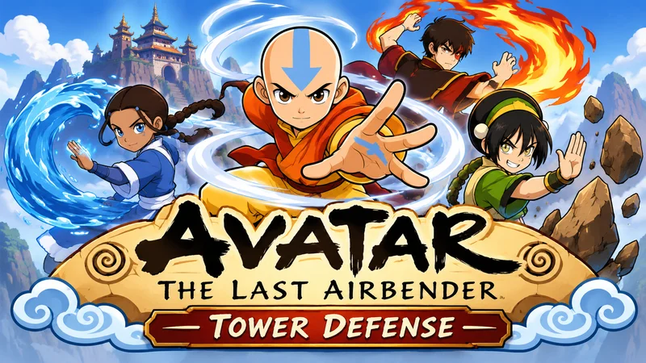

# Tower Defense

A tower defense game in the world of *Avatar: The Last Airbender*, made for a phone as well as a desktop. Soldiers and spirits march along a road across a floating island; you stop them by **dragging a podium** for a bender onto the board. Each of the four nations has its own attack, with its own effect: air gusts, water slows, earth stuns and fire burns. In the last step you build **maps of your own** by dropping pieces onto a board.

Like the other series in this repo, each sample is also a step-by-step tutorial: every folder has a `TUTORIAL.md` you can follow from empty files, a `reset-tutorial.js` to go back to the start, and tests you can run in a browser.

**A fan project.** *Avatar: The Last Airbender* belongs to its owners. This is a non-commercial fan project, made to teach, and is not endorsed by them. Nothing of the show's own artwork, music or voices is used.

## What you need

- A desktop browser or a phone. There are no sensors and no camera, so nothing needs HTTPS, but a **web server** is needed from the first step, because the page loads models from files: run `npx serve` in the repo root.
- The models in `assets/` are already made web-sized. The originals are not in the repo (see the [assets README](assets/README.md)).

## The plan

| # | Sample | What it teaches |
|---|--------|-----------------|
| 1 | [Tower Defense World](tower_defense_world/README.md) ([tutorial](tower_defense_world/TUTORIAL.md)) | Models made web-sized, loaded into containers and copied as instances, measured and fitted to a cell, a board as data, an orthographic camera that fits any screen, a floating island made in code, drifting clouds, and a page for a phone |
| 2 | [Tower Defense Path](tower_defense_path/README.md) ([tutorial](tower_defense_path/TUTORIAL.md)) | A map as text that can be checked, autotiling (the piece in a cell from four bits, turned by shifting them), a route with rounded corners, a walker that knows only distance and time, and five enemies with skeletons that walk it at a speed that keeps their feet on the ground |
| 3 | [Tower Defense Benders](tower_defense_benders/README.md) ([tutorial](tower_defense_benders/TUTORIAL.md)) | A podium with a bender on it for each nation, animations with their root motion taken out so an attack stays on the podium, a table of numbers measured on the real clips, targeting as scores, a state machine that speaks in events, angles that wrap, and bolts that follow the enemy |
| 4 | [Tower Defense Build](tower_defense_build/README.md) ([tutorial](tower_defense_build/TUTORIAL.md)) | Dragging a podium onto the board: turning a place on the screen into a cell (two equations, two unknowns), a finger held above where it is, a drag told from a tap by a small state machine, one rule that says why not, an outline that fades from red to green at the same pace on any computer, a tray, gold, and a hand that is tested with no screen |
| 5 | [Tower Defense Waves](tower_defense_waves/README.md) ([tutorial](tower_defense_waves/TUTORIAL.md)) | Enemies with health that fall with their death animations, waves from a table turned into a timeline, a director whose state machine speaks in events, damage when a bolt arrives, a whole frame of the game as a function of a world (so a test plays a game with no screen), the readouts, and balance set by a simulation |
| 6 | [Tower Defense Scenery](tower_defense_scenery/README.md) ([tutorial](tower_defense_scenery/TUTORIAL.md)) | Props written in the map's own text (a new thing in a data format that everything old still reads), models of every shape measured and stood in their cells, instances so that scenery is free, and one rule that now says *there is a spirit shrine there* |
| 7 | [Tower Defense Variety](tower_defense_variety/README.md) ([tutorial](tower_defense_variety/TUTORIAL.md)) | An attack as a list of hits (the fire bender's combo throws a flame for every punch, from the clip's measured moments), levels as a row of numbers multiplied into a bender's row, rings that show them, small rules for upgrading and selling, a panel for a chosen tower, and a simulation taught about upgrades |
| 8 | [Tower Defense Elements](tower_defense_elements/README.md) ([tutorial](tower_defense_elements/TUTORIAL.md)) | An effect for each nation (water slows the crowd, fire burns, earth stuns, air pushes back): a table of effects, a status that runs out, enemies that resist or are weak, effects carried by bolts and made stronger by upgrades, marks over the head, and a simulation that finds out which idea does nothing |
| 9 | [Tower Defense Screens](tower_defense_screens/README.md) ([tutorial](tower_defense_screens/TUTORIAL.md)) | A flow of screens as a state machine, a title with a card (and a drawn minimap) for each map, a pause, a result with stars and the numbers of the game, and records kept in storage that is allowed to fail |
| 10 | [Tower Defense Polish](tower_defense_polish/README.md) ([tutorial](tower_defense_polish/TUTORIAL.md)) | A speed button (more steps, never longer ones), a limit on how many enemies are on the board, a detail setting that is remembered and lowered by a frame meter, sound effects made in code from a table of recipes (and tested by rendering them into numbers), three tracks of music that crossfade with the game, and a `?dev` panel of sliders built from a table |
| 11 | [Tower Defense Editor](tower_defense_editor/README.md) ([tutorial](tower_defense_editor/TUTORIAL.md)) | A map editor for the text maps of the second tutorial: brushes and rules, strokes that undo, the game's own checks as the editor's, a map in a link that is checked as if it were hostile, kept maps in storage that is allowed to fail, a board that redraws only what changed, and custom maps on the title screen |

The plan may shift as each step teaches something unexpected.

## Credits

Everything in this series that you can see (apart from the code) was made by other people or given to this project, and they deserve the credit. See the [assets README](assets/README.md).

- The 3D models (the tiles, podiums, benders and enemies) were made with [Meshy](https://www.meshy.ai), and are shared under a Creative Commons licence that allows them to be used, shared and modified. Credit to Meshy.
- The fonts, Cinzel and Lato, are under the SIL Open Font Licence.
- Music by [Mykola Odnoroh](https://pixabay.com/users/ikoliks_aj-48415707/?utm_source=link-attribution&utm_medium=referral&utm_campaign=music&utm_content=346568) from [Pixabay](https://pixabay.com/music//?utm_source=link-attribution&utm_medium=referral&utm_campaign=music&utm_content=346568).
- Music by [Tunetank](https://pixabay.com/users/tunetank-50201703/?utm_source=link-attribution&utm_medium=referral&utm_campaign=music&utm_content=349180) from [Pixabay](https://pixabay.com/music//?utm_source=link-attribution&utm_medium=referral&utm_campaign=music&utm_content=349180).
- Music by [Tunetank](https://pixabay.com/users/tunetank-50201703/?utm_source=link-attribution&utm_medium=referral&utm_campaign=music&utm_content=349493) from [Pixabay](https://pixabay.com//?utm_source=link-attribution&utm_medium=referral&utm_campaign=music&utm_content=349493).
